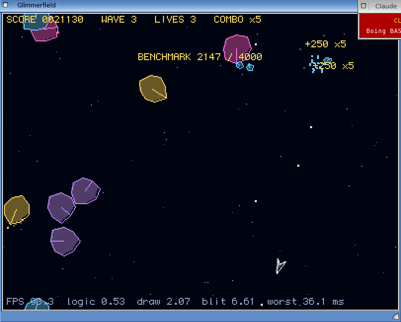
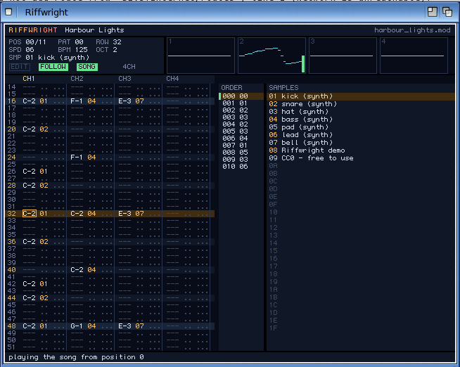
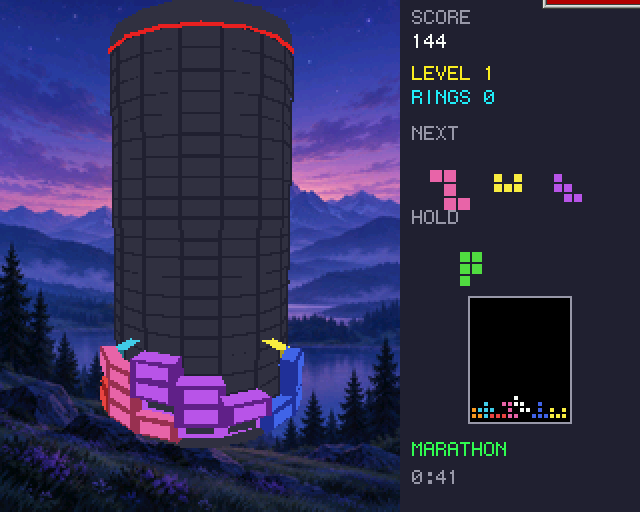
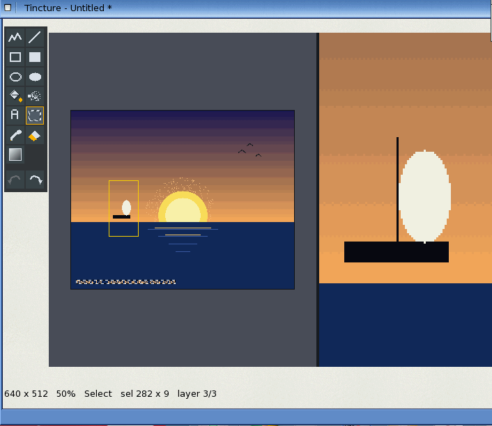

# Boing BASIC

A structured BASIC for building GUI programs on AmigaOS 4.1 (PowerPC): interpreted for a quick
edit-run cycle, or compiled to C and built with GCC into an optimised native executable. Forms
are designed in the [AmiForge](https://github.com/geekychris/amiforge) IDE: double-click a
control to write its event code.

The [user manual](docs/manual/README.md) covers the whole language, the AmigaOS 4 desktop,
networking and the libraries, and extending Boing BASIC in C or C++, with exercises; every
listing is a runnable program in [examples/book](examples/book). `make manual-pdf` builds it
as a PDF. Design notes: [docs/DESIGN.md](docs/DESIGN.md).

## Gallery

Games and applications written in Boing BASIC, on the AmigaOS 4.1 guest. All of them, with
what each one shows off and how fast it runs: **[docs/gallery.md](docs/gallery.md)**.

<table>
<tr>
<td><a href="docs/gallery.md#glimmerfield"></a></td>
<td><a href="docs/gallery.md#riffwright"></a></td>
</tr>
<tr><td align="center">Glimmerfield, an arcade game (Canvas, MOD music)</td><td align="center">Riffwright, a ProTracker editor (Boing.Audio)</td></tr>
<tr>
<td><a href="docs/gallery.md#stack-tower"></a></td>
<td><a href="docs/gallery.md#tincture"></a></td>
</tr>
<tr><td align="center">Stack Tower, a puzzle on Engine3D</td><td align="center">Tincture, a paint program</td></tr>
</table>

## Building and using it (host: macOS / Linux)

```
make                      # build/boing, build/libboing.a, build/include/
make test                 # every test through the VM and as a native build (host cc)
build/boing run prog.bas  # interpret
build/boing build prog.bas -o prog      # compile to C, then cc -O2
build/boing check prog.bbp              # errors as file:line:col: error: message
build/boing symbols file.bas            # declarations, for IDE outlines
build/boing build prog.bbp --target os4 # AmigaOS 4 executable via Docker (docs/os4.md)
make opengl               # Mesa's software OpenGL for Extension=opengl programs (docs/opengl.md)
```

Docs: [language reference](docs/language.md), [runtime C API](docs/runtime-api.md),
[forms and events](docs/forms-events.md), [AmigaOS 4](docs/os4.md), [OpenGL](docs/opengl.md).

## Licence

MIT; see [LICENSE](LICENSE). OpenGL comes from Mesa 7.8.2 (MIT), downloaded and built by
`third_party/mesa/build.sh`; `ext/opengl/GL/gl.h` is Mesa's header. The files in `bindings/` are generated by `tools/genbind` from the
interface descriptions and headers of the AmigaOS 4 SDK (function names, call offsets and
constants only); AmigaOS and its SDK are © Hyperion Entertainment. The guest test tools read the
ssh logins of remote test machines from `~/.config/boing-basic/os4guest-hosts.json` or
`BB_SSH_<GUEST>` (see `tools/os4guest.py`).
