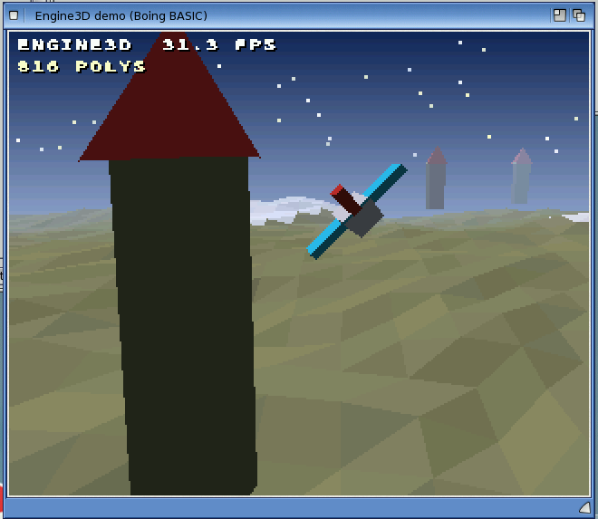

# Engine3D: the 3D game engine

`Boing.Engine3D` is a runtime object that does a game's 3D in C: the camera, the transform,
near-plane and screen clipping, projection, a depth-sorted draw list, models, terrain
grids, lines, points, the engine font, flat shading and fog. It draws into a
[Canvas](graphics.md) (a form's canvas or an off-screen one), so it works in the VM,
under `--jit` and in native builds, and on the Mac (frame-hash tests).

The engine is the amiga3d engine (`amiga_mcp/examples/amiga3d`, MIT, Chris Collins), vendored
in `src/runtime/a3d/`. Its rules are kept: 16-bit angles, 16.16 fixed point, integer maths,
the same camera, clipping and painter's draw list, so a BASIC port of an amiga3d game draws
what the C game draws. `examples/common/A3Scene.bas` (the stopgap BASIC port) maps onto it
call for call (table at the end).

**Status: implemented (2026-11-08)**, tested in the VM, the JIT and native builds
(`tests/graphics/engine3d.bas`). Names and arguments are fixed unless a game agent asks for a
change; additions will come. Demo: `examples/engine3d_demo` (`Engine3DDemo.bbp`, and
`Bench.bbp` off-screen with an fps figure).



`examples/engine3d_demo` on the QEMU guest (AmigaOS 4.1 FE), natively built: a terrain flyover
with fog, Lambert-shaded models and a point cloud, about 820 polygons a frame.

```basic
Dim e As Object, cv As Object
Set e = CreateObject("Boing.Engine3D")
e.Attach view                          ' the canvas it draws into
e.View 320, 256, 160, 128, 256         ' 3D area w, h; centre x, y; fov (cam_view)
e.Palette12 Array(&H000, &HFFF, &H58A) ' pens 0, 1, 2 (12-bit &HRGB), or e.Palette (VB colours)

Private Sub tick_Timer()
    e.CamPlace px, py, pz              ' 16.16 world position (or e.CamPos x, y, z whole units)
    e.CamAngles yaw, pitch             ' 16-bit angles (cam_setup is implied)
    view.Cls e.PenColor(4)
    e.Begin 3000                       ' empty the draw list; depths 0..3000 bucketed
    e.DrawGrid ground, 0, 0
    e.DrawModel tank, tx, 0, tz, tyaw
    e.QuadW -1, 7, x0,0,z0, x1,0,z1, x1,70,z1, x0,70,z0
    e.Flush                            ' draw the list, far to near, into the canvas
    e.Text 4, 4, "SCORE " & score, 1
    view.Refresh
End Sub
```

Declare the variable `As Engine3D` (or `As Boing.Engine3D`) rather than `As Object`: `boing check`
then reports misspelt members at compile time, and native code calls the members directly by
number. `As Object` works too, late bound.

## Conventions

- **Angles**: 0..65535 is a full turn (any Long, wrapped). Yaw 0 looks along +z, increasing
  towards +x; pitch > 0 looks down; roll turns the picture clockwise.
- **World**: x right, y up, z ahead; whole units. Positions given as "16.16" are
  units * 65536 (amiga3d's `cam_place` / `cam_for`).
- **Camera space**: what `Xform` returns: x right, y up, z ahead. A placed camera
  (`CamPlace`) works in sixteenths of a unit, `CamU` = 16 (see amiga3d's README); compare
  with `CamNear`, not 12.
- **Pens**: colours are pens 0..255 of the engine's palette, as in amiga3d. `-1 - vbColour`
  (i.e. `Not RGB(...)`) is accepted anywhere a pen is, for a direct colour.
  Model faces may use `COL_BODY` (200, 201: the body pens given when drawing) and
  `COL_FLASH` (210).
- **Screen**: coordinates are the 3D area's pixels, (0, 0) top left, as given to `View`. With
  `e.Sub = 2` the engine draws into a canvas twice that size at the finer resolution (the
  games keep 320 x 256 coordinates, polygons and text are drawn at 640 x 512: amiga3d's
  `A3_SUB`). `Sub` 1 (default): canvas pixels = 3D-area pixels.
- Arrays may be Long, Integer, Single, Double or Variant; Long is fastest. Output arrays
  (`XformMany`, `RotYPR`, `SinTable`...) must be Long and big enough (error 9). Array
  variables are passed to late-bound calls by reference (no copy), so batch calls are cheap.
- Errors: 5 bad argument, 9 bad array size or index, 13 not an array, 91 no canvas attached,
  380 bad handle (model / grid).

## Setup

| Member | |
|---|---|
| `Attach canvas` | draw into this Canvas (its current `Target`: the back buffer or an image) |
| `View vw, vh, cx, cy, fov` | the 3D area (clip rectangle) 0..vw-1, 0..vh-1, the projection centre and scale |
| `ViewOrigin x, y` | where the 3D area's (0, 0) is on the canvas (default 0, 0): a 3D window inside a HUD |
| `Sub` | 1 or 2 (above) |
| `Palette colours() [, first]` | set pens first.. from VB colours (`RGB()`) |
| `Palette12 colours() [, first]` | the same from 12-bit `&HRGB` (amiga3d's palettes) |
| `Pen(i)` | read/write one pen (VB colour) |
| `PenColor(i)` | the VB colour of pen i (for `Canvas.Cls`) |
| `SkyGradient pen, topColour, bottomColour, rows` | pen i is drawn as a vertical gradient (amiga3d's `plat_sky`) |
| `Clear pen` | fill the 3D area with a pen (gradient pens included) |
| `Far` | read: the far depth given to `Begin` |

## Camera

One camera, kept in the engine. `CamSave n` / `CamLoad n` keep up to 8 copies (a second
view, a radar, a mirror).

| Member | |
|---|---|
| `CamPos x, y, z` | whole units (amiga3d `cam.x = ...`, precise off) |
| `CamPlace x, y, z` | 16.16 position (amiga3d `cam_place`: precise, CamU 16) |
| `CamAngles yaw, pitch [, roll]` | set the angles and the cached trig (`cam_setup`) |
| `CamSet x, y, z, yaw, pitch [, qx, qy, qz [, roll]]` | the whole amiga3d camera in one call: whole units, with sixteenths qx, qy, qz (precise) when given |
| `CamLookAt x, y, z` | turn the camera to look at a world point |
| `CamX`, `CamY`, `CamZ`, `CamYaw`, `CamPitch`, `CamRoll` | properties (read/write; writing an angle redoes the trig) |
| `CamU`, `CamNear` | 1/16 and 12/192 (above) |
| `Horizon` | screen row of the horizon (`cam_horizon`) |
| `CamSave n`, `CamLoad n` | n = 0..7 |
| `Xform wx, wy, wz, cx, cy, cz` | world point → camera space into the ByRef Longs cx, cy, cz |
| `XformMany n, wx(), wy(), wz(), cx(), cy(), cz()` | n points at once |
| `Project(wx, wy, wz, sx, sy)` | world point → screen (ByRef sx, sy); returns False when it is behind the near plane |
| `ProjectCam(x, y, z, sx, sy)` | the same for a camera-space point |
| `Visible(wx, wy, wz, radius)` | False when a sphere is certainly off screen (for game-side culling) |

Roll is the turn of camera space's x and y about the line of sight after the transform
(orbit_docking's `cam_roll`): x' = x cos + y sin, y' = y cos - x sin. With roll 0 everything is
bit-exact with amiga3d. `CamBank cos16, sin16` sets the turn from a 16.16 cosine and sine
instead, as x' = x cos - y sin, y' = x sin + y cos (ace_pilot2's `xf`, bit-exact; sin 0 = no
bank); call it after `CamAngles`/`CamSet`, which reset it.

## The draw list

Polygons go into 512 depth buckets and are drawn far to near; within a bucket, in the order
they were added (amiga3d's painter's algorithm). Up to 8000 entries a frame; more are
counted in `Dropped`.

| Member | |
|---|---|
| `Begin farZ` | empty the list (`a3_begin`) |
| `Poly depth, pen, xs(), ys(), zs(), n` | a convex polygon of n (3..10) camera-space points (`a3_poly`) |
| `Quad depth, pen, ax, ay, az, bx, by, bz, cx, cy, cz, dx, dy, dz` | camera space (`a3_quad`) |
| `PolyW depth, pen, xs(), ys(), zs(), n` | a polygon of world points |
| `QuadW depth, pen, x0, y0, z0, x1, y1, z1, x2, y2, z2, x3, y3, z3` | a quad of world points (A3Scene's `A3QuadW`) |
| `QuadsW n, depth, pens, coords() [, first]` | n world quads from quad `first` (default 0): `coords` holds 12 values a quad (from `first * 12`), `pens` an array (from `first`) or one pen; no back-face culling. Static ground sorted into blocks once can be drawn a block a call |
| `Spot x, y, z, r, pen [, bias]` | a square of half size r facing the camera at a world point (shells, particles) |
| `Star x, y, z, r, pen, points, turn [, bias]` | a ragged star facing the camera (explosions): `points` is the number of tips (2..5; the polygon has 2 x points vertices, the inner ones at r/2) |
| `Line3D x1, y1, z1, x2, y2, z2, pen [, bias]` | a world line, z-sorted with the polygons |
| `Lines3D n, coords(), pens` | n lines, 6 values each |
| `Points n, xs(), ys(), zs(), pens [, size [, bias]]` | a point cloud (stars, rain, sparks): world points as size x size squares (size shrinks with distance when negative) |
| `DrawLine3D x1, y1, z1, x2, y2, z2, pen` | a world line drawn now, not sorted (cut at the near plane, clipped to the 3D area) |
| `QuadBias` | added to the depth of `...W` quads in mode -1 (default 0) |
| `Flush` | draw the list into the canvas (`a3_flush`) |
| `NPolys`, `Dropped` | counts since `Begin` (read only) |

`depth` is a camera-space z (CamU units, as in amiga3d). For the `...W` calls, `depth` < 0
picks it: -1 = the middle of the first and third corners plus `QuadBias`, -2 = the average of
the corners, -3 = the nearest corner, -4 = the farthest, -5 = the average plus `QuadBias`; >= 0 is
used as is (A3Scene's modes).

## Models

Models live in the engine and are numbered from 1. Up to 256 vertices and 192 faces a model
(amiga3d had 64 / 48), faces of 3 or 4 vertices.

| Member | |
|---|---|
| `ModelNew()` | a new empty model, returns its number (`mdl_begin`) |
| `MdlVtx(m, x, y, z)` | add a vertex, returns its index |
| `MdlFace m, lit, shade, n, a, b, c, d, ix, iy, iz` | add a face, flipped to face away from the interior point, pen lit or shade by amiga3d's fixed sun |
| `MdlBox m, lit, shade, x0, x1, y0, y1, z0, z1` | `mdl_box` |
| `MdlPyramid m, lit, shade, x0, x1, y0, z0, z1, apex` | `mdl_pyramid` |
| `MdlPrism m, lit, shade, sides, r, y0, y1 [, noTop]` | `mdl_prism` (about the y axis); noTop True leaves out the top fan |
| `MdlShadow m, pen, x0, x1, z0, z1` | `mdl_shadow` (flat at y = 1, drawn first) |
| `ModelFromArrays(vx(), vy(), vz(), nv, fn(), fi(), fcol(), nf)` | build from arrays: `fn(k)` 3 or 4, `fi` 4 indices a face, `fcol` pens; faces wound clockwise seen from outside |
| `ModelLoad(path)` | a text model file (below) |
| `ModelFree m`, `ModelClear m` | |
| `ModelVerts(m)`, `ModelFaces(m)` | counts |
| `ModelRadius(m)` | the bounding radius (for `Visible`) |

### Drawing models

| Member | |
|---|---|
| `DrawModel m, x, y, z [, yaw [, pitch [, roll [, bodyLit [, bodyShade [, flash [, bias]]]]]]]` | at a whole-unit world position; rotation roll, pitch, yaw (`a3_rot_ypr`); with all angles 0 the model is unrotated (`rot` NULL) |
| `DrawModelF m, x16, y16, z16 [, same as above]` | at a 16.16 position: does amiga3d's `cam_for` (a model drawn where it is, not on whole units) |
| `DrawModelM m, x, y, z, rot() [, bodyLit, bodyShade, flash, bias]` | with your own 3x3 16.16 matrix (row-major, world = M * model); scale the matrix to draw a model built in smaller units (entries \\ 4 for quarter units) |
| `DrawModelMF m, x16, y16, z16, rot() [, ...]` | the same at a 16.16 position (`cam_for`, as `DrawModelF`) |
| `DrawModels n, ids, xs(), ys(), zs(), yaws [, f16 [, bodyLit [, bodyShade [, bias]]]]` | n models in one call; `ids`, `yaws`, `bodyLit`, `bodyShade` and `bias` each an array (one a model) or one value; f16 True: positions are 16.16; bodyShade defaults to bodyLit |

The model's faces that face the camera are sorted far to near and go into the list at the
depth of the model's centre minus `bias` (amiga3d's `a3_model`). A model whose centre is more
than `ModelMargin` units (default 800, amiga3d's) behind the camera or outside the view is
skipped; a game with small models can narrow it.

### Model files

Text, one statement a line, `#` comments, numbers in decimal:

```
# a crate
v -34 0 -34          # vertex (index 0, 1, ... in order)
v  34 0 -34
...
f 13 0 3 2 1         # face: pen, then 3 or 4 vertex indices (clockwise from outside)
f body 4 5 6 7       # pen names: body (200), shade (201), flash (210)
box 13 14 -34 34 0 56 -34 34     # the builders work too: box, pyramid, prism, shadow
```

## Terrain: height grids

A grid is w x h heights at a spacing of `cell` units, its corner at world (x0, z0). It is
drawn as quads (two triangles where the four corners don't lie in a plane), each shaded
by its slope, inside a window round the camera, so a big map costs only what is near.

| Member | |
|---|---|
| `GridNew(w, h, cell [, x0, z0])` | returns its number; heights 0 |
| `GridSet g, heights() [, pens()]` | all heights (w * h, row by row along x) and optionally a pen a cell ((w-1) * (h-1)) |
| `GridHeightSet g, i, j, y` / `GridPenSet g, i, j, pen` | one point / cell |
| `GridHeight(g, x, z)` | the height under world point (x, z), interpolated (16.16 in, whole units out; `GridHeightF` returns 16.16) |
| `GridGenerate g, seed, rough, height` | fractal terrain (diamond-square), for demos and generated levels |
| `GridColours g, waterLevel, waterPen, lowPen, highPen, snowLevel, snowPen` | pens by height |
| `DrawGrid g [, range [, bias]]` | the cells within `range` units of the camera (default: all) that are ahead of it |
| `GridShade g, on` | shade the cells by slope with the engine's `Light` (default True, whatever `Shading` is); False: plain pens, one quad a cell |
| `GridFree g` | |

## Shading and fog

| Member | |
|---|---|
| `Shading` | 0 = pens as given (amiga3d, default); 1 = flat Lambert shading of each face's pen by its normal |
| `Light x, y, z [, ambient]` | the direction to the light (any length) and the ambient level 0..256 (default 64) |
| `Fog colour, near, far` | blend towards a VB colour from depth near to far (camera units); `Fog -1` off |

## Text and 2D (the engine font)

The engine font is amiga3d's 16 x 16 cell font (DejaVu Sans Mono Bold, characters 32..126).
These draw straight onto the canvas (not into the draw list), in 3D-area coordinates
(scaled by `Sub`).

| Member | |
|---|---|
| `Text x, y, s, pen [, scale]` | y = the top of the cells; scale 1 = 8 x 8 cells at Sub 1 (16 x 16 at Sub 2), 2, 3, ... bigger |
| `TextShadow x, y, s, pen [, scale]` | with a black shadow one pixel down-right |
| `TextCentre y, s, pen [, scale]` | centred in the 3D area, shadowed |
| `TextWidth(s [, scale])` | in 3D-area pixels |
| `FillRect x0, y0, x1, y1, pen`, `PolyFill xs(), ys(), n, pen` | 2D in pens, in 3D-area coordinates (amiga3d's `g_rect`, `g_poly`) |
| `Span y, xl, xr, pen` | a span in the drawing's own pixels (x Sub, amiga3d's `g_span_sub`) |
| `FillGradient y0, y1, topColour, bottomColour` | rows y0..y1 of the 3D area, its full width, shaded from one VB colour to the other (amiga3d's `g_fill_grad`), at the drawing's resolution |
| `Blend y, xl, xr, pen, alpha` | a see-through span (alpha 0..256), the drawing's pixels |

## Maths helpers

All integer, the same values as amiga3d's `a3d_math.c` / `a3d_fix.c`, so game rules stay
bit-exact. They are methods of the engine (`e.Sin(a)`), a call each; for many values use
the array forms.

| Member | |
|---|---|
| `Sin(a)`, `Cos(a)` | 16-bit angle → 16.16 (`a3_sin`, interpolated table) |
| `Atan2(x, y)` | angle of (x, y) from +y towards +x (`a3_atan2`) |
| `ISqrt(v)`, `Hypot(x, y)` | `a3_isqrt` (v as unsigned 32-bit), `a3_hypot` |
| `Hash(x)`, `Rand(state)` | `a3_hash`; `a3_rand` (state ByRef Long) |
| `FMul(a, b)`, `FDiv(a, b)`, `FSqrt(a)` | 16.16 (`a3d_fix.c`) |
| `RotYPR rot(), yaw, pitch, roll` | 9 Longs, 16.16 (`a3_rot_ypr`); `RotYaw rot(), yaw` |
| `MatMul out(), a(), b()` | 3x3 16.16 |
| `MatApply rot(), x, y, z, ox, oy, oz` | ByRef outputs |
| `SinTable(out())`, `CosTable` | fill a 256-entry Long array (BASIC-side lookups without a call) |

## Performance

The point is to keep the per-vertex work in C. A frame should be tens of calls: a grid, a
batch of quads, one call a model, one a point cloud. A call costs about the same as a
`Canvas` call (the member is looked up once per call site). Timings on the m1 guest go
in [performance.md](performance.md#engine3d).

## Porting from A3Scene.bas

The quickest way: put `examples/common/A3Engine.bas` in the project instead of `A3Scene.bas`.
It has A3Scene's subs, types and globals and does the work in the engine, so the game code
stays as it is (Tank Duel ran unchanged with the same game-state hash). Or call the engine
directly:

| A3Scene | Engine3D |
|---|---|
| `Dim cam As A3Cam` / `CamView cam, ...` | `e.View ...` |
| `cam.x = ...: CamSetup cam` | `e.CamPos x, y, z: e.CamAngles yaw, pitch` |
| `CamPlace cam, x, y, z` | `e.CamPlace x, y, z` |
| `CamFor cam, x, y, z, tc` + `A3ModelDraw tc, ...` | `e.DrawModelF m, x, y, z, yaw` |
| `CamXform cam, x, y, z` (→ `ox, oy, oz`) | `e.Xform x, y, z, ox, oy, oz` |
| `CamHorizon cam`, `CamU`, `CamNear` | `e.Horizon`, `e.CamU`, `e.CamNear` |
| `A3Begin fz` / `A3Flush cv` | `e.Begin fz` / `e.Flush` |
| `pvx/pvy/pvz` + `A3Poly cam, d, col, n` | `e.Poly d, col, pvx, pvy, pvz, n` |
| `A3Quad cam, d, col, 12 values` | `e.Quad d, col, 12 values` |
| `A3QuadW cam, d, col, 12 values` | `e.QuadW d, col, 12 values` |
| `Dim m As A3Model: MdlBegin m` | `m = e.ModelNew()` (a Long) |
| `MdlBox m, ...`, `MdlPyramid`, `MdlPrism`, `MdlShadow`, `MdlFace`, `MdlVtx` | `e.MdlBox m, ...` etc., same arguments |
| `RotYaw rot, yaw` + `A3ModelDraw cam, m, x, y, z, True, rot, lit, shade, flash, bias` | `e.DrawModel m, x, y, z, yaw, 0, 0, lit, shade, flash, bias` |
| `A3ModelDraw cam, m, x, y, z, False, rot, lit, shade, 0, 0` | `e.DrawModel m, x, y, z, 0, 0, 0, lit, shade` |
| `GfxPalette Array(...)` (12-bit) | `e.Palette12 Array(...)` |
| `Spot` / `Burst` (TdDraw) | `e.Spot` / `e.Star` |
| `A3Sin`, `A3Cos`, `A3Atan2`, `A3Hash`, `FMul` ... | `e.Sin` ... (or keep A3Fix.bas for rules) |
