# Boing BASIC gallery

<!-- Generated by tools/gallery.py from examples/*/gallery.toml: edit those, then run it. -->

Boing BASIC is a Visual Basic 6 style language for AmigaOS 4.1 (PowerPC). A program runs in the interpreter (a bytecode VM, with an optional PowerPC JIT) for a quick edit-run cycle, or is compiled to C and built with GCC into a native executable. Forms are designed in the [AmiForge](https://github.com/geekychris/amiforge) IDE; the runtime brings a Canvas for 2D graphics, Engine3D for filled 3D, a ProTracker player and sound effects through AHI, menus, dialogs and ReAction gadgets, an ARexx port, and `Declare` for calling any AmigaOS library. See the [README](../README.md) and the [design](DESIGN.md).

Everything below was written in Boing BASIC and runs on AmigaOS 4.1; the screenshots are from the QEMU sam460ex guest. 15 games, 6 applications and 6 examples and tools.

**Games**

<table>
<tr><td align="center" valign="bottom"><a href="#glimmerfield">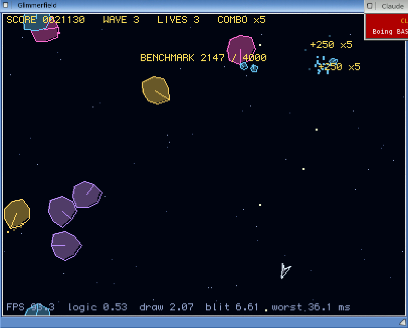 Glimmerfield</a></td><td align="center" valign="bottom"><a href="#stack-tower">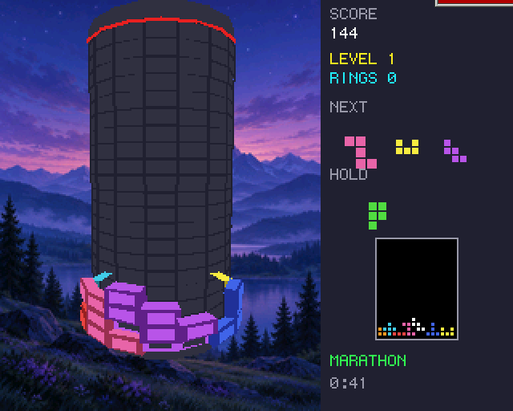 Stack Tower</a></td><td align="center" valign="bottom"><a href="#boing-pinball">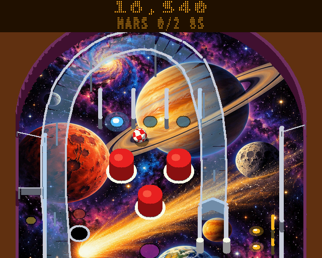 Boing Pinball</a></td><td align="center" valign="bottom"><a href="#lander-3d">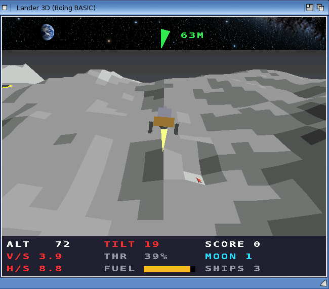 Lander 3D</a></td></tr>
<tr><td align="center" valign="bottom"><a href="#ace-pilot-2">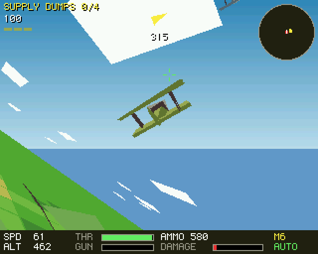 Ace Pilot 2</a></td><td align="center" valign="bottom"><a href="#orbit-docking">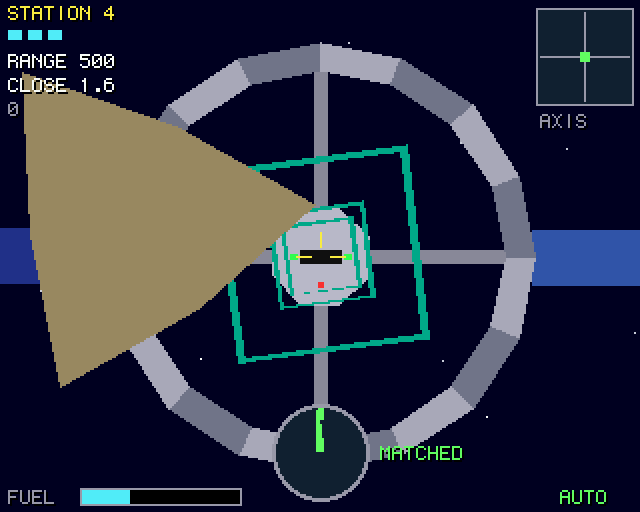 Orbit Docking</a></td><td align="center" valign="bottom"><a href="#scairy-fun"> ScAIry Fun</a></td><td align="center" valign="bottom"><a href="#block-breaker-3d">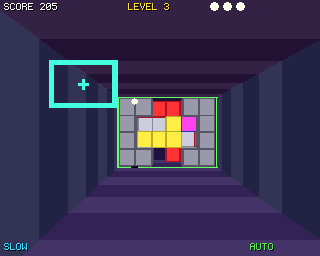 Block Breaker 3D</a></td></tr>
<tr><td align="center" valign="bottom"><a href="#canyon-rail">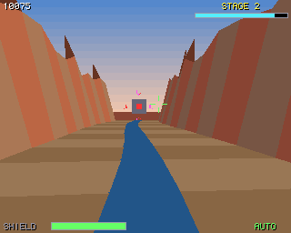 Canyon Rail</a></td><td align="center" valign="bottom"><a href="#drone-courier">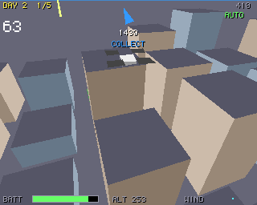 Drone Courier</a></td><td align="center" valign="bottom"><a href="#harbour-crane">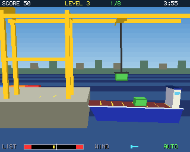 Harbour Crane</a></td><td align="center" valign="bottom"><a href="#marble-tilt">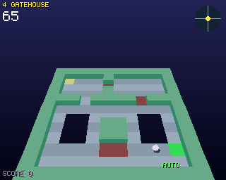 Marble Tilt</a></td></tr>
<tr><td align="center" valign="bottom"><a href="#ridge-runner">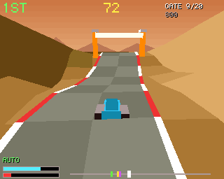 Ridge Runner</a></td><td align="center" valign="bottom"><a href="#sphere-siege">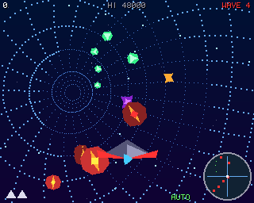 Sphere Siege</a></td><td align="center" valign="bottom"><a href="#tank-duel">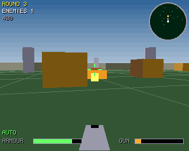 Tank Duel</a></td></tr>
</table>

**Applications**

<table>
<tr><td align="center" valign="bottom"><a href="#gridwise">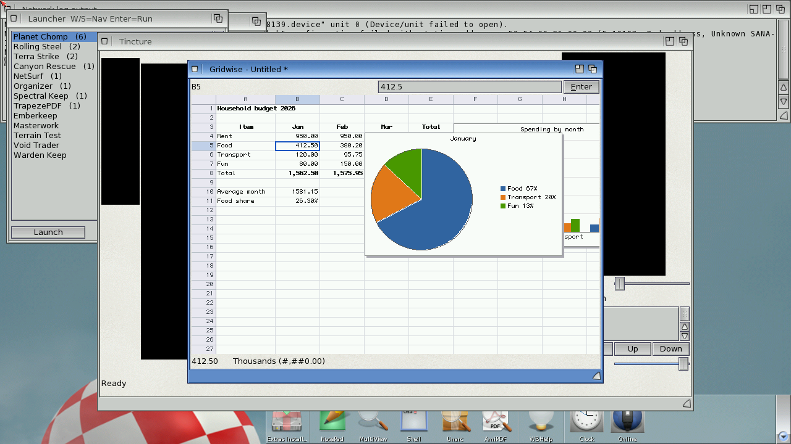 Gridwise</a></td><td align="center" valign="bottom"><a href="#penwright">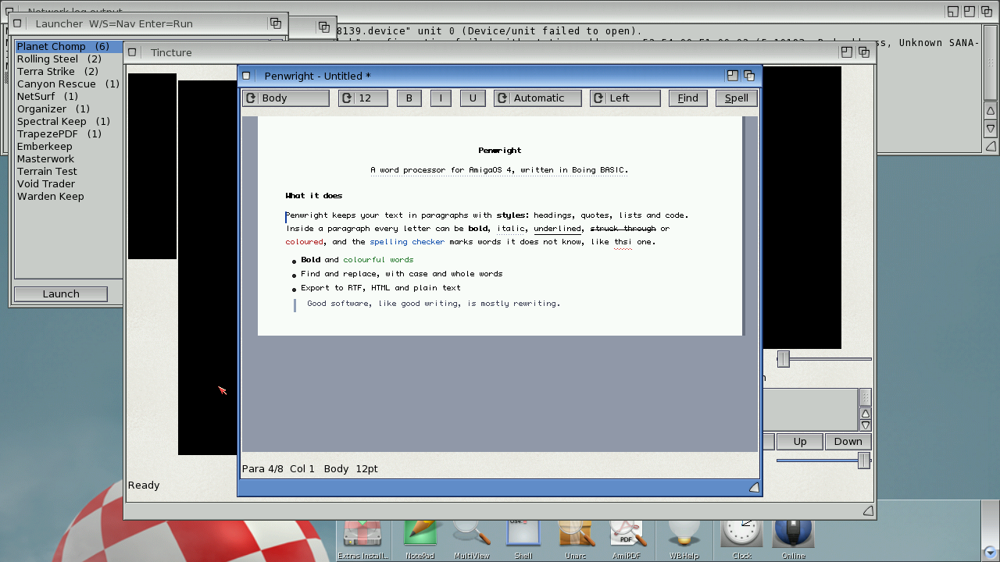 Penwright</a></td><td align="center" valign="bottom"><a href="#riffwright">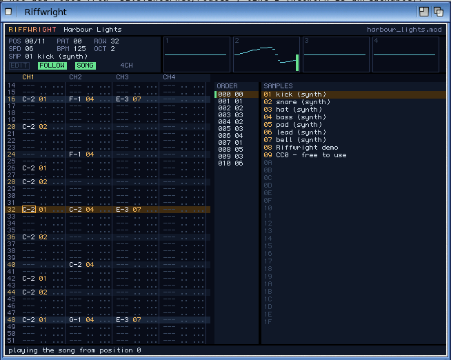 Riffwright</a></td><td align="center" valign="bottom"><a href="#tincture">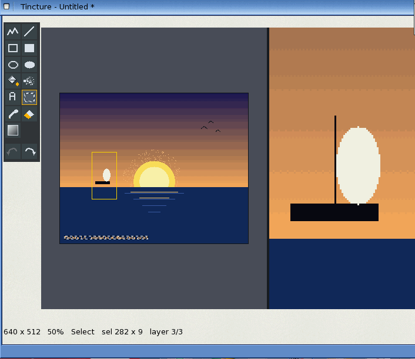 Tincture</a></td></tr>
<tr><td align="center" valign="bottom"><a href="#boingpad">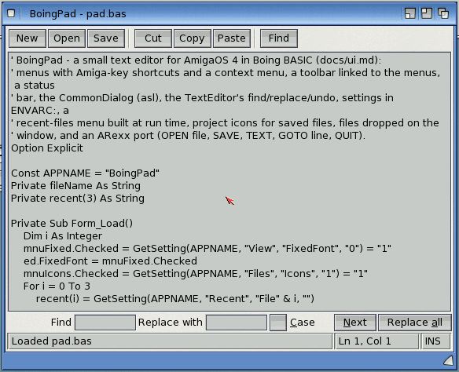 BoingPad</a></td><td align="center" valign="bottom"><a href="#minisheet">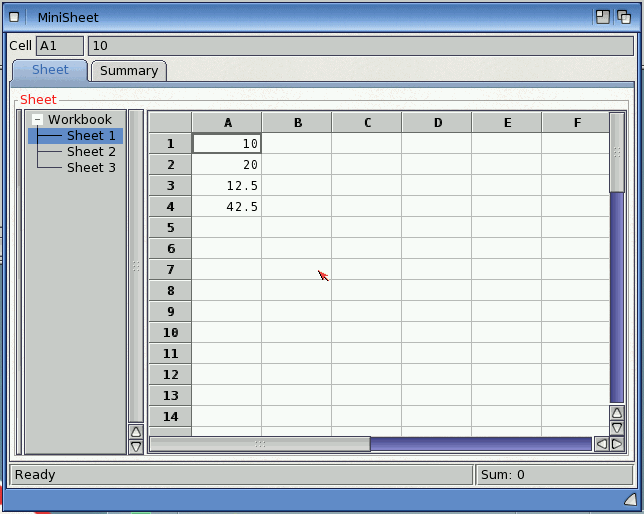 MiniSheet</a></td></tr>
</table>

**Examples and tools**

<table>
<tr><td align="center" valign="bottom"><a href="#hello">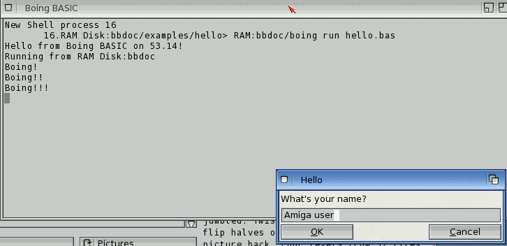 Hello</a></td><td align="center" valign="bottom"><a href="#calculator">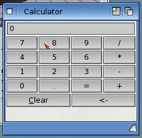 Calculator</a></td><td align="center" valign="bottom"><a href="#file-viewer">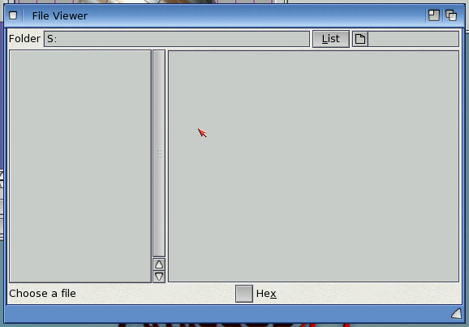 File Viewer</a></td><td align="center" valign="bottom"><a href="#sysinfo-declare">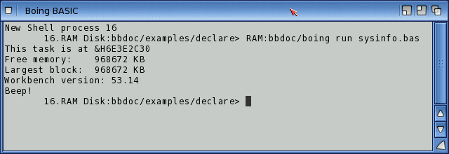 SysInfo (Declare)</a></td></tr>
<tr><td align="center" valign="bottom"><a href="#declare-graphics">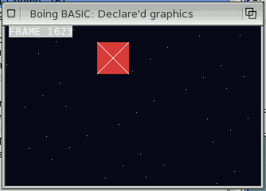 Declare graphics</a></td><td align="center" valign="bottom"><a href="#engine3d-demo">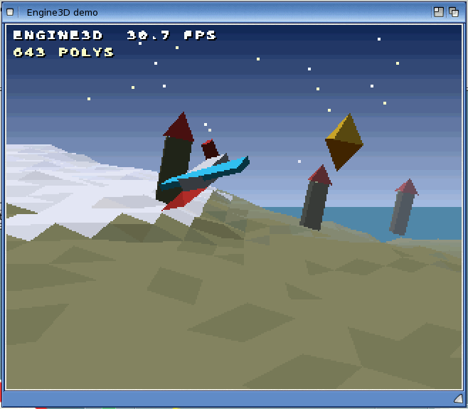 Engine3D demo</a></td></tr>
</table>

## Games

### Glimmerfield

An arcade shooter: fly a skiff through a wrapping field of glimmer crystals that crack into shards and grow back, with hunting wisps from wave 2.

**Shows off:** Canvas (scaled, double-buffered), Audio: an original ProTracker MOD and synthesised effects, Timer-driven game loop, High scores, a benchmark of the language

**Performance:** 354-365 fps native, 88 fps in the VM, 75-79 fps with the JIT (`--bench 1000`, m1 guest).

*The bot playing wave 3 at 2x scale, with the F1 timing line*

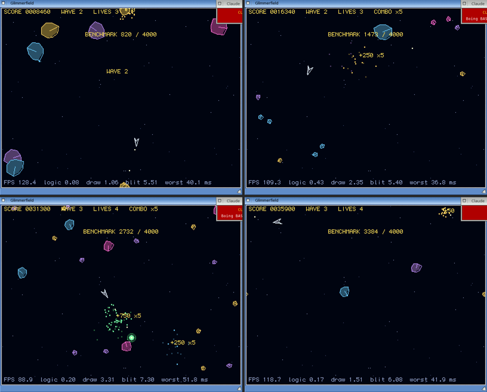

*Four frames on the guest*

[README](../examples/glimmerfield/README.md) · [source](../examples/glimmerfield/)

### Stack Tower

The falling-block puzzle wrapped round a sixteen-column tower: no side walls, and a ring only clears when the back is full too.

**Shows off:** Engine3D (the tower), Canvas (panel and text), Audio: MOD music and effects, Bot player, High scores

**Performance:** 126.9 fps native, 82.3 fps in the VM, 75.7 fps with the JIT (`--bench 500`, m1b guest).

*Playing on the guest*

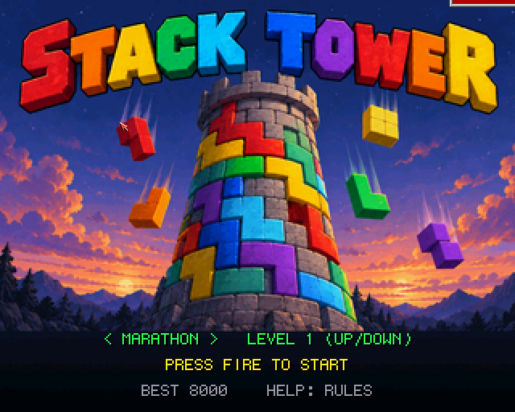

*The title screen*

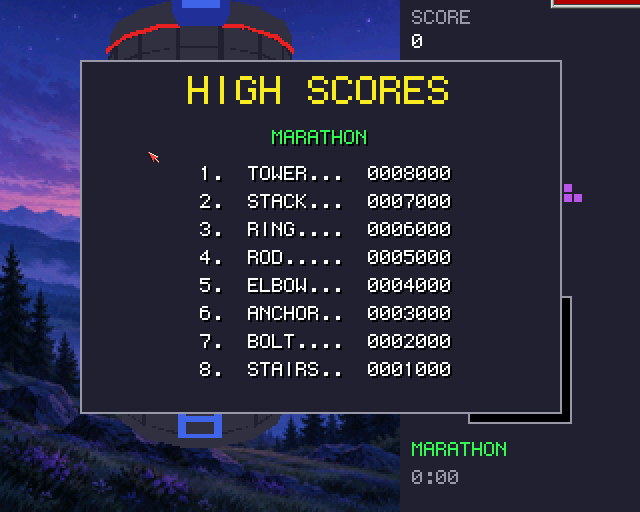

*High scores*

[README](../examples/stack_tower_bb/README.md) · [source](../examples/stack_tower_bb/)

### Boing Pinball

Pinball with three tables and the Boing ball: the classic Amiga view, tilted and scrolling to follow the ball, with a dot-matrix display.

**Shows off:** Canvas (painted playfields, scrolling), Ball physics in BASIC, Audio: music and sound effects, Bot player, a port of a C amiga3d game

**Performance:** 217.3 fps native, 84.5 fps in the VM, 76.2 fps with the JIT (`--bench 1500`, m1b guest); the game needs 50.

*Comet Tour*

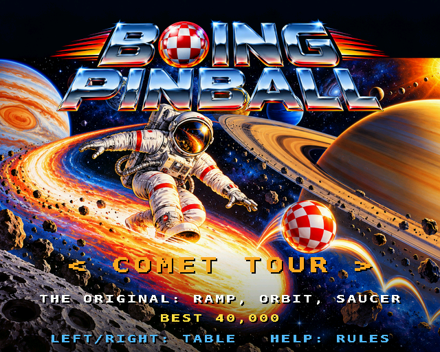

*The title: Comet Tour's backglass*

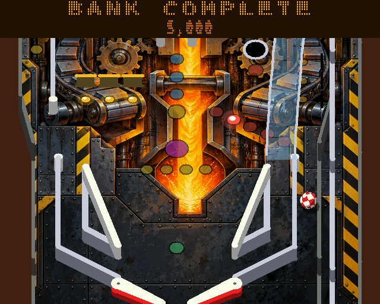

*Foundry*

[README](../examples/boing_pinball_bb/README.md) · [source](../examples/boing_pinball_bb/)

### Lander 3D

The lunar lander in three dimensions: tip the lander to move, keep the thrust against gravity, and touch down softly on one of three pads on the Moon, Mars or an asteroid.

**Shows off:** Engine3D (terrain, lander, FillGradient horizon), Canvas (HUD), Audio: MOD music and effects, Autopilot that proves every level can be landed, a port of a C amiga3d game, bit-for-bit simulation

**Performance:** 62.2 fps native, 38.4 fps in the VM, 30.8 fps with the JIT (`--bench`, m1c guest).

*The Moon*

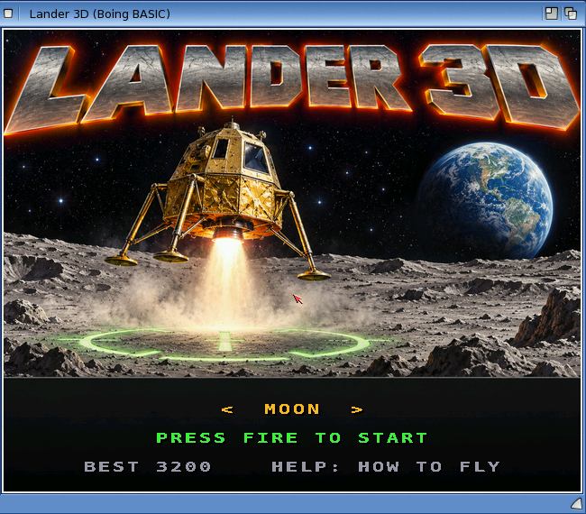

*The title*

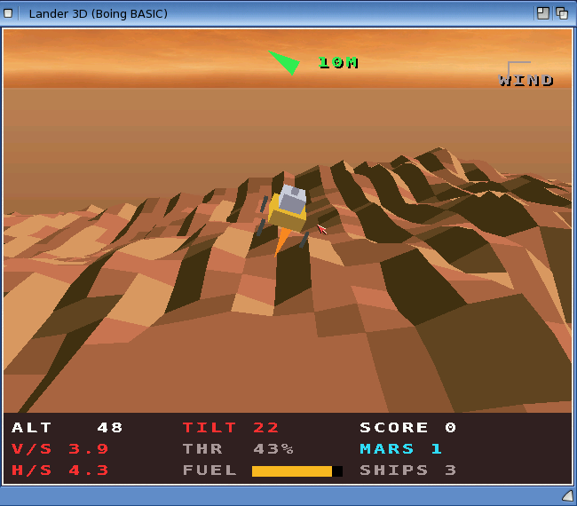

*Mars*

[README](../examples/lander_3d_bb/README.md) · [source](../examples/lander_3d_bb/)

### Ace Pilot 2

A biplane war in 3D: fly a Swallow scout over the trenches and the river Sellen, in the chase view or from the cockpit.

**Shows off:** Engine3D, Canvas (instruments, text), Audio: sound effects, Autopilot bot, a port of a C amiga3d game

**Performance:** 148.2 fps native, 63.2 fps in the VM, 62.4 fps with the JIT (`--bench 500`, m1b guest).

*Mission 6, Supply Lines: the autopilot banks after the dumps*

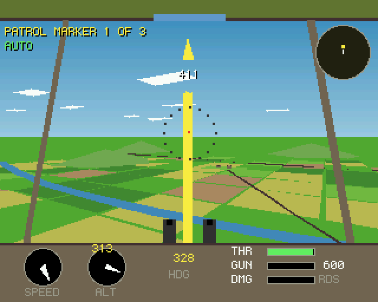

*The cockpit view: upper wing, struts, twin guns and ring sight*

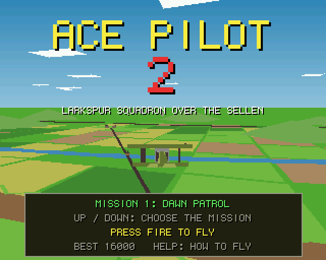

*The title*

[README](../examples/ace_pilot2_bb/README.md) · [source](../examples/ace_pilot2_bb/)

### Orbit Docking

A slow, tense docking simulator: match a spinning station's roll and slide into its port, with no friction and limited fuel.

**Shows off:** Engine3D, Canvas (instruments), Audio: sound effects, Autopilot bot, a port of a C amiga3d game

**Performance:** 186.0 fps native, 109.4 fps in the VM, 94.6 fps with the JIT (`--bench 500`, m1b guest).

*The approach to station 4*

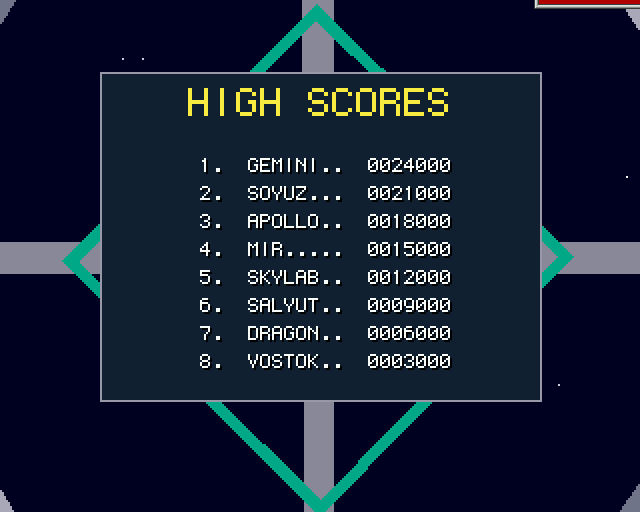

*High scores*

[README](../examples/orbit_docking_bb/README.md) · [source](../examples/orbit_docking_bb/)

### ScAIry Fun

A self-driving car game: score while the autopilot drives, and grab the wheel just before it gets something wrong.

**Shows off:** Engine3D (the road, about 400 polygons), Canvas, Audio: MOD music and sampled voice lines, a port of a C amiga3d game

**Performance:** 90.7 fps native, 27.7 fps in the VM, 24.5 fps with the JIT (`--bench 500`, m1c guest); in real time the VM holds 30.2 fps with music, effects and voice.

*Levee Road on autopilot*

*Mountain Pass: the low sun blinds the autopilot*

*Flooded Town from the cockpit*

[README](../examples/scairy_fun_bb/README.md) · [source](../examples/scairy_fun_bb/)

### Block Breaker 3D

Breakout down a tunnel: move a paddle frame on the near opening and send the ball at a block of bricks at the far end, over 8 levels with capsules.

**Shows off:** Engine3D (examples/common/A3Engine.bas), Canvas (HUD), Audio: sound effects, Autopilot bot, a port of a C amiga3d game, same state hashes as the C

**Performance:** 148 fps native, 38 fps in the VM, 36 fps with the JIT (`--bench 300`, m1b guest).

*Playing on the AmigaOS 4 guest*

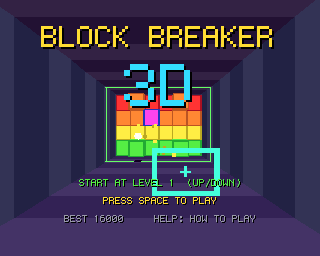

*The title*

[README](../examples/block_breaker_3d/README.md) · [source](../examples/block_breaker_3d/)

### Canyon Rail

A rail shooter down a winding canyon: move the sight, shoot turrets, drones and their bolts, then a guardian at the end of each stage.

**Shows off:** Engine3D (examples/common/A3Engine.bas), Canvas (HUD), Audio: sound effects, Autopilot bot, a port of a C amiga3d game, same state hashes as the C

**Performance:** 131 fps native, 41 fps in the VM, 40 fps with the JIT (`--bench 300`, m1b guest).

*Playing on the AmigaOS 4 guest*

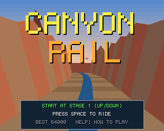

*The title*

[README](../examples/canyon_rail/README.md) · [source](../examples/canyon_rail/)

### Drone Courier

Parcel deliveries by drone across a city of towers: collect at the depot pad, land gently on the customer's pad, beat the clock and the wind.

**Shows off:** Engine3D (examples/common/A3Engine.bas), Canvas (HUD), Audio: sound effects, Autopilot bot, a port of a C amiga3d game, same state hashes as the C

**Performance:** 149 fps native, 48 fps in the VM, 46 fps with the JIT (`--bench 300`, m1b guest).

*Playing on the AmigaOS 4 guest*

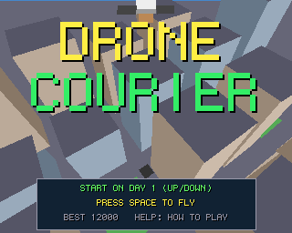

*The title*

[README](../examples/drone_courier/README.md) · [source](../examples/drone_courier/)

### Harbour Crane

A gantry crane loading a ship that rolls in the swell: swing containers onto the deck by trolley and winch, and keep her level.

**Shows off:** Engine3D (examples/common/A3Engine.bas), Canvas (HUD), Audio: sound effects, Autopilot bot, a port of a C amiga3d game, same state hashes as the C

**Performance:** 119 fps native, 35 fps in the VM, 33 fps with the JIT (`--bench 300`, m1b guest).

*Playing on the AmigaOS 4 guest*

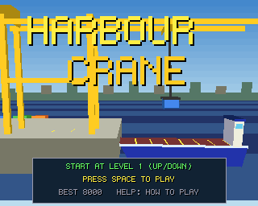

*The title*

[README](../examples/harbour_crane/README.md) · [source](../examples/harbour_crane/)

### Marble Tilt

Tilt a floating maze board to roll a marble to the exit: holes, gates, bumpers, sand and checkpoints over 8 levels against the clock.

**Shows off:** Engine3D (examples/common/A3Engine.bas), Canvas (HUD), Audio: sound effects, Autopilot bot, a port of a C amiga3d game, same state hashes as the C

**Performance:** 122 fps native, 44 fps in the VM, 40 fps with the JIT (`--bench 300`, m1b guest).

*Playing on the AmigaOS 4 guest*

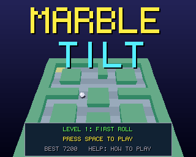

*The title*

[README](../examples/marble_tilt/README.md) · [source](../examples/marble_tilt/)

### Ridge Runner

A hover-bike race down a winding valley against three rivals, through gates that add time, over six tracks.

**Shows off:** Engine3D (examples/common/A3Engine.bas), Canvas (HUD), Audio: sound effects, Autopilot bot, a port of a C amiga3d game, same state hashes as the C

**Performance:** 124 fps native, 31 fps in the VM, 29 fps with the JIT (`--bench 300`, m1b guest).

*Playing on the AmigaOS 4 guest*

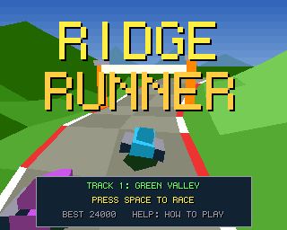

*The title*

[README](../examples/ridge_runner/README.md) · [source](../examples/ridge_runner/)

### Sphere Siege

A shooter inside a hollow sphere: your ship rides the shell facing the centre, and shots cross it to the far wall.

**Shows off:** Engine3D (examples/common/A3Engine.bas), Canvas (HUD), Audio: sound effects, Autopilot bot, a port of a C amiga3d game, same state hashes as the C

**Performance:** 126 fps native, 32 fps in the VM, 32 fps with the JIT (`--bench 300`, m1b guest).

*Playing on the AmigaOS 4 guest*

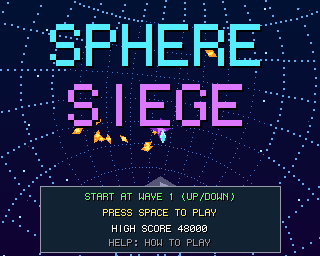

*The title*

[README](../examples/sphere_siege/README.md) · [source](../examples/sphere_siege/)

### Tank Duel

A tank fight in a walled arena seen from the turret: shells bounce once off the walls, over 8 rounds of scouts, mortars and bulwarks.

**Shows off:** Engine3D (examples/common/A3Engine.bas), Canvas (HUD), Audio: sound effects, Autopilot bot, a port of a C amiga3d game, same state hashes as the C

**Performance:** 158 fps native, 44 fps in the VM, 36 fps with the JIT (`--bench 300`, m1b guest).

*Playing on the AmigaOS 4 guest*

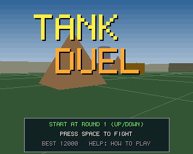

*The title*

[README](../examples/tank_duel/README.md) · [source](../examples/tank_duel/)

## Applications

### Gridwise

A spreadsheet with charts: 1000 x 26 cells, 60 functions, recalculation in dependency order, bar/line/pie charts that follow the data, CSV, undo/redo.

**Shows off:** Canvas (the grid and charts drawn in BASIC), A formula compiler in BASIC, Menus, toolbar, status bar, context menu, ASL requesters and Save/Discard/Cancel, Clipboard, drag and drop, printing, iconify, AmigaGuide help, Scripting (`--script`)

**Performance:** One keystroke (edit + recalculation + redraw) takes 111 ms in the VM, 85 ms with the JIT, 30 ms native; a full recalculation of 25 027 formulas 4.8 s VM, 0.17 s native (m1 guest).

*A household budget with formulas, number formats, a bar chart and a pie chart*

[README](../examples/gridwise/README.md) · [source](../examples/gridwise/)

### Penwright

A word processor: paragraph styles and alignment, per-character bold/italic/underline/colour/size, bullets and quotes, a spelling checker with a 2.3 MB dictionary, RTF export.

**Shows off:** Canvas (page layout and drawing in BASIC), Menus, toolbar, status bar, Spelling checker in BASIC, ASL requesters, clipboard, printing, AmigaGuide help, icons, Scripting (`--script`)

**Performance:** Typing a character and redrawing takes 60 ms in the VM, 9 ms native; drawing a screen 30 ms VM, 6 ms native (m1 guest).

*A styled document with headings, bullets, a quote and a spelling mark under "thsi"*

[README](../examples/penwright/README.md) · [source](../examples/penwright/)

### Riffwright

A ProTracker music editor: a keyboard-driven pattern editor, sample editor, order list, channel scopes and VU meters, 200 steps of undo.

**Shows off:** Canvas, Boing.Audio (the runtime's ProTracker player and mixer through AHI), Menus and dialogs, ARexx port, Drag and drop, AmigaGuide help, Program and project icons

**Performance:** 161 fps native, 98.5 fps in the VM, 97.7 fps with the JIT, with music, scopes and VU meters (`--bench 300`, m1b guest).

*Playing Harbour Lights in follow mode*

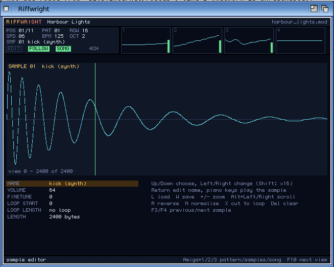

*The sample editor*

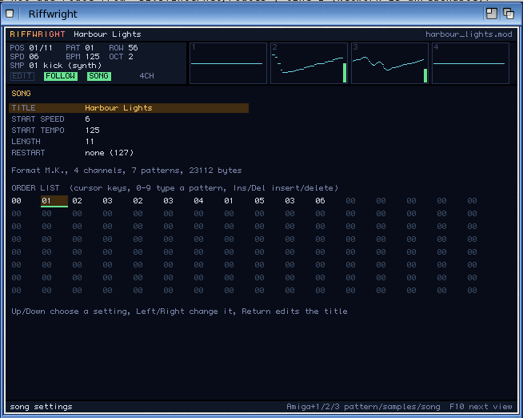

*Song settings and the order list*

[README](../examples/riffwright/README.md) · [source](../examples/riffwright/)

### Tincture

A paint program: true colour or up to 256 colours, 16 layers, multi-level undo, custom brushes, a magnifier and a command language.

**Shows off:** Canvas members for the per-pixel work (fills, brushes, scaled views, codecs), Forms and panels, Menus and dialogs, IFF ILBM and PNG load/save in BASIC, Scripting (`.tsc` command files), Workbench icons

*The sunset demo script (`--script demo/sunset.tsc`) painted in three layers, with the magnifier pane*

[README](../examples/tincture/README.md) · [source](../examples/tincture/)

### BoingPad

A text editor: menus with Amiga-key shortcuts, a toolbar, status bar, find/replace, recent files, ASL file requesters and an ARexx port, in 230 lines.

**Shows off:** Menus and context menu, Toolbar and status bar, CommonDialog (ASL), TextEditor gadget, GetSetting/SaveSetting (ENVARC:), ARexx port, Drag and drop, Project icons

*Editing its own source*

[source](../examples/boingpad/)

### MiniSheet

A small spreadsheet: editable cells with =SUM(B2:B10)-style formulas, a TreeView of sheets, tabs, a sortable summary list and a splitter.

**Shows off:** Grid control with BeforeEdit/AfterEdit, TreeView, Tabs, ListBrowser columns, Splitter, Menus and status bar

*Sheet 1 of the workbook: the TreeView of sheets, the grid, the formula bar and the status bar*

[source](../examples/minisheet/)

## Examples and tools

### Hello

A console program: Print, Environ, App.Path, Command(), then an InputBox and a MsgBox.

**Shows off:** Console output, InputBox and MsgBox requesters

*`boing run hello.bas` in a Shell, asking for a name*

[source](../examples/hello/)

### Calculator

A four-function calculator: a form designed in AmiForge with about 90 lines of event code.

**Shows off:** Forms (AmiForge .afg), Button and TextBox events

*The calculator form on the guest*

[source](../examples/calculator/)

### File Viewer

Lists a folder and shows a file as text or hex dump.

**Shows off:** Forms, ListBox and TextBox, Dir()/file I/O

*Browsing a folder on the guest*

[source](../examples/fileviewer/)

### SysInfo (Declare)

Calls exec, dos and intuition functions with Declare: free memory, the current task, an environment variable, a DisplayBeep.

**Shows off:** Declare ... Lib "exec.library" (calling AmigaOS libraries), The generated bindings (bindings/*.bi)

*`boing run sysinfo.bas` in a Shell*

[source](../examples/declare/)

### Declare graphics

An animation in a window opened and painted entirely through Declare'd intuition and graphics calls: no forms, no Canvas.

**Shows off:** Declare and the generated bindings, TagLists, PeekL/PeekB into OS structures, graphics.library drawing, an IDCMP message loop in BASIC

*The bouncing box, the cross and the frame counter, drawn with RectFillColor, Move/Draw, WritePixelColor and Text*

[source](../examples/declare_gfx/)

### Engine3D demo

A terrain flyover with spinning models and an fps counter, in 15 lines of form code.

**Shows off:** Engine3D, Forms, Timer

*The flyover on the AmigaOS 4 guest (VM)*

[source](../examples/engine3d_demo/)
