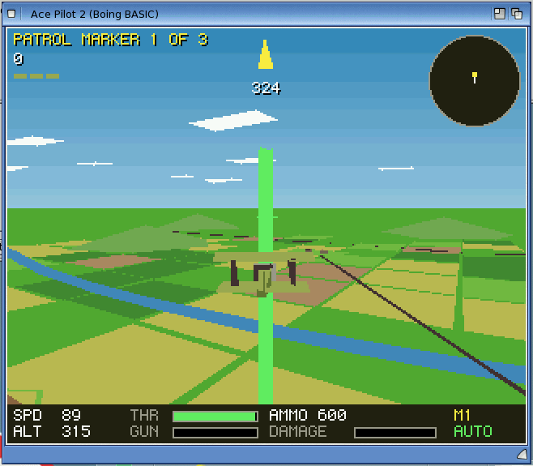
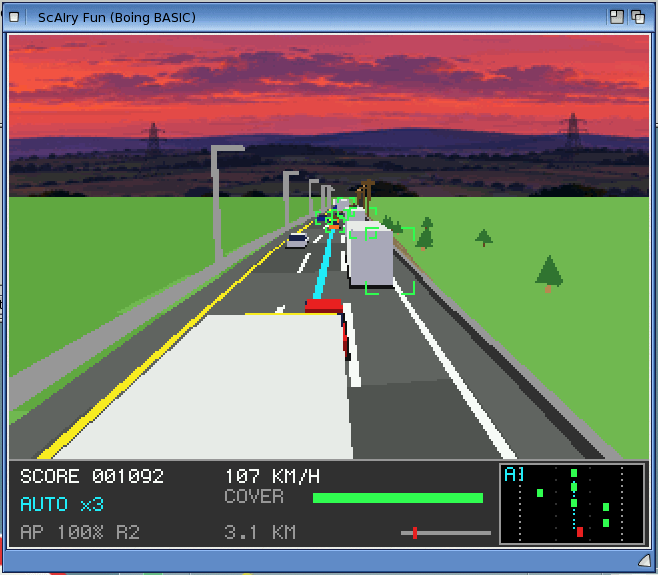
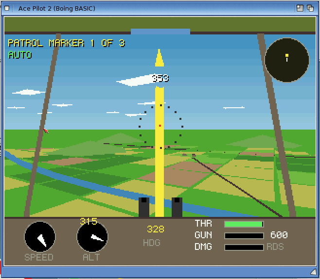

# Boing BASIC gallery

<!-- Generated by tools/gallery.py from examples/*/gallery.toml: edit those, then run it. -->

Boing BASIC is a Visual Basic 6 style language for AmigaOS 4.1 (PowerPC). A program runs in the interpreter (a bytecode VM, with an optional PowerPC JIT) for a quick edit-run cycle, or is compiled to C and built with GCC into a native executable. Forms are designed in the [AmiForge](https://github.com/geekychris/amiforge) IDE; the runtime brings a Canvas for 2D graphics, Engine3D for filled 3D, a ProTracker player and sound effects through AHI, menus, dialogs and ReAction gadgets, an ARexx port, and `Declare` for calling any AmigaOS library. See the [README](../README.md) and the [design](DESIGN.md).

Everything below was written in Boing BASIC and runs on AmigaOS 4.1; the screenshots are from the QEMU sam460ex guest. 6 games, 4 applications and 6 examples and tools.

**Games**

<table>
<tr><td align="center" valign="bottom"><a href="#glimmerfield"> Glimmerfield</a></td><td align="center" valign="bottom"><a href="#stack-tower"> Stack Tower</a></td><td align="center" valign="bottom"><a href="#boing-pinball"> Boing Pinball</a></td><td align="center" valign="bottom"><a href="#ace-pilot-2"> Ace Pilot 2</a></td></tr>
<tr><td align="center" valign="bottom"><a href="#orbit-docking"> Orbit Docking</a></td><td align="center" valign="bottom"><a href="#scairy-fun"> ScAIry Fun</a></td></tr>
</table>

**Applications**

<table>
<tr><td align="center" valign="bottom"><a href="#riffwright"> Riffwright</a></td><td align="center" valign="bottom"><a href="#tincture"> Tincture</a></td><td align="center" valign="bottom"><a href="#boingpad"> BoingPad</a></td><td align="center" valign="bottom"><a href="#minisheet"> MiniSheet</a></td></tr>
</table>

**Examples and tools**

<table>
<tr><td align="center" valign="bottom"><a href="#hello"> Hello</a></td><td align="center" valign="bottom"><a href="#calculator"> Calculator</a></td><td align="center" valign="bottom"><a href="#file-viewer"> File Viewer</a></td><td align="center" valign="bottom"><a href="#sysinfo-declare"> SysInfo (Declare)</a></td></tr>
<tr><td align="center" valign="bottom"><a href="#declare-graphics"> Declare graphics</a></td><td align="center" valign="bottom"><a href="#engine3d-demo"> Engine3D demo</a></td></tr>
</table>

## Games

### Glimmerfield

An arcade shooter: fly a skiff through a wrapping field of glimmer crystals that crack into shards and grow back, with hunting wisps from wave 2.

**Shows off:** Canvas (scaled, double-buffered), Audio: an original ProTracker MOD and synthesised effects, Timer-driven game loop, High scores, a benchmark of the language

**Performance:** 354-365 fps native, 88 fps in the VM, 75-79 fps with the JIT (`--bench 1000`, m1 guest).

*The bot playing wave 3 at 2x scale, with the F1 timing line*

*Four frames on the guest*

[README](../examples/glimmerfield/README.md) · [source](../examples/glimmerfield/)

### Stack Tower

The falling-block puzzle wrapped round a sixteen-column tower: no side walls, and a ring only clears when the back is full too.

**Shows off:** Engine3D (the tower), Canvas (panel and text), Audio: MOD music and effects, Bot player, High scores

**Performance:** 126.9 fps native, 82.3 fps in the VM, 75.7 fps with the JIT (`--bench 500`, m1b guest).

*Playing on the guest*

*The title screen*

*High scores*

[README](../examples/stack_tower_bb/README.md) · [source](../examples/stack_tower_bb/)

### Boing Pinball

Pinball with three tables and the Boing ball: the classic Amiga view, tilted and scrolling to follow the ball, with a dot-matrix display.

**Shows off:** Canvas (painted playfields, scrolling), Ball physics in BASIC, Audio: music and sound effects, Bot player, a port of a C amiga3d game

**Performance:** 217.3 fps native, 84.5 fps in the VM, 76.2 fps with the JIT (`--bench 1500`, m1b guest); the game needs 50.

*Comet Tour*

*The title: Comet Tour's backglass*

*Foundry*

[README](../examples/boing_pinball_bb/README.md) · [source](../examples/boing_pinball_bb/)

### Ace Pilot 2

A biplane war in 3D: fly a Swallow scout over the trenches and the river Sellen, in the chase view or from the cockpit.

**Shows off:** Engine3D, Canvas (instruments, text), Audio: sound effects, Autopilot bot, a port of a C amiga3d game

**Performance:** On the Mac: VM 13037 fps, native 19995 fps off-screen (`Bench.bbp --frames 3000 --mission 6`); guest numbers to follow in its README.

*The autopilot flying a mission, chase view*

*The cockpit view: upper wing, struts, twin guns and ring sight*

[README](../examples/ace_pilot2_bb/README.md) · [source](../examples/ace_pilot2_bb/)

### Orbit Docking

A slow, tense docking simulator: match a spinning station's roll and slide into its port, with no friction and limited fuel.

**Shows off:** Engine3D, Canvas (instruments), Audio: sound effects, Autopilot bot, a port of a C amiga3d game

**Performance:** 186.0 fps native, 109.4 fps in the VM, 94.6 fps with the JIT (`--bench 500`, m1b guest).

*The approach to station 4*

*High scores*

[README](../examples/orbit_docking_bb/README.md) · [source](../examples/orbit_docking_bb/)

### ScAIry Fun

A self-driving car game: score while the autopilot drives, and grab the wheel just before it gets something wrong.

**Shows off:** Engine3D maths with its own road renderer, Canvas, Audio: MOD music and sampled voice lines, a port of a C amiga3d game

**Performance:** On the Mac: VM 4736 fps, native 12523 fps off-screen (`Bench.bbp --frames 3000 --route 1`); guest numbers to follow in its README.

*On autopilot*

[README](../examples/scairy_fun_bb/README.md) · [source](../examples/scairy_fun_bb/)

## Applications

### Riffwright

A ProTracker music editor: a keyboard-driven pattern editor, sample editor, order list, channel scopes and VU meters, 200 steps of undo.

**Shows off:** Canvas, Boing.Audio (the runtime's ProTracker player and mixer through AHI), Menus and dialogs, ARexx port, Drag and drop, AmigaGuide help, Program and project icons

**Performance:** 161 fps native, 98.5 fps in the VM, 97.7 fps with the JIT, with music, scopes and VU meters (`--bench 300`, m1b guest).

*Playing Harbour Lights in follow mode*

*The sample editor*

*Song settings and the order list*

[README](../examples/riffwright/README.md) · [source](../examples/riffwright/)

### Tincture

A paint program: true colour or up to 256 colours, 16 layers, multi-level undo, custom brushes, a magnifier and a command language.

**Shows off:** Canvas members for the per-pixel work (fills, brushes, scaled views, codecs), Forms and panels, Menus and dialogs, IFF ILBM and PNG load/save in BASIC, Scripting (`.tsc` command files), Workbench icons

*The sunset demo script (`--script demo/sunset.tsc`) painted in three layers, with the magnifier pane*

[README](../examples/tincture/README.md) · [source](../examples/tincture/)

### BoingPad

A text editor: menus with Amiga-key shortcuts, a toolbar, status bar, find/replace, recent files, ASL file requesters and an ARexx port, in 230 lines.

**Shows off:** Menus and context menu, Toolbar and status bar, CommonDialog (ASL), TextEditor gadget, GetSetting/SaveSetting (ENVARC:), ARexx port, Drag and drop, Project icons

*Editing its own source*

[source](../examples/boingpad/)

### MiniSheet

A small spreadsheet: editable cells with =SUM(B2:B10)-style formulas, a TreeView of sheets, tabs, a sortable summary list and a splitter.

**Shows off:** Grid control with BeforeEdit/AfterEdit, TreeView, Tabs, ListBrowser columns, Splitter, Menus and status bar

*A sheet with formulas*

[source](../examples/minisheet/)

## Examples and tools

### Hello

A console program: Print, Environ, App.Path, Command(), then an InputBox and a MsgBox.

**Shows off:** Console output, InputBox and MsgBox requesters

*`boing run hello.bas` in a Shell, asking for a name*

[source](../examples/hello/)

### Calculator

A four-function calculator: a form designed in AmiForge with about 90 lines of event code.

**Shows off:** Forms (AmiForge .afg), Button and TextBox events

*The calculator form on the guest*

[source](../examples/calculator/)

### File Viewer

Lists a folder and shows a file as text or hex dump.

**Shows off:** Forms, ListBox and TextBox, Dir()/file I/O

*Browsing a folder on the guest*

[source](../examples/fileviewer/)

### SysInfo (Declare)

Calls exec, dos and intuition functions with Declare: free memory, the current task, an environment variable, a DisplayBeep.

**Shows off:** Declare ... Lib "exec.library" (calling AmigaOS libraries), The generated bindings (bindings/*.bi)

*`boing run sysinfo.bas` in a Shell*

[source](../examples/declare/)

### Declare graphics

An animation in a window opened and painted entirely through Declare'd intuition and graphics calls: no forms, no Canvas.

**Shows off:** Declare and the generated bindings, TagLists, PeekL/PeekB into OS structures, graphics.library drawing, an IDCMP message loop in BASIC

*The window, drawn with RectFillColor, Move/Draw, WritePixelColor and Text*

[source](../examples/declare_gfx/)

### Engine3D demo

A terrain flyover with spinning models and an fps counter, in 15 lines of form code.

**Shows off:** Engine3D, Forms, Timer

*The flyover on the AmigaOS 4 guest (VM)*

[source](../examples/engine3d_demo/)
