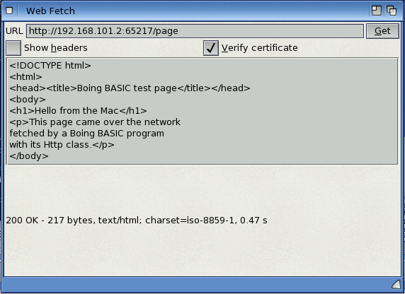

# Http: HTTP and HTTPS from Boing BASIC

`Http` is a built-in class for talking to web servers: fetch a page, call a REST/JSON API, post
a form, download a file. It speaks HTTP/1.1 and HTTPS (TLS with certificate checking) on
AmigaOS 4 and on the host (macOS/Linux).

```basic
Dim web As Http
Set web = CreateObject("Http")
page = web.Get("https://example.com/")
If web.Status = 200 Then Print Len(page); " bytes of "; web.ContentType
```



*`examples/webfetch` on AmigaOS 4: a form that fetches a URL into a text editor.*

## Making requests

| Method | Does | Returns |
|---|---|---|
| `Get(url)` | GET | the body (String) |
| `Post(url, body [, contentType])` | POST `body`; content type defaults to `application/x-www-form-urlencoded` | the body |
| `Put(url, body [, contentType])` | PUT | the body |
| `Delete(url)` | DELETE | the body |
| `Head(url)` | HEAD (headers only) | "" |
| `Send(method, url [, body [, contentType]])` | any method (`"PATCH"`, ...) | the body |
| `GetToFile(url, path)` | GET, the body written to `path` (not kept in memory) | the number of bytes |

Every method waits until the whole answer is in (or an error happens). The body is the bytes
the server sent, in a String; Boing BASIC strings hold any bytes, so binary data is fine.
No character set conversion is done: most web pages are UTF-8, while the Amiga uses Latin-1,
so accented letters in UTF-8 text show as two characters (a UTF-8 conversion function is on
the list of coming libraries).

## Request settings

| Property / method | Default | |
|---|---|---|
| `SetHeader name, value` | | adds a request header for all later requests (`SetHeader name, ""` removes it) |
| `ClearHeaders` | | removes all of them |
| `Timeout` | 30000 | milliseconds for connecting and for each wait for data |
| `FollowRedirects` | True | follow 301/302/303/307/308 answers |
| `MaxRedirects` | 10 | more raises error 31107 |
| `VerifyCertificate` | True | check the server's certificate chain and its host name (HTTPS) |
| `CACertFile` | "" | a PEM file of trusted certificates instead of the system's store |
| `UserAgent` | `BoingBASIC/1.0` | |

A 303 answer (and, as browsers do, a 301/302 after a POST) continues with a GET without body;
307 and 308 repeat the request as it was.

## The answer

| Property / method | |
|---|---|
| `Status` | 200, 404, ... (0 before the first request) |
| `StatusText` | "OK", "Not Found", ... |
| `ResponseText` | the body again (the default member: `Print web`) |
| `ResponseHeader(name)` | one header's value, any case; "" if absent |
| `ResponseHeaders` | all headers, `Name: value` lines |
| `ContentType` | the `Content-Type` header |
| `Url` | the URL the answer came from (after redirects) |
| `Redirects` | how many redirects were followed |
| `BytesReceived` | body length |
| `TlsAvailable()` | True if HTTPS can be used here |

## Errors

An answer with an error status (404, 500, ...) is still an answer: check `Status`. Problems
that leave no answer raise a run-time error, catchable with `On Error`:

| `Err.Number` | |
|---|---|
| 31101 | bad or unsupported URL (only `http://` and `https://`) |
| 31102 | the host name can't be resolved |
| 31103 | can't connect (refused, unreachable, no TCP/IP stack) |
| 31104 | no answer within `Timeout` |
| 31105 | the TLS handshake failed |
| 31106 | the certificate isn't trusted, or is for another host |
| 31107 | too many redirects |
| 31108 | HTTPS isn't available (no AmiSSL / OpenSSL) |
| 31109 | the connection closed early, or the answer isn't HTTP |
| 31110 | `GetToFile` couldn't write the file |
| 18 | interrupted with Ctrl-C (AmigaOS) |

`Err.Description` says what happened ("the certificate of example.com isn't trusted:
certificate has expired").

```basic
On Error GoTo Failed
data = web.Get(url)
...
Failed:
    MsgBox "Can't fetch " & url & ":" & vbLf & Err.Description, vbExclamation
```

## Examples

```basic
' JSON API with a token
web.SetHeader "Authorization", "Bearer " & token
web.SetHeader "Accept", "application/json"
reply = web.Post("https://api.example.com/v1/items", "{""name"":""Boing""}", "application/json")
If web.Status <> 201 Then Print "failed: "; web.Status; " "; reply

' download a file
n = web.GetToFile("https://example.com/files/game.lha", "RAM:game.lha")
Print n; " bytes"

' a local test server with its own certificate authority
web.CACertFile = "PROGDIR:test-ca.pem"
```

## Cookies and kept connections

An `Http` object works like a browser session: it remembers the cookies servers set and keeps
its connection open for the next request to the same server.

| | |
|---|---|
| `UseCookies` | store `Set-Cookie` answers and send them back (default True) |
| `GetCookie(name [, host])` | a stored cookie's value, or `""` |
| `SetCookie name, value, domain [, path]` | add one (for the domain and its subdomains; path default `/`) |
| `ClearCookies` | forget them all |
| `CookieCount` | how many are stored |
| `Cookies` | all of them as text, one per line in the `cookies.txt` layout curl and browsers use (domain, subdomains TRUE/FALSE, path, secure, expiry as Unix time with 0 for "until the program ends", name, value, separated by tabs); assigning text replaces them |
| `KeepAlive` | keep the connection open after a request (default True) |
| `ConnectionReused` | True if the last request went over a kept connection |

Cookies follow the usual rules (RFC 6265): `Domain` (a cookie for another site is refused),
`Path` (longer paths are sent first), `Expires` and `Max-Age` (an expiry in the past deletes
the cookie), `Secure` (sent over HTTPS only). Cookies set by a redirect go with the request
to its target, so a login that redirects works. A `Cookie` header set with `SetHeader` replaces
the stored cookies for that request.

```basic
' log in once; later requests carry the session cookie
s = web.Post("https://example.com/login", "user=boing&pass=" & UrlEncode(pw), "application/x-www-form-urlencoded")
s = web.Get("https://example.com/account")

' keep the login for the next run
Open "PROGDIR:cookies.txt" For Output As #1: Print #1, web.Cookies;: Close #1
' ... and load it
Open "PROGDIR:cookies.txt" For Binary As #1
web.Cookies = Input(LOF(1), #1)
Close #1
```

A kept connection saves the TCP and TLS handshakes, which on a 68k-class or emulated machine
are most of a small request's time. When the server closed it in the meantime the request
quietly opens a new one. On AmigaOS 4 a connection belongs to the task that opened it, so
asynchronous requests (which run on a task of their own) use a new connection each time and
close it at the end; the cookie jar is shared, and can't be read while an asynchronous request
of the same object runs (error 5).

## Asynchronous requests

`Get`, `Post` and the rest wait for the answer, so a form freezes during a long download.
The asynchronous calls start the request on a background task and return at once:

| | |
|---|---|
| `GetAsync url` | starts a GET |
| `SendAsync method, url [, body [, contentType]]` | starts any request |
| `Busy` | True while the request runs |
| `Wait([ms])` | waits until it ends (handling events meanwhile), at most `ms` milliseconds if given; True if it has ended |
| `Cancel` | stops it; it then ends with `ErrorNumber` 18 |
| `OnDone` | the name of a `Sub` with no arguments, called when the request ends (or use the events below) |
| `OnProgress` | the name of a `Sub (got As Long, total As Long)`, called as data arrives; `total` is the `Content-Length`, or -1 if the server didn't send one |
| `ErrorNumber`, `ErrorText` | how it ended: 0 and `""`, or the error (31101–31110, 18) |

When it has ended, `Status`, `ResponseText`, `ResponseBody`, `GetResponseHeader` and
`StatusText` hold the answer, as after a `Get`. Errors are **not** raised: check `ErrorNumber`.

`OnDone` and `OnProgress` run in the program's own task, never in the background, so they can
change forms and variables freely. They are called while the program handles events: in a
form's event loop, in `DoEvents`, in `Wait` and in `Busy`. A program without forms polls:

```basic
Dim web As Http
Set web = CreateObject("Http")
web.OnProgress = "Progress"
web.GetAsync "https://example.com/files/game.lha"
Do While web.Busy
    DoEvents
Loop
If web.ErrorNumber = 0 Then Print Len(web.ResponseBody); " bytes"

Sub Progress(got As Long, total As Long)
    If total > 0 Then StatusBar.Text = (got * 100 \ total) & "%"
End Sub
```

### Events

An `Http` variable declared `WithEvents` raises events, handled by Subs named
*variable*`_`*event*, like a form's controls:

| Event | |
|---|---|
| `Done()` | the request ended with an answer (any HTTP status: check `Status`) |
| `Failed(number As Long, text As String)` | it ended without one: `number` is `ErrorNumber` (31101–31110, or 18 after `Cancel`) |
| `Progress(got As Long, total As Long)` | data arrived (`total` is -1 when the server didn't send a length) |

In a form, start the request in a button's `Click` and handle the answer in the events:

```basic
Private WithEvents web As Http

Private Sub FetchButton_Click()
    Set web = CreateObject("Http")
    web.GetAsync UrlField.Text
    FetchButton.Enabled = False
End Sub

Private Sub web_Done()
    FetchButton.Enabled = True
    Page.Text = Utf8Decode(web.ResponseText)
End Sub

Private Sub web_Failed(number As Long, text As String)
    FetchButton.Enabled = True
    MsgBox text
End Sub

Private Sub web_Progress(got As Long, total As Long)
    If total > 0 Then Status.Text = (got * 100 \ total) & "%"
End Sub
```

### OnDone and OnProgress

Without `WithEvents`, name the Subs to call instead (both ways can be used together):

```basic
Private web As Http

Private Sub FetchButton_Click()
    Set web = CreateObject("Http")
    web.OnDone = "Fetched"
    web.GetAsync UrlField.Text
    FetchButton.Enabled = False
End Sub

Sub Fetched()
    FetchButton.Enabled = True
    If web.ErrorNumber <> 0 Then MsgBox web.ErrorText: Exit Sub
    Page.Text = Utf8Decode(web.ResponseText)
End Sub
```

Several `Http` objects can run requests at the same time; each object runs one at a time
(starting a second one, or calling `Get` while one runs, raises error 5). Settings
(`Timeout`, headers, `CACertFile`, ...) are read when the request starts.

On AmigaOS 4 each request runs in its own child process ("Boing BASIC worker", 128 KB stack)
with its own `bsdsocket.library` and AmiSSL bases, as both libraries require; the program's
task is woken with a signal as data arrives. On the host it is a thread.

## How it works, per platform

**AmigaOS 4.** TCP goes through `bsdsocket.library` (Roadshow), TLS through AmiSSL
(`amisslmaster.library` → `amissl_v3xx.library`). Both are opened on the first request, so a
program that never uses `Http` doesn't need a running TCP/IP stack or AmiSSL. Certificates
are checked against AmiSSL's store, `AmiSSL:Certs` (installed with AmiSSL), plus the host
name. AmiSSL is given the program's own bsdsocket interface, so the TLS layer works on the
program's sockets (the Python 3.12 port's `_ssl` module trips over exactly this and shells out
to `openssl s_client` instead). Host names are resolved with `gethostbyname` (no timeout).

**Host (macOS, Linux).** BSD sockets; TLS through OpenSSL 3, loaded when the first HTTPS
request is made (`libssl.3`, or the directory in `BOING_OPENSSL_DIR`). Where OpenSSL isn't
installed, HTTPS raises error 31108 and HTTP still works. On macOS with Homebrew's OpenSSL the
default certificate store is Homebrew's.

## Tests

- `tests-net/run.sh` (part of `make test`): `tools/http_testserver.py` serves HTTP and HTTPS
  (with a generated test CA) on the host; `tests-net/httptest.bas` checks 38 cases in the VM and
  as a native build: GET/POST/PUT/DELETE/HEAD/PATCH, headers, chunked bodies, redirects
  (relative, 303, loops, the limit), 300 KB binary bodies, `GetToFile`, timeouts, bad URLs,
  unknown hosts, refused connections, HTTPS with the CA, an untrusted certificate,
  `VerifyCertificate = False`.
- `tests-net/os4-run.sh`: the same 38 checks on the AmigaOS 4 guest (QEMU), VM and native,
  through AmiSSL, against the test server on the Mac (reached at the QEMU gateway
  192.168.101.2). 2026-11-10: 38/38 both.
- `tests-net/asynctest.bas` (in both runners): 19 checks of the asynchronous calls: `Busy` with
  `DoEvents`, `OnDone`, two requests at once finishing in their own order, `OnProgress` over a
  300 KB body, `Wait` with a limit, `Cancel`, error 5 for overlapping requests, `ErrorNumber` for
  an unknown host, a POST, HTTPS (one and two at once), and the `WithEvents` events.
- `tests-net/sessiontest.bas` (in both runners): 31 checks of kept connections (reuse, a POST, the
  server's `Connection: close`, a connection the server dropped, `KeepAlive = False`, chunked
  answers, HTTPS) and cookies (Path, longer paths first, replacing, `Max-Age=0`, `Expires`,
  another domain, `Secure`, a cookie set by a redirect, `SetCookie`, `Cookies` as text and back,
  `UseCookies = False`, your own `Cookie` header, asynchronous requests).

## Not yet

`Content-Encoding: gzip`, proxies, IPv6 on AmigaOS.
