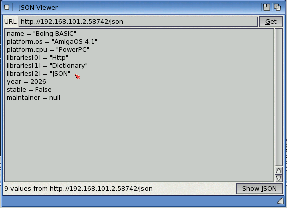

# JSON: reading and writing JSON text

`JsonParse` turns JSON text (what web APIs send) into Boing BASIC values, `JsonStringify` turns
values back into JSON text.

```basic
Dim web As Http, user As Variant
Set web = CreateObject("Http")
user = JsonParse(web.Get("https://jsonplaceholder.typicode.com/users/1"))
Print user("name"); " lives in "; user("address")("city")
For Each key In user: Print key: Next
```



*`examples/jsonview` on AmigaOS 4: a JSON document as path = value lines.*

## JsonParse(text) As Variant

| JSON | becomes |
|---|---|
| object `{...}` | a `Dictionary` (keys in the order of the text) |
| array `[...]` | a Variant array, `0` to `n - 1` (an empty array has `UBound` -1) |
| string | a String |
| integer that fits a Long | a `Long` |
| other numbers | a `Double` |
| `true` / `false` | a `Boolean` |
| `null` | `Null` |

So `doc("items")(0)("name")` reads the name of the first item, `IsObject(v)` tells an object,
`IsArray(v)` an array, and `For Each k In obj` walks an object's keys.

Strings are kept as the bytes of the text. JSON text is UTF-8, so letters beyond ASCII arrive as
UTF-8 byte sequences; `\u` escapes are written as UTF-8 too. Convert them for display with the
text encoding functions (coming next). A UTF-8 byte order mark at the start is skipped.

Arrays are values: `a = doc("items")` makes a copy. Change an array inside a document with
`doc("items") = a` after changing `a`. Objects are references: `Set o = doc("user")` and
`o("name") = "x"` changes the document.

Errors: invalid JSON raises error **31201** with the position, e.g.
`JSON: ',' or '}' was expected at line 3, column 12 (found '"')`. Nesting deeper than 512
levels is an error too.

## JsonStringify(value [, indent]) As String

| value | JSON |
|---|---|
| `Dictionary` | an object (number keys are written as strings) |
| one-dimensional array, `Collection` | an array |
| numbers | numbers (`NaN`/infinity as `null`) |
| String | a string (`"`, `\`, control characters escaped; other bytes as they are) |
| Boolean | `true` / `false` |
| `Null`, `Empty`, `Nothing` | `null` |
| Date | an ISO 8601 string, `"1985-07-23T10:30:05"` |

`indent` (0 to 16, default 0) is the number of spaces per level: 0 writes everything on one line,
2 gives the usual pretty layout. Values that can't be JSON (other objects, arrays with more than
one dimension, a Dictionary that contains itself) raise error **31202**.

```basic
Dim order As Dictionary
Set order = CreateObject("Dictionary")
order("id") = 1001
order("items") = Array("apple", "pear")
order("paid") = True
body = JsonStringify(order)        ' {"id":1001,"items":["apple","pear"],"paid":true}
reply = web.Post("https://api.example.com/orders", body, "application/json")
```

## Examples

- `examples/jsonview`: fetch a JSON API (`Http`) and show every value of the document in a list;
  "Show JSON" pretty-prints it with `JsonStringify(doc, 2)`.

## Tests

`tests/lib/jsontest.bas` (in `make test`, VM and native): numbers (Long/Double limits,
exponents), escapes, `\u` and surrogate pairs, nesting, empty objects and arrays, key order,
stringify of every value type (Dates, Collections, number keys), indentation, a 500-object round
trip, every parse error with its position, and the values that can't be written. On the
AmigaOS 4 guest: identical output in the VM and native (`tools/os4guest.py outtest
tests/lib/jsontest.bas`).
