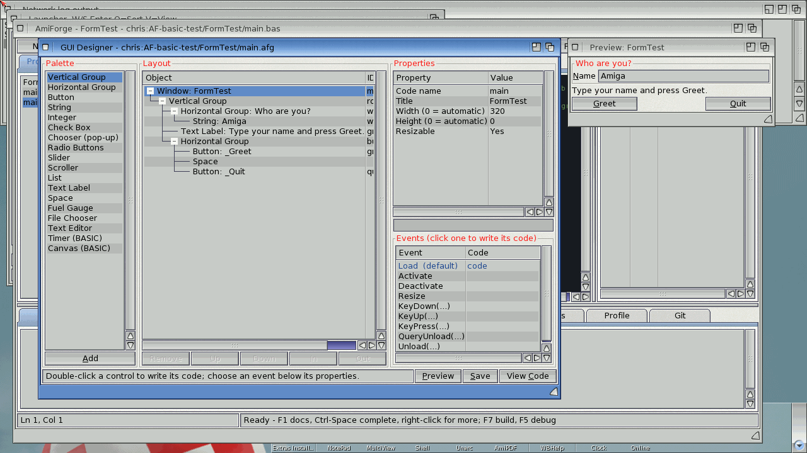
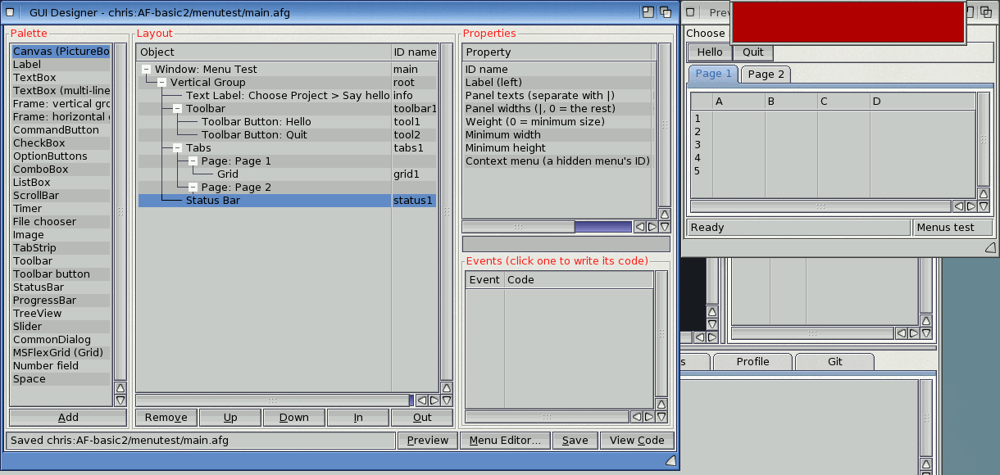
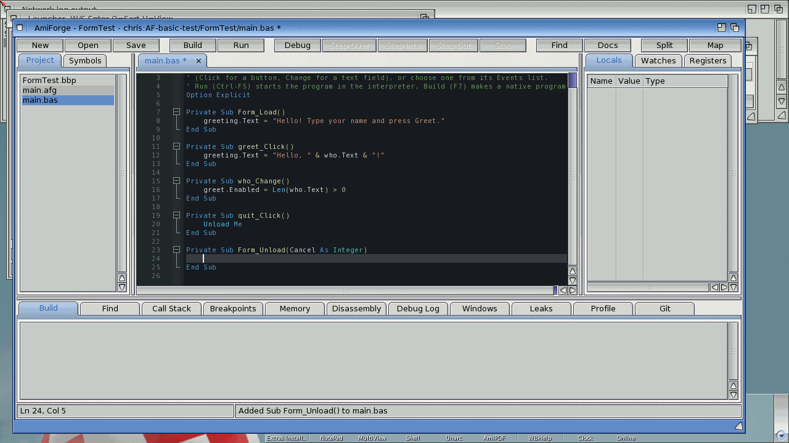
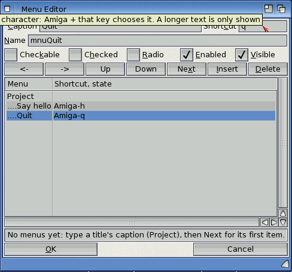
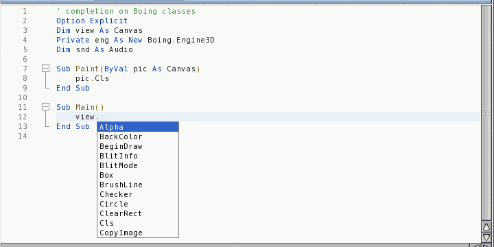
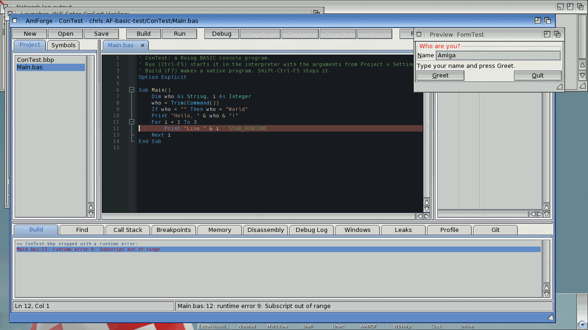
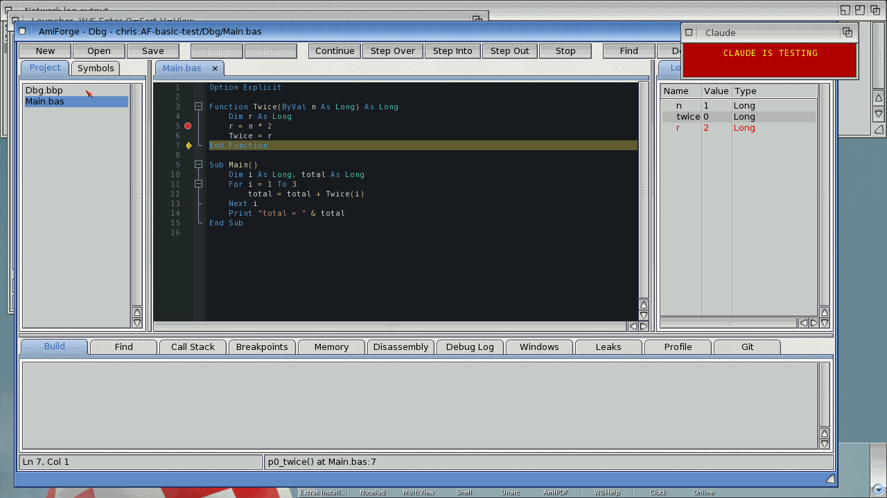

# Using Boing BASIC with AmiForge

AmiForge is an integrated development environment for AmigaOS 4.1 that knows Boing BASIC.
You draw a window in its form designer, double-click a button to write what happens when it
is clicked, and run the program with one key. This chapter covers what AmiForge does for
Boing BASIC projects; AmiForge's own user guide (in its `Docs` drawer) describes the rest of
the IDE.

## Setting up

AmiForge comes in the Boing BASIC kit, in the same drawer as `boing`. It finds `boing` in this
order:

1. **Project > Settings > Boing BASIC command**, for one project;
2. the environment variable `AmiForge/Boing`, for example
   `SetEnv SAVE AmiForge/Boing Work:BoingBASIC/boing`;
3. `C:boing`, `SDK:C/boing`, `BoingBASIC:boing`, `Boing:boing`, and AmiForge's own drawer.

Run and the form designer need nothing else. **Build** (native programs) and the debugger need
the AmigaOS 4 SDK installed, with its `SDK:` assign.

## Starting a project

**Project > New Project from Template** offers two Boing BASIC templates:

| Template | What it makes |
|---|---|
| **Boing BASIC Form App** | a project with one form (a text field and two buttons) and its code, opened in the designer |
| **Boing BASIC Console App** | a project whose `Sub Main` prints to a console window |

Choose one, type the project's name and choose the drawer to make it in. AmiForge makes a
drawer with these files:

| File | What it is |
|---|---|
| `Hello.bbp` | the Boing BASIC project (see [projects](02-shell.md#projects)): it lists the program's files and says where it starts |
| `main.afg` | the form's layout, edited in the designer |
| `main.bas` | the form's code ("code-behind"): the procedures that handle its events |
| `Hello.afp` | AmiForge's own project file: breakpoints, settings, the files open in the editor |

**Project > Open Project** opens an existing `.bbp` too (AmiForge makes an `.afp` beside it if
there isn't one). Adding a file to the project or removing it (in the project browser) updates
the `.bbp`'s `Module=`, `Form=` and `Class=` lines.

## The form designer

Open a form with **Tools > GUI Designer**, or by double-clicking its `.afg` in the project
browser. The designer has three columns:

- **Palette**: the controls you can add. Select one and click **Add** (or double-click it): it
  goes into the selected group, or after the selected control.
- **Layout**: the window and everything in it, as a tree. Windows are built from groups that
  arrange their contents in a column (vertical group) or a row (horizontal group); a control's
  **Weight** says how much of the spare space it gets. **Up**, **Down**, **In**, **Out** and
  **Remove** rearrange the tree.
- **Properties**: the selected object's properties. Click one, type the new value underneath
  and press Return.

The **preview** window shows the form as it will look, built from the real gadgets, and is
rebuilt after every change. Click a control in the preview to select it.

The palette has, in order: Canvas (a drawing surface), Label, TextBox, multi-line TextBox,
vertical and horizontal groups (frames), CommandButton, CheckBox, OptionButtons, ComboBox,
ListBox, ScrollBar, Timer, File chooser, Image, TabStrip, Toolbar and toolbar button,
StatusBar, ProgressBar, TreeView, Slider, CommonDialog, Grid, Number field and Space.
[Forms and controls](12-forms.md) describes each one and what you can do with it from code.

Two properties matter most:

- every control has an **ID name**: this is its name in your code. A button with the ID name
  `greet` is `greet` in BASIC (`greet.Enabled = False`), and its Click event is handled by
  `Sub greet_Click()`;
- the window's **Code name** is the form's name: `main.Show` shows it from other code. Inside
  its own code the form is `Me`.

The Timer and CommonDialog take no space in the window; a Timer has an **Interval** in
milliseconds and **Enabled**.

## Writing the code: events

Code runs when something happens: the form opens (`Form_Load`), a button is clicked
(`ok_Click`), the text in a field changes (`who_Change`), a timer fires (`tick_Timer`). Each
of these is an **event**, handled by a procedure named after the control and the event.

- **Double-click a control** in the Layout tree, or click it twice in the preview: the editor
  opens the form's `.bas` file at the procedure for its main event, for example
  `Sub greet_Click()` for a button. If the procedure isn't there yet it is added, empty, with
  the right parameters, and the cursor is put inside it.
- The **Events** list under the properties shows every event of the selected control. Events
  with code are marked **code**, empty procedures **empty**. Click one to go to its procedure
  (it is made if it is missing).

- **Renaming a control** (its ID name) offers to rename its event procedures and the uses of
  the old name in the code.
- **View Code** saves the form and opens its code; **Tools > View Form / View Code** (Alt-F7)
  switches between a form and its code.

A first form, step by step, is [exercise 4](exercises/04-first-form.md).

## Menus: the Menu Editor

The **Menu Editor...** button makes the form's menus. It shows one list of every menu: the
titles at the left and their items indented under them (sub-items once more). For the selected
entry you set:

| | |
|---|---|
| **Caption** | the text; `-` makes a separator bar |
| **Name** | its name in the code; left empty, it is made from the caption: `Say hello` becomes `mnuSayHello`, handled by `Sub mnuSayHello_Click()` |
| **Shortcut** | one character: the item is chosen with Amiga + that key |
| **Checkable**, **Checked**, **Radio** | items with a checkmark, and groups of which one is checked |
| **Enabled**, **Visible** | a hidden title is a context menu, shown by a control's **Context menu** property or by `Me.PopupMenu` |

The arrows change an entry's level and order; **Next** goes to the next entry (adding one at
the end), **Insert** adds one before the selected entry. **OK** puts the menus into the form.
Double-click a menu item in the Layout tree, or choose it from the preview's menu strip, to
write its `Click` procedure.

## Editing BASIC

The editor highlights Boing BASIC (keywords in any case, strings, comments, numbers, dates,
labels) and helps you write it:

- **Folding**: procedures, block `If`, loops, `Select Case`, `With`, `Type` and `Enum` fold.
- **Auto-indent**: Return after a line that opens a block indents the next line; typing
  `End If`, `Next`, `Loop`, `Else`, `Case` or `End Select` lines it up with its block.
- **Comment / Uncomment** (Amiga-/) puts `'` in front of the selected lines.
- The **Symbols** tab lists the procedures, types, enumerations, constants, declarations,
  events and module-level variables of the file.
- **Completion** (Ctrl-Space, or by itself after three letters) offers the keywords, the
  built-in functions, the names in the project and the forms' control names. After `ok.` it
  lists the properties and methods of the control `ok`; after `v.` for a variable declared
  `As Canvas`, `As Engine3D` or `As Audio` it lists that object's members.
- **Find All References** and **Rename Symbol** ignore case, as Boing BASIC does.

## Running and building

| Command | Key | What it does |
|---|---|---|
| **Run** | Ctrl-F5 | checks the project, then runs it in the interpreter (`boing run`) in a console window, with the project's program arguments |
| **Start** | F5 | the same, unless the project has breakpoints: then it makes a debug build and starts the debugger |
| **Stop Program** | Shift-Ctrl-F5 | stops the running program (Ctrl-C) |
| **Build** | F7 | checks, then makes a native program with debugging information (`boing build --debug`) |
| **Package Release** | | an optimised native build, packed with an icon, readme and installer as an LhA archive ready for Aminet |

Compile errors and run-time errors go into the **Build** tab in the form
`main.bas:12:5: error: ...`; click one to go to the line. A program that stops with a run-time
error puts the editor on the line that failed.

## Debugging

The debugger works on the native program **Build** makes:

- set a breakpoint with F9 on a line of a `.bas` file, then press F5;
- **Step Over** (F10) and **Step Into** (F11) go from BASIC line to BASIC line;
- the **Locals** panel shows the procedure's variables with their BASIC names and types, and
  the **Call Stack** the procedures that led there;
- a String shows as the runtime's string structure: expand it to see its length and text.

Programs run with **Run** (in the interpreter) can't be stepped through; use `Print`
statements or a debug build for that.

## Summary

- New Project from Template makes a Boing BASIC form or console project.
- Draw the form in the designer; give each control an ID name; double-click it to write its
  event procedure.
- Make menus with the Menu Editor.
- Ctrl-F5 runs the program at once; F7 builds it natively; F5 with breakpoints debugs it.

Next: the language, starting with [program structure and data](04-data.md).
