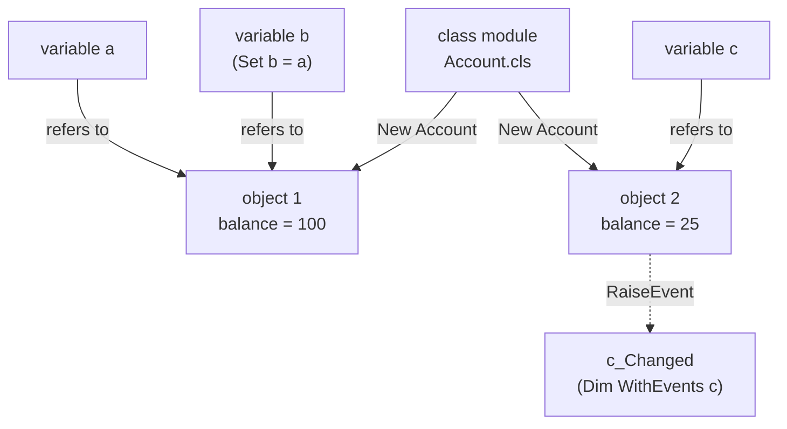

# Classes and objects

This chapter shows how to define your own kinds of object with class modules: their member
variables, methods and properties, how objects are created and released, how a class tells
other code what happened with events, and how several classes can share one interface. It also
covers the objects you get without writing a class (`Collection`, the runtime's own objects
through `CreateObject`), and the statements that work with objects: `Set`, `Is`, `TypeOf`,
`With` and `For Each`.

## Objects and classes

A *class* describes a kind of object: the data each object holds and the procedures that work
on it. An *object* is one instance of a class, made at run time with `New`. You can make as
many objects of a class as you like, and each one has its own copy of the class's data.



*Figure: A class is the pattern; New makes objects from it, and variables refer to objects. An object lives while something refers to it.*

A variable whose type is a class does not hold the object itself, only a *reference* to it.
Two variables can refer to the same object, and a variable that refers to no object holds the
special value `Nothing`.

Boing BASIC has three sorts of class:

- **Your own classes**, written in class modules (`.cls` files), described in most of this
  chapter.
- **`Collection`**, a built-in list of values with optional keys
  ([below](#the-collection-object)).
- **The runtime's objects**: forms and their controls ([chapter 12](12-forms.md)), the Canvas
  ([chapter 14](14-graphics.md)), Engine3D, Audio and the CommonDialog, which you make with
  `CreateObject` ([below](#createobject-the-runtimes-classes)).

## Class modules

A class is a file of its own with the extension `.cls`, listed in the project file with a
`Class=` line. The class's name is the file's name without `.cls`: `Counter.cls` defines the
class `Counter`. A project with one standard module and one class:

*Listing 11.1* (`examples/book/ch11-classes/counter/counter.bbp`)

<!-- project: examples/book/ch11-classes/counter/counter.bbp -->
```basic
' main.bas - uses the Counter class
Option Explicit

Sub Main()
    Dim c As Counter            ' a variable that can hold a Counter (Nothing for now)
    Print c Is Nothing
    Set c = New Counter         ' create the object
    c.Increment
    c.Increment 5
    c.Value = c.Value + 10
    c.Caption = "clicks"
    Print c.Value; c.Limit
    Print c.Describe()

    Dim d As Counter
    Set d = c                   ' a second reference to the same object
    d.Increment
    Print c.Value; d Is c

    On Error Resume Next
    c.Value = 500
    Print "Error"; Err.Number; ": "; Err.Description
    On Error GoTo 0

    Set c = Nothing             ' d still holds the object
    Print "c released"
    Set d = Nothing             ' the last reference: Class_Terminate runs
    Print "done"
End Sub
```

The project file, `counter.bbp`:

```ini
# Counter: a first class module (manual chapter 11)
Name=Counter
Startup=Sub Main
Module=main.bas
Class=Counter.cls
```

And the class, `Counter.cls`:

*Listing 11.2* (`examples/book/ch11-classes/counter/counter.bbp`)

<!-- project: examples/book/ch11-classes/counter/counter.bbp -->
```basic
' Counter.cls - a counter that can only go up, with a lower and upper limit
Option Explicit

Private mValue As Long          ' member variables: one set per object
Private mLimit As Long
Public Caption As String        ' a Public variable is a property

Private Sub Class_Initialize()
    mLimit = 100
    Caption = "counter"
    Print "Class_Initialize"
End Sub

Private Sub Class_Terminate()
    Print "Class_Terminate "; Caption
End Sub

' a method: a Public Sub
Public Sub Increment(Optional ByVal by As Long = 1)
    Value = mValue + by         ' goes through Property Let, so the check below runs
End Sub

Public Sub Reset()
    mValue = 0
End Sub

' a read/write property: Property Get and Property Let with the same name
Public Property Get Value() As Long
    Value = mValue
End Property

Public Property Let Value(ByVal v As Long)
    If v < 0 Or v > mLimit Then Err.Raise 380, "Counter", "Value must be 0 to " & mLimit
    mValue = v
End Property

' a read-only property: Property Get only
Public Property Get Limit() As Long
    Limit = mLimit
End Property

' a method that returns a value: a Public Function
Public Function Describe() As String
    Describe = Caption & " = " & mValue
End Function
```

`boing run counter.bbp` prints:

```output
True
Class_Initialize
 16  100 
clicks = 16
 17 True
Error 380 : Value must be 0 to 100
c released
Class_Terminate clicks
done
```

A class always lives in a project: a `.bas` file can't contain a class, and `boing check`,
`run` and `build` are given the `.bbp` file.

### What a class module may contain

A class module holds declarations and procedures only. Statements outside procedures are an
error ("executable statements are not allowed at class module level").

| Item | Meaning in a class |
|---|---|
| `Private x As T` (or `Dim x As T`) | a member variable: every object has its own; only the class's code sees it |
| `Public x As T` | a member variable that is also a property: `obj.x` reads and writes it |
| `Public Sub` / `Public Function` | a method, called as `obj.Name args` or `obj.Name(args)` |
| `Public Property Get` / `Let` / `Set` | a property (see below) |
| `Private Sub` / `Function` / `Property` | a helper only the class's own code can call |
| `Friend` | the same as `Public` in Boing BASIC |
| `Private Const`, `Private Type`, `Enum` | constants and types for the class's own code |
| `Public Event` | an event the class can raise ([Events](#events)) |
| `Implements I` | the class provides the interface `I` ([Interfaces](#interfaces-implements)) |
| `Class_Initialize`, `Class_Terminate` | run when an object is created and released |

An `Enum` declared in a class (even `Public Enum`) is only visible inside the class. Put
enumerations that callers need in a standard module.

A `Static` variable in a method is shared by all objects of the class, not kept per object.
Use a member variable for anything that belongs to one object.

Class files written by other tools may start with `VERSION`, `BEGIN` ... `END` and `Attribute`
lines. Boing BASIC accepts and ignores them.

### Member variables

Member variables are declared at the top of the class, outside any procedure. Each object gets
its own set, starting at the type's empty value (0, `""`, `Nothing`), and they live as long as
the object. Arrays, fixed-length strings, user-defined types and object references can all be
members. A dynamic array member is sized with `ReDim` in a method.

A `Public` member variable is the simplest property: callers read and set it as `obj.Caption`.
Use `Property` procedures instead when the class must check or react to a change.

### Methods

Every `Public Sub` and `Public Function` of the class is a method. Calls follow the rules of
ordinary procedures ([chapter 5](05-procedures.md)): `Optional`, `ByVal`, `ByRef`,
`ParamArray` and named arguments all work. Inside the class, call another method of the same
object by its name alone (`Reset`) or through `Me` (`Me.Reset`).

### Property procedures

A property looks like a variable to the caller but runs code:

- `Property Get Name() As T` runs when the property is read; assign the result to the
  property's name, as in a Function.
- `Property Let Name(ByVal v As T)` runs when a value is assigned (`obj.Name = 5`).
- `Property Set Name(ByVal v As SomeClass)` runs when an object is assigned with `Set`
  (`Set obj.Name = other`).

The `Let` or `Set` takes one more parameter than the `Get`: the value. A property with only a
`Get` is read-only: assigning to it is a compile error ("property 'Limit' has no Property
Let"). A property can take parameters, like
an array: `Property Get Cell(ByVal r As Long, ByVal c As Long) As Double` with the matching
`Property Let Cell(ByVal r As Long, ByVal c As Long, ByVal v As Double)` is used as
`m.Cell(1, 2) = 4.5`.

A property that holds an object needs `Property Set`, and its `Property Get` returns the object
with `Set`. From `examples/book/ch11-classes/library`:

*Listing 11.3* (`examples/book/ch11-classes/library/library.bbp`)

<!-- project: examples/book/ch11-classes/library/library.bbp -->
```basic
' Book.cls
Option Explicit

Public Title As String
Public Year As Long
Private mShelf As Shelf

' Property Set: the property holds an object
Public Property Set Home(ByVal s As Shelf)
    Set mShelf = s
End Property

Public Property Get Home() As Shelf
    Set Home = mShelf           ' Set, because the value is an object
End Property

Public Function Describe() As String
    Describe = Title & " (" & Year & ")"
    If Not mShelf Is Nothing Then Describe = Describe & " on " & mShelf.Name
End Function
```

To report a bad value, raise an error in the `Property Let`, as `Counter` does with
`Err.Raise 380, "Counter", "..."`. Error 380 is "Invalid property value"; any number will do,
and `vbObjectError + n` keeps your own numbers apart from the runtime's
([chapter 8](08-errors.md)).

### Class_Initialize and Class_Terminate

`Class_Initialize` runs once for every new object, before `New` returns, and is the place to
give members their starting values. `Class_Terminate` runs when the object is released (see
[Object lifetime](#object-lifetime)): close files or release other objects there. Both are
`Private Sub` with no parameters. Neither can take arguments, so a class that needs values to
start with usually has an `Init` method that the caller calls after `New`.

### Me

Inside a class, `Me` is the object whose code is running. Use it to pass the object to someone
else, or to return it:

*Listing 11.4* (`examples/book/ch11-classes/library/library.bbp`)

<!-- project: examples/book/ch11-classes/library/library.bbp -->
```basic
' Shelf.cls - a collection of books, kept by title
Option Explicit

Public Name As String
Private mBooks As New Collection

Public Function Add(ByVal title As String, ByVal year As Long) As Book
    Dim b As New Book
    b.Title = title
    b.Year = year
    Set b.Home = Me             ' Me: the Shelf object running this code
    mBooks.Add b, title         ' the title is the key
    Set Add = b
End Function

' a member called Item is the default: shelf("Dune") means shelf.Item("Dune")
Public Property Get Item(ByVal key As Variant) As Book
    Set Item = mBooks(key)
End Property

Public Property Get Count() As Long
    Count = mBooks.Count
End Property

Public Sub Remove(ByVal key As Variant)
    Dim b As Book
    Set b = mBooks(key)
    Set b.Home = Nothing        ' break the link back to the shelf
    mBooks.Remove key
End Sub

' For Each works on arrays and Collections, so hand out the Collection
Public Property Get Books() As Collection
    Set Books = mBooks
End Property

' the books point back at the shelf, so the shelf and its books keep each other alive:
' Clear breaks those links (and empties the shelf)
Public Sub Clear()
    Dim b As Book
    For Each b In mBooks
        Set b.Home = Nothing
    Next
    Set mBooks = New Collection
End Sub

Private Sub Class_Terminate()
    Print "shelf "; Name; " released"
End Sub
```

In a form's code-behind, `Me` is the form ([chapter 12](12-forms.md)).

### Names

Names are not case-sensitive, so a variable can't have the same name as a class: after
`Dim tank As Tank`, the name `Tank` means the variable, and `New Tank` fails with "class 'Tank'
is not defined". The same goes for a property with its class's name (`Property Get Shelf() As
Shelf`). Choose another name: `Dim water As Tank`, `Property Get Home() As Shelf`.

## Creating and using objects

### New and Set

`New ClassName` creates an object. Object references are assigned with `Set`:

<!-- fragment -->
```basic
Dim c As Counter
Set c = New Counter
Set other = c               ' both refer to the same object
Set c = Nothing             ' c refers to nothing now
```

Without `Set`, `c = something` would assign the object's default value (see
[Default members](#default-members)), not the reference.

`Dim x As New ClassName` declares a variable that creates its object by itself the first time
it is used. Every use checks whether there is an object yet, and makes one if not, also after
`Set x = Nothing`: so `x Is Nothing` is always `False` for such a variable. That is convenient
for objects that always exist (`Dim items As New Collection`), but when you need to know
whether an object is there, declare the variable without `New` and create the object with
`Set x = New ClassName`.

`Dim x As New` also works for member variables of a class (`Private mBooks As New Collection`)
and for local variables, which then get a fresh object each time the procedure runs.

### Nothing, Is and IsObject

`Nothing` is the value of an object variable that refers to no object; it is the starting
value of every object variable. Using a member through `Nothing` is error 91, "Object variable
or With block variable not set".

`a Is b` is `True` when `a` and `b` refer to the same object (or are both `Nothing`). `=`
does not compare references: it compares the objects' default values. `IsObject(v)` tells
whether a Variant holds an object reference:

*Listing 11.5* (`examples/book/ch11-classes/listing-11-05.bas`)

<!-- run -->
```basic
Option Explicit
Dim c As Collection, v As Variant, o As Object
Print c Is Nothing; IsObject(c); TypeName(c)
Set c = New Collection
Print c Is Nothing; TypeName(c); TypeOf c Is Collection
Set o = c
Print o Is c; TypeName(o)
v = 42
Print IsObject(v); TypeName(v)
Set v = c
Print IsObject(v); TypeName(v)
Set c = Nothing
Print o.Count; "items: o still holds the object"
```

```output
TrueTrueNothing
FalseCollectionTrue
TrueCollection
FalseInteger
TrueCollection
 0 items: o still holds the object
```

### TypeOf and TypeName

`TypeOf x Is ClassName` is `True` when `x` refers to an object of that class, or of a class
that implements that interface ([below](#interfaces-implements)). It is `False` for
`Nothing`. `TypeName(x)` returns the class's name as a String: `"Counter"`, `"Collection"`,
`"Nothing"` for no object. For forms and controls it is the control's kind (`"CommandButton"`,
`"TextBox"`, ... see [chapter 12](12-forms.md)); for the runtime's objects `"Canvas"`,
`"Engine3D"`, `"Audio"`, `"CommonDialog"`. `TypeOf` does not work with those runtime classes:
use `TypeName` to test them.

### Early and late binding

A variable declared with a class's name (`Dim c As Counter`) is *early bound*: `boing check`
knows the class, reports a misspelt member as a compile error, and the call goes straight to
the procedure. A variable declared `As Object` or `As Variant` can hold any object and is *late
bound*: the member is looked up by its name when the line runs, and a name the object doesn't
have is run-time error 438, "Object doesn't support this property or method".

Late binding works for every kind of object: your classes, `Collection`, forms, controls and
the runtime's objects. Use it when one variable must hold objects of different classes; use
early binding everywhere else, for the checks and the speed.

In a late-bound call, a variable passed to a `ByRef` parameter is passed by reference as
usual (the method can change it); put it in parentheses, `o.Inc (i)`, to pass a copy.

## Object lifetime

Boing BASIC counts the references to every object. `Set x = New C` makes one reference;
`Set y = x` makes a second; storing the object in a Collection, an array or another object's
member makes more. When a variable gets another object, is set to `Nothing`, or goes out of
scope (a local variable at the end of its procedure), the object loses that reference. When
the last reference goes, the object is released at once: its `Class_Terminate` runs, then its
own members are released in turn.

This makes lifetimes predictable: an object made in a procedure and not handed out is released
when the procedure ends, also when it ends because of an error. A Function can return an object
(`Set MakeNode = x`) and the caller then holds it.

**Circular references.** Two objects that refer to each other keep each other alive: in the
library example a `Shelf` holds its books and each `Book` holds its shelf (`b.Home`). When the
program lets go of the shelf, neither object's count reaches zero, and neither is released (nor
is its `Class_Terminate` run) until the program ends. Break such links yourself before you let
go of the objects, as `Shelf.Clear` does:

*Listing 11.6* (`examples/book/ch11-classes/library/library.bbp`)

<!-- project: examples/book/ch11-classes/library/library.bbp -->
```basic
' main.bas
Option Explicit

Sub Main()
    Dim s As New Shelf, b As Book
    s.Name = "Science fiction"
    s.Add "Dune", 1965
    s.Add "Solaris", 1961
    s.Add("Neuromancer", 1984).Year = 1984
    Print s.Count; "books"
    Print s("Dune").Describe()          ' the default member Item
    Print s.Item(2).Title               ' by position, from 1
    For Each b In s.Books
        Print " - "; b.Describe()
    Next
    s.Remove "Solaris"
    Print s.Count; "books"
    With s("Neuromancer")
        .Title = .Title & " (Ace)"
        Print .Describe()
    End With
    On Error Resume Next
    Set b = s("Ubik")
    Print "Error"; Err.Number; Err.Description
    On Error GoTo 0
    Set b = Nothing
    s.Clear                             ' without this the shelf is never released
End Sub
```

```output
 3 books
Dune (1965) on Science fiction
Solaris
 - Dune (1965) on Science fiction
 - Solaris (1961) on Science fiction
 - Neuromancer (1984) on Science fiction
 2 books
Neuromancer (Ace) (1984) on Science fiction
Error 5 Invalid procedure call or argument
shelf Science fiction released
```

Without the `s.Clear` line the last line is missing: the shelf was never released.

## Default members

A class can have one *default member*: a public member called `Item` or `Value` (the first of
them in the class). The default member is used when the object is written without a member
name:

- `s("Dune")` means `s.Item("Dune")`, as in the library example.
- `Print c` prints `c.Value`; `x = c` assigns it.
- `s("Dune") = other` assigns through `Property Let Item`.

`Collection`'s default member is `Item`. The controls of a form have `Text`, `Caption` or
`Value` as their default, depending on the kind.

`obj!name` is short for `obj("name")`: `books!Dune` is `books("Dune")`.

## Events

A class can announce that something happened, without knowing who is interested. The class
declares its events and raises them; any number of other objects or modules can handle them.

### Declaring and raising events

In the class, declare each event with `Public Event`, then fire it with `RaiseEvent`:

*Listing 11.7* (`examples/book/ch11-classes/events/events.bbp`)

<!-- project: examples/book/ch11-classes/events/events.bbp -->
```basic
' Tank.cls - a water tank that tells its listeners what happens
Option Explicit

Public Event Changed(ByVal level As Long)
Public Event Full(Cancel As Boolean)        ' ByRef: a handler can set Cancel
Public Event Emptied()

Private mLevel As Long
Public Capacity As Long

Private Sub Class_Initialize()
    Capacity = 100
End Sub

Public Sub Fill(ByVal amount As Long)
    Dim stopIt As Boolean
    If mLevel + amount > Capacity Then
        RaiseEvent Full(stopIt)
        If stopIt Then Exit Sub         ' a handler said no
        amount = Capacity - mLevel
    End If
    mLevel = mLevel + amount
    RaiseEvent Changed(mLevel)
End Sub

Public Sub Drain()
    mLevel = 0
    RaiseEvent Changed(mLevel)
    RaiseEvent Emptied
End Sub

Public Property Get Level() As Long
    Level = mLevel
End Property
```

An event's parameters are declared like a Sub's. A `ByRef` parameter (the default) lets the
handlers send a value back: after `RaiseEvent Full(stopIt)`, `stopIt` holds what the handlers
set it to. This is the usual way to let a handler cancel something. `RaiseEvent` is only
allowed in a class module, for the class's own events. Raising an event that nobody handles
does nothing.

### Handling events: WithEvents

To receive an object's events, hold it in a variable declared `WithEvents`, at module level
(in a class, a standard module or a form's code-behind), with the class's name as its type.
Then write a Sub for each event you want, named `variable_Event`, with the event's parameters:

*Listing 11.8* (`examples/book/ch11-classes/events/events.bbp`)

<!-- project: examples/book/ch11-classes/events/events.bbp -->
```basic
' Logger.cls - listens to a Tank through a WithEvents variable
Option Explicit

Private WithEvents mTank As Tank
Public Lines As Long

Public Sub Watch(t As Tank)
    Set mTank = t               ' connected: mTank_ subs now receive the events
End Sub

Public Sub StopWatching()
    Set mTank = Nothing         ' disconnected
End Sub

Private Sub mTank_Changed(ByVal level As Long)
    Lines = Lines + 1
    Print "  log: level"; level
End Sub

Private Sub mTank_Full(Cancel As Boolean)
    Print "  log: the tank is full, refusing"
    Cancel = True
End Sub
```

Events go to the object the variable refers to at the time: assigning another object
reconnects the handlers to it, and `Nothing` disconnects them. Events you don't write a handler
for are ignored. Several `WithEvents` variables (in different objects or modules) can refer to
the same object; each gets every event, in the order they were connected. A standard module
can handle events too:

*Listing 11.9* (`examples/book/ch11-classes/events/events.bbp`)

<!-- project: examples/book/ch11-classes/events/events.bbp -->
```basic
' main.bas - a standard module can hold WithEvents variables too
Option Explicit

Dim WithEvents water As Tank
Dim book As New Logger

Sub water_Changed(ByVal level As Long)
    Print "main: level is now"; level
End Sub

Sub water_Emptied()
    Print "main: empty"
End Sub

Sub Main()
    Set water = New Tank
    book.Watch water
    water.Fill 60
    water.Fill 60               ' too much: Full is raised, the logger cancels
    Print "level"; water.Level
    book.StopWatching
    water.Fill 60               ' nobody cancels now: filled to the top
    water.Drain
    Print "the logger wrote"; book.Lines; "lines"
End Sub
```

```output
main: level is now 60 
  log: level 60 
  log: the tank is full, refusing
level 60 
main: level is now 100 
main: level is now 0 
main: empty
the logger wrote 1 lines
```

The rules for `WithEvents`:

- It is allowed only at module level, not in a procedure ("WithEvents is only allowed at module
  level").
- The type must be a class of the program ("WithEvents needs a class type"): not `Object`, not
  an array. `Dim WithEvents x As New Tank` is allowed.
- A `WithEvents` variable keeps its object alive like any other reference.

Form controls report their events in a similar way, through subs named `control_Event` in the
form's code-behind ([chapter 12](12-forms.md)), without `WithEvents`.

## Interfaces: Implements

An *interface* is a list of methods and properties that several classes promise to provide.
Code written for the interface then works with objects of any of those classes.

In Boing BASIC an interface is an ordinary class module whose procedures have empty bodies:

*Listing 11.10* (`examples/book/ch11-classes/shapes/shapes.bbp`)

<!-- project: examples/book/ch11-classes/shapes/shapes.bbp -->
```basic
' IShape.cls - the interface: what every shape can do. The bodies stay empty.
Option Explicit

Public Function Area() As Double
End Function

Public Property Get Name() As String
End Property

Public Sub Scale(ByVal factor As Double)
End Sub
```

A class that implements it says `Implements IShape` at the top, and provides every member of
the interface as a procedure named `IShape_Member`, usually `Private` so that it is only
reached through the interface:

*Listing 11.11* (`examples/book/ch11-classes/shapes/shapes.bbp`)

<!-- project: examples/book/ch11-classes/shapes/shapes.bbp -->
```basic
' Circle.cls
Option Explicit
Implements IShape

Public Radius As Double

Private Function IShape_Area() As Double
    IShape_Area = 3.14159265 * Radius * Radius
End Function

Private Property Get IShape_Name() As String
    IShape_Name = "circle"
End Property

Private Sub IShape_Scale(ByVal factor As Double)
    Radius = Radius * factor
End Sub
```

`Rectangle.cls` does the same with its own width and height. A variable declared `As IShape`
can now hold a `Circle` or a `Rectangle`, and calls through it run the object's own
`IShape_` procedure:

*Listing 11.12* (`examples/book/ch11-classes/shapes/shapes.bbp`)

<!-- project: examples/book/ch11-classes/shapes/shapes.bbp -->
```basic
' main.bas - one loop works on every kind of shape
Option Explicit

Dim shapes(1 To 3) As IShape
Dim c As Circle, r As Rectangle, i As Integer, total As Double

Set c = New Circle
c.Radius = 1
Set shapes(1) = c               ' a Circle is an IShape
Set r = New Rectangle
r.SetSize 2, 3
Set shapes(2) = r
Set c = New Circle
c.Radius = 2
Set shapes(3) = c

For i = 1 To 3
    shapes(i).Scale 2
    Print shapes(i).Name; " "; Format(shapes(i).Area, "0.00")
    total = total + shapes(i).Area
Next
Print "total "; Format(total, "0.00")

Print TypeOf shapes(2) Is Rectangle; TypeOf shapes(2) Is IShape; TypeOf shapes(2) Is Circle
Print TypeName(shapes(1)); " "; TypeName(shapes(2))

Dim s As Variant
For Each s In shapes
    If TypeOf s Is Circle Then Print "a circle of radius"; s.Radius
Next
```

```output
circle 12.57
rectangle 24.00
circle 50.27
total 86.83
TrueTrueFalse
Circle Rectangle
a circle of radius 2 
a circle of radius 4 
```

Points to know:

- A class must provide every member of each interface it implements; `boing check` reports a
  missing one, for example "class 'Rectangle' must implement 'IShape_Scale' (Sub of interface
  'IShape')".
- A class can implement several interfaces (one `Implements` line each) and have its own
  public members besides (`Circle.Radius`, `Rectangle.SetSize`). Through an `IShape` variable
  you only see the interface's members; through a `Circle` variable, or late bound through a
  Variant (`s.Radius` above), the class's own.
- An interface class can't have `Public` variables: declare a `Property Get` (and `Let`)
  instead.
- `TypeOf x Is IShape` is `True` for objects of every class that implements `IShape`.

## The Collection object

A `Collection` is an ordered list of values of any type (numbers, strings, objects, arrays),
each with an optional string key. It grows as you add to it. Positions count from 1.

| Member | What it does |
|---|---|
| `Add item [, key] [, before] [, after]` | adds `item`; with `key` (a String) it can be found by that key; `before` or `after` (a position or a key) puts it before or after that item instead of at the end |
| `Item(index)` | the item at a position (1 to `Count`) or with a key; the default member, so `c(2)` and `c("key")` work, and `c!key` too |
| `Count` | the number of items |
| `Remove index` | removes the item at a position or with a key |

*Listing 11.13* (`examples/book/ch11-classes/listing-11-13.bas`)

<!-- run -->
```basic
Option Explicit
Dim fruit As New Collection, f As Variant
fruit.Add "apple", "a"              ' item, key
fruit.Add "cherry", "c"
fruit.Add "banana", "b", "c"        ' before the item with key "c"
fruit.Add "date", "d", , 3          ' after the third item
Print fruit.Count; "items"
For Each f In fruit
    Print f; " ";
Next
Print
Print fruit(1); " "; fruit("B"); " "; fruit.Item("c"); " "; fruit!d
fruit.Remove "a"                    ' by key
fruit.Remove 1                      ' by position
Print fruit.Count; fruit(1)
```

```output
 4 items
apple banana cherry date 
apple banana cherry date
 2 cherry
```

Keys are compared without regard to case (`"B"` finds `"b"`) and must be unique. The errors:

*Listing 11.14* (`examples/book/ch11-classes/listing-11-14.bas`)

<!-- run -->
```basic
Option Explicit
Dim c As New Collection
c.Add 10, "ten"
On Error Resume Next
c.Add 11, "TEN"
Print Err.Number; Err.Description
Err.Clear
Print c("eleven")
Print Err.Number; Err.Description
Err.Clear
Print c(2)
Print Err.Number; Err.Description
```

```output
 457 This key is already associated with an element of this collection
 5 Invalid procedure call or argument
 9 Subscript out of range
```

There is no way to ask whether a key exists, or to list the keys: use the error, as in
`On Error Resume Next: Set x = c(key): found = (Err.Number = 0)`. To empty a collection, give
the variable a new one: `Set c = New Collection`. There is no `Dictionary` object; a
Collection with keys does the same job.

`Item` returns a copy of a stored number or string: to change one, `Remove` it and `Add` the
new value. A stored object is a reference, so `c("ada").Deposit 5` changes the object in the
collection.

## With ... End With

`With` names an object or a user-defined-type variable once, so the statements inside can use
its members with a leading dot:

*Listing 11.15* (`examples/book/ch11-classes/listing-11-15.bas`)

<!-- run -->
```basic
Option Explicit
Type Rect
    Left As Long
    Top As Long
    Width As Long
    Height As Long
End Type

Dim r As Rect
With r
    .Left = 10
    .Top = 20
    .Width = 100
    .Height = .Width \ 2            ' members can be read too
    Print .Left; .Top; .Width; .Height
End With

Dim jobs As New Collection
With jobs
    .Add "backup"
    .Add "print"
    Print .Count; "jobs, first: "; .Item(1)
End With
```

```output
 10  20  100  50 
 2 jobs, first: backup
```

The expression after `With` is worked out once, at the start: `With s("Neuromancer")` in the
library example finds the book once, however many members the block uses. The block keeps a
reference to the object, so it stays alive until `End With` even if nothing else holds it.
`With` blocks can be nested; a leading dot always refers to the innermost one. Don't jump into
a `With` block with `GoTo`.

## For Each

`For Each variable In group ... Next` runs its body once for every element of an array, every
item of a Collection, or a Variant holding either:

*Listing 11.16* (`examples/book/ch11-classes/listing-11-16.bas`)

<!-- run -->
```basic
Option Explicit
Dim nums(1 To 2, 1 To 3) As Integer, r As Integer, c As Integer
For r = 1 To 2
    For c = 1 To 3
        nums(r, c) = r * 10 + c
    Next
Next
Dim n As Variant
For Each n In nums                  ' every element, first index fastest
    Print n;
Next
Print

Dim words() As String, w As Variant
words = Split("red green blue", " ")
For Each w In words
    w = UCase(w)                    ' changes the loop variable, not the array
    Print w; " ";
Next
Print words(0)

Dim total As Long, x As Variant
For Each x In Array(3, 4, 5)
    total = total + x
Next
Print "total"; total
```

```output
 11  21  12  22  13  23 
RED GREEN BLUE red
total 12 
```

- The loop variable is a copy of each element. Assigning to it doesn't change the array. To
  change elements, loop over the indexes with `For i = LBound(a) To UBound(a)`. Objects are
  references, so `For Each b In books: b.Year = 2000: Next` does change the objects.
- The loop variable can be a Variant, or a variable of the elements' type (`For Each b In
  s.Books` with `Dim b As Book`, `For Each s In names` with `Dim s As String`).
- A multi-dimensional array is visited with the first index changing fastest.
- `Exit For` leaves the loop early.
- For Each does not work over an array of user-defined types ("For Each over an array of
  user-defined types is not supported"): use an index loop. Nor does it work over an object of
  your own class (error 438); give the class a property that returns its Collection, as
  `Shelf.Books` does.
- Don't add items to or remove items from a Collection while a For Each walks over it.

## CreateObject: the runtime's classes

`CreateObject(name)` makes an object of one of the runtime's own classes:

| Name | Object | Chapter |
|---|---|---|
| `"Boing.Canvas"` | an off-screen picture (320 x 200 at first) to draw into | [14](14-graphics.md) |
| `"Boing.Engine3D"` | a 3D engine | [15](15-engine3d.md) |
| `"Boing.Audio"` | music and sound | [16](16-audio.md) |
| `"Boing.CommonDialog"` | file, font, colour and screen-mode requesters | [13](13-menus-dialogs.md) |

The `Boing.` part may be left out (`"Canvas"`). Any other name is error 429, "ActiveX component
can't create object"; `CreateObject` can't make objects of your own classes (use `New`).

Hold the object `As Object` and its members are late bound. Declare the variable with the
class's name instead, `Dim e As Engine3D` (or `As Boing.Engine3D`, likewise `Canvas` and
`Audio`), and `boing check` knows the members: for Engine3D and Audio a misspelt name is a
compile error such as "'DrawMesj' is not a member of Engine3D". (A Canvas variable accepts any
member name at compile time, because a canvas in a form also has the control properties; a
wrong name is error 438 when the line runs.) `New Engine3D` and `TypeOf x Is Engine3D` are not
supported for these classes; use `CreateObject` and `TypeName`. If your program has a class or
module with one of these names, yours is used.

*Listing 11.17* (`examples/book/ch11-classes/listing-11-17.bas`)

<!-- run -->
```basic
Option Explicit
Dim pic As Object
Set pic = CreateObject("Boing.Canvas")      ' an off-screen picture, 320 x 200
Print TypeName(pic); pic.Width; pic.Height
pic.PSet 10, 10, RGB(255, 0, 0)
Print Hex(pic.Point(10, 10))

Dim cv As Canvas                            ' typed: early bound
Set cv = CreateObject("Boing.Canvas")
cv.Cls
Print cv.Width

On Error Resume Next
Dim x As Object
Set x = CreateObject("Boing.Spreadsheet")
Print Err.Number; Err.Description
```

```output
Canvas 320  200 
FF
 320 
 429 ActiveX component can't create object
```

On the Shell, `boing members Canvas` (or `Engine3D`, `Audio`) lists every member of these
classes.

## Summary

- A class is a `.cls` file listed with `Class=` in the project. Its `Private` variables are
  per-object data, its `Public` procedures and variables are the methods and properties.
- `Property Get` / `Let` / `Set` make properties that run code; `Class_Initialize` and
  `Class_Terminate` run at creation and release.
- `Set x = New C` creates an object, `Set x = Nothing` lets go of it; `Is`, `TypeOf ... Is`,
  `TypeName` and `IsObject` inspect references. An object is released when its last reference
  goes; objects that refer to each other must be unlinked by hand.
- `Public Event`, `RaiseEvent` and `WithEvents` variables with `var_Event` subs connect a class
  to the code that uses it; `Implements` lets classes share an interface.
- `Collection` holds values by position and key; `With` and `For Each` work on objects and
  arrays; `CreateObject` makes the runtime's Canvas, Engine3D, Audio and CommonDialog objects.

See also: [Procedures and modules](05-procedures.md), [Errors](08-errors.md),
[Forms and controls](12-forms.md), [Graphics](14-graphics.md).
