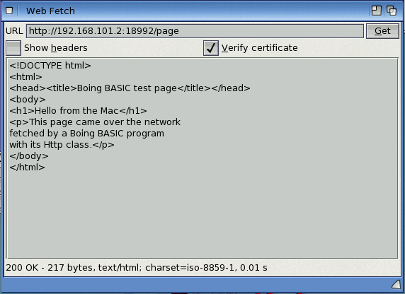
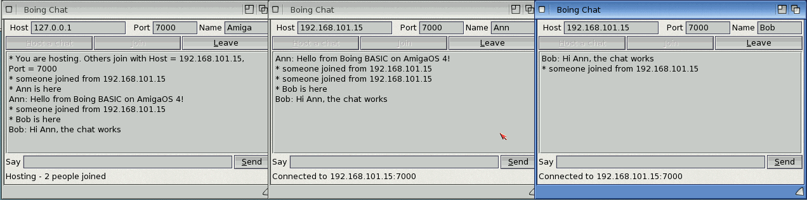

# Networking and modern libraries

This chapter shows how a Boing BASIC program talks to the internet: fetching web pages,
calling web services that answer in JSON, posting data and downloading files, over HTTP and
HTTPS. It also lists the other modern libraries that are on their way.

## The Http object

`Http` is a built-in object for talking to web servers. It speaks HTTP/1.1 and HTTPS
(encrypted, with the server's certificate checked) on AmigaOS 4, and also on macOS and Linux
when you test a program there. Create one with `CreateObject`:

*Listing 19.1* (`examples/book/ch19-networking/listing-19-01.bas`)

```basic
Option Explicit
Dim web As Http, page As String
Set web = CreateObject("Http")
page = web.Get("https://example.com/")
If web.Status = 200 Then
    Print Len(page); " bytes of "; web.ContentType
Else
    Print "The server said "; web.Status; " "; web.StatusText
End If
```

Declaring the variable `As Http` lets the compiler check the names you use (`web.Gte` is an
error when you compile, not when the program runs), and lets AmiForge complete them.

A program or module may be called `http.bas`: after `As` and `New`, `Http` still means the
class. A clearer name such as `webfetch.bas` avoids confusing a reader, though.

### What AmigaOS needs

`Http` uses the computer's TCP/IP stack (Roadshow, `bsdsocket.library`) and, for `https://`
addresses, AmiSSL. Both come with AmigaOS 4.1 Final Edition. They are opened when the program
makes its first request, so a program that only uses `Http` sometimes still starts without a
network. `web.TlsAvailable()` tells you whether HTTPS can be used:

*Listing 19.2* (`examples/book/ch19-networking/listing-19-02.bas`)

```basic
Dim web As Http
Set web = CreateObject("Http")
If web.TlsAvailable() Then
    Print "HTTPS works here"
Else
    Print "No AmiSSL: http:// addresses only"
End If
```

## Making requests

Each request method waits until the whole answer has arrived (or something goes wrong) and
returns the body: the page, the JSON text, the file's bytes. A String can hold any bytes, so
binary data is fine.

| Method | What it does | Returns |
|---|---|---|
| `Get(url)` | fetch a page | the body |
| `Post(url, body [, contentType])` | send `body`; the content type is `application/x-www-form-urlencoded` unless you give one | the body |
| `Put(url, body [, contentType])` | upload `body` | the body |
| `Delete(url)` | delete | the body |
| `Head(url)` | fetch only the headers | `""` |
| `Send(method, url [, body [, contentType]])` | any other method, such as `"PATCH"` | the body |
| `GetToFile(url, path)` | download straight into a file, without keeping it in memory | the number of bytes |

Downloading a file:

*Listing 19.3* (`examples/book/ch19-networking/listing-19-03.bas`)

```basic
Dim web As Http, n As Long
Set web = CreateObject("Http")
n = web.GetToFile("https://example.com/", "RAM:example.html")
Print n; " bytes saved"
```

Posting a form:

*Listing 19.4* (`examples/book/ch19-networking/listing-19-04.bas`)

```basic
Dim web As Http, reply As String
Set web = CreateObject("Http")
reply = web.Post("https://httpbin.org/post", "name=Boing&colour=red")
Print web.Status
```

## Request settings

| Property or method | Default | What it does |
|---|---|---|
| `SetHeader name, value` | | adds a header to every later request; `SetHeader name, ""` removes it |
| `ClearHeaders` | | removes all the headers you set |
| `Timeout` | 30000 | milliseconds to wait for a connection, and for each piece of data |
| `FollowRedirects` | True | follow the server's "moved" answers (301, 302, 303, 307, 308) |
| `MaxRedirects` | 10 | how many to follow before giving up with error 31107 |
| `VerifyCertificate` | True | check that an HTTPS server's certificate is valid and is for that host |
| `CACertFile` | `""` | a file of trusted certificates (PEM) to use instead of the system's |
| `UserAgent` | `BoingBASIC/1.0` | how the program introduces itself to the server |

Keep `VerifyCertificate` on: turned off, a program cannot tell the real server from an
impostor. Turn it off only to talk to a test server of your own, and better still give that
server's certificate with `CACertFile`.

## The answer

| Property or method | What it is |
|---|---|
| `Status` | the server's status code: 200 OK, 404 not found, ... (0 before the first request) |
| `StatusText` | its text: `"OK"`, `"Not Found"`, ... |
| `ResponseText` | the body of the last answer again (also what `Print web` prints) |
| `ResponseHeader(name)` | the value of one header, in any case; `""` if there isn't one |
| `ResponseHeaders` | all the headers, one `Name: value` per line |
| `ContentType` | the `Content-Type` header, e.g. `text/html; charset=utf-8` |
| `Url` | the address the answer came from, after any redirects |
| `Redirects` | how many redirects were followed |
| `BytesReceived` | the length of the body |

An error page (404, 500 ...) is still an answer: check `Status` before using the body.

## Errors

Problems that leave no answer at all raise a run-time error, which a program catches with
`On Error` (see [Errors and error handling](08-errors.md)):

| `Err.Number` | Meaning |
|---|---|
| 31101 | the address is not a valid `http://` or `https://` URL |
| 31102 | the host name can't be found |
| 31103 | can't connect (refused, unreachable, no TCP/IP stack running) |
| 31104 | no answer within `Timeout` |
| 31105 | the encrypted connection could not be set up |
| 31106 | the certificate isn't trusted, or is for another host |
| 31107 | too many redirects |
| 31108 | HTTPS isn't available (AmiSSL isn't installed) |
| 31109 | the connection closed early, or the answer isn't HTTP |
| 31110 | `GetToFile` couldn't write the file |
| 18 | the user pressed Ctrl-C |

`Err.Description` explains what happened, for example
`the certificate of example.com isn't trusted: certificate has expired`.

*Listing 19.5* (`examples/book/ch19-networking/listing-19-05.bas`)

```basic
Option Explicit
Dim web As Http, page As String
Set web = CreateObject("Http")
On Error GoTo Failed
page = web.Get("https://no-such-host.example/")
Print "Fetched "; Len(page); " bytes"
End
Failed:
Print "Can't fetch the page: "; Err.Description
```

## Text and character sets

Most web pages and web services send text in UTF-8, while AmigaOS uses Latin-1. `Http` gives
you the bytes as they came, so an accented letter in UTF-8 text shows as two characters. Plain
English text and numbers are the same in both. (`Utf8Decode` converts it: see [Text encodings](20-libraries.md#text-encodings).)

## Working with JSON

Many web services answer in JSON, a text format of names and values:

```text
{"full_name":"geekychris/amiforge","description":"An IDE for AmigaOS 4.1","stargazers_count":12}
```

The best way to read such answers is `JsonParse`, which turns the text into Dictionaries and
arrays: see [JSON](20-libraries.md#json) in the next chapter. For a quick look at a simple, flat
answer, a small function can also pick out values with the string functions. `JsonText` finds `"key"`, then the string after its colon; `JsonNumber` reads the
number after the colon:

*Listing 19.6* (`examples/book/ch19-networking/listing-19-06.bas`)

<!-- run -->
```basic
Option Explicit

Function JsonText(json As String, key As String) As String
    Dim p As Long, q As Long
    p = InStr(json, """" & key & """")
    If p = 0 Then Exit Function
    p = InStr(p + Len(key) + 2, json, ":")
    p = InStr(p, json, """")
    If p = 0 Then Exit Function
    q = p + 1
    Do While q <= Len(json)
        If Mid(json, q, 1) = "\" Then
            q = q + 2
        ElseIf Mid(json, q, 1) = """" Then
            Exit Do
        Else
            q = q + 1
        End If
    Loop
    JsonText = Replace(Mid(json, p + 1, q - p - 1), "\""", """")
End Function

Function JsonNumber(json As String, key As String) As Double
    Dim p As Long
    p = InStr(json, """" & key & """")
    If p = 0 Then Exit Function
    p = InStr(p + Len(key) + 2, json, ":")
    JsonNumber = Val(LTrim(Mid(json, p + 1, 30)))
End Function

Dim reply As String
reply = "{""full_name"":""geekychris/amiforge"",""description"":""An IDE for AmigaOS 4.1""," & _
        """stargazers_count"":12}"
Print JsonText(reply, "full_name")
Print JsonText(reply, "description")
Print JsonNumber(reply, "stargazers_count"); "stars"
```

```output
geekychris/amiforge
An IDE for AmigaOS 4.1
 12 stars
```

Web services usually want to know what you accept, and many need a key or token. Set those
as headers once, before the requests:

*Listing 19.7* (`examples/book/ch19-networking/listing-19-07.bas`)

```basic
Dim web As Http, reply As String, token As String
Set web = CreateObject("Http")
token = Environ("API_TOKEN")
web.SetHeader "Accept", "application/json"
web.SetHeader "Authorization", "Bearer " & token
reply = web.Post("https://api.example.com/v1/items", "{""name"":""Boing""}", "application/json")
If web.Status <> 201 Then Print "Failed: "; web.Status; " "; reply
```

## A web page in a form

The program below is a small web browser for text: type an address, press **Get**, and the
page (or, with the check box, its headers too) appears in a text editor, with the status,
size and time underneath. Its form has a text field, a button, two check boxes, a text
editor and a label:



```text
window name=webfetch title="Web Fetch" width=560 height=360 resizable=1
vlayout id=root
  hlayout weight=0
    string id=url label="URL" text="https://example.com/" maxchars=1024
    button id=go text="_Get" weight=0
  hlayout weight=0
    checkbox id=headers text="Show _headers"
    checkbox id=verify text="_Verify certificate" checked=1
  texteditor id=page
  label id=status text="Type a URL and press Get"
```

and its code:

*Listing 19.8* (`examples/book/ch19-networking/webfetch/webfetch.bbp`)

<!-- project: examples/book/ch19-networking/webfetch/webfetch.bbp -->
```basic
Private web As Http

Private Sub Form_Load()
    Set web = CreateObject("Http")
    web.Timeout = 15000
    page.Locked = True
    If Not web.TlsAvailable() Then status.Caption = "HTTPS isn't available here (no AmiSSL): http:// only"
    If Command() <> "" Then              ' webfetch URL: fetch it straight away
        url.Text = Command()
        Fetch
    End If
End Sub

Private Sub go_Click()
    Fetch
End Sub

Private Sub url_KeyPress(KeyAscii As Integer)
    If KeyAscii = 13 Then Fetch
End Sub

Private Sub Fetch()
    Dim body As String, t As Single
    status.Caption = "Fetching " & url.Text & " ..."
    Me.Enabled = False
    DoEvents
    web.VerifyCertificate = (verify.Value = vbChecked)
    t = Timer
    On Error GoTo Failed
    body = web.Get(url.Text)
    Me.Enabled = True
    If headers.Value = vbChecked Then
        page.Text = "HTTP " & web.Status & " " & web.StatusText & vbLf & Replace(web.ResponseHeaders, vbCr, "") & vbLf & body
    Else
        page.Text = body
    End If
    status.Caption = web.Status & " " & web.StatusText & " - " & web.BytesReceived & " bytes, " & _
                     web.ContentType & ", " & Format(Timer - t, "0.00") & " s"
    Exit Sub
Failed:
    Me.Enabled = True
    page.Text = ""
    status.Caption = "Error " & Err.Number & ": " & Err.Description
End Sub
```

Points to notice:

- `Me.Enabled = False` and `DoEvents` before the request: the window shows "Fetching..." and
  doesn't take clicks while the program waits for the answer.
- Errors (no network, unknown host, bad certificate) go to `Failed:` and appear in the
  status line instead of stopping the program.
- `Command()` lets you start it with an address: `boing run webfetch.bbp https://example.com/`.

A second example in the same drawer, `repoinfo`, asks GitHub's JSON API about a repository
and shows its name, description, stars and forks with the `JsonText` and `JsonNumber`
functions above:

*Listing 19.9* (`examples/book/ch19-networking/repoinfo/repoinfo.bbp`)

<!-- project: examples/book/ch19-networking/repoinfo/repoinfo.bbp -->
```basic
Private Sub go_Click()
    Dim reply As String
    status.Caption = "Asking GitHub..."
    DoEvents
    On Error GoTo Failed
    reply = web.Get("https://api.github.com/repos/" & repo.Text)
    If web.Status <> 200 Then
        status.Caption = "GitHub says " & web.Status & " " & web.StatusText
        Exit Sub
    End If
    title.Caption = JsonText(reply, "full_name")
    desc.Caption = JsonText(reply, "description")
    stars.Caption = JsonNumber(reply, "stargazers_count") & " stars, " & _
                    JsonNumber(reply, "forks_count") & " forks"
    status.Caption = "Done"
    Exit Sub
Failed:
    status.Caption = "Error " & Err.Number & ": " & Err.Description
End Sub
```

## Cookies and kept connections

An `Http` object behaves like a browser session: it remembers the cookies servers set, sends
them back on later requests to those servers, and keeps its connection open for the next
request to the same server. Both are on unless you switch them off.

| Member | What it does |
|---|---|
| `UseCookies` | store the cookies servers set and send them back (default True) |
| `GetCookie(name [, host])` | a stored cookie's value, or `""` |
| `SetCookie name, value, domain [, path]` | add a cookie, for the domain and its subdomains (the path is `/` unless you give one) |
| `ClearCookies` | forget all the cookies |
| `CookieCount` | how many are stored |
| `Cookies` | all of them as text, one line each in the `cookies.txt` layout browsers and `curl` use (domain, subdomains `TRUE`/`FALSE`, path, secure, expiry as Unix time with 0 for "until the program ends", name and value, separated by tabs); assigning text replaces them |
| `KeepAlive` | keep the connection open after a request (default True) |
| `ConnectionReused` | True if the last request went over a connection kept from an earlier one |

*Listing 19.10* (`examples/book/ch19-networking/listing-19-10.bas`)

<!-- run -->
```basic
Dim web As Http
Set web = New Http
web.SetCookie "theme", "dark", "example.com"
web.SetCookie "lang", "en", "example.com", "/docs"
Print web.CookieCount; "cookies; theme = "; web.GetCookie("theme", "example.com")
Print Replace(web.Cookies, vbTab, " | ");
web.ClearCookies
Print web.CookieCount; "after ClearCookies"
```

```output
 2 cookies; theme = dark
example.com | TRUE | / | FALSE | 0 | theme | dark
example.com | TRUE | /docs | FALSE | 0 | lang | en
 0 after ClearCookies
```

Cookies follow the usual rules of the web: a cookie for another site is refused, longer paths
are sent first, an expiry in the past deletes the cookie, and a `Secure` cookie only travels
over HTTPS. Cookies set by a redirect go with the request to its target, so a login page that
redirects works. A `Cookie` header set with `SetHeader` replaces the stored cookies for that
request.

To stay logged in between runs of the program, save the `Cookies` text in a file and load it
next time:

<!-- fragment -->
```basic
Open App.Path & "/cookies.txt" For Output As #1
Print #1, web.Cookies;
Close #1
' ... and in the next run:
Open App.Path & "/cookies.txt" For Binary As #1
web.Cookies = Input(LOF(1), #1)
Close #1
```

A kept connection saves setting up the connection (and, for HTTPS, the encryption) again,
which is most of the time a small request takes on an emulated or older machine. If the
server has closed it in the meantime, the next request quietly opens a new one. On AmigaOS 4
requests in the background (`GetAsync`) always use a connection of their own.

## Requests that don't block: GetAsync / SendAsync

`Get`, `Post` and the other request methods wait until the whole answer has arrived. In a
console program that is what you want. In a form it isn't: while the program waits, it doesn't
handle events, so the window doesn't redraw, buttons don't react, and a download of a few
megabytes freezes it for as long as it takes.

The asynchronous calls start the request in the background and return at once. Your program
goes on handling events; the `Http` object tells you how far the request has got, and calls a
Sub of yours when it is done.

| Member | Kind | What it does |
|---|---|---|
| `GetAsync url` | method | starts a GET of `url` and returns at once |
| `SendAsync method, url [, body [, contentType]]` | method | starts any request: `"POST"`, `"PUT"`, `"DELETE"`, `"PATCH"`... with an optional body, as `Send` does |
| `Busy` | property | `True` while the request runs |
| `Wait([ms])` | method | waits until the request has ended, handling events meanwhile; with `ms`, for at most that many milliseconds. Returns `True` if it has ended |
| `Cancel` | method | stops the request; it then ends with `ErrorNumber` 18 |
| `OnDone` | property | the name of a Sub without arguments, called once when the request has ended, however it ended (naming a Sub that doesn't exist is error 35 at once) |
| `OnProgress` | property | the name of a `Sub (got As Long, total As Long)`, called as the answer arrives: `got` bytes so far of `total`, or `total` = -1 if the server didn't say how big the answer is |
| `ErrorNumber` | property | how the request ended: 0 if an answer came, otherwise the error number (31101 to 31110, or 18 for cancelled); a waiting request (`Get`...) that fails sets it too |
| `ErrorText` | property | the error message, `""` when there was none; a new request clears it |

When the request has ended, `Status`, `StatusText`, `ResponseText`, `ResponseHeader(name)`,
`ResponseHeaders`, `ContentType`, `Url`, `Redirects` and `BytesReceived` describe the answer, as
after a `Get`. While it runs, they still describe the previous answer.

The request takes the object's settings (`Timeout`, `SetHeader` headers, `UserAgent`,
`CACertFile`, `VerifyCertificate`, `FollowRedirects`, `MaxRedirects`) at the moment it starts:
changing them later affects only the next request.

### Events: Done, Failed and Progress

Instead of naming Subs in `OnDone` and `OnProgress`, declare the variable `WithEvents`: the
`Http` object then raises events, handled by Subs named after the variable and the event, like
a form's controls:

| Event | When |
|---|---|
| `Done()` | the request ended with an answer (any HTTP status: check `Status`) |
| `Failed(number As Long, text As String)` | it ended without an answer: `number` is the `ErrorNumber` (31101 to 31110, or 18 after `Cancel`) |
| `Progress(got As Long, total As Long)` | data arrived (`total` is -1 when the server didn't say how much is coming) |

<!-- fragment -->
```basic
Private WithEvents web As Http

Private Sub fetch_Click()
    Set web = CreateObject("Http")
    web.GetAsync url.Text
    fetch.Enabled = False
End Sub

Private Sub web_Done()
    fetch.Enabled = True
    page.Text = Utf8Decode(web.ResponseText)
End Sub

Private Sub web_Failed(number As Long, text As String)
    fetch.Enabled = True
    MsgBox text, vbExclamation
End Sub

Private Sub web_Progress(got As Long, total As Long)
    If total > 0 Then status.Caption = (got * 100 \ total) & "%"
End Sub
```

Events and `OnDone`/`OnProgress` can be used together; both run on the program's own task, so
they can change the form freely.

### Errors are not raised

A `Get` that can't reach the server raises a run-time error. An asynchronous request has no
statement to raise it in: it was started long ago, and the program is somewhere else now. So
its errors are **not** raised: the request ends, and `ErrorNumber` and `ErrorText` say what went
wrong. Check `ErrorNumber` first, then `Status` (a request that fails halfway can have a
`Status` of 200 and half a body):

*Listing 19.11* (`examples/book/ch19-networking/listing-19-11.bas`)

<!-- run -->
```basic
Option Explicit
Dim web As Http, ended As Boolean
Set web = CreateObject("Http")
web.OnDone = "Finished"

web.GetAsync "ftp://example.com/readme.txt"       ' Http speaks http:// and https:// only
ended = web.Wait()
Print "ended: " & ended & ", error " & web.ErrorNumber & ": " & web.ErrorText

web.GetAsync "http://127.0.0.1:1/"                 ' nothing listens on port 1
ended = web.Wait(10000)
Print "error " & web.ErrorNumber & ": " & web.ErrorText

Sub Finished()
    Print "Finished: Busy is " & web.Busy & ", Status " & web.Status
End Sub
```

```output
Finished: Busy is False, Status 0
ended: True, error 31101: bad URL: ftp://example.com/readme.txt
Finished: Busy is False, Status 0
error 31103: can't connect to 127.0.0.1:1
```

The error numbers are the ones `Get` raises (see "Errors" earlier in this chapter): 31101 a bad
URL, 31102 an unknown host, 31103 no connection, 31104 no answer within `Timeout`, 31105 and
31106 TLS and certificate problems, 31107 too many redirects, 31108 no HTTPS, 31109 a broken
answer; and 18 for a request you cancelled. An answer with an error status such as 404 is still
an answer: `ErrorNumber` is 0 and `Status` is 404.

Some mistakes are still raised at once, in the statement that makes them:

| Error | When |
|---|---|
| 5 | `GetAsync`, `SendAsync`, `Get`, `Post` or another request on an object whose request is still running. One `Http` object runs one request at a time; use another object for a second one |
| 35 | `OnDone` or `OnProgress` names a Sub that doesn't exist (raised when the Sub is to be called: in `DoEvents`, `Wait`, `Busy` or the form's event loop) |
| 7 | the background task for the request can't be started (out of memory) |

### Where OnDone and OnProgress run

The request runs in the background, but your Subs never do. `OnDone` and `OnProgress` are called
on your program's own task, at the moments when it handles events anyway:

- in a form program, from the event loop, between your event Subs, just like a button's `Click`;
- in `DoEvents`;
- in `Wait`, while it waits;
- when you read `Busy`.

So the Subs can do anything an event Sub can: change controls, set variables, start the next
request, show a `MsgBox`. Nothing runs at the same time as your code, and you need no locks.
The other side of this is that a program that doesn't handle events (a long calculation
without `DoEvents`) gets no `OnProgress` calls until it does, even though the download goes on
in the background.

The names are looked up when the Sub is called, among the Subs of all the modules and forms
of the program, without regard to case. Use a Sub of a module or of a form, not a method of a
class module (those can't be found by name), and give each Sub a name no other module uses.
Set the property to `""` to stop the calls.

`OnDone` is called once per request, after `Busy` has become `False`, so inside it the answer is
complete and the object is ready for the next request.

### Polling from a console program

A program without forms can start a request, do other work, and look at `Busy` now and then.
`Busy` handles the events (and calls `OnProgress` and `OnDone`) each time you read it:

*Listing 19.12* (`examples/book/ch19-networking/listing-19-12.bas`)

```basic
Option Explicit
Dim web As Http, ticks As Long
Set web = CreateObject("Http")
web.OnProgress = "Progress"
web.GetAsync "https://example.com/files/game.lha"
Do While web.Busy
    ticks = ticks + 1          ' here the program could do something useful
    DoEvents
Loop
If web.ErrorNumber <> 0 Then
    Print "Failed: "; web.ErrorText
ElseIf web.Status = 200 Then
    Print web.BytesReceived; " bytes"
Else
    Print "The server said"; web.Status; " "; web.StatusText
End If

Sub Progress(got As Long, total As Long)
    If total > 0 Then Print (got * 100# \ total); "%" Else Print got; " bytes"
End Sub
```

`Wait` does the same loop for you. `web.Wait()` waits as long as it takes; `web.Wait(500)` waits
at most half a second and tells you whether the request ended in that time:

*Listing 19.13* (`examples/book/ch19-networking/listing-19-13.bas`)

```basic
Option Explicit
Dim web As Http
Set web = CreateObject("Http")
web.GetAsync "https://example.com/slow-report"
Do Until web.Wait(1000)
    Print "still waiting ..."
Loop
Print web.Status
```

### Several requests at once

Each `Http` object runs one request at a time, but several objects can run theirs together.
They end in their own order: a quick one started after a slow one ends first.

*Listing 19.14* (`examples/book/ch19-networking/listing-19-14.bas`)

```basic
Option Explicit
Dim news As Http, weather As Http
Set news = CreateObject("Http")
Set weather = CreateObject("Http")
news.OnDone = "NewsDone"
weather.OnDone = "WeatherDone"
news.GetAsync "https://example.com/news.json"
weather.GetAsync "https://example.com/weather.json"
Do While news.Busy Or weather.Busy
    DoEvents
Loop

Sub NewsDone()
    Print "news:"; news.Status; news.BytesReceived
End Sub

Sub WeatherDone()
    Print "weather:"; weather.Status; weather.BytesReceived
End Sub
```

### Cancelling

`Cancel` stops the request at once, whatever it is doing: looking up the host name,
connecting, waiting for the server's first reply or receiving the answer. The request then ends
with `ErrorNumber` 18 (and `OnDone` is called as for any other end). After a cancelled or failed
request `Status` is 0 and `ResponseText` is `""`, so nothing half-arrived is mistaken for an
answer. Calling `Cancel` when no request runs does nothing.

When a program ends, requests that are still running are cancelled for you. In a form it is
still tidier to cancel a running request in `Form_Unload`, and clear `OnDone` first so that it isn't called while the window
goes away:

*Listing 19.15* (`examples/book/ch19-networking/asyncfetch/asyncfetch.bbp`)

<!-- project: examples/book/ch19-networking/asyncfetch/asyncfetch.bbp -->
```basic
Private Sub Form_Unload(Cancel As Integer)
    web.OnDone = ""
    web.OnProgress = ""
    If web.Busy Then
        web.Cancel
        web.Wait 5000
    End If
End Sub
```

### A downloader with a progress bar

The book example `asyncfetch` downloads a file in the background. While it runs, a progress
bar fills up, the status line counts the kilobytes, the window can be moved and resized, and a
**Cancel** button stops the download. When it is done, the file is saved. The form:

```text
window name=asyncfetch title="Download" width=480 height=0
vlayout id=root
  string id=url label="URL" text="https://example.com/" maxchars=1024
  string id=target label="Save as" text="RAM:download" maxchars=256
  fuelgauge id=meter min=0 max=100 level=0
  label id=status text="Type a URL and press Download"
  hlayout even=1
    button id=download text="_Download"
    button id=abort text="_Cancel" disabled=1
```

(The Cancel button is called `abort`, since `Stop` is a statement of the language and can't
name a control.)

`Form_Load` creates the `Http` object once and names the two Subs. **Download** starts the
request and returns at once; **Cancel** asks it to stop:

*Listing 19.16* (`examples/book/ch19-networking/asyncfetch/asyncfetch.bbp`)

<!-- project: examples/book/ch19-networking/asyncfetch/asyncfetch.bbp -->
```basic
Private web As Http
Private started As Single

Private Sub Form_Load()
    Set web = CreateObject("Http")
    web.Timeout = 20000
    web.OnProgress = "Fetching"           ' Sub Fetching(got As Long, total As Long)
    web.OnDone = "Fetched"                ' Sub Fetched()
End Sub

Private Sub download_Click()
    meter.Value = 0
    meter.Text = ""
    status.Caption = "Connecting to " & url.Text & " ..."
    started = Timer
    web.GetAsync url.Text                 ' returns at once
    download.Enabled = False
    abort.Enabled = True
End Sub

Private Sub abort_Click()
    web.Cancel                            ' Fetched is called soon, with ErrorNumber 18
    status.Caption = "Cancelling ..."
End Sub
```

`Fetching` moves the progress bar. When the server didn't send the size (`total` is -1), it
can't show a percentage, so it shows the kilobytes in the bar instead:

*Listing 19.17* (`examples/book/ch19-networking/asyncfetch/asyncfetch.bbp`)

<!-- project: examples/book/ch19-networking/asyncfetch/asyncfetch.bbp -->
```basic
' called (on the program's own task) each time more of the answer has arrived
Sub Fetching(got As Long, total As Long)
    If total > 0 Then
        meter.Max = 100
        meter.Value = got * 100# / total
        meter.Text = ""
        status.Caption = Format(got / 1024, "0") & " of " & Format(total / 1024, "0") & " KB"
    Else                                  ' the server didn't say how big it is
        meter.Text = Format(got / 1024, "0") & " KB"
        status.Caption = Format(got / 1024, "0") & " KB so far"
    End If
End Sub
```

`Fetched` runs once at the end. It puts the buttons back, then looks at how the request ended:
cancelled, failed, an error status from the server, or a whole answer to save:

*Listing 19.18* (`examples/book/ch19-networking/asyncfetch/asyncfetch.bbp`)

<!-- project: examples/book/ch19-networking/asyncfetch/asyncfetch.bbp -->
```basic
' called once when the request has ended, however it ended
Sub Fetched()
    Dim f As Integer, data As String
    download.Enabled = True
    abort.Enabled = False
    If web.ErrorNumber = 18 Then
        status.Caption = "Cancelled"
        meter.Value = 0
        Exit Sub
    ElseIf web.ErrorNumber <> 0 Then
        status.Caption = "Error " & web.ErrorNumber & ": " & web.ErrorText
        meter.Value = 0
        Exit Sub
    ElseIf web.Status <> 200 Then
        status.Caption = "The server said " & web.Status & " " & web.StatusText
        Exit Sub
    End If
    data = web.ResponseText
    On Error GoTo CantSave
    f = FreeFile
    Open target.Text For Binary Access Write As #f
    Put #f, , data
    Close #f
    meter.Value = meter.Max
    meter.Text = ""
    status.Caption = "Saved " & Len(data) & " bytes in " & target.Text & " (" & _
                     Format(Timer - started, "0.0") & " s)"
    Exit Sub
CantSave:
    status.Caption = "Can't save " & target.Text & ": " & Err.Description
End Sub
```

Points to notice:

- No `DoEvents` anywhere: the form's own event loop calls `Fetching` and `Fetched`.
- The buttons are the only state: **Download** is disabled while a request runs, so the
  program never starts a second request on the same object (which would be error 5).
- The answer is kept in memory until it is complete, then written in one go. For files larger
  than the free memory, use the blocking `GetToFile`, which writes as it receives.

### How it works

On AmigaOS 4 each request runs in a child process of its own, called "Boing BASIC worker", with
its own `bsdsocket.library` and AmiSSL bases (both libraries require one per process). The
worker signals your program's task as data arrives, and the event loop, `DoEvents`, `Wait` and
`Busy` pick up the news. On macOS and Linux the request runs in a thread.

### Summary

- `web.GetAsync url` or `web.SendAsync method, url, body, type` start a request and return at
  once; one request per object at a time.
- `web.OnDone = "SubName"` and `web.OnProgress = "SubName"` name Subs that run on your own
  task, from the event loop, `DoEvents`, `Wait` and `Busy`: they can update the form.
- `Busy`, `Wait([ms])` and `Cancel` follow and control the request.
- Errors are not raised: check `ErrorNumber` (0, 31101 to 31110, or 18) and `ErrorText`, then
  `Status`.

## Sockets: TCP and UDP

`Http` covers web servers. For everything else on the network there is `Socket`: a client for
a line-based protocol (mail, a game server, a telnet-style service), a small server of your
own, a chat between two Amigas, game positions sent many times a second over UDP. It works on
AmigaOS 4 (through `bsdsocket.library`, the Roadshow TCP/IP stack) and on macOS and Linux, with
the same behaviour.

You can use a socket in two ways, and mix them in one program:

- **Waiting calls.** `Connect`, `Send`, `Read`, `ReceiveLine` and `Accept` wait until they are
  done, but at most `Timeout` milliseconds. This is the easy way for console programs and
  simple clients.
- **Events.** Declare the variable `WithEvents` and write handlers such as `link_Connect`,
  `link_DataArrival` and `link_Close`. In a form program they arrive through the window's
  event loop, like a button's `Click`, so the window stays responsive while the network works.

A first client, asking a web server for the headers of its home page by hand:

*Listing 19.19* (`examples/book/ch19-networking/listing-19-19.bas`)

```basic
Option Explicit
Dim web As Socket
Set web = CreateObject("Socket")
web.Connect "example.com", 80
web.Send "HEAD / HTTP/1.0" & vbCrLf & "Host: example.com" & vbCrLf & vbCrLf
Print web.ReceiveLine()            ' HTTP/1.0 200 OK
web.Close
```

### Making a socket

`Set s = CreateObject("Socket")` (or `CreateObject("Boing.Socket")`) makes a new socket. It
starts closed. `Connect` opens it as a TCP client, `Listen` as a TCP server and `Bind` as a UDP
socket. `Close` closes it; it can then be opened again, in any of the three ways. A socket is also
closed when the last reference to it goes away (the last variable that holds it is set to
`Nothing` or goes out of scope).

Declare the variable `As Socket`: then the compiler checks the member names you use, and
AmiForge can complete them.

A module named `socket.bas` doesn't get in the way of the class: after `As` and `New`, `Socket`
means the class.

### A server and a client with waiting calls

A TCP connection has two ends. The server `Listen`s on a port; a client `Connect`s to the
server's address and that port; the server's `Accept` then returns a new socket for its end of
that connection. Both ends `Send` and receive bytes; each `Close`s its end when done.

This program is a tiny echo server and its client at once. The server answers every line in
capitals. Port 0 asks for any free port, which `LocalPort` then tells you:

*Listing 19.20* (`examples/book/ch19-networking/listing-19-20.bas`)

<!-- run -->
```basic
' an echo server and its client in one program, with waiting calls
Option Explicit
Dim server As Socket, client As Socket, conn As Socket, addr As String, word As Variant

Set server = CreateObject("Socket")
addr = "127.0.0.1"
On Error Resume Next
server.Listen 0, addr                  ' 0: any free port
If Err.Number <> 0 Then                ' no loopback interface (some Roadshow setups)
    addr = server.MachineAddress
    Err.Clear
    server.Listen 0, addr
End If
On Error GoTo 0

Set client = CreateObject("Socket")
client.Timeout = 5000
client.Connect addr, server.LocalPort
Set conn = server.Accept(2000)         ' the server's end of the connection
conn.Timeout = 5000

For Each word In Array("hello", "Amiga", "bye")
    client.SendLine word               ' the client sends a line
    conn.SendLine UCase(conn.ReceiveLine())     ' the server echoes it in capitals
    Print "client got: "; client.ReceiveLine()
Next

client.Close
Print "server sees the end:"; conn.ReceiveLine() = ""; conn.AtEnd
conn.Close
server.Close
```

```output
client got: HELLO
client got: AMIGA
client got: BYE
server sees the end:TrueTrue
```

`127.0.0.1` is the *loopback* address: this machine, talking to itself. Some Roadshow setups on
AmigaOS have no loopback interface, so listening on `127.0.0.1` fails there; the program then
uses `MachineAddress`, the machine's own address on the network, instead.

A real server waits for clients in a loop and serves them one after the other:

*Listing 19.21* (`examples/book/ch19-networking/listing-19-21.bas`)

```basic
Option Explicit
Dim server As Socket, client As Socket
Set server = CreateObject("Socket")
server.Listen 7000
Do
    Set client = server.Accept(60000)        ' Nothing when nobody came within a minute
    If Not client Is Nothing Then
        client.SendLine "Hello from the Amiga, " & client.RemoteHost
        client.Close
    End If
Loop
```

Try it with `telnet` or `nc` from another computer: `nc amiga.local 7000`. Stop it with Ctrl-C.

### TCP client members

| Member | What it does |
|---|---|
| `Connect host, port` | connects to a host name or address. Without events it waits until it is connected (at most `Timeout`). With events it returns at once, and `Connect` (or `Error`) fires later. |
| `Send data` | sends all the bytes of a String (binary data is fine), waiting while the network is busy (at most `Timeout`). If the socket is still connecting, it waits for the connection first. |
| `SendLine text` | the same as `Send text & vbCrLf` |
| `Receive([maxBytes])` | what has arrived so far (at most maxBytes), without waiting; `""` when nothing is there |
| `Peek([maxBytes])` | like `Receive`, but the data stays there to be read again |
| `Read(count)` | waits until count bytes have arrived and returns them; fewer only when the other side has closed. Error 31104 after `Timeout`. |
| `ReceiveLine()` | waits for a line ending in LF and returns it without the line end (a CR before the LF is dropped too). When the other side has closed, it returns what is left, and then `""`. Error 31104 after `Timeout`. |
| `BytesAvailable` | how many bytes can be read now |
| `AtEnd` | True when the other side has closed and everything has been read |
| `Close` | closes the connection |

Reading everything until the other side closes:

<!-- fragment -->
```basic
Do Until s.AtEnd
    Print s.ReceiveLine()
Loop
```

### TCP server members

| Member | What it does |
|---|---|
| `Listen port [, address]` | waits for connections on port (0: any free port; read it back from `LocalPort`). address limits it to one network interface, for example `"127.0.0.1"` for this machine only; the default is all of them. |
| `Accept([waitMs])` | takes a waiting connection and returns it as a new, connected Socket, or `Nothing` when none came within waitMs milliseconds (default: `Timeout`; 0: don't wait) |

### UDP

UDP sends single messages, *datagrams*, without a connection. It is quick and simple, which
suits games that send their state many times a second, but a datagram can be lost or arrive out
of order, and nobody tells you. Each `SendTo` is one datagram; keep them under about 1400 bytes
so that each fits in one network packet.

| Member | What it does |
|---|---|
| `Bind port [, address]` | opens a UDP socket on port (0: any free port) |
| `SendTo host, port, data` | sends one datagram. On a socket that isn't open yet, it first opens a UDP socket on any free port. |
| `ReceiveFrom([waitMs])` | the next datagram, or `""` if none came within waitMs milliseconds (default 0: don't wait). `RemoteHost` and `RemotePort` then tell you who sent it. |
| `BytesAvailable` | the size of the next datagram |

*Listing 19.22* (`examples/book/ch19-networking/listing-19-22.bas`)

<!-- run -->
```basic
' UDP: two sockets on this machine send each other datagrams
Option Explicit
Dim a As Socket, b As Socket, addr As String, msg As String

Set b = CreateObject("Socket")
addr = "127.0.0.1"
On Error Resume Next
b.Bind 0, addr                        ' 0: any free port
If Err.Number <> 0 Then addr = b.MachineAddress: Err.Clear: b.Bind 0, addr
On Error GoTo 0
Print "b:"; b.Protocol; " "; b.State = sockOpen

Set a = CreateObject("Socket")
a.SendTo addr, b.LocalPort, "ping"    ' a opens itself on any free port
msg = b.ReceiveFrom(2000)             ' wait up to 2 seconds
Print "b got "; msg; ", from a:"; b.RemotePort = a.LocalPort
b.SendTo b.RemoteHost, b.RemotePort, "pong"
Print "a got "; a.ReceiveFrom(2000)
Print "nothing more: ["; a.ReceiveFrom(); "]"
```

```output
b:UDP True
b got ping, from a:True
a got pong
nothing more: []
```

### Properties

| Property | What it holds |
|---|---|
| `State` | what the socket is doing: one of the constants below |
| `Connected` | True while a TCP connection is open |
| `RemoteHost`, `RemotePort` | the other side's address and port (for UDP: the sender of the last datagram read) |
| `LocalHost`, `LocalPort` | this side's address and port |
| `MachineAddress` | this machine's IPv4 address on the network, the one other machines use to reach it (`"127.0.0.1"` without a network) |
| `Timeout` | how many milliseconds the waiting calls wait; 30000 at first |
| `Protocol` | `"TCP"` or `"UDP"` |
| `Tag` | any value your program wants to keep with the socket, a user name for example |

| `State` constant | Value | Meaning |
|---|---|---|
| `sockClosed` | 0 | not open |
| `sockOpen` | 1 | a UDP socket, open |
| `sockListening` | 2 | a TCP server waiting for connections |
| `sockConnecting` | 6 | a `Connect` with events is under way |
| `sockConnected` | 7 | connected |
| `sockClosing` | 8 | the other side has closed; data may still be waiting to be read |
| `sockError` | 9 | the connection failed |

### Events

Declare the socket `WithEvents` at module level (or in a class) and write subs named
`<variable>_<event>`, as for a control:

| Event | When it fires |
|---|---|
| `Connect()` | a `Connect` with events has succeeded |
| `Error(ByVal Number As Long, ByVal Description As String)` | a `Connect` with events has failed (refused, unreachable) |
| `DataArrival(ByVal Bytes As Long)` | data has arrived; Bytes is how much is waiting now. Read it with `Receive`, with `ReceiveLine` (once `Peek` shows a whole line) or, for UDP, with `ReceiveFrom`. It fires once per arrival: data you leave unread doesn't fire it again, but more data does. |
| `Close()` | the other side has closed the connection (data may still be waiting: read it) |
| `ConnectionRequest()` | a client is connecting to a listening socket: call `Accept` here. A request you don't accept is refused. |
| `ClientDataArrival(ByVal Client As Socket, ByVal Bytes As Long)` | on a listening socket: data has arrived on one of the connections it accepted |
| `ClientClose(ByVal Client As Socket)` | on a listening socket: the other side has closed one of its connections |

The two `Client...` events let one handler serve every connection of a server. A socket
returned by `Accept` that has no event handlers of its own reports its events to the listening
socket, with itself as `Client`.

**Where events fire.** Events never interrupt code that is running: they wait until your
program is ready for them.

- In a form program they fire in the event loop, between the other events, with no code
  needed. A form program that only waits for the network uses no CPU time meanwhile.
- In a program without forms they fire in `DoEvents`, and in `s.WaitEvents([ms])`. That waits
  up to ms milliseconds (default: `Timeout`) for events of **any** socket, fires them, and
  returns True if any fired. Use `WaitEvents` in a loop: unlike a `DoEvents` loop it doesn't
  keep the CPU busy.

A run-time error in an event handler ends the program, as in any event handler; use
`On Error` inside the handler where something can go wrong.

Here is the echo server and client again, with events. The server keeps the connections it
accepts in a Collection; the client sends its lines as soon as it is connected and closes the
connection when the answer to "bye" comes back:

*Listing 19.23* (`examples/book/ch19-networking/listing-19-23.bas`)

<!-- run -->
```basic
' the echo server and client again, with events
Option Explicit
Dim WithEvents server As Socket
Dim WithEvents link As Socket
Dim conns As New Collection            ' the accepted connections (keep them!)
Dim done As Boolean

Sub server_ConnectionRequest()
    conns.Add server.Accept()
End Sub

Sub server_ClientDataArrival(ByVal conn As Socket, ByVal Bytes As Long)
    Do While InStr(conn.Peek(), vbLf) > 0
        conn.SendLine UCase(conn.ReceiveLine())
    Loop
End Sub

Sub server_ClientClose(ByVal conn As Socket)
    conn.Close
End Sub

Sub link_Connect()
    Print "connected"
    link.SendLine "hello"
    link.SendLine "bye"
End Sub

Sub link_DataArrival(ByVal Bytes As Long)
    Dim reply As String
    Do While InStr(link.Peek(), vbLf) > 0
        reply = link.ReceiveLine()
        Print "client got: "; reply
        If reply = "BYE" Then link.Close: done = True
    Loop
End Sub

Sub link_Error(ByVal Number As Long, ByVal Description As String)
    Print "can't connect: "; Description
    done = True
End Sub

Sub Main()
    Dim addr As String, t As Double
    Set server = CreateObject("Socket")
    addr = "127.0.0.1"
    On Error Resume Next
    server.Listen 0, addr
    If Err.Number <> 0 Then addr = server.MachineAddress: Err.Clear: server.Listen 0, addr
    On Error GoTo 0
    Set link = CreateObject("Socket")
    link.Connect addr, server.LocalPort        ' returns at once: Connect or Error follows
    t = Timer
    Do Until done Or Timer - t > 10
        server.WaitEvents 100                  ' fires the events of every socket
    Loop
    server.Close
End Sub
```

```output
connected
client got: HELLO
client got: BYE
```

Two things in this program are worth copying every time:

- **Reading lines in a handler.** One `DataArrival` can bring half a line, one line or several.
  `Do While InStr(s.Peek(), vbLf) > 0 ... s.ReceiveLine() ... Loop` takes every whole line
  that is there, and leaves a half line for the next event. Calling `ReceiveLine` without
  checking first would wait (and freeze a form) until the rest of the line comes.
- **Keeping accepted sockets.** A server must keep the sockets `Accept` returns, in a
  Collection or an array. A socket that no variable refers to is closed, so a connection
  accepted into a local variable would end as soon as the handler returns.

You choose the name of the handlers' parameter. Here (and in the chat below) it is `conn`:
names aren't case-sensitive, so a parameter called `Client` would hide a module variable
called `client`.

### A chat room in a form

The book example `examples/book/ch19-networking/chat` is a chat room: one program is both
ends. "Host a chat" listens on a port and relays every line to everyone connected; "Join"
connects to a host. The protocol is plain text lines (`name: text`), so a `telnet` or `nc`
client can join in too. To try it on one machine, start it twice: host in one window and join
`127.0.0.1` (or the address the host shows) in the other.



*Three chat windows on AmigaOS 4: the host (top) with the whole conversation, then Ann and
Bob, who joined it.*

The chat can also be started from the Shell, with what to do on its command line (built with
`boing build`, or with `boing run chat.bbp` and the same arguments):

```sh
chat host 7000                              ; host a chat on port 7000 straight away
chat join self 7000 Ann Hello from Boing!   ; join this machine's chat as Ann and say hello
chat join 192.168.1.20 7000 Bob             ; join another machine's chat as Bob
```

`self` stands for this machine's own address (`MachineAddress`), and the words after the name
are said once the connection is made. The three windows in the picture were started this way.

```text
# chat.afg
window name=chat title="Boing Chat" width=420 height=260 resizable=1
vlayout id=root
  hlayout weight=0
    string id=host label="Host" text="127.0.0.1" maxchars=128
    string id=port label="Port" text="7000" maxchars=5 weight=0
    string id=nick label="Name" text="Amiga" maxchars=32 weight=0
  hlayout weight=0
    button id=hostbtn text="_Host a chat"
    button id=joinbtn text="_Join"
    button id=leavebtn text="_Leave" disabled=1
  texteditor id=log
  hlayout weight=0
    string id=msg label="Say" maxchars=400
    button id=sendbtn text="_Send" weight=0 disabled=1
  label id=status text="Host a chat, or join one at Host:Port" weight=0
```

The hosting half: the listening socket accepts every client into a Collection, and its
`ClientDataArrival` and `ClientClose` events serve all of them with one handler each.
`MachineAddress` tells the user what the others should type into Host:

*Listing 19.24* (`examples/book/ch19-networking/chat/chat.bbp`)

<!-- project: examples/book/ch19-networking/chat/chat.bbp -->
```basic
Private WithEvents server As Socket     ' when hosting: the listening socket
Private WithEvents link As Socket       ' when joined: the connection to the host
Private clients As Collection           ' when hosting: the connected clients

Private Sub hostbtn_Click()
    On Error GoTo Failed
    Set clients = New Collection
    Set server = CreateObject("Socket")
    server.Listen CLng(port.Text)
    SetConnected True, "Hosting on " & server.MachineAddress & ":" & server.LocalPort & " - 0 people joined"
    Show "* You are hosting. Others join with Host = " & server.MachineAddress & ", Port = " & server.LocalPort
    Exit Sub
Failed:
    status.Caption = "Can't host: " & Err.Description
    Set server = Nothing
End Sub

Private Sub server_ConnectionRequest()
    Dim c As Socket
    Set c = server.Accept()
    If c Is Nothing Then Exit Sub
    clients.Add c
    Relay Nothing, "* someone joined from " & c.RemoteHost
    status.Caption = "Hosting - " & clients.Count & " people joined"
End Sub

Private Sub server_ClientDataArrival(ByVal conn As Socket, ByVal Bytes As Long)
    Do While InStr(conn.Peek(), vbLf) > 0
        Relay conn, conn.ReceiveLine()
    Loop
End Sub

Private Sub server_ClientClose(ByVal conn As Socket)
    Dim i As Long
    For i = clients.Count To 1 Step -1
        If clients(i) Is conn Then clients.Remove i
    Next
    conn.Close
    Relay Nothing, "* someone left"
    status.Caption = "Hosting - " & clients.Count & " people joined"
End Sub

' a line to everyone but its sender, and to our own window
Private Sub Relay(ByVal from As Socket, ByVal text As String)
    Dim c As Variant
    Show text
    On Error Resume Next            ' a client that just went away
    For Each c In clients
        If Not c Is from Then c.SendLine text
    Next
End Sub
```

The joining half connects with events, so the window doesn't freeze while it connects, and
shows each line as it arrives:

*Listing 19.25* (`examples/book/ch19-networking/chat/chat.bbp`)

<!-- project: examples/book/ch19-networking/chat/chat.bbp -->
```basic
Private Sub joinbtn_Click()
    On Error GoTo Failed
    Set link = CreateObject("Socket")
    link.Timeout = 10000
    status.Caption = "Connecting to " & host.Text & ":" & port.Text & " ..."
    link.Connect host.Text, CLng(port.Text)        ' with events: Connect or Error follows
    hostbtn.Enabled = False
    joinbtn.Enabled = False
    Exit Sub
Failed:
    status.Caption = "Can't connect: " & Err.Description
End Sub

Private Sub link_Connect()
    SetConnected True, "Connected to " & link.RemoteHost & ":" & link.RemotePort
    link.SendLine "* " & nick.Text & " is here"
End Sub

Private Sub link_Error(ByVal Number As Long, ByVal Description As String)
    SetConnected False, "Can't connect: " & Description
End Sub

Private Sub link_DataArrival(ByVal Bytes As Long)
    Do While InStr(link.Peek(), vbLf) > 0
        Show link.ReceiveLine()
    Loop
End Sub

Private Sub link_Close()
    Show "* the host closed the chat"
    SetConnected False, "Disconnected"
End Sub
```

The rest of `chat.bas` (sending what the user typed, Leave, `Show` and `SetConnected`) is
ordinary form code; the whole program is in the example's drawer.

### Errors

The waiting calls raise run-time errors that you can catch with `On Error`. The network
numbers are the same as for `Http`:

| `Err.Number` | Meaning |
|---|---|
| 31102 | the host name can't be resolved |
| 31103 | can't connect (refused, unreachable, no TCP/IP stack running), or can't listen or bind (the port is in use) |
| 31104 | nothing came within `Timeout` (`Connect`, `Send`, `Read`, `ReceiveLine`) |
| 31109 | the socket isn't open, or the connection broke while sending |
| 380 | a port outside 0 to 65535, or a negative `Timeout` |
| 5 | a call that doesn't fit the socket: `Send` on a UDP socket, `Accept` on one that isn't listening, `ReceiveFrom` on a TCP socket |
| 18 | the user pressed Ctrl-C while a call was waiting |

*Listing 19.26* (`examples/book/ch19-networking/listing-19-26.bas`)

<!-- run -->
```basic
' what goes wrong, as run-time errors
Option Explicit
Dim s As Socket, l As Socket, addr As String, port As Long, text As String

Set l = CreateObject("Socket")
addr = "127.0.0.1"
On Error Resume Next
l.Listen 0, addr
If Err.Number <> 0 Then addr = l.MachineAddress: Err.Clear: l.Listen 0, addr
port = l.LocalPort
l.Close                               ' nobody listens on port now

Set s = CreateObject("Socket")
s.Timeout = 3000
s.Connect addr, port
Print "connect:"; Err.Number
Err.Clear
s.Send "x"
Print "send:"; Err.Number; " "; Err.Description
Err.Clear
s.Listen 70000
Print "listen:"; Err.Number; " "; Err.Description
Err.Clear
l.Listen 0, addr
Set s = CreateObject("Socket")
s.Connect addr, l.LocalPort
s.Timeout = 300
text = s.ReceiveLine()               ' the server never sends anything
Print "line:"; Err.Number; " "; Err.Description
```

```output
connect: 31103 
send: 31109  the socket isn't open
listen: 380  a port is 0 to 65535
line: 31104  no line within 300 ms
```

A `Connect` with events reports a failure through the `Error` event instead, and `State`
becomes `sockError`.

### On AmigaOS

- `bsdsocket.library` is opened when the program makes its first socket, so a program that
  never makes one doesn't need a running TCP/IP stack.
- The waiting calls can be interrupted with Ctrl-C (error 18). A form program with sockets
  waits for the network and the window together, and uses no CPU time while nothing happens.
- Some Roadshow setups have no loopback interface, so `127.0.0.1` doesn't work there. To talk
  to a server on the same Amiga, use `MachineAddress`, as the examples above do.
- Host names are looked up with the system's `gethostbyname`, which has no time limit: with no
  DNS server reachable, an unknown name can take minutes, and `Timeout` doesn't help. On such
  setups use numeric addresses (`"192.168.1.20"`).
- Only IPv4 is supported.

### Limits

- No encrypted (TLS) sockets: use `Http` for HTTPS.
- No IPv6.
- `Send` always waits until the data is out; a very large send from a form program holds the
  window until then. Send big data in pieces from a Timer (see the next section).
- Looking up a host name always waits.

## Long jobs without freezing the window: Timer slices

A form program does one thing at a time. While an event sub runs, the window can't be moved,
redrawn or clicked: the next event waits until the sub returns. That is fine for a sub that
takes a fraction of a second. A job that takes longer (reading a big file, importing thousands
of records, working through every picture in a drawer) would freeze the window, and the user
couldn't even press a Cancel button.

Boing BASIC programs run as one AmigaOS task, and there are no background threads. Network
waits don't need any: `Socket` events and asynchronous `Http` requests arrive through the event
loop on their own. For work that keeps the processor busy, the way to stay responsive is to cut
the job into small pieces, *slices*, and do one slice per `Timer` event:

1. A Start button prepares the job (opens the file, resets the counters), clears a `cancelled`
   flag and enables a Timer with a short `Interval` (10 ms, say).
2. Each `Timer` event does a fixed amount of work (200 lines, 200 records), updates a progress
   bar and returns. Between two ticks the event loop handles everything else: redrawing,
   moving the window, the Cancel button.
3. The Cancel button only sets `cancelled = True`. The next tick sees it and stops.
4. When the work is done (or cancelled) the tick disables the Timer and cleans up.

Choose the slice so that one tick takes about a twentieth of a second or less: the window then
feels as quick as usual, and the job loses little time to the gaps between ticks. Timer events
never overlap: if a tick is still running when the next is due, that one is skipped, so a slice
that is too big makes the job slower, never wrong.

### Example: statistics of a big text file

The book example `examples/book/ch19-networking/slices` counts the lines and words of a text
file and finds its longest line, 200 lines per tick, with a progress bar and a Cancel button:

```text
# scan.afg
window name=scan title="Text statistics" width=420 height=0
vlayout id=root
  getfile id=src label="File" title="Choose a text file"
  hlayout weight=0
    button id=startbtn text="_Start"
    button id=cancelbtn text="_Cancel" disabled=1
  fuelgauge id=progress min=0 max=100 level=0
  label id=status text="Choose a file and press Start"
  timer id=tick interval=10 enabled=0
```

The progress is how far into the file the job has read: `Seek(f)` is the position of the next
byte to read (from 1) and `LOF(f)` the file's length.

*Listing 19.27* (`examples/book/ch19-networking/slices/slices.bbp`)

<!-- project: examples/book/ch19-networking/slices/slices.bbp -->
```basic
' scan.bas - the code-behind of scan.afg: a long job in Timer slices.
' Each tick reads at most SLICE lines, updates the progress bar and checks the Cancel flag,
' then returns to the event loop, so the window can be moved, resized and clicked meanwhile.
Option Explicit

Private Const SLICE = 200            ' lines per tick

Private f As Integer                 ' the open file, 0 while no job runs
Private lines As Long, words As Long, longest As Long
Private cancelled As Boolean
Private started As Double

Private Sub startbtn_Click()
    If src.FileName = "" Then status.Caption = "Choose a file first": Exit Sub
    On Error GoTo Failed
    f = FreeFile
    Open src.FileName For Input As #f
    lines = 0: words = 0: longest = 0
    cancelled = False
    started = Timer
    progress.Value = 0
    startbtn.Enabled = False
    cancelbtn.Enabled = True
    tick.Enabled = True              ' the work starts at the next tick
    Exit Sub
Failed:
    status.Caption = "Can't open it: " & Err.Description
    f = 0
End Sub

Private Sub tick_Timer()
    Dim i As Long, text As String
    For i = 1 To SLICE
        If cancelled Or EOF(f) Then
            Finish
            Exit Sub
        End If
        Line Input #f, text
        lines = lines + 1
        words = words + CountWords(text)
        If Len(text) > longest Then longest = Len(text)
    Next
    If LOF(f) > 0 Then progress.Value = CLng(100 * (Seek(f) - 1) / LOF(f))
    status.Caption = lines & " lines so far ..."
End Sub

Private Sub cancelbtn_Click()
    cancelled = True                 ' the next tick stops (events never interrupt a tick)
End Sub

Private Sub Finish()
    tick.Enabled = False
    Close #f
    f = 0
    startbtn.Enabled = True
    cancelbtn.Enabled = False
    If cancelled Then
        status.Caption = "Cancelled after " & lines & " lines"
    Else
        progress.Value = 100
        status.Caption = lines & " lines, " & words & " words, longest line " & longest & _
                         " characters (" & Format(Timer - started, "0.0") & " s)"
    End If
End Sub
```

The rest of `scan.bas` is the `CountWords` function and a `Form_Unload` that closes the file if
the window is closed in the middle of a job.

All the job's state lives in module variables (`f`, `lines`, `words`...), not in local
variables: a tick returns after each slice, and its locals are gone. Disable the Start button
while the job runs, so that a second click can't start a second job on top of the first.

### The same pattern for other jobs

Any job that can be done a piece at a time fits this shape. The book example
`examples/book/ch20-libraries/csvimport` imports a CSV file into an SQLite database with a fuel
gauge and a Cancel button. Its Import button opens the `Csv` reader and the database, prepares
an `INSERT` and starts a transaction; then each tick reads and inserts at most 200 records and
moves the gauge. At the end the tick commits the transaction, and after a Cancel or an error it
rolls the transaction back, so the database is left as it was:

*Listing 19.28* (`examples/book/ch20-libraries/csvimport/csvimport.bbp`)

<!-- project: examples/book/ch20-libraries/csvimport/csvimport.bbp -->
```basic
Private Sub tick_Timer()
    Dim i As Long, f, n As Long, k As Long
    On Error GoTo Failed
    For i = 1 To SLICE
        If cancelled Then
            db.Rollback
            Finish "Cancelled: nothing was imported"
            Exit Sub
        End If
        If Not table.ReadRecord() Then
            db.Commit
            Finish "Imported " & table.RecordNumber & " records into " & Ident(tbl.Text), _
                   " in " & Format(Timer - t0, "0.0") & " s"
            Exit Sub
        End If
        f = table.Fields
        n = ins.ParameterCount
        If UBound(f) + 1 <> n Then ReDim Preserve f(n - 1)      ' short or long records fit the table
        ins.Execute f
    Next
    progress.Value = IIf(table.RecordNumber > progress.Max, progress.Max, table.RecordNumber)
    status.Caption = "Importing ... " & table.RecordNumber & " of " & total
    Exit Sub
Failed:
    If db.InTransaction Then db.Rollback
    Finish "Error at record " & table.RecordNumber & ": " & Err.Description
End Sub
```

`Finish` stops the timer, enables the buttons again and closes the file and the database. The
`Csv` reader and `SQLite` are described in [Modern libraries](20-libraries.md); the rest of the
importer is in [Example: importing a CSV file](20-libraries.md#example-importing-a-csv-file)
there.

### Slices or DoEvents?

A long loop that calls `DoEvents` now and then also lets events in, and is shorter to write.
But the events then run *inside* your loop: a click on Start can start the job a second time
while the first is still running, and closing the window leaves the loop running on a form that
has gone. With Timer slices, your code is never in the middle of the job when an event comes,
so these problems can't arise. Use `DoEvents` for a short burst of work with a progress bar;
use Timer slices for anything the user may want to cancel.

## Limits

Not supported yet: compressed (gzip) answers, proxies, and IPv6 on AmigaOS.

## Summary

- `Set web = CreateObject("Http")`, then `web.Get(url)`, `web.Post(url, body)`,
  `web.GetToFile(url, path)` and the others return the answer's body.
- Check `web.Status`; catch errors 31101-31110 with `On Error`.
- Set headers with `SetHeader`; keep certificate checking on.
- Read JSON answers with `JsonParse` ([chapter 20](20-libraries.md#json)).
- `GetAsync` and `SendAsync` fetch in the background, so a window stays responsive.
- `Socket` talks TCP and UDP to any server, with waiting calls or with events.
- Long jobs run in slices on a Timer, so the window keeps working.

See also: [Forms and controls](12-forms.md), [Errors](08-errors.md),
[Built-in functions](09-builtins.md).
