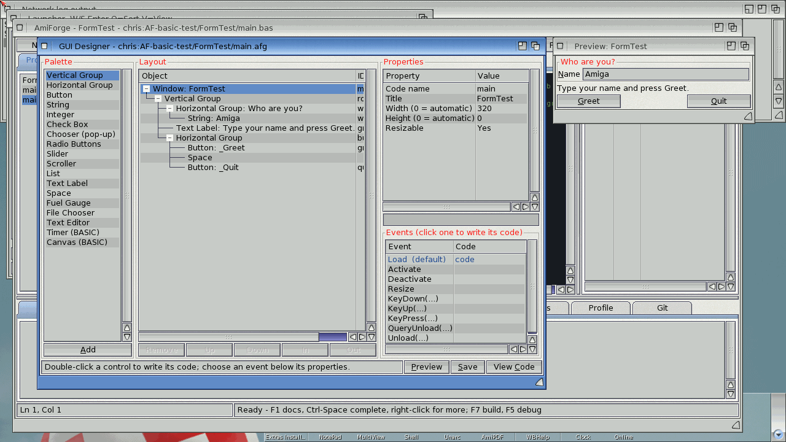
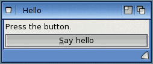
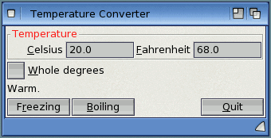

# Exercise 4: Your first form

Until now your programs have run in a Shell window. From here on they open windows of their
own, with buttons, text fields and check boxes. In Boing BASIC such a window is a **form**:
its layout is described in a `.afg` file, and its behaviour is written in a `.bas` file beside
it, the form's **code-behind**, as Subs that run when something happens (an **event**). In
this exercise you make a temperature converter, first in AmiForge's GUI designer, then by
writing the files by hand.

**Goal:** a window with a Celsius and a Fahrenheit field; typing in either one updates the
other, two buttons set freezing and boiling point, and a check box rounds to whole degrees.

**What you will learn:**

- the `.afg` layout: `window`, `vlayout`, `hlayout`, `label`, `string`, `checkbox`, `button`,
  `space`
- control ids, and the form's name in `Startup=Form ...`
- event Subs: `Form_Load`, `<id>_Click`, `<id>_Change`
- reading and setting properties: `Text`, `Caption`, `Value`, `Enabled`
- why setting a text field from code fires its `Change` event, and how to deal with it
- `Unload Me`

The solution is in `examples/book/ex04-first-form/` (`Converter.bbp`, `conv.afg`,
`conv.bas`), and the first step in `examples/book/ex04-first-form/step1/`.

Form programs need AmigaOS 4: on another computer `boing check` checks them, but they cannot
open their windows.

## How a form program is put together

A form program has three files:

| File | What it holds |
|---|---|
| `Hello.bbp` | the project: `Startup=Form main` (the form that opens first, by its file name without `.afg`) and a `Form=main.afg` line for each form |
| `main.afg` | the layout of the window: one object per line, indented to show what is inside what |
| `main.bas` | the code-behind: the form's variables and its event Subs |

The `.afg` and the `.bas` of a form have the same name, and the code-behind is not listed in
the `.bbp`: Boing BASIC finds it beside the `.afg`.

When the program starts, the startup form is loaded: `Form_Load` runs, the window opens, and
then the program waits. Each time you click a button or type in a field, the Sub for that
event runs. The program ends when its last form is unloaded, for example when you click the
window's close gadget.

## Step 1: A window with a label and a button

### In AmiForge

1. Choose **New Project from Template**, pick **Boing BASIC Form App**, and give the project a
   name (`Hello`). AmiForge makes `Hello.bbp`, `main.afg` and `main.bas`, and opens the form
   in the GUI designer. The template window already has a text field, a label and two buttons;
   delete what you don't need, or start again with an empty window.
2. The designer's **palette** lists the controls you can add. Select the window's layout in
   the **Layout** tree, then add a **Label** and a **CommandButton**.
3. Select the label and set its **ID name** to `message` and its text to `Press the button.`
   Select the button and set its **ID name** to `hello` and its text to `_Say hello`. The `_`
   underlines the next letter: Amiga users can press that key instead of clicking.
4. Select the window and set its title to `Hello`. Its **Code name** is the form's name
   (`main` here), the `name=` of the `window` line. `Startup=Form main` in the `.bbp` names the
   startup form by its file, `main.afg`; in the template the two names are the same. They may
   differ, but the window name must not be the name of another module, a class or a Public
   procedure or variable (`boing check` reports that as an error).
5. **Double-click the button** in the Layout tree (or click it twice in the preview). The
   editor opens `main.bas` at a new, empty `Sub hello_Click()`, with the cursor inside it.
   Type the code below.
6. Press **Ctrl-F5** (Run). AmiForge saves the files, checks the program and runs it.



*A Boing BASIC form in AmiForge's designer, with its Events list and the preview*

### By hand

You can write the same files in any text editor. `main.afg`:

```text
# AmiForge GUI (a Boing BASIC form: its code is in main.bas)
window name=main title="Hello" width=240
vlayout id=root
  label id=message text="Press the button."
  button id=hello text="_Say hello"
```

`main.bas`:

<!-- project: examples/book/ex04-first-form/step1/Hello.bbp -->
```basic
' main.bas - the code behind main.afg.
Option Explicit

Private clicks As Long

Private Sub hello_Click()
    clicks = clicks + 1
    message.Caption = "Hello, Amiga! (" & clicks & ")"
End Sub
```

and `Hello.bbp`:

```ini
# Boing BASIC project: the first step of exercise 4, a window with a label and a button.
Name=Hello
Startup=Form main
Form=main.afg
```

Run it from a Shell in that drawer with `boing run Hello.bbp`.



*The Hello window when it opens*

### What the .afg lines mean

- Each line is one object: its **kind** (`window`, `label`, `button` ...) and then
  `key=value` settings. Values with spaces go in double quotes.
- Indentation (two spaces a level) puts an object inside the one above it. The `window` is
  first; its one child is a layout, and the controls are inside the layout.
- `window name=main title="Hello" width=240`: the form is called `main`, its title bar says
  Hello, and it is (at least) 240 pixels wide. Without a `height` the window is as tall as its
  contents need.
- `vlayout` stacks its children from top to bottom; `hlayout` puts them side by side. Layouts
  can be nested, and the window sizes everything for you: you never give controls positions.
- `id=message` names the control. In the code it is a variable of that name:
  `message.Caption = "..."`. An object without an `id` can't be used from the code.
- Lines starting with `#` are comments.

### What the code means

- `Sub hello_Click()` is an **event Sub**: the name is the control's id, `_`, and the event.
  Boing BASIC calls it when the button is clicked. A misspelt name is just an ordinary Sub
  that never gets called, so let the designer make these Subs for you when you can.
- `clicks` is declared at the top of the code-behind, outside any Sub, so it keeps its value
  between clicks. A `Dim` inside the Sub would start at 0 every time.
- A label's text is its `Caption` (or `Text`: both work).

## Step 2: The converter's layout

Now the real thing. The converter has two text fields side by side in a frame, a check box,
a label for messages, and a row of buttons:

```text
# AmiForge GUI (a Boing BASIC form: its code is in conv.bas)
window name=conv title="Temperature Converter" width=320 height=0
vlayout id=root
  hlayout id=temps title="Temperature"
    string id=celsius label="_Celsius" text=0 maxchars=12 hint="Degrees Celsius"
    string id=fahrenheit label="_Fahrenheit" text=32 maxchars=12 hint="Degrees Fahrenheit"
  checkbox id=whole text="_Whole degrees"
  label id=feel text=" "
  hlayout id=buttons even=1
    button id=freezing text="F_reezing"
    button id=boiling text="_Boiling"
    space
    button id=quit text="_Quit"
```

| Line | Meaning |
|---|---|
| `hlayout ... title="Temperature"` | a row with a frame round it and a title on the frame |
| `string id=celsius label="_Celsius" text=0 maxchars=12` | a one-line text field (a TextBox) with a label at its left, starting with the text `0`, holding at most 12 characters |
| `hint="Degrees Celsius"` | the help bubble shown when the pointer rests on the control (its `ToolTipText`) |
| `checkbox id=whole text="_Whole degrees"` | a check box with its text |
| `label id=feel text=" "` | a line of text the program changes; a space so that it has a height from the start |
| `hlayout ... even=1` | a row whose children all get the same width |
| `space` | an empty gap that takes up spare room, pushing Quit to the right |

In the designer: add a horizontal group (frame) and give it the title `Temperature`, put two
**TextBox**es in it, then a **CheckBox**, a **Label**, another horizontal group with three
**CommandButton**s and a **Space**. Set each control's **ID name**, text and label in the
property list. The Layout tree shows the same nesting as the indented `.afg` lines.

## Step 3: Form_Load

`Form_Load` runs once, when the form is loaded and before its window opens. It is the place
to set things up. Double-click the window in the designer's Layout tree to get it, or type it:

<!-- project: examples/book/ex04-first-form/Converter.bbp -->
```basic
Private Sub Form_Load()
    ' runs once, before the window opens: give the fields their first values
    ShowCelsius 20
End Sub
```

The form's own events are always called `Form_` and the event, whatever the window's name.
`ShowCelsius` is an ordinary Sub of the code-behind (step 5).

## Step 4: Change events

A text field fires `Change` every time its text changes: on every key you type. Double-clicking
a TextBox in the designer gives its `Change` Sub. When the Celsius field changes, the
Fahrenheit field is worked out from it:

<!-- project: examples/book/ex04-first-form/Converter.bbp -->
```basic
Private Sub celsius_Change()
    ' Setting fahrenheit.Text below fires fahrenheit_Change, which would set celsius.Text,
    ' which fires celsius_Change again... busy stops that ping-pong.
    If busy Then Exit Sub
    If IsNumeric(celsius.Text) Then
        busy = True
        fahrenheit.Text = Nice(Val(celsius.Text) * 9 / 5 + 32)
        busy = False
        Describe Val(celsius.Text)
    Else
        feel.Caption = "Type a number."
    End If
End Sub
```

There is a trap here. Setting a text field's `Text` from the code fires its `Change` event,
just as typing does. So setting `fahrenheit.Text` runs `fahrenheit_Change`, which sets
`celsius.Text`, which runs `celsius_Change` again, and so on. The module-level flag `busy`
(`Private busy As Boolean` at the top of `conv.bas`) breaks the circle: while it is `True`,
both Change Subs return at once. Only `Text` behaves like this: setting other properties
from code (a label's `Caption`, a check box's `Value`, ...) does not fire `Change`, but see
the note on check boxes below.

`fahrenheit_Change` is the mirror image: it works out Celsius as `(F - 32) * 5 / 9`.

## Step 5: Buttons and the check box

Each button has a `Click` Sub; double-click the button in the designer to get it.

<!-- project: examples/book/ex04-first-form/Converter.bbp -->
```basic
Private Sub freezing_Click()
    ShowCelsius 0
End Sub

Private Sub boiling_Click()
    ShowCelsius 100
End Sub

Private Sub whole_Click()
    ShowCelsius Val(celsius.Text)        ' write both fields again, rounded or not
End Sub

Private Sub quit_Click()
    Unload Me                            ' the last form unloaded ends the program
End Sub
```

- A check box's `Value` is `vbChecked` (1) or `vbUnchecked` (0). Its event is `Click`, and it
  fires when the user clicks it and also when the code changes `Value`.
- `Me` is the form itself, in its own code. `Unload Me` closes and frees it; as it is the only
  form, the program ends. The window's close gadget does the same.

The helpers fill in both fields, format the numbers and describe the temperature:

<!-- project: examples/book/ex04-first-form/Converter.bbp -->
```basic
' Put a Celsius value in both fields.
Private Sub ShowCelsius(ByVal c As Double)
    busy = True
    celsius.Text = Nice(c)
    fahrenheit.Text = Nice(c * 9 / 5 + 32)
    busy = False
    Describe c
End Sub

' A number as text: whole degrees, or one decimal place.
Private Function Nice(ByVal x As Double) As String
    If whole.Value = vbChecked Then
        Nice = CStr(Round(x))
    Else
        Nice = Format(x, "0.0")
    End If
End Function
```

`Describe` sets `feel.Caption` with a `Select Case c` and `Case Is < 0`, `Case Is < 12` ...,
as in [Exercise 1](01-console.md).



*The converter when it opens, at 20 degrees Celsius*

## The controls and events used here

| Control (`.afg` kind) | Properties used | Event |
|---|---|---|
| `window` (the form) | `Caption` (`title`) | `Form_Load()`, and others such as `Form_Unload(Cancel As Integer)` |
| `label` | `Caption` / `Text` (`text`) | none |
| `string` | `Text` (`text`), `MaxLength` (`maxchars`) | `<id>_Change()` on every change |
| `checkbox` | `Value` (`checked`), `Caption` (`text`) | `<id>_Click()` |
| `button` | `Caption` (`text`), `Enabled` | `<id>_Click()` |

Every control also has `Enabled` (`False` greys it out), `Visible` and `ToolTipText`
(`hint`). For example `boiling.Enabled = False` would grey out the Boiling button. The
complete list of controls, properties and events is in [Forms and controls](../12-forms.md).

## Running it

From a Shell in the solution's drawer on AmigaOS 4:

```sh
boing run Converter.bbp
boing build Converter.bbp -o Converter
```

In AmiForge, open `Converter.bbp` with **Open Project** and press **Ctrl-F5** to run it in
the interpreter, or **F7** to build the native program. **Alt-F7** (Tools > View Form / View
Code) switches between the form in the designer and its code.

## Try this

1. Add a third field for Kelvin (K = C + 273.15), kept in step with the other two.
2. Grey out the Freezing button while the temperature is already 0 (`freezing.Enabled`), and
   the same for Boiling at 100.
3. Show the temperature on a **fuel gauge** (`fuelgauge id=gauge min=-20 max=50`), setting
   its `Value` in `Describe`.
4. Replace the two buttons by a **slider** (`slider id=temp min=-30 max=50`) whose `Change`
   event sets the Celsius value.
5. Turn the form into a tip calculator: fields for the bill and the number of people, a
   **chooser** (`chooser id=tip items="10%|15%|20%"`) for the tip, and a label with each
   person's share.

## See also

- [Forms and controls](../12-forms.md), [Using AmiForge](../03-amiforge.md)
- Previous: [Exercise 3: Classes and events](03-classes.md).
  Next: [Exercise 5: A notes application](05-notes-app.md)
