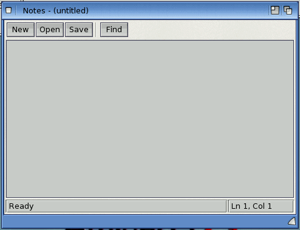

# Exercise 5: A notes application

In this exercise you build "Notes", a small but complete text editor: it has a menu bar with
keyboard shortcuts and a checkmark item, a toolbar, a status bar, file requesters for opening
and saving, a "Save the changes?" requester, a second window for finding text, and it
remembers its settings between runs. These are the parts most Amiga applications are made
of, so you can reuse this program as the start of your own.

**Goal:** a text editor with Project, Edit and Settings menus, a toolbar and status bar, and a
Find window.

**What you will learn:**

- menus in the `.afg`: titles, items, separators, shortcuts (`key=`), checkmark items
- a `toolbar` whose tools call menu items, and a `statusbar` with panels
- the `texteditor` control: `LoadFile`, `SaveFile`, `Modified`, `Find`, `Cut`/`Copy`/`Paste`
- the `commondialog`: `ShowOpen`, `ShowSave`, `Cancelled`, `Flags`
- `MsgBox` with Yes/No/Cancel, and `Form_QueryUnload` to stop the window closing
- a second form: `Show`, `Hide`, `Unload`, and using one form's controls from another
- `GetSetting` and `SaveSetting` for preferences

The solution is in `examples/book/ex05-notes-app/`: `Notes.bbp`, the main window `main.afg` +
`main.bas`, and the Find window `findwin.afg` + `findwin.bas`.

<!-- screenshot: examples/book/ex05-notes-app/shots/notes.png: the Notes window with some text, the toolbar (New, Open, Save, Find), the Project menu pulled down showing New, Open..., Save, Save as..., About..., Quit with their Amiga-key shortcuts, and the status bar "Ln 3, Col 12" -->


## Step 1: The window and its menus

Start with **New Project from Template**, **Boing BASIC Form App**, named `Notes`, or write
the files by hand. The window holds a toolbar, a text editor, a status bar and a common
dialog. After the root layout come the menus:

```text
# AmiForge GUI (a Boing BASIC form: its code is in main.bas)
window name=notes title="Notes" width=480 height=320 remember=1
vlayout id=root
  toolbar id=tb weight=0
    tool id=tbNew text="New" hint="Start a new note" menu=mnuNew
    tool id=tbOpen text="Open" hint="Open a text file" menu=mnuOpen
    tool id=tbSave text="Save" hint="Save the note" menu=mnuSave
    tool separator=1
    tool id=tbFind text="Find" hint="Find text in the note" menu=mnuFind
  texteditor id=ed
  statusbar id=sb panels="Ready|Ln 1, Col 1" widths="0|110"
  commondialog id=dlg filter="Text files|#?.(txt|doc|readme)"
menu id=mnuProject text="Project"
  menu id=mnuNew text="New" key=N
  menu id=mnuOpen text="Open..." key=O
  menu id=mnuSave text="Save" key=S
  menu id=mnuSaveAs text="Save as..." key=A
  menu text=-
  menu id=mnuAbout text="About..." key=?
  menu id=mnuQuit text="Quit" key=Q
menu id=mnuEdit text="Edit"
  menu id=mnuUndo text="Undo" key=Z
  menu text=-
  menu id=mnuCut text="Cut" key=X
  menu id=mnuCopy text="Copy" key=C
  menu id=mnuPaste text="Paste" key=V
  menu id=mnuSelAll text="Select all" key=L
  menu text=-
  menu id=mnuFind text="Find..." key=F
menu id=mnuSettings text="Settings"
  menu id=mnuFixed text="Fixed-width font" checkable=1
  menu id=mnuReopen text="Open the last note at start" checkable=1 checked=1
```

How the menus work:

- A `menu` at the top level of the file (not indented) is a **menu title** in the screen's
  menu bar. The `menu` lines indented under it are its **items**; items indented once more
  would be a sub-menu.
- `text=-` makes a separator bar.
- `key=N` is the Amiga-key shortcut: right Amiga + N chooses the item. It is shown at the
  right of the item.
- `checkable=1` makes an item that toggles a checkmark; `checked=1` starts it checked.
- Each item with an `id` gets a `Click` event: `Sub mnuNew_Click()`.
- By Amiga custom, `Quit` (with `key=Q`) is the last item of the first menu, and items that
  open a requester end in `...`.

The window line has `remember=1`: the window's position and size are saved when it closes and
used the next time it opens.

**In AmiForge**, the designer's **Menu Editor...** button edits the menus as one list, the
titles at the left and their items indented under them. For each entry you set its **Caption**
(`-` for a separator), **Name** (made from the caption if you leave it empty: `Save as...`
becomes `mnuSaveAs`), **Shortcut**, and the **Checkable**, **Checked**, **Enabled** and
**Visible** boxes. The arrows change an entry's level and order. After OK the menus are rows
of the Layout tree: double-click one to write its `Click` Sub.

<!-- screenshot: examples/book/ex05-notes-app/shots/menu-editor.png: AmiForge's Menu Editor with the Notes menus: Project, its items indented, the separator, the Settings menu with "Fixed-width font" selected and Checkable ticked -->


The simplest menu Subs just call the text editor:

<!-- project: examples/book/ex05-notes-app/Notes.bbp -->
```basic
Private Sub mnuUndo_Click(): ed.Undo: End Sub
Private Sub mnuCut_Click(): ed.Cut: End Sub
Private Sub mnuCopy_Click(): ed.Copy: End Sub
Private Sub mnuPaste_Click(): ed.Paste: End Sub
Private Sub mnuSelAll_Click(): ed.SelectAll: End Sub
```

A checkable item already has its new state when its `Click` runs, so the Sub only has to read
`Checked`:

<!-- project: examples/book/ex05-notes-app/Notes.bbp -->
```basic
Private Sub mnuFixed_Click()
    ed.FixedFont = mnuFixed.Checked
End Sub
```

## Step 2: The toolbar and the status bar

A `toolbar` is a row of buttons, one `tool` each; `tool separator=1` is a gap. A tool can have
a picture (`image="file"`), but without one it shows its text, which is enough here. The key
`menu=mnuOpen` makes the tool stand for that menu item: clicking it runs `mnuOpen_Click`, and it
is greyed out when the item is. So the toolbar needs no code of its own.

The `statusbar` has panels separated by `|` in `panels`, with their widths in pixels in
`widths` (0 = the rest of the bar). Panel 0 is also the status bar's `Text`:

<!-- project: examples/book/ex05-notes-app/Notes.bbp -->
```basic
Private Sub ed_CursorMove()
    sb.Panel(1) = "Ln " & (ed.CurrentLine + 1) & ", Col " & (ed.CurrentColumn + 1)
End Sub

Private Sub ed_Change()
    If ed.Modified And sb.Text <> "Modified" Then sb.Text = "Modified"
End Sub
```

The text editor fires `CursorMove` whenever the cursor moves, and `Change` when the text
changes. `CurrentLine` and `CurrentColumn` count from 0, so 1 is added for people.
`Modified` is `True` once the text has changed since it was loaded, saved or set to `False`.

## Step 3: Opening and saving files

The `commondialog` takes no space in the window: it is there to open the standard ASL file
requester. Set its properties, call `ShowOpen` or `ShowSave`, and then look at `Cancelled` and
`FileName`:

<!-- project: examples/book/ex05-notes-app/Notes.bbp -->
```basic
Private Sub mnuOpen_Click()
    If Not ConfirmDiscard() Then Exit Sub
    dlg.DialogTitle = "Open a note"
    dlg.Flags = cdlOFNFileMustExist
    dlg.ShowOpen
    If Not dlg.Cancelled Then LoadFile dlg.FileName
End Sub
```

| CommonDialog member | Use |
|---|---|
| `DialogTitle` | the requester's title |
| `Filter` (`filter=`) | which files to show: an AmigaDOS pattern such as `#?.txt`, optionally after a description and a bar, as in the `.afg` above (the description is ignored) |
| `InitDir` | the drawer to start in |
| `Flags` | `cdlOFNFileMustExist` (only existing files), `cdlOFNOverwritePrompt` (ask before replacing a file), `cdlOFNAllowMultiselect` |
| `ShowOpen`, `ShowSave` | open the requester; the program waits until it is closed |
| `Cancelled` | `True` if the user cancelled |
| `FileName` | the full path chosen (set it before `ShowSave` to suggest a name) |

`LoadFile` and `SaveFile` read the file into the editor or write it out. If the file can't be
read or written they raise a run-time error, which `On Error GoTo` turns into a friendly
requester:

<!-- project: examples/book/ex05-notes-app/Notes.bbp -->
```basic
Private Sub LoadFile(ByVal path As String)
    On Error GoTo Failed
    ed.LoadFile path
    ed.Modified = False
    fileName = path
    UpdateTitle
    sb.Text = "Opened " & path
    Exit Sub
Failed:
    MsgBox "Can't open " & path & vbLf & Err.Description, vbExclamation, APPNAME
End Sub
```

`SaveFile(askName)` in the solution is the same shape: when there is no file name yet, or for
**Save as...**, it calls `dlg.ShowSave` first with `dlg.Flags = cdlOFNOverwritePrompt`, and
it returns `True` when the note was saved.

## Step 4: "Save the changes?"

Nobody wants to lose their work, so every action that throws the text away (New, Open, Quit,
the close gadget) first calls `ConfirmDiscard`:

<!-- project: examples/book/ex05-notes-app/Notes.bbp -->
```basic
Private Function ConfirmDiscard() As Boolean
    If Not ed.Modified Then
        ConfirmDiscard = True
        Exit Function
    End If
    Select Case MsgBox("The note has changed." & vbLf & "Save the changes?", vbYesNoCancel + vbQuestion, APPNAME)
    Case vbYes: ConfirmDiscard = SaveFile(False)
    Case vbNo: ConfirmDiscard = True
    Case Else: ConfirmDiscard = False          ' Cancel: stay
    End Select
End Function
```

`MsgBox(prompt, buttons + icon, title)` opens a requester and returns the button chosen.

| Buttons | Returns |
|---|---|
| `vbOKOnly` (the default), `vbOKCancel` | `vbOK`, `vbCancel` |
| `vbYesNo`, `vbYesNoCancel` | `vbYes`, `vbNo`, `vbCancel` |
| `vbRetryCancel`, `vbAbortRetryIgnore` | `vbRetry`, `vbCancel`, `vbAbort`, `vbIgnore` |

Add an icon with `+ vbQuestion`, `vbExclamation`, `vbInformation` or `vbCritical`. `vbLf`
starts a new line in the text. Used as a statement, without brackets, `MsgBox "text"` just shows
a message (the About item does this).

The window's close gadget and `Unload Me` (the Quit item) both fire `Form_QueryUnload`
first. Setting `Cancel` there keeps the window open:

<!-- project: examples/book/ex05-notes-app/Notes.bbp -->
```basic
Private Sub Form_QueryUnload(Cancel As Integer, UnloadMode As Integer)
    If Not ConfirmDiscard() Then Cancel = True
End Sub
```

`UnloadMode` is 0 when the user clicked the close gadget and 1 when the code called `Unload`.

<!-- screenshot: examples/book/ex05-notes-app/shots/save-changes.png: the "Save the changes?" requester in front of the Notes window, with the question icon and the buttons Yes, No and Cancel -->


## Step 5: A second window: Find

The Find window is a form of its own, `findwin.afg`, listed in the project with a second
`Form=` line:

```ini
Name=Notes
Startup=Form main
Form=main.afg
Form=findwin.afg
```

```text
# AmiForge GUI (a Boing BASIC form: its code is in findwin.bas)
window name=finder title="Find" width=280 height=0 toolwindow=1
vlayout id=root
  string id=what label="_Find" maxchars=200
  checkbox id=matchCase text="_Match case"
  hlayout even=1
    button id=findNext text="Find _next"
    button id=closeIt text="_Close"
```

`toolwindow=1` gives it no size or depth gadget, as befits a small helper window. In
AmiForge, add a new form to the project (a new `.afg` with a `.bas` beside it) and design it as
in [Exercise 4](04-first-form.md).

Forms are used by their **window name**: the main window is `notes` and the Find window is
`finder`. Any module can show a form, and use its controls as *form*`.`*control*:

<!-- project: examples/book/ex05-notes-app/Notes.bbp -->
```basic
Private Sub mnuFind_Click()
    ' the selected text (if any) is what to look for
    If ed.SelText <> "" Then finder.what.Text = ed.SelText
    finder.Show                   ' a second window; both stay usable
    finder.what.SetFocus
End Sub
```

**Give each window a name that is different from its file name.** The code-behind module of
`findwin.afg` is called `findwin`, after its file. If the window were also called `findwin`,
then `findwin.Show` in another module would mean the module, not the form, and `boing check`
would report "module 'findwin' has no public member 'Show'". `Startup=Form main` names the
startup form by its file (`main.afg`), not by its window name.

The first use of a form, or of one of its controls, loads it (`Form_Load` runs). `Show` opens
its window; `finder.Show vbModal` would instead wait until the window is closed, and keep the
other windows from taking input meanwhile (good for dialogs that need an answer).

In `findwin.bas`, the main window's controls are `notes.ed` and `notes.sb`. `Find` selects
the next match after the cursor and returns `True` if there was one; a third argument `True`
searches from the top:

<!-- project: examples/book/ex05-notes-app/Notes.bbp -->
```basic
Private Sub findNext_Click()
    Dim caseToo As Boolean
    If what.Text = "" Then Exit Sub
    caseToo = matchCase.Value = vbChecked
    ' look on from the cursor; if it isn't found, start again at the top
    If notes.ed.Find(what.Text, caseToo) Then
        notes.sb.Text = "Found " & what.Text
    ElseIf notes.ed.Find(what.Text, caseToo, True) Then
        notes.sb.Text = "Found " & what.Text & " (from the top)"
    Else
        notes.sb.Text = "Not found: " & what.Text
        Beep
    End If
End Sub

' Return in the text field is the same as Find next.
Private Sub what_KeyPress(KeyAscii As Integer)
    If KeyAscii = 13 Then findNext_Click
End Sub
```

A text field's `KeyPress` event comes for Return (13) and Tab (9): the keys that finish an
entry.

Closing the Find window should only hide it, so that it keeps what was typed:

<!-- project: examples/book/ex05-notes-app/Notes.bbp -->
```basic
Private Sub closeIt_Click()
    Me.Hide                       ' keep the form (and what was typed) for next time
End Sub

' The close gadget hides the window too, instead of unloading it.
Private Sub Form_QueryUnload(Cancel As Integer, UnloadMode As Integer)
    If UnloadMode = 0 Then
        Cancel = True
        Me.Hide
    End If
End Sub
```

A hidden form is still loaded, and a program ends only when its **last loaded form** is
unloaded. So when the main window closes, its `Form_Unload` unloads the Find window too
(`Unload finder`, which does nothing if it was never loaded); otherwise the program would go
on running with no window open.

<!-- screenshot: examples/book/ex05-notes-app/shots/find.png: the Find tool window beside the Notes window, "Amiga" typed in the Find field, the word selected in the text, and "Found Amiga" in the status bar -->


## Step 6: Remembering settings

`SaveSetting app, section, key, value` stores a string; `GetSetting(app, section, key,
default)` reads it back, giving the default if it was never saved; `DeleteSetting app,
section [, key]` removes it. On AmigaOS they are files in `ENVARC:` (and `ENV:`), as
`ENVARC:app/section/key`, so they survive a reboot. This console program shows the three:

<!-- run -->
```basic
Option Explicit
Print "Before: [" & GetSetting("NotesDemo", "View", "FixedFont", "0") & "]"
SaveSetting "NotesDemo", "View", "FixedFont", "1"
Print "After:  [" & GetSetting("NotesDemo", "View", "FixedFont", "0") & "]"
DeleteSetting "NotesDemo", "View", "FixedFont"
Print "Deleted: [" & GetSetting("NotesDemo", "View", "FixedFont", "default") & "]"
```

```output
Before: [0]
After:  [1]
Deleted: [default]
```

Notes reads its settings in `Form_Load`, and saves them in `Form_Unload`:

<!-- project: examples/book/ex05-notes-app/Notes.bbp -->
```basic
Private Sub Form_Load()
    ' the settings saved last time (GetSetting gives the default when there are none)
    mnuFixed.Checked = GetSetting(APPNAME, "View", "FixedFont", "0") = "1"
    mnuReopen.Checked = GetSetting(APPNAME, "Files", "Reopen", "1") = "1"
    ed.FixedFont = mnuFixed.Checked
    If mnuReopen.Checked Then
        fileName = GetSetting(APPNAME, "Files", "Last", "")
        If fileName <> "" Then
            If Dir(fileName) <> "" Then LoadFile fileName Else fileName = ""
        End If
    End If
    UpdateTitle
End Sub

' The window is closing for good: remember the settings, close the Find window too.
Private Sub Form_Unload(Cancel As Integer)
    SaveSetting APPNAME, "View", "FixedFont", IIf(mnuFixed.Checked, "1", "0")
    SaveSetting APPNAME, "Files", "Reopen", IIf(mnuReopen.Checked, "1", "0")
    SaveSetting APPNAME, "Files", "Last", fileName
    Unload finder
End Sub
```

Settings are strings, so a Boolean is kept as `"1"` or `"0"`. `Dir(path)` returns the file's
name if it exists and `""` if not, which stops Notes from complaining about a last file that
has been deleted since.

## Running it

On AmigaOS 4, from a Shell in the solution's drawer:

```sh
boing run Notes.bbp
boing build Notes.bbp -o Notes
```

In AmiForge, **Open Project** `Notes.bbp` and press **Ctrl-F5**. Try the shortcuts (right
Amiga + O, S, F, Q), type something and close the window to see the requester, and quit and
start again to see the settings kept.

## Try this

1. Add a **Recent files** sub-menu with the last four files, kept with `SaveSetting`. Menus can
   be added at run time with `Me.AddMenu id, caption, parent` and removed with
   `Me.RemoveMenu id`; their Subs are `<id>_Click` as usual.
2. Add a Replace field and a **Replace all** button to the Find window, using
   `notes.ed.Replace(find, with, True, matchCase)`, which returns how many it replaced.
3. Make **About...** a form of its own (`aboutwin.afg`, window name `about`), shown with
   `about.Show vbModal`, with a picture
   (`image id=logo file="..."`) and an OK button that unloads it.
4. Add a word count to a third status-bar panel, updated in `ed_Change` (with `Split`, as in
   [Exercise 1](01-console.md)).
5. Add a hidden menu (`menu id=mnuCtx text="Edit" hidden=1` with Cut, Copy and Paste items)
   and give the editor `contextmenu=mnuCtx`, so the right mouse button opens it over the text.

## See also

- [Menus, toolbars and dialogs](../13-menus-dialogs.md), [Forms and controls](../12-forms.md),
  [Files and settings](../10-files.md)
- Previous: [Exercise 4: Your first form](04-first-form.md).
  Next: [Exercise 6: A Canvas game](06-canvas-game.md)
