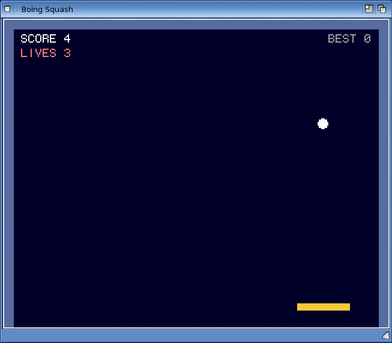

# Exercise 6: A Canvas game

In this exercise you write "Boing Squash", an action game: a ball bounces round a court and
you keep it in play with a bat. You learn how a game draws on a **Canvas**, how a **Timer**
drives the game loop, how to read the keyboard, and how to keep the game running at the same
speed on slow and fast machines.

**Goal:** a bat-and-ball game with a score, a best score that is kept between runs, three
lives, a pause key, a title screen and a game-over screen.

**What you will learn:**

- the `canvas` control: `Cls`, `Box`, `Circle`, `DrawText`, `TextWidth`, `Refresh`
- colours with `RGB` and the `vb` colour constants
- a game loop on a `timer`, and frame timing with `TimerMs`
- keys: the `Form_KeyDown` event and `view.KeyDown(...)` for keys held down
- game states (title, playing, paused, game over) with constants and `Select Case`
- an off-screen canvas, which works on any computer

The solution is in `examples/book/ex06-canvas-game/` (`Squash.bbp`, `squash.afg`,
`squash.bas`), with the first step in `examples/book/ex06-canvas-game/step1/`.

<!-- screenshot: examples/book/ex06-canvas-game/shots/squash.png: Boing Squash running on AmigaOS 4: the dark blue court with grey-blue walls, the yellow bat near the bottom, the white ball, SCORE and LIVES at the top left and BEST at the top right -->


## Step 1: Drawing on a canvas

A canvas is a picture of a fixed size that you draw on with methods such as `Box` and
`Circle`. Coordinates are pixels, with (0, 0) at the top left; x grows to the right and y
downwards. A canvas can also live in memory without a window, made with
`CreateObject("Boing.Canvas")`. That kind works on every computer, so you can try the drawing
methods straight away:

<!-- run -->
```basic
Option Explicit
Dim cv As Canvas
Set cv = CreateObject("Boing.Canvas")    ' a canvas in memory, without a window
cv.Resize 100, 60
cv.Cls RGB(0, 0, 40)
cv.Box 10, 10, 30, 20, RGB(255, 200, 60)            ' a filled rectangle
cv.Line 0, 59, 99, 0, vbWhite                       ' a line
cv.Circle 70, 30, 12, vbRed, True                   ' a filled circle
cv.DrawText 2, 50, "HI", vbGreen
Print "Size:"; cv.Width; "x"; cv.Height
Print "Inside the box: "; Hex(cv.Point(20, 20))
Print "Centre of the circle: "; Hex(cv.Point(70, 30))
Print "Off the canvas:"; cv.Point(200, 5)
Print "Text width of SCORE 10:"; cv.TextWidth("SCORE 10")
```

```output
Size: 100 x 60 
Inside the box: 3CC8FF
Centre of the circle: FF
Off the canvas:-1 
Text width of SCORE 10: 48 
```

- `RGB(red, green, blue)` makes a colour from three values 0 to 255. The constants `vbBlack`,
  `vbWhite`, `vbRed`, `vbGreen`, `vbBlue`, `vbYellow`, `vbCyan` and `vbMagenta` are ready-made
  colours. A colour is a number `&HBBGGRR`, which is why the yellowish box reads back as
  `3CC8FF`.
- `Point(x, y)` reads a pixel back (-1 outside the canvas). Games rarely need it, but it shows
  what was drawn.
- `DrawText x, y, text, colour` writes in a built-in 6 x 9 pixel font, so `TextWidth` of an
  8-character text is 48.
- `Dim cv As Canvas` (rather than `As Object`) lets `boing check` catch a misspelt method
  name.

| Method | Draws |
|---|---|
| `Cls [colour]` | clears the whole picture |
| `PSet x, y [, colour]` | one pixel |
| `Line x1, y1, x2, y2 [, colour]` | a line |
| `Box x, y, w, h [, colour]` | a filled rectangle, w x h pixels |
| `Rect x, y, w, h [, colour]` | the outline of a rectangle |
| `Circle x, y, r [, colour [, filled]]` | a circle of radius r, filled when `filled` is `True` |
| `DrawText x, y, text [, colour]` | text |
| `Refresh` | shows the picture in the window |

## Step 2: A canvas in a window, moved by a Timer

In a form, a canvas is the `.afg` kind `canvas`, and a `timer` calls a Sub at a fixed
interval: the heartbeat of the game. Here is a ball bouncing round the window
(`step1/bounce.afg`):

```text
# AmiForge GUI (a Boing BASIC form: its code is in bounce.bas)
window name=bounce title="Bounce" width=320 height=256
vlayout id=root
  canvas id=view width=320 height=256
  timer id=tick interval=20 enabled=1
```

and its code, `bounce.bas`:

<!-- project: examples/book/ex06-canvas-game/step1/Bounce.bbp -->
```basic
' bounce.bas - a ball bouncing round the canvas, moved by a Timer.
Option Explicit

Private x As Long, y As Long, dx As Long, dy As Long

Private Sub Form_Load()
    x = 160: y = 128: dx = 3: dy = 2
End Sub

' Every 20 ms: move the ball, draw the frame, show it.
Private Sub tick_Timer()
    x = x + dx
    y = y + dy
    If x < 10 Or x > view.Width - 10 Then dx = -dx      ' bounce off the sides
    If y < 10 Or y > view.Height - 10 Then dy = -dy     ' and off the top and bottom
    view.Cls RGB(0, 0, 40)
    view.Circle x, y, 10, RGB(255, 80, 80), True
    view.DrawText 4, 4, "FRAME " & view.Frames, vbWhite
    view.Refresh
End Sub
```

This is the shape of every Canvas game:

1. The timer fires (`interval=20`: every 20 milliseconds, up to 50 times a second).
2. The game moves everything one step.
3. It draws the **whole** picture again, from the background up.
4. `view.Refresh` shows it.

Drawing goes into a picture in memory (the "back buffer"), and nothing appears in the window
until `Refresh` copies the finished picture there in one go. So the picture never flickers,
even though it is cleared and redrawn fifty times a second. If you forget `Refresh`, you see
nothing at all.

In AmiForge's designer the canvas is **Canvas (BASIC)** in the palette (set its **Width** and
**Height**) and the timer is **Timer (BASIC)** (set its **Interval**). The timer takes no space
in the window. Double-click the timer to get its `tick_Timer` Sub.

## Step 3: The game's layout and state

The game's canvas is 320 x 256 pixels, the size of a classic PAL Amiga screen, and `scale=2`
shows it twice as big, in a 640 x 512 window. The program still draws at 320 x 256:

```text
# AmiForge GUI (a Boing BASIC form: its code is in squash.bas)
window name=squash title="Boing Squash" width=640 height=512
vlayout id=root
  canvas id=view width=320 height=256 scale=2
  timer id=tick interval=20 enabled=1
```

The sizes of things and the game's states are constants, so the code reads well and is easy
to tune:

<!-- project: examples/book/ex06-canvas-game/Squash.bbp -->
```basic
' the court, in canvas pixels (the canvas is 320 x 256, shown twice as big: scale=2)
Const W = 320, H = 256
Const WALL = 8                       ' thickness of the walls
Const BATW = 44, BATH = 6, BATY = 236
Const BALLR = 4                      ' the ball's radius
Const FRAME_MS = 20                  ' one step of the game: 20 ms, 50 steps a second

' what the game is doing
Const TITLE = 0, PLAYING = 1, PAUSED = 2, GAMEOVER = 3
Private state As Integer
```

`state` says what the game is doing. The timer keeps running in every state, but only moves
things while `state = PLAYING`; the drawing code shows a message for the others. Keeping one
state variable like this is much simpler than a tangle of Boolean flags.

The ball's position and speed are `Double`s, so it can move a fraction of a pixel per step
and fly at any angle. The drawing methods round them to whole pixels.

## Step 4: The keyboard

There are two ways to read keys, and a game needs both:

- **Events**, for keys that do one thing each time they are pressed: `Form_KeyDown` runs once
  per key press (and again when the key repeats).
- **Polling**, for keys that are held down: `view.KeyDown(key)` is `True` for as long as the
  key is down. Asking it once a frame moves the bat smoothly, without waiting for the key
  repeat.

<!-- project: examples/book/ex06-canvas-game/Squash.bbp -->
```basic
Private Sub Form_KeyDown(KeyCode As Integer, Shift As Integer)
    Select Case KeyCode
    Case vbKeySpace
        If state = TITLE Or state = GAMEOVER Then NewGame
    Case vbKeyP
        If state = PLAYING Then
            state = PAUSED
        ElseIf state = PAUSED Then
            state = PLAYING
        End If
    Case vbKeyEscape
        Unload Me
    End Select
End Sub
```

<!-- project: examples/book/ex06-canvas-game/Squash.bbp -->
```basic
Private Sub MoveBat()
    If auto Then
        ' the demo player: follow the ball
        If ballX < batX + BATW / 2 - 4 Then batX = batX - 4
        If ballX > batX + BATW / 2 + 4 Then batX = batX + 4
    Else
        If view.KeyDown(vbKeyLeft) Or view.KeyDown(vbKeyZ) Then batX = batX - 5
        If view.KeyDown(vbKeyRight) Or view.KeyDown(vbKeyX) Then batX = batX + 5
    End If
    If batX < WALL Then batX = WALL
    If batX > W - WALL - BATW Then batX = W - WALL - BATW
End Sub
```

Key codes are constants: `vbKeyA` to `vbKeyZ`, `vbKey0` to `vbKey9`, `vbKeyLeft`,
`vbKeyRight`, `vbKeyUp`, `vbKeyDown`, `vbKeySpace`, `vbKeyReturn`, `vbKeyEscape`, `vbKeyF1`
to `vbKeyF10` and more. `Shift` tells which qualifier keys were held: 1 Shift, 2 Ctrl, 4 Alt,
8 Amiga (added together). Keys reach the form only while its window is active.

## Step 5: Moving the ball

Each step the ball moves by its speed (`ballDX`, `ballDY`) and bounces off the walls by
turning its speed round. The bat sends it back up, at an angle that depends on where it hit:

<!-- project: examples/book/ex06-canvas-game/Squash.bbp -->
```basic
    ' the bat: only when the ball is coming down onto it
    If ballDY > 0 And ballY + BALLR >= BATY And ballY + BALLR <= BATY + BATH + 4 Then
        If ballX >= batX - BALLR And ballX <= batX + BATW + BALLR Then
            ballY = BATY - BALLR
            ballDY = -ballDY
            ' where it hits the bat sets the angle: the ends send it off sideways
            ballDX = (ballX - (batX + BATW / 2)) / (BATW / 2) * 3
            score = score + 1
            If score Mod 5 = 0 Then ballDY = ballDY * 1.1   ' faster every 5 hits
        End If
    End If
```

Checking `ballDY > 0` (the ball is coming down) stops the ball from being "caught" inside the
bat and bouncing back and forth. Below the bat the player loses a life; with no lives left the
state becomes `GAMEOVER` and the best score is updated.

## Step 6: Drawing the frame

`DrawFrame` draws everything again: background, walls, bat, ball, the score, and the message
for the current state, centred with `TextWidth`. Then `Refresh`:

<!-- project: examples/book/ex06-canvas-game/Squash.bbp -->
```basic
Private Sub DrawFrame()
    Dim msg As String
    view.Cls RGB(0, 0, 40)                                   ' the background
    view.Box 0, 0, W, WALL, RGB(90, 110, 160)                ' top wall
    view.Box 0, 0, WALL, H, RGB(90, 110, 160)                ' left wall
    view.Box W - WALL, 0, WALL, H, RGB(90, 110, 160)         ' right wall
    view.Box batX, BATY, BATW, BATH, RGB(255, 200, 60)       ' the bat
    If state <> TITLE Then view.Circle ballX, ballY, BALLR, vbWhite, True
    view.DrawText 14, 12, "SCORE " & score, vbWhite
    view.DrawText W - 14 - view.TextWidth("BEST " & best), 12, "BEST " & best, RGB(160, 160, 160)
    view.DrawText 14, 24, "LIVES " & lives, RGB(255, 120, 120)

    Select Case state
    Case TITLE: msg = "BOING SQUASH - PRESS SPACE"
    Case PAUSED: msg = "PAUSED - PRESS P"
    Case GAMEOVER: msg = "GAME OVER - PRESS SPACE"
    Case Else: msg = ""
    End Select
    If msg <> "" Then view.DrawText (W - view.TextWidth(msg)) \ 2, H \ 2, msg, vbYellow
    view.Refresh                                             ' show the finished frame
End Sub
```

The best score is read with `GetSetting` in `Form_Load` and saved with `SaveSetting` in
`Form_Unload`, as in [Exercise 5](05-notes-app.md).

<!-- screenshot: examples/book/ex06-canvas-game/shots/gameover.png: Boing Squash showing GAME OVER - PRESS SPACE in yellow in the middle of the court, with the final score and the best score at the top -->


## Step 7: Frame timing

A timer with `interval=20` asks for 50 frames a second, but it can't promise them. If a frame
takes longer than 20 ms (a busy machine, a slow emulator, the interpreter rather than a native
build), the timer simply skips the ticks it missed: timer events never overlap. A game that
moves the ball one step per tick then slows down on a slow machine.

The cure is to measure time. `TimerMs` gives the time in milliseconds, with a fine
resolution. The game loop works out how many 20 ms steps have really passed since the last
frame and moves the game that many steps, then draws once:

<!-- project: examples/book/ex06-canvas-game/Squash.bbp -->
```basic
Private Sub tick_Timer()
    Dim now As Double, steps As Long
    ' How many 20 ms steps have passed since the last frame? Usually 1; more if the computer
    ' was busy. Moving one step at a time keeps the game's speed the same on any machine.
    now = TimerMs
    steps = Int((now - lastMs) / FRAME_MS)
    If steps < 1 Then steps = 1
    If steps > 5 Then steps = 5          ' after a long pause don't jump far ahead
    lastMs = lastMs + steps * FRAME_MS
    If now - lastMs > FRAME_MS * 5 Then lastMs = now

    Do While steps > 0
        If state = PLAYING Then MoveBat: MoveBall
        steps = steps - 1
    Loop
    DrawFrame

    frames = frames + 1
    If maxFrames > 0 And frames >= maxFrames Then Unload Me
End Sub
```

Moving in fixed steps, rather than by a distance proportional to the time, keeps the
collision tests simple and the game identical everywhere. More advice for smooth games:

- Do the slow work once, not every frame: make the colours, load pictures and build tables in
  `Form_Load`.
- Draw only what is on screen, and draw repeated shapes into an image once (`CreateImage`,
  `SetTarget`, then `DrawImage` each frame; see [Graphics](../14-graphics.md)).
- A native build (`boing build`) runs the same program many times faster than `boing run`.
- Don't wait in a loop inside an event (`Do ... Loop` until a key is pressed): the window
  can't react while an event Sub runs. Let the timer call you again instead.

The two arguments `--auto` (the computer plays) and `--frames N` (stop after N frames) are
for demonstrations and screenshots: `boing run Squash.bbp --auto --frames 500`.

## Running it

On AmigaOS 4, from a Shell in the solution's drawer:

```sh
boing run Squash.bbp
boing build Squash.bbp -o Squash
```

In AmiForge, **Open Project** `Squash.bbp`, then **Ctrl-F5** to run it or **F7** to build it.
Click in the window so that it is active before you press keys.

## Try this

1. Add bricks at the top (an array of Booleans, drawn as `Box`es) that disappear when the ball
   hits them, turning the game into a breakout.
2. Let the mouse move the bat: add `mousemove=1` to the canvas and a
   `view_MouseMove(Button As Integer, Shift As Integer, X As Long, Y As Long)` Sub that sets
   `batX`.
3. Draw a trail behind the ball: keep its last 8 positions in arrays and draw them as smaller,
   darker circles.
4. Make it a two-player game with a second bat at the top (keys A and D).
5. Add sound effects when the ball hits the bat or a wall: see
   [Exercise 8](08-sound.md).

## See also

- [Graphics: the Canvas](../14-graphics.md), [Forms and controls](../12-forms.md) (Timer,
  keyboard events)
- Previous: [Exercise 5: A notes application](05-notes-app.md).
  Next: [Exercise 7: A 3D scene](07-3d-scene.md)
