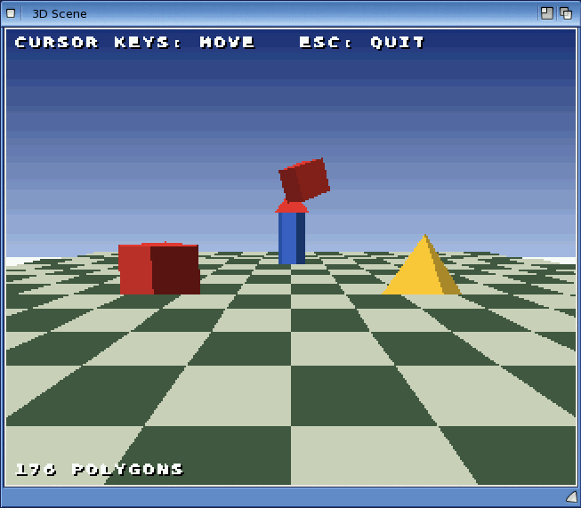

# Exercise 7: A 3D scene

In this exercise you build a small 3D world with **Engine3D**, Boing BASIC's 3D engine:
spinning models stand on a chequered floor under a sky, and you walk round them with the
cursor keys. The engine does all the 3D arithmetic, sorting and drawing in fast compiled code;
your program only says what is where.

**Goal:** a window showing a red cube, a gold pyramid, a blue tower and a tumbling cube on a
chequered floor, lit from one side and fading into the distance, with a camera you drive.

**What you will learn:**

- making an Engine3D and attaching it to a canvas (`Attach`, `View`)
- pens: the engine's numbered colours (`Pen`, `SkyGradient`)
- building models from boxes, pyramids and prisms (`ModelNew`, `MdlBox`, `MdlPyramid`,
  `MdlPrism`)
- a floor made from a height grid (`GridNew`, `GridPenSet`, `DrawGrid`)
- the camera (`CamPos`, `CamAngles`) and 16-bit angles
- a frame: `Clear`, `Begin`, `DrawGrid`, `DrawModel`, `Flush`, then text on top
- lighting (`Shading`, `Light`) and fog (`Fog`)
- moving in the direction you face with `Sin` and `Cos`

The solution is in `examples/book/ex07-3d-scene/`: `Scene3D.bbp`, the module `World.bas` (the
3D world) and the form `scene.afg` + `scene.bas`. For a bigger example, with a fractal
landscape, a flying ship and a star field, see `examples/engine3d_demo`.



*The 3D scene on AmigaOS 4*

## How Engine3D works, in short

- The **world** has x to the right, y up and z ahead, in whole units. Our models are about 60
  units across, and the floor is 1024 units square.
- **Angles** are 16-bit: 0 to 65535 is a full turn, so 16384 is a quarter turn (90 degrees)
  and 8192 an eighth. A yaw (turn) of 0 looks along +z, and larger yaws turn towards +x.
- **Colours** are **pens**: numbered slots 0 to 255 of the engine's palette. You set a pen's
  colour once (`e.Pen(4) = RGB(230, 60, 50)`), and models and floors refer to pen numbers.
- Each frame you **begin** a list, **add** the floor and the models to it, and **flush** it:
  the engine sorts every polygon from far to near and paints them into the canvas in that
  order, so near things cover far ones.
- The engine draws into a [Canvas](06-canvas-game.md): in a form, or off-screen in memory.

## Step 1: A cube, off-screen

You can try the engine without a window, on any computer, by giving it an off-screen canvas:

<!-- run -->
```basic
Option Explicit
Dim cv As Canvas, e As Engine3D, cube As Long

Set cv = CreateObject("Boing.Canvas")      ' an off-screen canvas: no window needed
cv.Resize 320, 256
Set e = CreateObject("Boing.Engine3D")
e.Attach cv                                ' the engine draws into this canvas
e.View 320, 256, 160, 128, 200             ' 3D area 320 x 256, centre (160, 128), fov 200

e.Pen(2) = RGB(230, 60, 50)                ' pen 2: red (lit sides)
e.Pen(3) = RGB(130, 30, 25)                ' pen 3: dark red (sides in shadow)
cube = e.ModelNew()
e.MdlBox cube, 2, 3, -30, 30, 0, 60, -30, 30
Print "The cube has"; e.ModelVerts(cube); "corners and"; e.ModelFaces(cube); "faces"

e.CamPos 0, 100, -200                      ' the camera: up 100, back 200
e.CamAngles 0, 2000                        ' facing +z, looking down a little
cv.Cls vbBlack
e.Begin 3000
e.DrawModel cube, 0, 0, 0, 8192            ' at the origin, turned an eighth of a turn
e.Flush
Print "Polygons drawn:"; e.NPolys
Print "Something drawn below the centre: "; cv.Point(160, 150) <> vbBlack
```

```output
The cube has 8 corners and 6 faces
Polygons drawn: 3 
Something drawn below the centre: True
```

Line by line:

- `e.View w, h, cx, cy, fov` sets the 3D area (here the whole canvas), the point on it that is
  straight ahead of the camera (its centre), and the field of view: a bigger number zooms in.
- `e.ModelNew()` makes an empty model and returns its number. `MdlBox model, lit, shade, x0,
  x1, y0, y1, z0, z1` adds a box with those corners, in the model's own coordinates. Faces
  that face the engine's built-in sun get the `lit` pen, the others the `shade` pen.
- `e.CamPos x, y, z` puts the camera at a world position; `e.CamAngles yaw, pitch` turns it.
  A positive pitch looks down.
- `e.Begin 3000` empties the draw list; 3000 is the farthest distance that will be drawn.
  `e.DrawModel model, x, y, z, yaw` adds the model's faces that face the camera, placed at
  (x, y, z) and turned by `yaw`. `e.Flush` paints the list into the canvas.
- Only 3 of the cube's 6 faces were drawn: the others face away from the camera.

Declaring `Dim e As Engine3D` (rather than `As Object`) lets `boing check` catch misspelt
member names before the program runs.

## Step 2: The window and the program's shape

The form is just a canvas and a timer, as in [Exercise 6](06-canvas-game.md). The canvas is
320 x 256, shown twice as big with `scale=2`:

```text
# AmiForge GUI (a Boing BASIC form: its code is in scene.bas)
window name=scene title="3D Scene" width=640 height=512
vlayout id=root
  canvas id=view width=320 height=256 scale=2
  timer id=tick interval=20 enabled=1
```

The 3D world lives in a module of its own, `World.bas`, listed in the project with
`Module=World.bas`. `Stack=262144` gives the program a larger stack, as the 3D examples do:

```ini
Name=Scene3D
Startup=Form scene
Module=World.bas
Form=scene.afg
Stack=262144
```

The form's code only connects the window to the world: it calls `WorldInit` once, and in every
timer tick reads the keys, calls `WorldFrame` and shows the result:

<!-- project: examples/book/ex07-3d-scene/Scene3D.bbp -->
```basic
Private Sub Form_Load()
    WorldInit view
    If InStr(Command(), "--frames") > 0 Then maxFrames = Val(Mid(Command(), InStr(Command(), "--frames") + 8))
End Sub

Private Sub tick_Timer()
    ' keys held down: read them every frame
    If view.KeyDown(vbKeyLeft) Then WorldMove -600, 0
    If view.KeyDown(vbKeyRight) Then WorldMove 600, 0
    If view.KeyDown(vbKeyUp) Then WorldMove 0, 8
    If view.KeyDown(vbKeyDown) Then WorldMove 0, -8
    If view.KeyDown(vbKeyEscape) Then Unload Me: Exit Sub

    WorldFrame t
    view.Refresh
    t = t + 1
    If maxFrames > 0 And t >= maxFrames Then Unload Me
End Sub
```

`WorldInit view` passes the form's canvas to a procedure in another module: a control is an
object like any other, and the parameter is declared `cv As Canvas`.

## Step 3: Setting up the world

`WorldInit` makes the engine and the palette. Pens are given names with constants, so the
code says `PEN_RED`, not `4`:

<!-- project: examples/book/ex07-3d-scene/Scene3D.bbp -->
```basic
    Set e = CreateObject("Boing.Engine3D")
    e.Attach cv                                       ' draw into this canvas
    ' the 3D area: the whole canvas, centred, with a field of view of 200
    e.View cv.Width, cv.Height, cv.Width \ 2, cv.Height \ 2, 200

    ' the palette: pen number -> colour (pen 0 stays black)
    e.Pen(PEN_TILE1) = RGB(70, 90, 70): e.Pen(PEN_TILE2) = RGB(200, 210, 190)
    e.Pen(PEN_RED) = RGB(230, 60, 50): e.Pen(PEN_REDDARK) = RGB(130, 30, 25)
    e.Pen(PEN_BLUE) = RGB(70, 120, 240): e.Pen(PEN_BLUEDARK) = RGB(35, 60, 130)
    e.Pen(PEN_GOLD) = RGB(250, 200, 60): e.Pen(PEN_GOLDDARK) = RGB(150, 110, 20)
    e.Pen(PEN_WHITE) = RGB(255, 255, 255)
    e.SkyGradient PEN_SKY, RGB(30, 50, 120), RGB(170, 190, 230), cv.Height \ 2
    e.Light -1, 3, -2, 80                             ' light from the upper left, behind us
    e.Fog RGB(170, 190, 230), 900, 1600              ' far things fade into the sky colour
```

- `SkyGradient pen, top, bottom, rows` makes a pen that is drawn as a gradient from one colour
  to the other over that many rows: a sky.
- `Light x, y, z, ambient` gives the direction the light comes from, and how bright the
  shadowed sides are (0 to 256). It is used when `Shading` is 1.
- `Fog colour, near, far` blends things towards the colour between those distances, so the
  world fades out instead of ending at a hard edge. `e.Fog -1` turns it off.

## Step 4: Models

Models are made once, at the start, from simple solids. Each call adds faces to the model,
so a model can be several solids together, like the tower (a prism with a pyramid roof):

<!-- project: examples/book/ex07-3d-scene/Scene3D.bbp -->
```basic
    cube = e.ModelNew()
    e.MdlBox cube, PEN_RED, PEN_REDDARK, -30, 30, 0, 60, -30, 30
    pyramid = e.ModelNew()
    e.MdlPyramid pyramid, PEN_GOLD, PEN_GOLDDARK, -35, 35, 0, -35, 35, 70
    tower = e.ModelNew()
    e.MdlPrism tower, PEN_BLUE, PEN_BLUEDARK, 6, 25, 0, 100
    e.MdlPyramid tower, PEN_RED, PEN_REDDARK, -25, 25, 100, -25, 25, 140
```

| Builder | Makes |
|---|---|
| `MdlBox m, lit, shade, x0, x1, y0, y1, z0, z1` | a box between those coordinates |
| `MdlPyramid m, lit, shade, x0, x1, y0, z0, z1, apex` | a pyramid on the rectangle x0..x1, z0..z1 at height y0, its point at height `apex` (below y0 for an upside-down one) |
| `MdlPrism m, lit, shade, sides, r, y0, y1` | an upright prism with that many sides and radius r, from height y0 to y1 (many sides look like a cylinder) |

The models stand with their base at y = 0 and their centre on the y axis, so drawing one at
(x, 0, z) stands it on the floor there. Models can also be loaded from a text file
(`ModelLoad`) or built face by face (`MdlVtx`, `MdlFace`): see [Engine3D](../15-engine3d.md).

## Step 5: The floor

A **grid** is a field of heights, drawn as tiles. Our floor is flat (all heights 0, as a new
grid is), and each tile gets one of two pens to make a chessboard:

<!-- project: examples/book/ex07-3d-scene/Scene3D.bbp -->
```basic
    floorGrid = e.GridNew(FLOORN, FLOORN, TILE, -(FLOORN \ 2) * TILE, -(FLOORN \ 2) * TILE)
    For j = 0 To FLOORN - 2
        For i = 0 To FLOORN - 2
            If (i + j) Mod 2 = 0 Then e.GridPenSet floorGrid, i, j, PEN_TILE1 Else e.GridPenSet floorGrid, i, j, PEN_TILE2
        Next i
    Next j
    e.GridShade floorGrid, False                      ' plain colours, no slope shading
```

`GridNew(w, h, cell, x0, z0)` makes a grid of w x h points `cell` units apart, with its corner
at world position (x0, z0): 17 x 17 points are 16 x 16 tiles, from -512 to 512. A grid can
also be a landscape: `GridGenerate` makes hills and valleys, and `GridColours` colours them by
height (water, grass, rock, snow), as `examples/engine3d_demo` does.

## Step 6: Drawing a frame

`WorldFrame` places the camera, then fills and flushes the draw list:

<!-- project: examples/book/ex07-3d-scene/Scene3D.bbp -->
```basic
Public Sub WorldFrame(ByVal t As Long)
    e.CamPos camX, CAMY, camZ
    e.CamAngles camYaw, 1200                          ' yaw, and a slight look down (pitch)
    e.Clear PEN_SKY                                   ' the sky
    e.Begin 3000                                      ' start the list of things to draw
    e.Shading = 0
    e.DrawGrid floorGrid                              ' the floor
    e.Shading = 1                                     ' the models: lit by the light
    e.DrawModel cube, -150, 0, 0, t * 300             ' spinning about the up axis (yaw)
    e.DrawModel pyramid, 150, 0, 0, -t * 200
    e.DrawModel tower, 0, 0, 250, t * 100
    e.DrawModel cube, 0, 180 + e.Sin(t * 500) \ 2048, 250, t * 700, t * 400   ' floating, tumbling
    e.Flush                                           ' draw the list, far to near
    e.TextShadow 4, 4, "CURSOR KEYS: MOVE   ESC: QUIT", PEN_WHITE
    e.TextShadow 4, 244, e.NPolys & " POLYGONS", PEN_WHITE
End Sub
```

- The spinning comes from `t`, the frame number: the cube turns 300 angle units a frame, and
  the pyramid the other way. A Long angle can grow beyond 65535; the engine wraps it.
- `DrawModel m, x, y, z, yaw, pitch, roll`: the floating cube also tumbles (a pitch), and its
  height bobs up and down with `e.Sin`.
- `Shading = 1` shades every face of the models by the angle between it and the light, so the
  sides of a spinning model darken and brighten as they turn. `Shading = 0` uses the pens
  exactly as given.
- The text is drawn after `Flush`, straight onto the canvas, so it is always on top. `Text`,
  `TextShadow` and `TextCentre` use the engine's own font, in pens. The form then calls
  `view.Refresh` to show the frame.

## Step 7: Moving the camera

To walk forward you move in the direction the camera faces. For a yaw angle that direction is
(sin, cos): straight ahead (yaw 0) is (0, 1), along +z. `e.Sin` and `e.Cos` take a 16-bit
angle and return a 16.16 fixed-point number (65536 means 1.0), so the result is divided by
65536 again:

<!-- project: examples/book/ex07-3d-scene/Scene3D.bbp -->
```basic
Public Sub WorldMove(ByVal dYaw As Long, ByVal dist As Long)
    camYaw = (camYaw + dYaw) And 65535
    ' the direction the camera faces is (Sin, Cos) of its angle; e.Sin gives 16.16 values
    camX = camX + dist * e.Sin(camYaw) \ 65536
    camZ = camZ + dist * e.Cos(camYaw) \ 65536
    ' stay on the floor
    If camX < -480 Then camX = -480
    If camX > 480 Then camX = 480
    If camZ < -480 Then camZ = -480
    If camZ > 480 Then camZ = 480
End Sub
```

`And 65535` keeps the angle in the range 0 to 65535 (a full turn later it is back at the
start). Holding Left turns 600 units a frame: a full turn in about 2 seconds at 50 frames a
second.

## Running it

On AmigaOS 4, from a Shell in the solution's drawer:

```sh
boing run Scene3D.bbp
boing build Scene3D.bbp -o Scene3D
```

`boing run Scene3D.bbp --frames 200` stops by itself after 200 frames. In AmiForge, open
`Scene3D.bbp` and press **Ctrl-F5**, or **F7** for a native build. A native build runs your
BASIC code faster; the engine's own work is compiled code either way.

## Try this

1. Add a ring of eight pyramids round the middle of the floor, placed with `e.Sin` and `e.Cos`
   in a `For` loop.
2. Let the camera look up and down with A and Z (change the pitch passed to `CamAngles`), and
   rise and fall with Page Up and Page Down.
3. Replace the flat floor with hills: `e.GridGenerate floorGrid, 1234, 60, 80` and
   `e.GridColours floorGrid, ...`, and keep the camera above the ground with
   `e.GridHeight(floorGrid, camX * 65536, camZ * 65536)`.
4. Give the scene a star field: arrays of points drawn with `e.Points` (see
   `examples/engine3d_demo/Scene.bas`).
5. Make one of the models a "target": when the camera comes within 60 units of it
   (`e.Hypot(dx, dz)`), move it somewhere else and add 1 to a score shown with
   `e.TextShadow`.

## See also

- [Engine3D](../15-engine3d.md), [Graphics: the Canvas](../14-graphics.md)
- Previous: [Exercise 6: A Canvas game](06-canvas-game.md).
  Next: [Exercise 8: Sound](08-sound.md)
