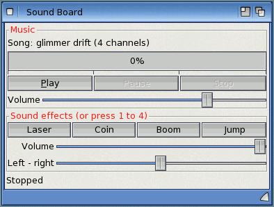

# Exercise 8: Sound

In this exercise your programs make a noise. You play a ProTracker module (a MOD file, the
Amiga's classic music format), make sound effects from nothing with a few calls, build one
sound sample by sample, and put it all into a "Sound Board" window with buttons and volume
sliders.

**Goal:** a window that plays, pauses and stops a module, shows where the music is, and plays
four synthesised sound effects from buttons or the keys 1 to 4, with volume and stereo
sliders.

**What you will learn:**

- the `Audio` object: `CreateObject("Boing.Audio")`, `Open`, `Close`, `Device`
- music: `LoadMusic`, `PlayMusic`, `Pause`, `Resume`, `StopMusic`, `Playing`, `Position`,
  `Row`, `MusicVolume`, `Loop`
- sound effects: `SynthTone`, `SynthNoise`, `PlaySound`, `SoundVolume`
- a sound built by hand: `CreateSound` and `SoundData`
- volume (0 to 64) and pan (-64 left to 64 right)
- the `slider` and `fuelgauge` controls, and `App.Path` for files beside the program

The solution is in `examples/book/ex08-sound/`: `SoundBoard.bbp` with `board.afg` and
`board.bas`, the console player `PlayMod.bas` (step 2), and the module `glimmer.mod`
("Glimmer Drift", the music of the Glimmerfield game in `examples/glimmerfield`).

<!-- screenshot: examples/book/ex08-sound/shots/soundboard.png: the Sound Board window on AmigaOS 4 while the music plays: the Music frame with "Song: glimmer drift (4 channels)", the progress gauge part filled, Play greyed out, Pause and Stop enabled, the Volume slider; the Sound effects frame with the Laser, Coin, Boom and Jump buttons and the two sliders; the status line "Position 3 of 10, row 17" -->


## How sound works in Boing BASIC

There is one software **mixer** for the whole program. It plays one piece of music (a module
of 4, 6 or 8 channels) and up to 8 sound effects at the same time, mixes them into stereo and
sends the result to AHI, the AmigaOS sound system. The mixer runs in a task of its own: once
you start the music, it plays on while your program does other things, without any call from
you each frame.

`CreateObject("Boing.Audio")` gives you an object to talk to the mixer. Every Audio object is
the same mixer, so keep one in a module-level variable.

| Unit | Range |
|---|---|
| volume | 0 (silent) to 64 (full), as on the Amiga's sound chip |
| pan | -64 (left) to 0 (centre) to 64 (right) |
| sound and song numbers | 1, 2, 3 ... as returned by the Load and Synth functions |

If AHI isn't set up (no audio mode chosen in Prefs/AHI), `Device` is `"none"` and every call
still works, silently: the program doesn't have to treat that as an error.

## Step 1: Sound effects without files

`SynthTone` and `SynthNoise` make sound effects from a few numbers. On another computer than
an Amiga the mixer still works, but nobody hears it: `Open "manual"` makes it mix only when
told to, which is how this example can show what happens:

<!-- run -->
```basic
Option Explicit
Dim au As Audio, laser As Long, boom As Long, v As Long

Set au = CreateObject("Boing.Audio")
au.Open "manual"                        ' no sound device: mix only when told (for testing)
laser = au.SynthTone(150, 1800, 300, 40, 1)      ' 150 ms, 1800 -> 300 Hz, square wave
boom = au.SynthNoise(400, 60, 8)                 ' 400 ms of noise, softened
Print "Device: "; au.Device; ", rate"; au.Rate
Print "Laser:"; au.SoundLength(laser); "samples at"; au.SoundRate(laser); "Hz"
Print "Boom:"; au.SoundLength(boom); "samples"
v = au.PlaySound(laser, 64, -32)                 ' full volume, a bit to the left
Print "Playing on voice"; v; "- playing: "; au.VoicePlaying(v)
au.Render au.Rate                                ' mix one second
Print "After a second, playing: "; au.VoicePlaying(v)
Print "Note 13 is "; au.NoteName(13); ", A-2 is note"; au.NoteFromName("A-2")
```

```output
Device: manual, rate 22050 
Laser: 3307 samples at 22050 Hz
Boom: 8820 samples
Playing on voice 1 - playing: True
After a second, playing: False
Note 13 is C-2, A-2 is note 22 
```

In a real program leave out the `"manual"`: `au.Open` with no argument opens the normal
device (AHI on AmigaOS 4), and the mixer opens itself with it on first use anyway.

| Member | |
|---|---|
| `SynthTone(ms, f0, f1 [, volume [, wave]])` | a tone sliding from f0 to f1 Hz, with a short fade at the end. `wave`: 0 triangle (default), 1 square, 2 sine, 3 sawtooth. Returns the new sound's number |
| `SynthNoise(ms [, volume [, smooth [, attack]]])` | noise that dies away: explosions, crashes. `smooth` 0 to 15 makes it duller; `attack` is how many ms it takes to rise |
| `PlaySound(sound [, volume [, pan [, rate [, loop]]]])` | plays the sound on a free voice and returns the voice's number (0 if all 8 voices are busy). `rate` changes the pitch |
| `VoicePlaying(voice)` | `True` while that voice still plays |
| `StopVoice voice`, `StopSounds` | stop one voice, or all the effects |

A falling tone sounds like a laser, a rising one like a jump or a pick-up, noise like an
explosion. Experiment: these few numbers give a surprising range of sounds.

## Step 2: Playing a module from the Shell

`LoadMusic` loads a ProTracker module and returns its number; `PlayMusic` starts it. This
console program plays a module once through and shows its progress
(`examples/book/ex08-sound/PlayMod.bas`):

<!-- project: examples/book/ex08-sound/PlayMod.bas -->
```basic
' PlayMod.bas - play a ProTracker module from the Shell (step 2 of exercise 8).
'   boing run PlayMod.bas                    plays glimmer.mod (beside this file)
'   boing run PlayMod.bas DH0:Mods/song.mod  plays another module
' It stops when the song has played through once, or when you press Ctrl-C.
Option Explicit

Dim au As Audio, song As Long, path As String, lastPos As Long

path = Trim(Command())
If path = "" Then path = App.Path & "/glimmer.mod"

Set au = CreateObject("Boing.Audio")
song = au.LoadMusic(path)             ' error 53 if the file isn't there
Print "Playing " & au.SongName(song) & " (" & au.Channels(song) & " channels, " & au.SongLength(song) & " positions)"
au.Loop = False                       ' stop at the end instead of starting again
au.PlayMusic song
lastPos = -1
Do While au.Playing
    If au.Position <> lastPos Then
        lastPos = au.Position
        Print "Position"; lastPos; "pattern"; au.Pattern
    End If
    Sleep 100                         ' wait a tenth of a second; the music plays on meanwhile
Loop
Print "The end."
```

```text
Playing glimmer drift (4 channels, 10 positions)
Position 0 pattern 0
Position 1 pattern 1
...
The end.
```

- `App.Path` is the drawer the program is in (for `boing run`, the drawer of the `.bas` or
  `.bbp` file), so `App.Path & "/glimmer.mod"` finds the module beside the program wherever
  you start it from.
- A module is a list of **positions**, each naming a **pattern** of 64 rows; `Position`,
  `Pattern` and `Row` say where the music is. `SongLength` is the number of positions.
- Music normally loops; with `Loop = False` it stops at the end, and `Playing` becomes `False`.
- `Sleep 100` waits 100 milliseconds without using the processor. Ctrl-C in the Shell stops
  the program, and the music with it.

Modules with 4 (`M.K.`), 6 or 8 channels play. Aminet has thousands of them.

## Step 3: The Sound Board window

The window has two framed groups (a `vlayout` with a `title`), sliders for the volumes, a
fuel gauge for the music's progress and a timer to update it:

```text
# AmiForge GUI (a Boing BASIC form: its code is in board.bas)
window name=board title="Sound Board" width=380 height=0
vlayout id=root
  vlayout id=musicGroup title="Music"
    label id=songInfo text=" "
    fuelgauge id=progress min=0 max=1 level=0
    hlayout id=musicButtons even=1
      button id=play text="_Play"
      button id=pause text="P_ause"
      button id=stopIt text="_Stop"
    slider id=musicVol label="Volume" min=0 max=64 level=48
  vlayout id=fxGroup title="Sound effects (or press 1 to 4)"
    hlayout id=fxButtons even=1
      button id=fxLaser text="Laser"
      button id=fxCoin text="Coin"
      button id=fxBoom text="Boom"
      button id=fxJump text="Jump"
    slider id=fxVol label="Volume" min=0 max=64 level=64
    slider id=fxPan label="Left - right" min=-64 max=64 level=0
  label id=status text=" "
  timer id=tick interval=200 enabled=1
```

| Control | Keys | In the code |
|---|---|---|
| `slider` | `min`, `max`, `level` (the starting value) | `Value`, `Min`, `Max`; events `Change` (let go at a new value) and `Scroll` (while dragged) |
| `fuelgauge` | `min`, `max`, `level` | `Value`, `Min`, `Max`: a bar that shows how far along something is |

The Stop button's id is `stopIt`, not `stop`, because `Stop` is a BASIC statement.

## Step 4: Loading everything in Form_Load

`Form_Load` opens the mixer, makes the effects and loads the module. If the module is
missing, the program says so instead of stopping with an error:

<!-- project: examples/book/ex08-sound/SoundBoard.bbp -->
```basic
Private Sub Form_Load()
    Set au = CreateObject("Boing.Audio")
    au.Open                           ' the default device: AHI on AmigaOS 4
    If au.Device = "none" Then status.Caption = "No AHI device: set one up in Prefs/AHI"

    ' sound effects, synthesised: SynthTone(ms, from Hz, to Hz, volume, wave)
    sLaser = au.SynthTone(180, 1800, 250, 40, 1)       ' a falling square wave
    sJump = au.SynthTone(220, 250, 900, 40, 2)         ' a rising sine
    sBoom = au.SynthNoise(600, 60, 8, 2)               ' noise, softened, dying away
    sCoin = MakeCoin()                                 ' built sample by sample

    ' the music
    On Error Resume Next
    song = au.LoadMusic(App.Path & "/glimmer.mod")
    If Err.Number <> 0 Then
        song = 0
        songInfo.Caption = "glimmer.mod could not be loaded (error " & Err.Number & ")"
    End If
    On Error GoTo 0
    If song > 0 Then
        songInfo.Caption = "Song: " & au.SongName(song) & " (" & au.Channels(song) & " channels)"
        progress.Max = au.SongLength(song)
    End If
    au.MusicVolume = musicVol.Value
    au.SoundVolume = fxVol.Value
    UpdateButtons
End Sub
```

`On Error Resume Next` lets the program look at `Err.Number` after a line that may fail;
`On Error GoTo 0` switches normal error handling back on. `Form_Unload` calls `au.Close`, which
stops all sound and frees the sound device.

## Step 5: A sound made sample by sample

A sound is a list of numbers, **samples**, played one after another at a fixed rate: 22050 a
second here. `CreateSound(length, rate, bits)` makes a silent sound, and `SoundData(sound,
index)` sets one sample (-32768 to 32767 for 16 bits). The coin sound is two notes of a
square wave that fades out:

<!-- project: examples/book/ex08-sound/SoundBoard.bbp -->
```basic
Private Function MakeCoin() As Long
    Dim s As Long, i As Long, n As Long, rate As Long, f As Double, amp As Double
    rate = 22050
    n = rate * 3 \ 10                         ' 0.3 seconds
    s = au.CreateSound(n, rate, 16)
    For i = 0 To n - 1
        If i < rate * 6 \ 100 Then f = 988 Else f = 1319     ' B-5, then E-6
        amp = 12000 * (1 - i / n)                           ' fade out
        ' a square wave: +amp for the first half of each cycle, -amp for the second
        If (i * f / rate) - Int(i * f / rate) < 0.5 Then
            au.SoundData(s, i) = amp
        Else
            au.SoundData(s, i) = -amp
        End If
    Next i
    MakeCoin = s
End Function
```

`i * f / rate` counts the cycles of the wave so far; its fractional part says where in the
current cycle sample `i` falls. Try a sine instead: `au.SoundData(s, i) = amp * Sin(2 *
3.14159 * i * f / rate)`. Building a sound this way takes a moment in the interpreter (one call
per sample), so do it once at the start. Sounds can also be loaded from files: `LoadSound`
reads IFF 8SVX and WAV files.

## Step 6: Buttons, sliders and keys

The music buttons call the mixer and then grey out the buttons that make no sense at the
moment:

<!-- project: examples/book/ex08-sound/SoundBoard.bbp -->
```basic
Private Sub play_Click()
    If song = 0 Then Exit Sub
    If au.Paused Then au.Resume Else au.PlayMusic song
    UpdateButtons
End Sub

Private Sub pause_Click()
    If au.Playing And Not au.Paused Then au.Pause
    UpdateButtons
End Sub

Private Sub stopIt_Click()
    au.StopMusic
    progress.Value = 0
    UpdateButtons
End Sub
```

`Playing` stays `True` while the music is paused; `Paused` tells the two apart. A slider gives
`Scroll` events while it is dragged and `Change` when it is let go; handling both changes the
volume as you drag:

<!-- project: examples/book/ex08-sound/SoundBoard.bbp -->
```basic
Private Sub musicVol_Scroll()
    au.MusicVolume = musicVol.Value
End Sub

Private Sub musicVol_Change()
    au.MusicVolume = musicVol.Value
End Sub
```

`MusicVolume` is the volume of the music and `SoundVolume` that of all the effects together,
both 0 to 64. (`Volume` is the master volume of everything.)

The effect buttons and the keys 1 to 4 all call one Sub, which plays the sound at the pan
chosen with the slider:

<!-- project: examples/book/ex08-sound/SoundBoard.bbp -->
```basic
Private Sub Effect(ByVal snd As Long)
    ' PlaySound(sound, volume 0..64, pan -64..64): returns the voice it plays on
    au.PlaySound snd, 64, fxPan.Value
End Sub

Private Sub fxLaser_Click(): Effect sLaser: End Sub
Private Sub fxCoin_Click(): Effect sCoin: End Sub
Private Sub fxBoom_Click(): Effect sBoom: End Sub
Private Sub fxJump_Click(): Effect sJump: End Sub
```

<!-- project: examples/book/ex08-sound/SoundBoard.bbp -->
```basic
' Keys 1 to 4 play the effects too, and Space starts or pauses the music.
Private Sub Form_KeyPress(KeyAscii As Integer)
    Select Case Chr(KeyAscii)
    Case "1": Effect sLaser
    Case "2": Effect sCoin
    Case "3": Effect sBoom
    Case "4": Effect sJump
    Case " ": If au.Playing And Not au.Paused Then pause_Click Else play_Click
    End Select
End Sub
```

`Form_KeyPress` gets the character of each key typed (`KeyAscii`, its character code), and
`Chr` turns it into a one-character string. Press the keys quickly: each press takes a free
voice, so up to 8 effects sound at once, on top of the music.

Five times a second the timer shows the position:

<!-- project: examples/book/ex08-sound/SoundBoard.bbp -->
```basic
Private Sub tick_Timer()
    If au.Playing Then
        status.Caption = "Position " & au.Position & " of " & au.SongLength(song) & ", row " & au.Row & IIf(au.Paused, " (paused)", "")
        progress.Value = au.Position
    ElseIf song > 0 Then
        status.Caption = "Stopped"
    End If
End Sub
```

## Sound in a game

To add sound to the game of [Exercise 6](06-canvas-game.md): make the effects in `Form_Load`,
start the music there, and call `au.PlaySound` where things happen (the ball hits the bat).
Give the player switches: `au.MusicEnabled = False` mutes the music but keeps its place,
`au.SoundEnabled = False` silences the effects. `SongEnded` counts how often the song reached
its end, so a game can change the tune after each round. Glimmerfield
(`examples/glimmerfield/Sound.bas`) does all of this.

## Running it

On AmigaOS 4, from a Shell in the solution's drawer:

```sh
boing run PlayMod.bas
boing run SoundBoard.bbp
boing build SoundBoard.bbp -o SoundBoard
```

Choose an audio mode in **Prefs/AHI** first if you have never used AHI. In AmiForge, open
`SoundBoard.bbp` and press **Ctrl-F5**.

## Try this

1. Add a **Loop** check box that sets `au.Loop`, and show `au.SongEnded` in the status line.
2. Show four VU meters (fuel gauges, 0 to 64) that follow `au.ChannelVU(0)` to
   `au.ChannelVU(3)` in the timer, with a shorter interval (50 ms).
3. Add a pitch slider for the effects: pass a `rate` to `PlaySound`
   (`au.PlaySound snd, 64, pan, 22050 * pitch \ 100`).
4. Add a **Load module...** button that picks another module with a `commondialog`
   (`dlg.Filter = "#?.mod"`, `dlg.ShowOpen`), frees the old one with `au.FreeMusic song` and
   loads the new one.
5. Make a tiny keyboard instrument: keys A, S, D, F, G, H, J, K play `au.PlayNote 0, note, 1`
   for notes 13 to 25 of the module's first sample, as a tracker does.

## See also

- [Sound: the Audio object](../16-audio.md), [Forms and controls](../12-forms.md) (slider,
  fuel gauge)
- Previous: [Exercise 7: A 3D scene](07-3d-scene.md). The last exercise is listed in the
  [exercise index](README.md).
