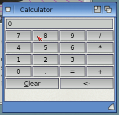
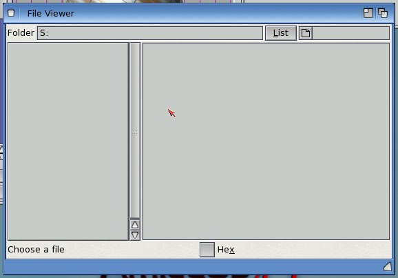

# Boing BASIC on AmigaOS 4

How the AmigaOS 4.1 (PowerPC) side is built, tested and laid out. The language and runtime
are in [DESIGN.md](DESIGN.md) and [runtime-api.md](runtime-api.md); the forms contract is
[forms-events.md](forms-events.md).

## Cross build on the Mac

```
tools/build-os4.sh            # build/os4/libboing.a, build/os4/boing, build/os4/tests/*
tools/build-os4.sh check-cpu  # the same, and fail if any binary has 440-only instructions
```

`tools/build-os4.sh` runs `make -f mk/os4.mk` in the walkero GCC 11 Docker image
(`walkero/amigagccondocker:os4-gcc11-arm64` on Apple silicon, `-amd64` elsewhere). Flags:
`-mcrt=newlib -O2 -mcpu=powerpc -Wall -D__USE_OLD_TIMEVAL__`, linked with `-lauto -lm`.

- **Never `-mcpu=440` or `-mcpu=440fp`**: GCC then inlines string functions with `dlmzb.`,
  which only the 440/460 has. QEMU's sam460ex runs it, real X5000, A1222 and G3/G4 machines
  crash. `check-cpu` greps `objdump -d` for it.
- No `-D__USE_INLINE__`: the runtime calls `IExec->...` explicitly.
- Other guest rules followed in the runtime: no `Delay(1)` (sleeps use timer.device), no
  `WaitTOF()` pacing, big copies in a loop (the QEMU guest's `memcpy` >= 256 KB bug).

What goes where:

| | |
|---|---|
| `src/runtime/os4/forms.c` | forms on ReAction (window.class, layout.gadget and the gadget classes), timers on timer.device, MsgBox/InputBox on requester.class |
| `src/runtime/os4/declare.c` | `Declare ... Lib`: OpenLibrary/OpenDevice + GetInterface, call through the interface's function table |
| `src/runtime/os4/os4_slots.c` | generated slot table (function name → slot) for Declares without `Alias "#n"` |
| `src/runtime/os4/sys.c` | Shell, Environ, Command, App, Beep, Clipboard (textclip.library), Dir/Kill/MkDir/... on dos.library |
| `src/runtime/os4/platform.c` | libboing's platform layer (console, time, files, directory scan) |
| `src/runtime/afg.c` | the `.afg` parser (portable; the host builds it too) |
| `src/runtime/forms_rt.c` | forms and controls as BASIC objects (portable) |

## Building BASIC programs for OS4

From the Mac:

```
tools/boing-build-os4.sh examples/calculator/calc.bbp -o build/calc
```

(the host `boing emit-c` writes the C, the Docker cross compiler compiles and links it with
`build/os4/libboing.a`; `boing build --target os4` runs this script).

On the Amiga, `boing build` uses the SDK's native GCC 11.5 (`SDK:gcc/bin/gcc` when it exists,
else `gcc` from the path; the SDK installed with its `SDK:` assign). It finds the headers and
`libboing.a` in `BOING:` if that assign exists, else next to the `boing` executable
(`PROGDIR:`). The Boing BASIC directory holds:

```
BOING:boing              the compiler/VM
BOING:include/           boing.h, platform.h, bb_forms.h, ... (the runtime's headers)
BOING:lib/libboing.a     (or BOING:libboing.a: boing looks in lib/ first, then beside itself)
BOING:bindings/          *.bi
BOING:examples/
```

`--opt 0|1|2|s` (or `BOING_OPT`) sets the C optimisation level, -O2 by default; `--opt 0` is
the quickest to compile with the SDK GCC on the guest. `--debug` compiles with `-gstabs -O0` (AmiForge's debugger reads stabs) and `BOING_CFLAGS`
is added to the GCC command line, here and in `tools/boing-build-os4.sh`.

and the compile is

```
SDK:gcc/bin/gcc -mcrt=newlib -mcpu=powerpc -O2 -D__USE_OLD_TIMEVAL__ -IBOING:include prog.c
    -o prog -LBOING: -lboing -lauto -lm
```

Stack: ReAction's layout code needs more stack than a CLI started with `run` (or a small
Workbench icon setting) gives. `os4/forms.c` carries a `$STACK:262144` cookie, so every program
linking the forms runtime (the `boing` VM and native builds) asks for 256 KB.

`tools/os4-native-test.sh tests/os4/*.c` checks that path: it pushes the headers and
`libboing.a` to `RAM:boing/` on the guest, compiles each test there with the SDK GCC and runs it.

## OS bindings

`tools/genbind` reads the SDK's `Include/interfaces/*.xml` and the numeric `#define`s of its
headers and writes `bindings/<lib>.bi` (104 libraries, ~2100 functions, ~8500 constants):

```
tools/genbind --slots src/runtime/os4/os4_slots.c      # all libraries
tools/genbind dos exec                                 # just these
```

```basic
Declare Function Dos_Open Lib "dos.library" Alias "#4" (ByVal name_ As String, ByVal accessMode As Long) As Long
Declare Sub DisplayBeep Lib "intuition.library" Alias "#15" (ByVal screen_ As Long)
Const MODE_OLDFILE = 1005
Const WA_Left = &H80000064
```

- `Alias "#n"` is the function's slot in the interface (Obtain = 0, the library's own functions
  from 4). Without it the runtime looks the name up in `os4_slots.c`.
- Pointers are `Long`. C strings are `ByVal As String` (VB6 Declare semantics: a NUL-terminated
  copy, copied back after the call, so `Space(256)` works as a buffer; `vbNullString` = NULL).
- Left out (with a comment in the .bi): variadic functions (use the TagList form,
  `AllocDosObject` not `AllocDosObjectTags`, with `TagList(...)`), and functions with 64-bit,
  float or struct-by-value arguments.
- Names that clash with BASIC keywords get the library's prefix (`Dos_Open`, `Dos_Lock`),
  as do names defined by two commonly combined libraries; argument names get a trailing `_`.
- Each header's constants go to the `.bi` of the library that owns the header (dos/*.h →
  dos.bi, gadgets/button.h → button.bi, utility/tagitem.h → utility.bi), each name once.

The call: arguments are 32-bit words in r4..r10 and on the stack (Self in r3), so one stub
with 12 arguments serves every function (the SysV PPC caller owns the argument area).

## Tests on the QEMU guest

The guest is shared with the user and other agents. The tools take amiga_mcp's emulator lock
and show the "CLAUDE IS TESTING" banner (`scripts/claude_busy.py`) while they run, and talk
to devbench's MCP at `http://localhost:3010/mcp` (localhost:3000 can be shadowed by another
program; set `OS4_MCP` to change it).

```
tools/os4guest.py test build/os4/tests/forms_test     # push to RAM:bbtest, run, PASS/FAIL
tools/os4guest.py push LOCAL AMIGA_PATH ...
tools/os4guest.py dos 'AmigaDOS command'
tools/os4-native-test.sh tests/os4/declare_test.c     # compiled on the guest by the SDK GCC
tools/os4shot.py examples/calculator/calc.afg docs/images/calculator.png
tools/os4guest.py bas tests-os4/declare/declare.bbp native   # BASIC project: VM, native or both
tools/os4-form-test.sh both                                  # the BASIC form test with a real click
```

Tests run in a background CLI (`run`) with their output in a file that the tools poll, so a
test stuck in a requester can't block the bridge; stderr goes to a second file and a runtime
error ends the wait.

| test | checks | result (2026-11-07, QEMU sam460ex, OS 4.1 FE) |
|---|---|---|
| `tests/os4/declare_test.c` | Declare glue: slots by name and `#n`, 11-argument calls (stack args), devices, errors 48/453 | 21/21 cross and native |
| `tests/os4/forms_test.c` | a form from .afg text: properties, AddItem/RemoveItem, timer, an injected mouse click calls `ok_Click`, typed keys fire `name_Change` per keystroke and `KeyPress`, list click, slider drag (`Scroll`/`Change`), `Form_KeyDown`/`KeyPress`, `Visible`, MsgBox and InputBox answered by injected keys, `Form_Unload` Cancel | 46/46 (2026-11-08) |
| `tests-os4/formbas/` (`tools/os4-form-test.sh`) | the same from BASIC: a .bbp with form + code-behind, properties, AddItem, `form.control` access, TypeName, a real click on OK (`tools/os4/ptr`) calling `ok_Click` | native (`boing build --target os4`): 13/13; VM: crashes on .bbp projects (open bug) |
| `tests-os4/declare/` (`tools/os4guest.py bas`) | Declare from BASIC: generated bindings (slots), Declares by name, Interface/Version, a String argument, a Space(n) buffer filled by GetVar | native 7/8 (vbNullString is passed as "" not NULL: open) |
| `tests/os4/sys_test.c` | Command, App.Path, Shell, Environ, Dir with patterns and vbDirectory, Kill, MkDir/RmDir, FileCopy, Name, clipboard (restored afterwards) | 30/30 |

Input injection uses input.device (`IND_WRITEEVENT`) from inside the test, at the control's
screen position (`bb_ctl_screen_box`), so it needs no host-side mouse control. Because the
guest is shared, the tests inject only while their own window is the active window on the
front screen (checked through IntuitionBase), and skip the check otherwise; `tools/os4/ptr`
(absolute pointer + click) takes a window title and does nothing unless that window is on
the front screen. Lesson learned: a key sent while another window is active goes to that
program (the launcher started a game).

 
