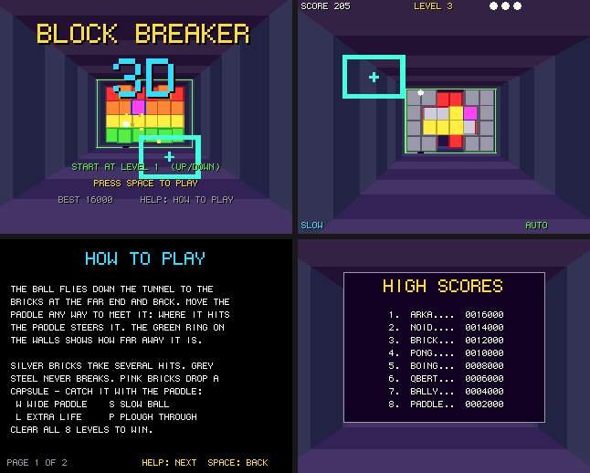

# Block Breaker 3D

Breakout down a tunnel: a port to Boing BASIC of the amiga3d game in amiga_mcp's
`examples/block_breaker_3d` (C, for the classic Amiga and AmigaOS 4).

The paddle is a frame on the tunnel's near opening that moves up, down, left and right; the
ball flies down the tunnel to a block of bricks at the far end (6 across, 4 high, 3 deep) and
back. Where the ball meets the paddle steers it, and a green ring on the walls shows how far
away it is.

*Frames saved by the game itself on the AmigaOS 4 guest (`--saveshot`), at the 320 x 256
it draws; the window shows them at twice the size.*

## The game

- 8 levels: First Light, Chequers, The Window, Pillars, Stairway, The Vault, Crossfire and The
  Core. Three lives.
- Tough (silver) bricks take two hits, three from level 5; steel never breaks; pink bricks drop
  a capsule: W wider paddle, S slower ball, L an extra life, P the ball ploughs through bricks.
- The ball speeds up as you rally.
- Scoring: 10 a brick, 30 tough, 50 bonus, +5 for each layer deeper; 5 for a hit that doesn't
  break; 100 a capsule; 250 x the level for clearing it. The eight best scores are kept in
  `block_breaker_3d.scores` beside the program.
- An autopilot (B) plays on its own (it predicts where the ball crosses the paddle's plane,
  folding it off the walls, and varies where it takes it); it also plays behind the title.

| Keys | |
|---|---|
| Cursor keys / WASD | move the paddle (on the title: the level to start at) |
| Space | serve, start |
| P | pause |
| B | autopilot on / off |
| Help / H | the rules and controls |
| F1 | timing overlay |
| Esc | back to the title, or quit from it |

Command line: `--level N`, `--seed N`, `--attract`, `--perf`, `--log`, `--bench N`.

## Files

| file | |
|---|---|
| `BlockBreaker3D.bbp` | the game: a form project (startup form `tunnel`) |
| `tunnel.afg`, `tunnel.bas` | the form and its code-behind |
| `BbCore.bas` | the rules, a line-by-line port of `bb_core.c` (1/256 units, one axis at a time, the autopilot, the state hash) |
| `BbDraw.bas` | the picture (`render.c`): the striped tunnel, only the bricks' visible faces, the ball with its shadow and depth ring, capsules, broken bits, the paddle; HUD, title, help |
| `BbSound.bas` | the original's sound effects (`game_sound_init`) on `Boing.Audio` |
| `Bench.bbp`, `BenchMain.bas` | the console bench |
| `tools/trace.c`, `tools/trace.sh` | the C original's games, for checking the port |

## Same game as the C

`tests/programs/block_breaker_3d` plays four autopilot games (levels 1, 3, 5 and 8, up to
20 000 ticks) and checks the state hashes against the C original's, in the VM, with the JIT and
native; the first is the original's own vector (`D2B5D3AA`).

## What changed from the original

- No bridge; command-line options instead. A table of eight high scores with name entry.
- The Canvas's 6 x 9 font; the picture at 320 x 256 shown at 2x.
- Sound: the original's effects, synthesised at start-up with the same calls and arithmetic as amiga3d's `a3d_sound.c` (`Boing.Audio`'s `SfxDefine`/`SfxTone`/`SfxNoise`/`Sfx`), so they are byte for byte the C game's; like the original, there is no music.

## Performance

`guest_game.py ... --bench 300`: 300 frames of the autopilot from seed 1234, on the AmigaOS 4.1
guest m1b (QEMU sam460ex on an M1 Mac), with sound. Every run printed the same state hash
as the console bench on the Mac. The Mac column is the console bench (`Bench.bbp --frames
300`, the same game and drawing into a canvas that is never shown) on the M1 itself. Blit
(showing the picture in QEMU's window) depends on the host's display load, about 3.4 ms
normally; logic and draw are the game's own work.

| build | fps on the guest | logic | draw | blit (ms/frame) | Mac console |
|---|---:|---:|---:|---:|---:|
| VM | **35** | 0.776 | 23.624 | 3.422 | 14708 fps |
| VM `--jit` | **34** | 1.420 | 24.596 | 3.349 | - |
| native (`boing build --target os4`) | **128** | 0.109 | 4.285 | 3.227 | 27282 fps |
