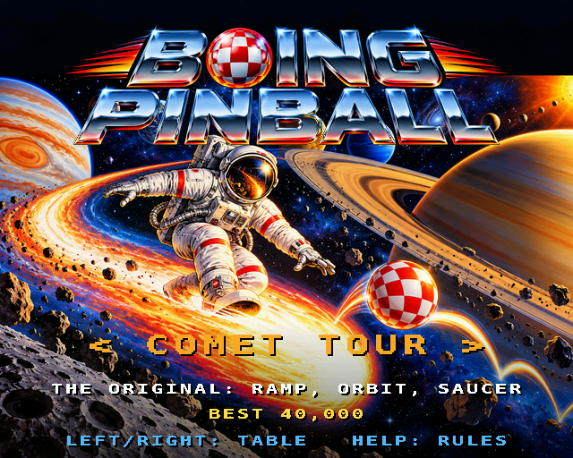
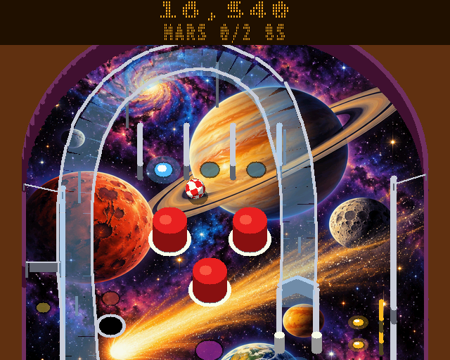
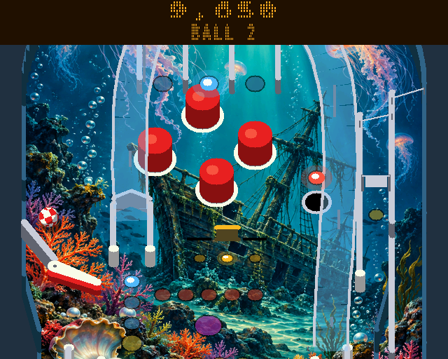
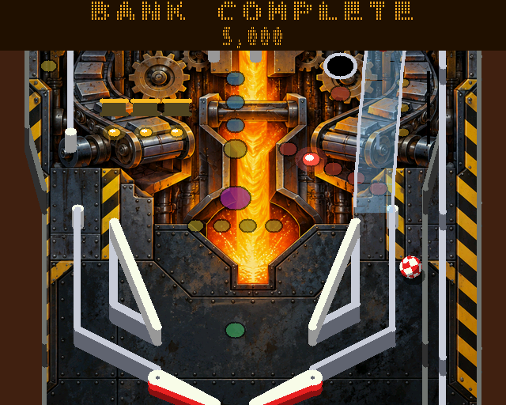
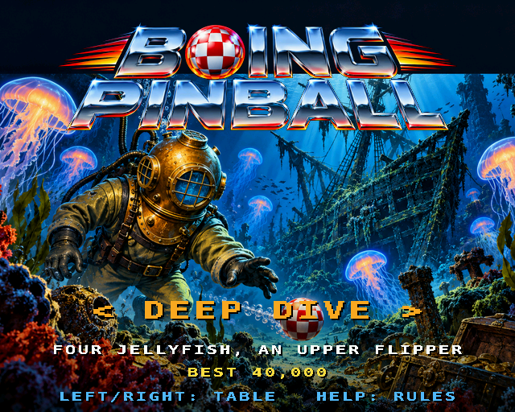
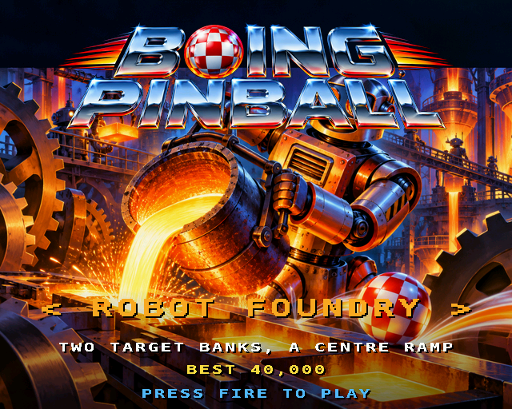
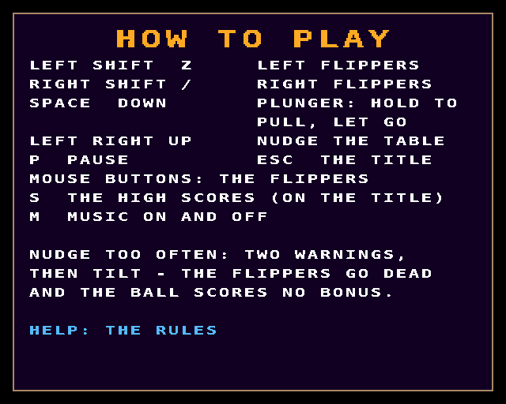
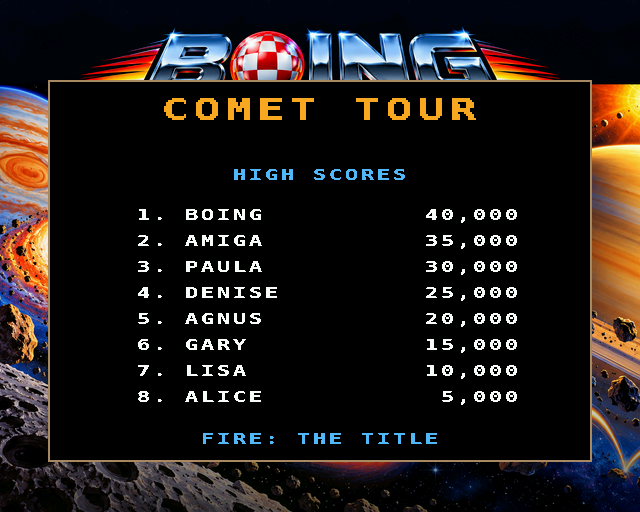

# Boing Pinball

(The window's title is "Boing Pinball (Boing BASIC)", to tell it from the C original.)

Pinball with three tables, in Boing BASIC: a port of the amiga3d game in amiga_mcp's
`examples/boing_pinball` (C, for the classic Amiga and AmigaOS 4), itself a port of the browser
game [Boing pinball](https://geekychris.github.io/tools/boing-pinball/). The ball is the Boing
ball; the view is the classic Amiga pinball one, the table seen from the player's end, tilted,
scrolling to follow the ball, with a dot-matrix display over it.

On the AmigaOS 4 guest (QEMU sam460ex), in the interpreter:

| | |
|---|---|
|  |  |
|  |  |
|  |  |
|  |  |

| Table | |
|---|---|
| **Comet Tour** | The browser's table: the ramp round to the left inlane, the left orbit past a spinner, three pop bumpers, a bank of three drop targets, the mission saucer. |
| **Deep Dive** | Four jellyfish bumpers, the ramp the other way (in on the left, round to the right inlane), a right orbit with the spinner, the target bank across the middle, an upper flipper on the left wall. |
| **Robot Foundry** | Two target banks, a centre ramp round to the right inlane, the left orbit, three bumpers at the top left, an upper flipper on the right wall. |

| Keys | Mouse | |
|---|---|---|
| Left Shift / Z (left Alt, left Amiga) | left button | left flippers |
| Right Shift / `/` (right Alt, right Amiga) | right button | right flippers |
| Space / Down / Return | | the plunger: hold to pull back, let go to launch |
| Left, Right, Up | | nudge the table (on the title: choose the table) |
| P | | pause |
| Help / H | | the controls, then the rules |
| S | | the chosen table's high scores (on the title) |
| M | | music on / off |
| F1 | | timing overlay |
| Esc | | the title, or quit from it |

On the title the backglass of the chosen table shows for ten seconds, then the bot plays a
demo on the table for fifteen, in turn; Left and Right (or the flippers) choose the table, fire
starts a game. After a game, a score good enough for the table's top eight asks for a name.

## The rules (the browser's)

- **Skill shot:** on the plunge, the flashing top lane is worth 10,000.
- **Top lanes:** light all three for the next bonus multiplier (up to 5x); the flippers move the
  lit lanes round.
- **Ramps:** three lock balls and start multiball (three balls); in multiball every ramp is a
  jackpot, 50,000 and 10,000 more each time.
- **Missions:** the saucer, when lit, starts one of five (pop bumpers, target banks, spins, ramp
  shots, lane sets) with 40 seconds to finish it. All five lead to **Supernova**: everything
  scores 3x for 30 seconds, with multiball.
- **Ball save** for the first ten seconds of a ball (and of multiball).
- **Tilt:** nudging too often gives two warnings and then tilts the ball: dead flippers and no
  bonus.
- **End-of-ball bonus:** ramps, targets, lanes and spins, times the multiplier.

## Files

| file | |
|---|---|
| `Pinball.bbp` | the game: a form project (startup form `pinball`) |
| `pinball.afg`, `pinball.bas` | the form (a 640 x 512 Canvas, a 20 ms Timer), keys, mouse, `--bench` |
| `PbCore.bas` | the physics and the rules, a line-by-line port of `pb_core.c` (16.16 fixed point), the bot, the state hash |
| `PbTables.bas` | the three tables (`pb_tables.c`): walls, posts, bumpers, targets, sensors, flippers, ramps, lamps, the collision grid |
| `PbDraw.bas` | the picture (`render.c`'s AmigaOS 4 path): the table, what moves, the dot-matrix display, title, help, high scores |
| `PbShell.bas` | the screens and timing (`game.c`), shared by the form and the bench |
| `PbSound.bas` | the music and the sound effects (the Audio object) |
| `PbFont.bas` | amiga3d's 16 x 16 font (generated by `tools/make_font.py`) |
| `art/` | the paintings (the user's, as the C uses them: `tools/make_art.py`) and the music |
| `Bench.bbp`, `BenchMain.bas` | the console bench: the bot plays, every frame drawn on an off-screen Canvas (the Mac too) |
| `Trace.bbp`, `PbTrace.bas`, `TraceMain.bas` | the bot's and random-input games, printing state hashes |
| `tools/trace.c`, `trace.sh`, `check_trace.sh` | the C original's games, and the comparison |
| `tools/guest.py` | runs, benchmarks and screenshots on an AmigaOS 4 guest |
| `tests/run.sh` | the host tests |
| `tools/probe/` | the native build's start-up step by step, and the sound on its own (for finding a crash) |

Command line of the game: `--table N` (0-2), `--bench N`, `--attract`, `--perf`, `--log`,
`--blit M`, `--screen demo|help1|help2|scores|play` (start on a screen, for screenshots).

## Same game as the C

The physics and the rules are the C's, operation for operation, in 16.16 fixed point
(`../common/A3Fix.bas`: the multiplications with a 64-bit intermediate through Double, exact for
these values; the C's square roots, lengths, sines and random numbers). `tools/check_trace.sh`
plays, on each of the three tables, eight bot games to game over (as the C's `make host-preview`
does, with its seeds) and one game of random input (flippers, the plunger held, nudges up to tilt
warnings), and compares a hash of the whole state (balls, flippers, spinners, targets, score,
rules, timers, the random generator) every 1000 steps with the C original's
(`tools/trace.c`): **284 hashes, all equal**. `make test` runs a shorter version
(`tests/programs/boing_pinball`) in the VM and natively.

`tests/run.sh` also plays the bot through the console bench on each table with every frame drawn
and checks the state and picture hashes against `tests/expected.txt` (the VM and native builds,
on the Mac and on AmigaOS 4, give the same pictures); runs the form program on the headless forms
backend (`--bench` must give the console bench's hashes; every screen must run); and plays
`--script`, a fixed sequence of keys through the form's own key handlers (start, plunger,
flippers, nudge, pause, help, the next table, its high scores, quit), against
`tests/script.out`. On AmigaOS 4 (`tools/guest.py run vm --script`) the script prints the same.

## How it is drawn

As in the C, everything that doesn't move is drawn once, when a table is chosen, into a tall
picture: here a 640 x 1024 image of the Canvas, with the painted playfield squashed into the
view's tilt and cut to the cabinet, the unlit inserts as see-through tinted plastic, the walls
and posts extruded upwards, the bumpers, the see-through ramps with chrome rails. The
see-through parts are blended pixel by pixel (`Point`/`PSet`) while the picture is built.

Each frame then is one `DrawImagePart` of the 448 rows in view, and what moves on top. The C
draws those with spans and blends every frame; here they are made at the same time as the
picture, so a frame stays at about 40 Canvas calls:

- a lit lamp, a flashing bumper or slingshot and a standing drop target: patches cut from the
  picture with the glow blended in (the background under them never changes);
- each flipper: 40 sprites from rest to up; the plunger's knob;
- the Boing ball: 8 sprites of its spin (the C's checked sphere, lit from the upper left), its
  shadow dithered;
- the display: drawn into its own image only when what it shows changes, from dot-matrix
  characters made on first use.

## Speed

The game in its window, the bot playing Comet Tour, `BoingPinball --bench 1500` (frames back to
back, 20 ms of game time each: 2.4 physics steps a frame, 640 x 512 shown every frame), on the
agents' guests on m1.local (QEMU sam460ex on a Mac mini M1), 2026-11-08, after bb-core's typed
`Int`/`Fix` and `MulShr`/`MulDiv` (the fixed-point helpers use them):

| | guest | fps | logic | draw | blit (ms per frame) |
|---|---|---:|---:|---:|---:|
| VM (`boing run`) | m1b | **88.9** | 4.38 | 4.78 | 1.69 |
| VM | m1c (AmiForge running too) | 77.7 | 5.06 | 5.47 | 1.96 |
| VM + JIT (`boing run --jit`) | m1c | 77.7 | 5.29 | 5.33 | 1.87 |
| native (`boing build --target os4`) | m1c | 225.5 | 0.28 | 2.34 | 1.65 |

Earlier, on m1b with main of a few hours before: VM 84.5, JIT 76.2, native 217.3; the VM with
the music and the sound effects playing (AHI, `--bench 1500 --withsound`) 77.8 fps (logic 5.12,
draw 5.39, blit 1.98).

All three give the same state hash (F9AFA545) and picture hash (2032836992) as the Mac, so the
game is the same on PPC in every build. The game needs 50 fps; the interpreter has 70 % to
spare. As in the other game ports, the JIT doesn't help under QEMU (docs/performance.md): the
logic is call-heavy fixed-point code.

The console bench (`Bench.bbp --frames 600`, off-screen, no blit): VM 106.9 fps (logic 4.41,
draw 4.89 ms), native 367.2 fps (0.32, 2.39). On the Mac's VM: 22000 fps.

Building a table's picture, patches and sprites: VM 2.0-2.4 s the first time (fonts, the ball
and both lower flippers' sprites are kept after that), native 0.3 s; loading the painting takes
0.15 s of it.

The physics: one 1/120 s step costs ~2 ms in the guest's VM (the Mac's VM: 5.5 us; the bot's
games in `tools/check_trace.sh`, 260 000 steps, take 1.4 s there). Drawing is ~40 Canvas calls
a frame whatever happens on the table.

## Changes from the C

- The mouse buttons work the flippers too.
- F1 is the timing overlay (the C's F1 starts a game; Space does that here too).
- High scores: the top eight of each table with names (the C keeps one best score per table).
- The dot-matrix characters are amiga3d's 16 x 16 font halved (the C uses the system's topaz 8,
  which a BASIC program can't read).
- The view follows the ball each frame at 50 fps (the C moves it at 25), with the same easing.
- The ball's shadow is dithered rather than blended (it moves over everything).
- No flat-colour playfield art (`theme_art`, `Deco`): the C draws it only without the
  paintings, and this port always has them (a plain field is drawn if a painting is missing).
- No AmigaBridge hooks; `--bench`, `--screen` and the console bench take their place for tests.
