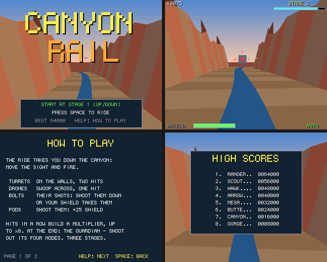

# Canyon Rail

A rail shooter down a winding canyon: a port to Boing BASIC of the amiga3d game in
amiga_mcp's `examples/canyon_rail` (C, for the classic Amiga and AmigaOS 4).

The ride takes you down the canyon at a steady speed; you move the sight and fire. Turrets on
the walls and drones swooping across fire bolts at you: shoot those down too, or your shield
takes them. At the end of each stage the ride stops before a guardian.

*Frames saved by the game itself on the AmigaOS 4 guest (`--saveshot`), at the 320 x 256
it draws; the window shows them at twice the size.*

## The game

- **Turrets** on the canyon walls take two hits; **drones** swoop across, one hit.
- **Bolts**: their shots, aimed where you will be; shoot them down for 25 each, or lose 12
  shield points when one lands. **Fuel pods**: shoot them for +25 shield.
- **The guardian**: a core with four nodes orbiting it, each firing in turn. Shoot out all four
  (4 to 6 hits each) to finish the stage.
- Hits in a row build a multiplier, up to x8, on everything you score; a miss or a hit taken
  resets it.
- 3 stages, each with more targets, quicker fire and faster nodes.
- Scoring: turret 100, drone 150, bolt 25, pod 50, node 500, guardian 2000 x the stage, all x
  the multiplier. The eight best scores are kept in `canyon_rail.scores` beside the program.
- An autopilot (B) shoots on its own (the most urgent thing first: a bolt about to land, then
  the nearest target); it also rides behind the title.

| Keys | |
|---|---|
| Cursor keys / WASD | move the sight (on the title: the stage to start at) |
| Space | fire (held: five shots a second), start |
| P | pause |
| B | autopilot on / off |
| Help / H | the rules and controls |
| F1 | timing overlay |
| Esc | back to the title, or quit from it |

Command line: `--stage N`, `--seed N`, `--demo`, `--help N`, `--scores`, `--attract`,
`--perf`, `--log`, `--bench N`.

## Files

| file | |
|---|---|
| `CanyonRail.bbp` | the game: a form project (startup form `canyon`) |
| `canyon.afg`, `canyon.bas` | the form and its code-behind |
| `CrCore.bas` | the rules, a line-by-line port of `cr_core.c`: the ride's line and the canyon, targets, bolts, the sight's hits found with the engine's camera maths (in integers, as `a3d_math.c`), the multiplier, the guardian, the autopilot, the state hash |
| `CrDraw.bas` | the picture (`render.c`): the sky, the canyon's banks, river, sloping walls and spires, turrets and drones as models facing the camera, pods and bolts (Engine3D `Spot`), the guardian and its nodes, explosions (`Star`); the HUD, title, help |
| `CrSound.bas` | the original's sound effects (`game_sound_init`) on `Boing.Audio` |
| `Bench.bbp`, `BenchMain.bas` | the console bench (off-screen Canvas) |
| `tools/trace.c`, `tools/trace.sh` | the C original's games, for checking the port |

## Same game as the C

`tests/programs/canyon_rail` plays three autopilot games and one of random input and checks the
state hashes against the C original's (`tools/trace.sh`), in the VM, with the JIT and native;
the whole autopilot game from stage 1 ends with the original's own vector (`137A07CD`).

## What changed from the original

- No bridge; command-line options instead. A table of eight high scores with name entry.
- The Canvas's 6 x 9 font; the picture at 320 x 256 shown at 2x (the original's AmigaOS 4 build
  fills polygons at 640 x 512 and sees 2200 units ahead; this one 1300, as on the 68k); the sky
  in 8-row bands of its gradient. The canyon's floor and walls are sorted by the middle of two
  opposite corners (the original: of all four), a difference only where slabs meet.

## Performance

`guest_game.py ... --bench 300`: 300 frames of the autopilot from seed 1234 as fast as they
go, on the AmigaOS 4.1 guest m1b (QEMU sam460ex on an M1 Mac), with sound. Every run printed
the same state hash as the console bench on the Mac. The Mac column is the console bench
(`Bench.bbp --frames 300`, the same game drawing into a canvas that is never shown) on the M1
itself.

| build | fps on the guest | logic | draw | blit (ms/frame) | Mac console |
|---|---:|---:|---:|---:|---:|
| VM | **41** | 0.463 | 20.011 | 3.317 | 13175 fps |
| VM `--jit` | **40** | 1.004 | 20.401 | 3.282 | - |
| native (`boing build --target os4`) | **131** | 0.061 | 3.970 | 3.422 | 26010 fps |

Played in real time (`--demo --perf`: the form's 40 ms timer, the original's 25 fps), the
VM build runs at 25 fps on the same guest. The JIT is slower than the VM on the QEMU guest
for now (its code and tables crowd the guest's small TLB; `docs/performance.md`), so run
without `--jit` there.