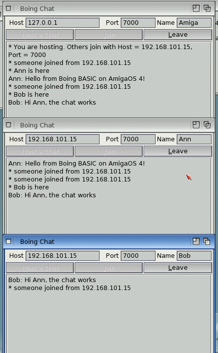

# Boing Chat



*On the AmigaOS 4 guest: `chat host 7000`, then `chat join self 7000 Ann ...` and
`chat join self 7000 Bob ...`; the host (top) relays every line to everyone.*

A chat room over TCP, written with the `Socket` class (docs/socket.md). One program is both
ends:

- **Host a chat**: listens on the port and relays every line to everyone connected. The status
  line shows the address others use to join.
- **Join**: connects to a host. Lines arrive in the window as they come; the window stays
  responsive because the socket's events (`link_Connect`, `link_DataArrival`, `link_Close`)
  come through the form's event loop, like a button's Click.

The protocol is plain text lines, so `telnet host 7000` or `nc host 7000` can join too.

```
boing run examples/chat/chat.bbp                 # interpreted
boing build examples/chat/chat.bbp --target os4  # native AmigaOS 4 executable
```

What it shows: `Dim WithEvents` on a Socket, `Listen`/`Accept` in `ConnectionRequest`, one
handler for all clients through the server's `ClientDataArrival`/`ClientClose` events, line
reading with `Peek` + `ReceiveLine`, connecting with events (`Connect`/`Error`), and
`MachineAddress` to tell the user where to connect.

Two instances on one machine: host in one, join `127.0.0.1` (or the shown address) in the other.
From a shell:

```
chat host 7000                              # host straight away
chat join self 7000 Ann Hello from Boing!   # join this machine's chat and say something
chat join 192.168.1.20 7000 Bob             # join another machine's
chat host 7000 @20,140                      # ... and put the window at x=20, y=140
```
