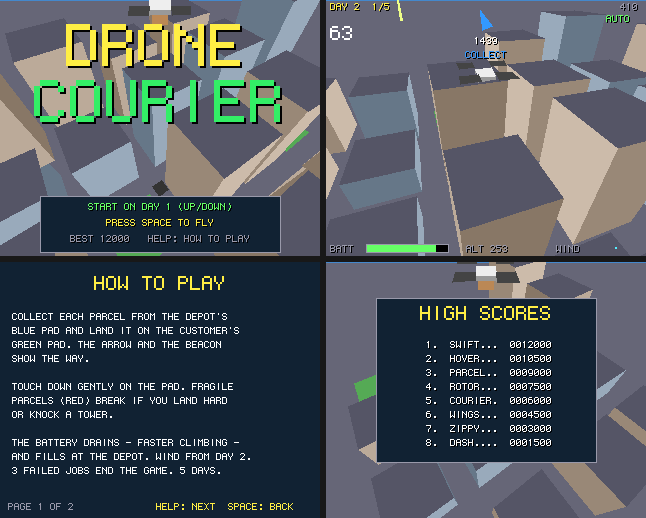

# Drone Courier

Parcel deliveries by drone across a city of towers: a port to Boing BASIC of the amiga3d game
in amiga_mcp's `examples/drone_courier` (C, for the classic Amiga and AmigaOS 4).

Each job: fly to the depot's blue rooftop pad and land to collect a parcel, then land it on the
customer's green pad before the clock runs out. The arrow at the top and a beacon over the pad
show the way.

*Frames saved by the game itself on the AmigaOS 4 guest (`--saveshot`), at the 320 x 256
it draws; the window shows them at twice the size.*

## The game

- Touch down gently on the pad: under 2 a tick down and 1.5 across. Harder, and you have to try
  again. From day 2 some parcels are fragile (red): land one hard or knock a tower with it and
  it breaks. Clip a tower's side and the drone bounces off it.
- The battery drains as you fly, faster when climbing, and is charged each time you collect at
  the depot. A flat battery ends the game.
- The wind blows from day 2 and gusts, harder each day; the pads get smaller.
- 5 days of 4 to 8 jobs. Three failed jobs (a broken parcel, or the clock running out) end the
  game.
- Scoring: 200 a delivery, + 5 for each second left and 150 for a fragile parcel; 500 x the day
  for finishing it. The eight best scores are kept in `drone_courier.scores`.
- An autopilot (B) flies on its own (it climbs over the skyline, flies to the pad allowing for
  drift, stops over it and settles); it also flies behind the title.

| Keys | |
|---|---|
| Up / Down (W / S) | forward / back (on the title: the day to start on) |
| Left / Right (A / D) | turn |
| Space | climb (let go: sink), start |
| P, B, Help / H, F1, Esc | pause, autopilot, help, timing overlay, title / quit |

Command line: `--day N`, `--seed N`, `--demo`, `--help N`, `--scores`, `--attract`, `--perf`,
`--log`, `--bench N`.

## Files

| file | |
|---|---|
| `DroneCourier.bbp` | the game (startup form `city`) |
| `city.afg`, `city.bas` | the form |
| `DcCore.bas` | the rules, a line-by-line port of `dc_core.c` |
| `DcDraw.bas` | the picture (`render.c`): towers culled by grid cell round the camera, pads, the beacon, the drone with rotors, parcel and shadow; HUD, title, help |
| `DcSound.bas` | the original's sound effects on `Boing.Audio` |
| `Bench.bbp`, `BenchMain.bas`, `tools/trace.*` | the console bench and the C trace |

## Same flights as the C

`tests/programs/drone_courier` checks four runs against the C original's state hashes (the
original's own vector, seed 1234, 9000 ticks: `0DB4E102`; days 2 and 4; random input), in the
VM, with the JIT and native. (VB's `And` evaluates both sides: where the C's `&&` skips drawing
a random number, the port tests the first condition on its own.)

## What changed from the original

- No bridge; command-line options instead. A table of eight high scores with name entry.
- The Canvas's 6 x 9 font; the picture at 320 x 256 shown at 2x; the sky in 8-row bands;
  quads sorted by the middle of two opposite corners (the C: all four).

## Performance

`guest_game.py ... --bench 300`: 300 frames of the autopilot from seed 1234 as fast as they
go, on the AmigaOS 4.1 guest m1b (QEMU sam460ex on an M1 Mac), with sound. Every run printed
the same state hash as the console bench on the Mac. The Mac column is the console bench
(`Bench.bbp --frames 300`, the same game drawing into a canvas that is never shown) on the M1
itself.

| build | fps on the guest | logic | draw | blit (ms/frame) | Mac console |
|---|---:|---:|---:|---:|---:|
| VM | **48** | 0.693 | 16.513 | 3.303 | 17691 fps |
| VM `--jit` | **46** | 0.882 | 17.210 | 3.397 | - |
| native (`boing build --target os4`) | **149** | 0.083 | 3.241 | 3.213 | 30643 fps |

Played in real time (`--demo --perf`: the form's 40 ms timer, the original's 25 fps), the
VM build runs at 24-25 fps on the same guest. The `VM --jit` row was measured with the JIT on; it
is slower than the VM on the QEMU guest (its code and tables crowd the guest's small TLB,
`docs/performance.md`), so since 46ffc8d `--jit` checks the TLB at start-up and stays off
there, running at VM speed (`--jit-force` keeps it on).