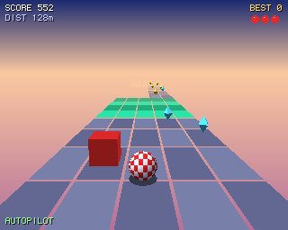

# Boing Rally

The checkered Boing ball rolls down an endless road of floating tiles in an evening sky. Steer
between five lanes, jump the gaps, ride the ramps, pick up gems and keep off the red blocks.
The road is made from a seed as you go and gets faster and meaner the further you roll.

A Boing BASIC game drawn with OpenGL (the `opengl` standard extension, [docs/opengl.md](../../docs/opengl.md)):
Mesa's software renderer, so it runs on any AmigaOS 4 machine, the QEMU guest included.



## Playing

| Key | |
|---|---|
| Left / Right (A / D) | steer |
| Space (Up / W) | jump |
| P | pause |
| Esc | back to the title; on the title, quit |
| F1 | frames a second |

- **Gems** (spinning yellow and blue diamonds): 100 points.
- **Red blocks**: rolling into one costs a ball. Steer round it or jump over it.
- **Gaps**: the whole road can stop for a row or two: jump. On a **narrow path** keep on the tiles.
- **Ramps** (orange) throw the ball high and far: there is always a long gap behind one.
- **Boost pads** (flashing green) speed the ball up for a while (25 points).
- A point a metre; a ball more every 5000 points. Three balls to start with; the best score
  is kept (`GetSetting`).

The title screen plays itself (the autopilot): press Space to take over.

## Running it

```
boing build BoingRally.bbp          # native (on the Amiga: the SDK's GCC; or --target os4 on a Mac)
boing run BoingRally.bbp            # the interpreter: the kit's boing has OpenGL linked in
```

Options: `--bench N` (the autopilot plays N frames flat out and prints the state, a picture hash
and the time a frame took), `--demo` (a game with the autopilot), `--seed N`, `--fps`,
`--frames N`, `--saveshot file.png --shotframe N`, `--nosound`.

## How it uses OpenGL

- `GLAttach view` binds OpenGL to the form's canvas (320 x 256, shown twice the size);
  `GLPresent` finishes the frame and the HUD is drawn on top with the canvas's own text calls
  before `view.Refresh`.
- `gluPerspective` and `gluLookAt` place the camera behind the ball; `GLProject` puts the
  "+100" labels where the gems were.
- The ball (`glutSolidCheckerSphere`) and the gems (an octahedron) are display lists, lit by one
  directional light with `GL_COLOR_MATERIAL`; the ball rolls with `glRotatef`.
- The road and blocks are flat-shaded `GL_QUADS`, unlit, with only the faces the camera can see,
  faded towards the horizon colour by the program (one factor a row) instead of GL fog: that keeps
  every triangle on OSMesa's fast path (`GL_LESS`, 16-bit depth, no fog, texture or blending).
- The sky is two `Canvas.Gradient` calls before the 3D, so GL only clears the depth buffer.

Files: `RallyCore.bas` (road generator, physics, autopilot), `RallyDraw.bas` (OpenGL),
`RallySound.bas` (effects synthesised with `Boing.Audio`), `rally.bas` and `rally.afg` (the form).
`tests/host-test.sh` checks that the native build and the VM play the same 300 frames to the
same picture.
