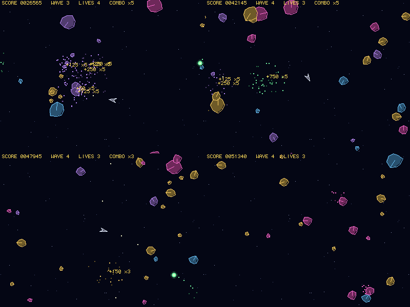

# Glimmerfield

An arcade game in Boing BASIC, and a benchmark of the language.

You fly a skiff through a wrapping field of drifting glimmer crystals. A shot cracks a big
crystal into three middle ones, a middle one into two shards, and a shard shatters. But a shard
you leave alone grows back: to a middle crystal after 16 seconds, to a big one after 26 more.
From wave 2, wisps come in from the edges and hunt you (three hits each). Hits in quick
succession build a combo multiplier up to x5. Clear the field for a wave bonus. You get an
extra life every 25 000 points. The eight best scores are kept in `glimmerfield.scores`
beside the program.



*Frames 2470, 4010, 4480 and 5120 of the bot's game (seed 1987), rendered by the Canvas
engine off-screen (`Bench.bbp --canvas --shot`); the picture is the same on every platform.*

Keys: Left/Right turn, Up thrust, Space fire, P pause, F1 timing overlay, Esc back to the
title (or quit).

## Files

| file | |
|---|---|
| `Glimmerfield.bbp` | the game: a form project (startup form `playfield`) |
| `playfield.afg`, `playfield.bas` | the form (a Canvas and a 20 ms Timer) and its code-behind: title, play, name entry, high scores, `--attract`, `--bench N` |
| `Game.bas` | the game logic: arrays of UDTs, integer fixed-point maths, collisions, waves, the bot. No drawing, no OS calls |
| `Render.bas` | draws the game through a canvas object (the Canvas control, or a SoftCanvas) |
| `Perf.bas` | fps and per-frame logic/draw/blit times, on screen (F1) and logged (`--perf`) |
| `HiScore.bas` | the high-score table, saved with `Write #` and read with `Input #` |
| `SoftCanvas.cls` | the Canvas control's drawing methods on a framebuffer, in BASIC |
| `Bench.bbp`, `Bench.bas`, `BenchMain.bas` | the console benchmark |
| `bench/micro.bas` | micro benchmarks of the constructs the game leans on |

## Determinism

Everything that decides the game is integer maths: positions are 8-bit fixed point, angles
0..255 with a sine table, and the random numbers come from the game's own Park-Miller
generator (Schrage's method, so no Long overflows). Particles use Single maths. The same seed
gives the same game in the VM and in a native build, on the Mac and on the Amiga. The bench
prints a hash of the game state every frame and, with `--draw`, of the picture. The test
`tests/programs/glimmerfield` checks both.

## Benchmark

```
boing run Bench.bbp --bench 3000 [--seed 1987] [--draw] [--quiet]     # VM
boing build Bench.bbp -o gbench && ./gbench --bench 3000 --draw        # native
Glimmerfield --bench 1000                                              # the real game, bot playing, as fast as it can
```

The bot plays from a fixed seed and starts a new game (seed + n) after each game over.
`--draw` also renders every frame onto a SoftCanvas, a 400x300 framebuffer drawn by BASIC
code (Bresenham lines, midpoint circles), with "blit" being the copy to the front buffer.
`--quiet` prints only the `state:` lines, which are the same in every build.

Results: see [docs/performance.md](../../docs/performance.md#game-benchmark).
