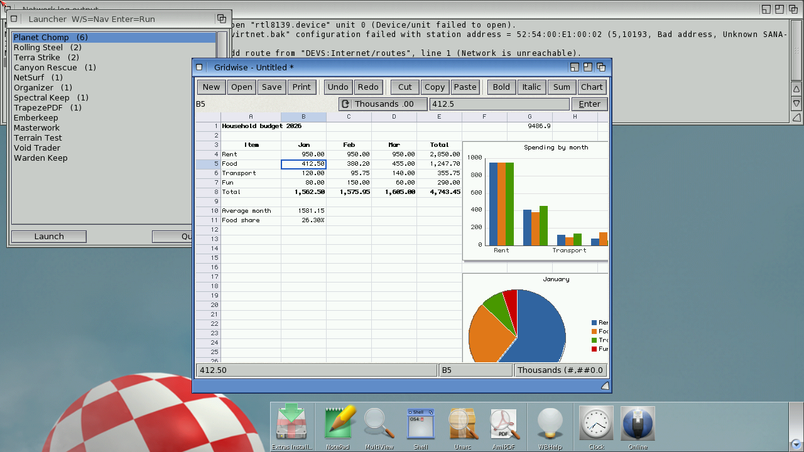

# Gridwise

A spreadsheet with charts for AmigaOS 4.1, written in Boing BASIC.



*On the AmigaOS 4.1 guest (QEMU sam460ex): the budget sheet of the smoke test, with formulas
(SUM, AVERAGE, fill down/right), number formats, bold headings, a bar and a pie chart.*

A sheet has 1000 rows and 26 columns of numbers, text and formulas. Formulas are compiled
and recalculated in dependency order as soon as a cell changes. Charts float over the sheet
and follow the data.

## Features

- **Formulas**: a proper expression parser (Excel precedence, `^`, `&`, `%`, comparisons),
  relative and absolute references (`A1`, `$A$1`, `A$1`), ranges, 60 functions: `SUM AVERAGE
  MIN MAX COUNT COUNTA COUNTBLANK PRODUCT MEDIAN STDEV SUMIF COUNTIF AVERAGEIF IF AND OR NOT
  IFERROR ISNUMBER ISTEXT ISBLANK CHOOSE VLOOKUP ROUND ROUNDUP ROUNDDOWN TRUNC INT ABS SIGN SQRT
  POWER MOD EXP LN LOG10 SIN COS TAN PI LEN LEFT RIGHT MID UPPER LOWER TRIM CONCAT FIND
  SUBSTITUTE REPT EXACT TEXT VALUE ROWS COLUMNS TODAY NOW DATE YEAR MONTH DAY NA`. `IF` only
  evaluates the branch it takes. Errors (`#DIV/0!`, `#VALUE!`, `#REF!`, `#NAME?`, `#N/A`,
  `#NUM!`, `#CIRC!`) propagate like Excel's.
- **Recalculation in dependency order**: each formula registers its precedents (single cells
  per cell, ranges per column and 32-row block). A change marks the formulas that depend on
  it, directly or not, and evaluates just those, each after its precedents (a depth-first
  walk). Cycles show `#CIRC!`.
- **Editing**: formula bar, typing starts an edit, Return/Tab, F2, mouse selection (cells,
  whole rows/columns, Shift+click), copy/cut/paste with relative references (also tab-separated
  text to and from other programs through the system clipboard), fill down/right,
  insert/delete rows and columns (every formula's references are rewritten), sort, find,
  go to, **undo/redo** of everything.
- **Formats**: General, Integer, Fixed, Thousands, Currency (symbol in the preferences),
  Percent, Scientific, Date, Time; bold, italic, alignment; column widths (drag the header
  edge); text overflows into empty cells; `####` when a number does not fit.
- **Charts**: bar, line and pie charts of a range, with labels from the first row/column,
  axes with "nice" steps, legends; drag to move, drag the corner to resize; saved with the sheet.
- **Files**: its own `.gws` format (text), CSV import (separator guessed, RFC 4180 quoting) and
  export, autosave every two minutes, recent files.
- **Amiga integration**: full menus with Amiga-key shortcuts, a toolbar (TBImages), a status
  bar, a context menu, asl file requesters and a Save/Discard/Cancel requester, files dropped
  on the window open, AmigaGuide help (`Gridwise.guide`, Help key), printing (the cells as a
  table, then the charts as pictures), iconify, icons (program and `.gws` project),
  preferences in `ENVARC:Gridwise.prefs`.
- **ARexx**: the port `GRIDWISE` takes every named command (`SETCELL A1 =SUM(B1:B9)`,
  `GETCELL A1`, `CHART BAR A1:C5 Sales`, `SAVE file` ...; see the guide); the same commands
  run from `--script` files.

## Files

| file | |
|---|---|
| `Gridwise.bbp` | the project (startup form `gridwise`) |
| `gridwise.afg`, `gridwise.bas` | the window (formula bar, canvas, status line, menus) and its code-behind: keys, mouse, menus, scripts, autosave |
| `Formula.bas` | the formula compiler (lexer, recursive-descent parser to postfix code) and reference rewriting for copy/insert/delete |
| `Sheet.bas` | the sheet: cells, evaluation, dependency tracking, recalculation, formats, clipboard, undo, sort, insert/delete |
| `SheetIO.bas` | `.gws` and CSV |
| `Charts.bas` | chart data from a range, bar/line/pie drawing on any Canvas |
| `GridView.bas` | scrolling, cursor/selection, hit testing, drawing the grid on a Canvas |
| `Script.bas` | the named commands (scripts, tests, ARexx) |
| `GwPrefs.bas` | preferences and recent files |
| `Gridwise.guide`, `icons/` | help and icons (`tools/mkicons.py` draws them) |
| `bench/SheetBench.bbp` | the console benchmark |
| `tests/smoke.gwr` | the guest smoke test's script |
| `tools/guest_smoke.py`, `tools/guest_bench.py` | run the smoke test / the benchmarks on an OS4 guest |

Only `gridwise.bas` touches the GUI: the engine, files, charts and grid drawing are plain
BASIC drawing into "any object with the Canvas methods", so `make test` runs them on the
host, in the VM, with the JIT and as native builds (`tests/apps/gridwise`, `gridio`, `gridview`).

## Building and running

```
boing run Gridwise.bbp [sheet.gws]                     # interpreted (AmigaOS 4)
boing build Gridwise.bbp -o Gridwise                   # native, on the Amiga
tools/boing-build-os4.sh examples/gridwise/Gridwise.bbp -o build/os4/Gridwise   # cross, from the Mac
```

Copy `Gridwise.guide` and `icons/Gridwise.info` (as `Gridwise.info`) beside the program;
`icons/def_gws.info` is the project icon for sheets.

## Tests

- Host (`make test`): `tests/apps/gridwise` (the formula engine: every function, errors,
  circular references, a 200-cell chain, running totals, formats, reference moving,
  copy/paste/fill, undo/redo, insert/delete, sort, serialization), `tests/apps/gridio`
  (`.gws` and CSV round trips, CSV quoting, charts drawn off-screen with picture hashes),
  `tests/apps/gridview` (the command interpreter on the budget script, grid drawing hash,
  navigation and hit testing, command errors).
- Guest: `BB_GUEST=m1 examples/gridwise/tools/guest_smoke.py build/os4/Gridwise
  examples/gridwise/tests/smoke.gwr --expect "GETCELL E8 -> 4,743.45"` builds the budget,
  takes a screenshot, saves, exports CSV, reloads and checks the values, then quits
  (PASS on m1).

## Performance

See [the numbers](#numbers) below; the benchmark is `bench/SheetBench.bbp` (1000 x 26 sheet:
25 000 formulas, 1000 row sums of 25 cells, 26 column sums of 1000 cells).

### Numbers

`bench/SheetBench.bbp`, milliseconds (macOS, Apple M-series; `boing run`, `boing run --jit`,
`boing build`):

| | VM | VM + JIT | native |
|---|---:|---:|---:|
| enter 26 027 cells (parse + compile) | 143 | 132 | 26 |
| full recalculation (25 027 formulas) | 19 | 11 | 4 |
| edit A1, recalculating its row (52 formulas) | 0.8 | 0.3 | 0.1 |
| draw the grid, 40 rows x 9 columns | 0.2 | 0.2 | 0.1 |
| edit + recalculation + redraw (one keystroke) | 1.1 | 0.5 | 0.3 |

Before the range dependencies were bucketed by 32-row blocks (each column had one list of
every range over it), a full recalculation took 180 ms in the VM and 113 ms native: marking
the dependents scanned each column's whole list for every changed cell.

On the AmigaOS 4 guest (m1's QEMU sam460ex, `tools/guest_bench.py`), milliseconds:

| | VM | VM + JIT | native |
|---|---:|---:|---:|
| enter 26 027 cells | 38 962 | 55 301 | 4 374 |
| full recalculation (25 027 formulas) | 4 847 | 7 184 | 170 |
| edit A1, recalculating its row and the 26 column sums of 1000 cells | 54 | 27 | 12 |
| draw the grid (a screen of cells formatted for the first time) | 51 | 54 | 17 |
| edit + recalculation + redraw (one keystroke) | 111 | 85 | 30 |

A repeat on the second m1 guest (m1b, with other jobs running) gave edit + recalculation +
redraw 138 / 99 / 31 ms and a grid redraw 61 / 65 / 19 ms (VM / JIT / native).

So in the interpreter an edit, its recalculation and the redraw take about a tenth of a
second even with every column summed over 1000 rows, and scrolling redraws at 15-20
frames per second (cells already shown are cached and cost less). Native builds are 3-4x
faster. Under QEMU the VM:native ratio is 15-30x (docs/performance.md explains why), and
the JIT helps the recalculation loops of an edit (2x) but not the big batch jobs.

What made the guest fast enough: caching each cell's shown text (formatting numbers was
most of the drawing time), walking ranges in the dependency walk only between the rows that
hold dirty formulas, and cutting string allocations (a formula's characters are read into a
Long array once; numbers are checked without building strings). Allocating a string costs
far more under QEMU than on real hardware: entering the cells was 76 s in the VM before
that (5.2 s native).
