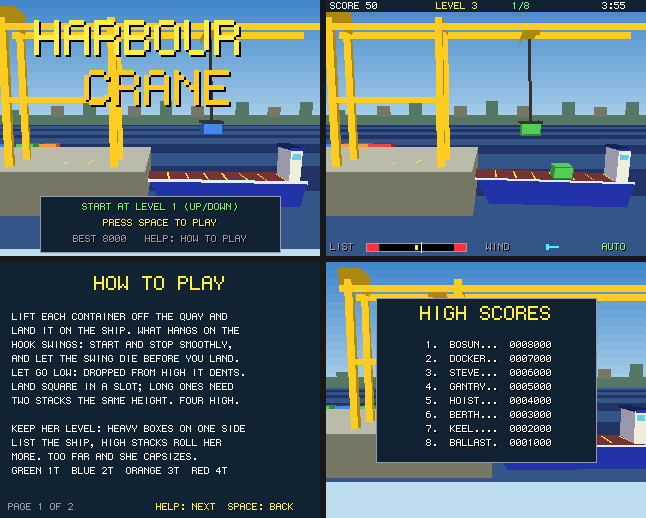

# Harbour Crane

A gantry crane loading a ship that rolls in the swell: a port to Boing BASIC of the amiga3d game
in amiga_mcp's `examples/harbour_crane` (C, for the classic Amiga and AmigaOS 4).

The crane runs from the quay out over the ship. Its trolley moves along the gantry, its winch
lets the hook up and down, and whatever hangs on the hook swings like a pendulum, pushed by the
trolley's starts and stops and by the wind. Lift each container off the quay and land it on the
deck: in one of six slots, stacked up to four high.

*Frames saved by the game itself on the AmigaOS 4 guest (`--saveshot`), at the 320 x 256
it draws; the window shows them at twice the size.*

## The game

- Containers are 1 or 2 slots long and weigh 1 to 4 tonnes (green, blue, orange, red).
- A container lands where you let go of it. Let go low: dropped from high up, it is dented.
  Land it square in a slot (within 14 units of the slot's edge); long ones need two stacks of
  the same height under them. Off the end of the deck, across two slots or over the water, it
  is lost in the harbour. Three lost end the game.
- Keep her level. The ship lists towards her heavy side (the yellow mark on the LIST gauge),
  rolls in the swell (the white needle), and rolls more the higher the stacks. Past the red ends
  she capsizes.
- The trolley takes about 2.5 seconds to reach full speed, close to one swing of the load:
  accelerate steadily and the swing that starting makes is cancelled by the time you reach
  speed.
- 8 levels, from 6 containers in still air to 12 in a strong wind with gusts, long containers
  and a heavy swell. Each has a clock.
- Scoring: 50 x the weight for each container, -40 dented, -100 lost; a bonus for time left,
  and 200 for sending her off on an even keel. The eight best scores are kept in
  `harbour_crane.scores`.
- An autopilot (B) works the crane on its own (it plans its speed to cancel the swing, chases
  what is left, and picks the slot that keeps her level); it also plays behind the title.

| Keys | |
|---|---|
| Left / Right (A / D) | move the trolley |
| Up / Down (W / S) | winch in / out (on the title: the level to start at) |
| Space | grab / let go, start |
| P, B, Help / H, F1, Esc | pause, autopilot, help, timing overlay, title / quit |

Command line: `--level N`, `--seed N`, `--demo`, `--help N`, `--scores`, `--attract`,
`--perf`, `--log`, `--bench N`.

## Files

| file | |
|---|---|
| `HarbourCrane.bbp` | the game (startup form `harbour`) |
| `harbour.afg`, `harbour.bas` | the form |
| `HcCore.bas` | the rules, a line-by-line port of `hc_core.c`: the pendulum integrated four times a tick, the ship's list, roll and bob, landing, the wind and gusts, the autopilot, the state hash |
| `HcDraw.bas` | the picture (`render.c`): the shore and the sea, the quay and the waiting containers, the crane, the ship rolled by her heel (points turned in BASIC, then drawn by Engine3D), the load swung with the cable; the HUD with the list gauge, title, help |
| `HcSound.bas` | the original's sound effects on `Boing.Audio` |
| `Bench.bbp`, `BenchMain.bas`, `tools/trace.*` | the console bench and the C trace |

## Same game as the C

`tests/programs/harbour_crane` checks four runs against the C original's state hashes (the
original's own vector, seed 1234 from level 1, 15000 ticks: `6ADC57B8`; levels 4 and 7; random
input), in the VM, with the JIT and native.

## What changed from the original

- No bridge; command-line options instead. A table of eight high scores with name entry.
- Sound: the original's effects, synthesised at start-up with the same calls and arithmetic as amiga3d's `a3d_sound.c` (`Boing.Audio`'s `SfxDefine`/`SfxTone`/`SfxNoise`/`Sfx`), so they are byte for byte the C game's; like the original, there is no music.
- The Canvas's 6 x 9 font; the picture at 320 x 256 shown at 2x; the sky in 8-row bands;
  quads sorted by the middle of two opposite corners (the C: all four).

## Performance

`guest_game.py ... --bench 300`: 300 frames of the autopilot from seed 1234 as fast as they
go, on the AmigaOS 4.1 guest m1b (QEMU sam460ex on an M1 Mac), with sound. Every run printed
the same state hash as the console bench on the Mac. The Mac column is the console bench
(`Bench.bbp --frames 300`, the same game drawing into a canvas that is never shown) on the M1
itself.

| build | fps on the guest | logic | draw | blit (ms/frame) | Mac console |
|---|---:|---:|---:|---:|---:|
| VM | **35** | 1.508 | 23.465 | 3.228 | 13546 fps |
| VM `--jit` | **33** | 1.988 | 24.395 | 3.328 | - |
| native (`boing build --target os4`) | **119** | 0.150 | 4.805 | 3.232 | 32383 fps |

Played in real time (`--demo --perf`: the form's 40 ms timer, the original's 25 fps), the
VM build runs at 24-25 fps on the same guest. The `VM --jit` row was measured with the JIT on; it
is slower than the VM on the QEMU guest (its code and tables crowd the guest's small TLB,
`docs/performance.md`), so since 46ffc8d `--jit` checks the TLB at start-up and stays off
there, running at VM speed (`--jit-force` keeps it on).