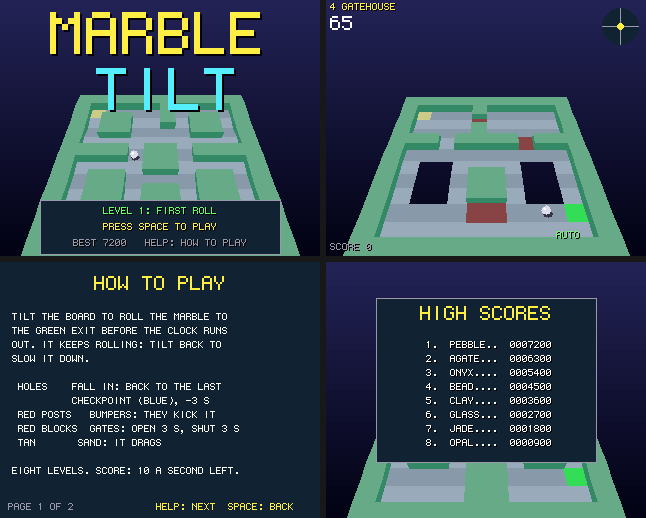

# Marble Tilt

Tilt a floating maze board to roll a marble to the exit: a port to Boing BASIC of the amiga3d
game in amiga_mcp's `examples/marble_tilt` (C, for the classic Amiga and AmigaOS 4).

The marble keeps rolling, so you tilt back to slow it. Eight levels mix holes, gates that open
and shut, bumpers, sand and checkpoints, each against the clock.

*Frames saved by the game itself on the AmigaOS 4 guest (`--saveshot`), at the 320 x 256
it draws; the window shows them at twice the size.*

## The game

- 8 levels: First Roll, The Moat, Zigzag, Gatehouse, Pinball, Sand Trap, Tightrope and The
  Gauntlet (12 x 12 text grids in `MtCore.bas`, as in the C).
- Holes: fall in and you lose three seconds and start again from the last checkpoint (the blue
  squares).
- Gates (red blocks) are open for three seconds, then shut for three; shut, they are walls. A
  gate never shuts on the marble.
- Bumpers kick the marble away; sand drags it.
- The tilt eases over in a fifth of a second. The board is drawn at twice its tilt so a few
  degrees read, and the gauge at the top right shows it.
- Scoring: 100 x the level for each one done, and 10 for each second left. The eight best
  scores are kept in `marble_tilt.scores` beside the program.
- An autopilot (B) rolls on its own (a breadth-first route across the grid, aiming through the
  next cells, waiting at shut gates, slower beside holes); it also plays behind the title.

| Keys | |
|---|---|
| Cursor keys / WASD | tilt (Up: the marble rolls away from you); on the title, the level to start at |
| Space | start |
| P | pause |
| B | autopilot on / off |
| Help / H | the rules and controls |
| F1 | timing overlay |
| Esc | back to the title, or quit from it |

Command line: `--level N`, `--attract`, `--perf`, `--log`, `--bench N`, `--blit M` (as Tank
Duel's).

## Files

| file | |
|---|---|
| `MarbleTilt.bbp` | the game: a form project (startup form `board`) |
| `board.afg`, `board.bas` | the form (a 320 x 256 Canvas at 2x, a 40 ms Timer) and its code-behind |
| `MtCore.bas` | the rules, a line-by-line port of `mt_core.c` (16.16 fixed point, the levels, the autopilot's route, the state hash) |
| `MtDraw.bas` | the picture (`render.c`): the board rolled and pitched, its floor and walls in runs, gates, bumpers, the marble and its shadow; HUD, title, help |
| `MtSound.bas` | the original's sound effects (`game_sound_init`) on `Boing.Audio` |
| `Bench.bbp`, `BenchMain.bas` | the console bench (off-screen Canvas) |
| `tools/trace.c`, `tools/trace.sh` | the C original's games, for checking the port |

The shared modules (`../common/A3Fix.bas`, `A3Engine.bas`, `Draw2D.bas`, `HiScore.bas`,
`Perf.bas`) are described in [Tank Duel's README](../tank_duel/README.md#files).

## Same game as the C

`tests/programs/marble_tilt` (in `make test`) plays the autopilot from every level and three
runs of random tilting (bumpers, walls, holes and falls) and checks each state hash against the
C original's (`tools/trace.sh`), in the VM, with the JIT and native. The whole autopilot game
from level 1 ends with the original's own vector, `07C7AF51`.

## What changed from the original

- No bridge (variables, hooks, the board memory region); command-line options instead.
- A table of eight high scores with name entry (the original kept only the best score).
- The Canvas's 6 x 9 font for text; the picture drawn at 320 x 256 and shown at 2x; the void's
  gradient in 8-row bands.
- Sound: the original's effects, synthesised at start-up with the same calls and arithmetic as amiga3d's `a3d_sound.c` (`Boing.Audio`'s `SfxDefine`/`SfxTone`/`SfxNoise`/`Sfx`), so they are byte for byte the C game's; like the original, there is no music.

## Performance

`guest_game.py ... --bench 300`: 300 frames of the autopilot from seed 1234 as fast as they
go, on the AmigaOS 4.1 guest m1b (QEMU sam460ex on an M1 Mac), with sound. Every run printed
the same state hash as the console bench on the Mac. The Mac column is the console bench
(`Bench.bbp --frames 300`, the same game drawing into a canvas that is never shown) on the M1
itself.

| build | fps on the guest | logic | draw | blit (ms/frame) | Mac console |
|---|---:|---:|---:|---:|---:|
| VM | **44** | 1.422 | 17.541 | 3.382 | 13062 fps |
| VM `--jit` | **40** | 1.443 | 19.545 | 3.388 | - |
| native (`boing build --target os4`) | **122** | 0.195 | 4.656 | 3.147 | 31005 fps |

Played in real time (`--demo --perf`: the form's 40 ms timer, the original's 25 fps), the
VM build runs at 24-25 fps on the same guest. The `VM --jit` row was measured with the JIT on; it
is slower than the VM on the QEMU guest (its code and tables crowd the guest's small TLB,
`docs/performance.md`), so since 46ffc8d `--jit` checks the TLB at start-up and stays off
there, running at VM speed (`--jit-force` keeps it on).