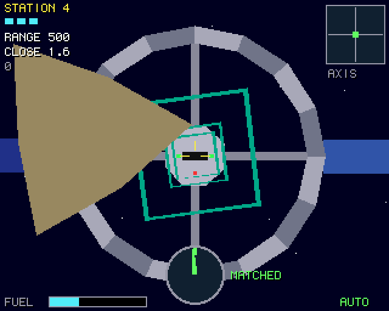
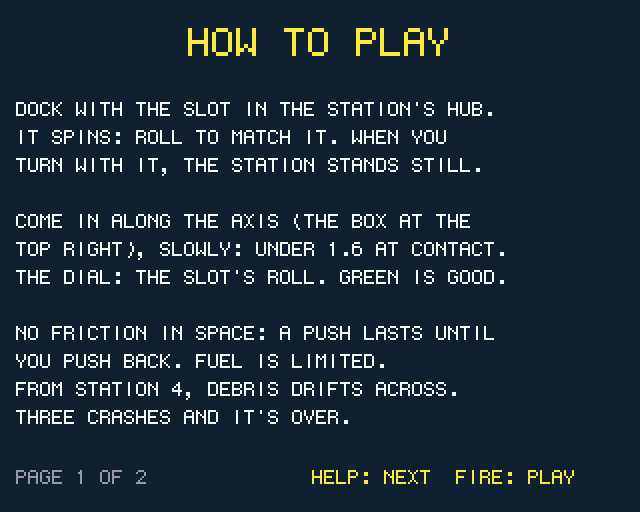
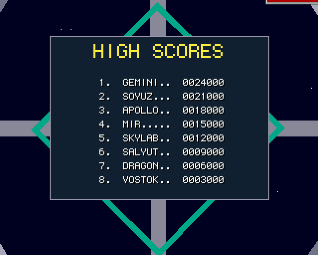

# Orbit Docking (Boing BASIC)

A slow, tense docking simulator in Boing BASIC: a port of amiga_mcp's
[`examples/orbit_docking`](https://github.com/geekychris/amiga_games/tree/main/orbit_docking)
(C on the amiga3d engine).

A station spins about its long axis. Its docking port is a slot at the end of its hub, on
that axis, turning with it. Fly your craft in along the axis, roll to match the slot and turn
as fast as it turns, and close in gently. There is no friction in space: a push lasts until
you push back, and fuel is limited.

| Key | |
|---|---|
| Cursor keys | move across (the craft's own left, right, up, down) |
| W / S | forward (in) / back (out) |
| A / D | roll |
| Space + cursor keys | up/down: in and out, left/right: roll (the C's joystick with fire held) |
| P | pause |
| B | autopilot on / off |
| Help / H | the rules and the controls |
| M | effects on / off |
| F9 | timing overlay |
| Esc | title / quit |

On the title, Up / Down choose the station to start from; Space or Return starts.

- At contact the craft must be within 14 units of the axis, closing at under 1.6 a tick,
  drifting across at under 0.8, rolled within 8 degrees of the slot (it looks the same turned
  half round), and turning within 7 degrees a second of it. Anything else is a crash, and the
  message says which limit you broke. Three crashes end the game.
- The view rolls with the craft. Rolled and turning with the slot, the station stands still
  in front of you.
- 6 stations: from a slow spin with you on the axis, to a fast spin the other way with you
  well off the axis and three pieces of debris drifting across the approach.
- Scoring: 1000 a dock, + 500 x the station, + 2 for each unit of fuel left, less a little
  for the time taken.

| | |
|---|---|
|  |  |

## What is the same, what changed

Kept from the C original:

- **The rules, exactly.** `OdCore.bas` is `od_core.c` line for line: the fixed-point flight
  (16.16 positions, angles with 8 more bits of fraction so slow spins accumulate exactly),
  the thrusters in the craft's rolled frame, fuel, the docking limits and every kind of
  crash, the debris, the levels, the scoring and the autopilot (which plans its way
  through the debris slices).
- The picture: render.c's station (hub, slot and lights, four arms, the ring, the solar
  panels) turning about its axis, the approach markers and debris standing still, the
  stars turning with the roll, the instruments (range and closing rate, the axis box, the
  roll dial with MATCHED / TURN, fuel, the sight), the palette, the title with the autopilot
  docking behind it, the help pages, the DOCKED and game-over screens.
- The effects, made at start-up with the same numbers as `game_sound_init` (Boing.Audio's
  `SfxDefine` / `SfxTone` / `SfxNoise` are a3d_sound.c's arithmetic). Like the C, no music.

Changed:

- **Drawing** is Boing.Engine3D: its camera roll is render.c's `cam_roll` (the other way
  round, so the game passes minus the roll), and the station is one model built once and
  turned by `DrawModel`'s roll instead of every corner being turned in the game's code each
  frame. The engine culls the faces that face away (the C draws them all and lets the
  painter's order hide them) and sorts the station's faces among themselves; the picture is
  the same.
- **High scores**: a table of eight, saved beside the program, with name entry after a game
  that makes it (the C keeps the best score in memory).
- **Text** is the Canvas's 6 x 9 font (the C uses topaz 8).
- **Keys**: Space plays the joystick's fire (a shift for in/out and roll); M switches the
  effects; F9 the timing overlay. The AmigaBridge interface isn't ported (the tests drive the
  BASIC directly).

## Files

| File | |
|---|---|
| `OrbitDocking.bbp` | the game: the form `dock.afg` + `dock.bas` |
| `OdCore.bas` | the rules (od_core.c), the autopilot and the state hash |
| `OdShell.bas` | the shell's 40 ms tick (game.c's `game_update`) |
| `OdDraw.bas` | the scene on Engine3D, the instruments, the screens |
| `OdSound.bas` | the effects on Boing.Audio |
| `Trace.bbp` | the rules against the C original (the host test) |
| `Bench.bbp` | console bench: the autopilot flies, every frame drawn off-screen |
| `tools/trace.c`, `tools/trace.sh`, `tools/test.sh` | the C original's games, the host test |
| `tools/guest_shots.py` | the screenshots on a guest |

## Tests

- **Host (`make test`)**: `tools/test.sh` runs `Trace.bbp` in the VM, the VM with every loop
  JIT-compiled, and native; each must print `tests/trace.out`, the C original's output
  (`tools/trace.sh`, run and compared too when amiga_mcp is beside boing_basic). It flies the
  C test's long autopilot game (seed 1234, whose hash is the C's `tests/vectors.h`), the
  autopilot from every station on three seeds, and six games of random thrusters: docks,
  every kind of crash, debris, fuel running out, levels, the win. After each the full state
  hash, the score and an event hash are the C's.
- **Guest smoke run**: `BB_GUEST=m1b examples/common/tools/guest_game.py
  examples/orbit_docking_bb/OrbitDocking.bbp vm --smoke 400 --data RAM:bbg/examples/orbit_docking_bb`
  (passed: AHI, the thrusters' effect, no Grim Reaper).
- **Screenshots**: `tools/guest_shots.py OUTDIR [vm] [names]` (one lock ticket each); the
  approach and help are from m1b, the scores from the local guest.

## Performance

`OrbitDocking --bench 500`: the autopilot flies station 1 from seed 1234 in the form's window,
frames back to back, every frame drawn (the scene through Engine3D, the instruments through the
Canvas) and shown. On **m1b** (QEMU sam460ex on an unloaded Mac), ms per frame:

| | logic | draw | blit | frame | fps |
|---|---:|---:|---:|---:|---:|
| VM (`boing run`) | 0.35 | 4.90 | 3.60 | 9.14 | **109.4** |
| VM `--jit` | 0.45 | 5.68 | 4.08 | 10.57 | **94.6** |
| native (`boing build --target os4`) | 0.15 | 1.94 | 3.18 | 5.38 | **186.0** |

All three end in the same state hash (FC0F23A8). Played in real time (`--smoke 400`, the
form's 20 ms timer, effects through AHI) the VM shows 48.9 fps on m1b (logic 0.2, draw 4.8, blit
3.2 ms a frame; the runtime's timer keeps a fixed timeline since c791c7a, before which it waited
20 ms after each frame and the game showed 31.6).

The scene is about 30 polygons a frame: the station is one model (one `DrawModel` call), the
markers and debris a few calls; most of the draw time is the instruments' 2D (text, circles,
boxes) and clearing the canvas. The JIT doesn't help (see docs/performance.md on the JIT under
QEMU); the plain VM is the one to use.
