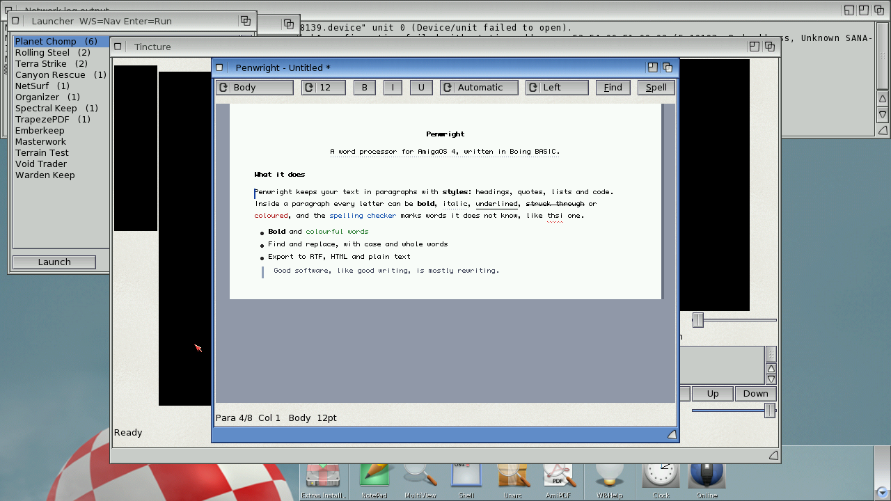

# Penwright

A word processor for AmigaOS 4.1, written in Boing BASIC.



*On the AmigaOS 4.1 guest (QEMU sam460ex): the sample document of the smoke test, with a
centred heading, character styles and colours, a bulleted list, a quote and the spelling
checker's mark under "thsi".*

Penwright keeps text in paragraphs with styles and alignment; every character can be bold,
italic, underlined, struck through, coloured and sized. The page is laid out and drawn by
BASIC code on a Canvas: word wrap, alignment (with justification), indents per style,
selection, caret and live spelling marks.

## Features

- **Styles**: bold, italic, underline, strike-through, 16 colours, sizes 6..96 pt per
  character; paragraph styles Body, Heading 1-3, Quote, Bullet, Code; left, centred, right
  and justified alignment. Toolbar choosers and buttons, menus and Amiga-key shortcuts.
- **Editing**: typing, Return, Backspace/Del (by word with Alt/Ctrl), cursor keys by
  letter/word/line/page, Home/End, mouse click/drag/double-click/Shift+click, the wheel;
  undo/redo (typing merges into one step), styled cut/copy/paste inside Penwright and plain
  text to and from the system clipboard.
- **Find and replace** with match case and whole word (find next wraps round; replace all is
  one undo step and keeps the replaced text's style).
- **Word count**, character counts, paragraph count.
- **Spelling**: a 225 000-word dictionary (Webster's Second International, public domain, plus
  modern and British words; `tools/mkdict.py`), binary-searched in place (ready in a fraction
  of a second), English endings understood (-s, -es, -ies, -ed, -ing, -er, -est, -ly, -ness,
  -'s), suggestions one edit away, your own words in `penwright.words`; misspelt words get a
  red wavy line as you type (cached per paragraph).
- **Files**: its own `.pwd` format (text: one line per paragraph with style runs), RTF export
  and import (styles, sizes, colours, alignment), HTML export (headings, lists, quotes, code,
  CSS colours and sizes), plain text import/export; document title and author.
- **Several documents**: up to eight open at once (Documents menu), recent files, autosave
  every two minutes, preferences in `ENVARC:Penwright.prefs` (default size, live spelling,
  autosave).
- **Amiga integration**: menus with Amiga-key shortcuts, a context menu, AmigaGuide help
  (`Penwright.guide`), icons (program and `.pwd` project).
- **Scripting**: named commands (`INSERTTEXT`, `BOLD ON`, `STYLE HEADING1`, `FIND x WORD`,
  `REPLACEALL "a" "b"`, `EXPORT RTF file`, `WORDCOUNT` ...; see the guide) from `--script`
  files, and for the ARexx port `PENWRIGHT` once the runtime has ARexx (docs/ui.md, planned).

## Files

| file | |
|---|---|
| `Penwright.bbp` | the project (startup form `penwright`) |
| `penwright.afg`, `penwright.bas` | the window (toolbar, page canvas, status line, menus) and its code-behind |
| `Doc.bas` | the document model: paragraphs with per-character attribute and size strings, editing, undo/redo, styled clipboard, find/replace, counts |
| `DocIO.bas` | `.pwd`, text, RTF and HTML |
| `Spell.bas` | the spelling checker |
| `PwView.bas` | layout (wrap, alignment, indents, a height cache updated per edit), drawing, cursor movement, hit testing |
| `PwScript.bas` | the named commands (keyboard, toolbar, scripts, tests and ARexx share them) |
| `DocSlots.bas` | several documents, recent files, preferences |
| `penwright.dict` | the dictionary (`tools/mkdict.py` makes it) |
| `Penwright.guide`, `icons/` | help and icons (`../gridwise/tools/mkicons.py`) |
| `bench/PwBench.bbp` | the console benchmark |
| `tests/letter.pws`, `tests/smoke.pws` | the sample document and the guest smoke test's script |

## Building and running

```
boing run Penwright.bbp [document.pwd]
tools/boing-build-os4.sh examples/penwright/Penwright.bbp -o build/os4/Penwright
```

Put `penwright.dict`, `Penwright.guide` and `icons/Penwright.info` (as `Penwright.info`)
beside the program.

## Tests

- Host (`make test`): `tests/apps/penwright` (the model: typing, multi-paragraph inserts,
  attributes and sizes, paragraph styles, deletes across paragraphs, undo/redo and typing
  merges, styled copy/paste, find with case/whole word/wrap, replace all and its undo,
  counts, word navigation, `.pwd`/HTML/RTF output, RTF read back, wrapped text, spelling and
  suggestions), `tests/apps/pwview` (the command interpreter on the sample document, the page
  drawn off-screen with a picture hash, cursor movement, spelling commands, copy/paste,
  save/open/export round trips, several documents and recent files).
- Guest: `BB_GUEST=m1 examples/gridwise/tools/guest_smoke.py build/os4/Penwright
  examples/penwright/tests/smoke.pws --push examples/penwright/penwright.dict
  DH1:office/penwright.dict --expect "SPELLNEXT -> thsi"` builds the sample document, takes a
  screenshot, saves, exports RTF and HTML, reopens, spell-checks and finds (PASS on m1).

## Known limits

- The canvas font has one size (6 x 9) today: sizes are kept, saved and exported (RTF/HTML),
  and laid out at their size once the Canvas gets real fonts (`HasFonts` in `PwView.bas` is
  ready for `FontSize`/`FontBold`/`FontItalic`); italic shows as a dotted underline meanwhile.
- File names are asked with requesters for text until the runtime's file requester
  (`commondialog`) lands; switching documents starts that document's undo history afresh.

## Performance

### Numbers

`bench/PwBench.bbp` (300 paragraphs, 12 900 words), milliseconds, macOS (Apple M-series):

| | VM | VM + JIT | native |
|---|---:|---:|---:|
| load the dictionary (2.3 MB) | 9 | 9 | 9 |
| lay out the whole document | 0.2 | 0.3 | 0.0 |
| draw a screen (with spelling marks) | 1.9 | 2.0 | 0.8 |
| type a character + redraw | 0.8 | 0.8 | 0.3 |
| spell-check all 12 900 words | 63 | 64 | 27 |
| RTF export | 23 | 23 | 9 |

On the AmigaOS 4 guest (m1's QEMU sam460ex, `../gridwise/tools/guest_bench.py pw`), milliseconds:

| | VM | VM + JIT | native |
|---|---:|---:|---:|
| load the dictionary | 267 | 270 | 260 |
| lay out the whole document | 169 | 197 | 18 |
| draw a screen, spelling checked when idle | 30 | 32 | 6 |
| draw a screen, checking the spelling of every new paragraph at once | 564 | 604 | 54 |
| type a character + redraw | 60 | 64 | 9 |
| spell-check all 12 900 words | 24 869 | 24 728 | 2 036 |
| save (.pwd text) | 426 | 403 | 73 |
| RTF export | 4 931 | 5 222 | 460 |

Typing costs 60 ms in the interpreter on the guest (it was 478 ms): the page draws without
spelling marks for paragraphs not yet checked, and the timer checks a few visible
paragraphs at a time while you pause; the paragraph you type in is checked a second after
you stop; style runs are found by comparing growing chunks instead of characters; and the
caret does not blink (each blink redrew the page).
