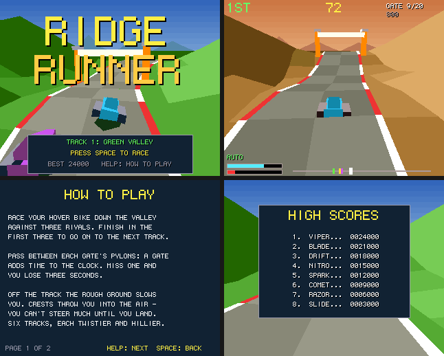

# Ridge Runner

A hover-bike race down a winding valley: a port to Boing BASIC of the amiga3d game in
amiga_mcp's `examples/ridge_runner` (C, for the classic Amiga and AmigaOS 4).

Race three rivals down a valley track over rolling hills, with bumps that throw the bike into
the air over their crests. Pass between each gate's pylons to add time to the clock, and finish
in the first three to go on to the next track.

*Frames saved by the game itself on the AmigaOS 4 guest (`--saveshot`), at the 320 x 256
it draws; the window shows them at twice the size.*

## The game

- 6 tracks: Green Valley, Red Canyon, Dune Run, Frost Pass, Basalt Gorge and Sky Ridge, in
  three looks (grass, desert, snow), each twistier and hillier than the last; the rivals are a
  little quicker on each.
- 20 gates, 800 units apart. Each one made adds time (9 seconds on the first track, 6 on the
  last); each one missed costs 3 seconds.
- Off the track the rough shoulder holds the bike to 60% of its speed; beyond it the valley's
  sides rise steeply. Over a crest the bike flies: you can hardly steer in the air, and a hard
  landing costs speed.
- The boost (the yellow bar) lasts about three seconds and recharges; once empty it needs a
  fifth of a charge before it fires again. Bumping a rival slows you and pushes you aside.
- Scoring: 100 a gate; 3000, 2000 or 1000 for finishing 1st, 2nd or 3rd; and 10 for each second
  left on the clock. The eight best scores are kept in `ridge_runner.scores`.
- An autopilot (B) races on its own; it also races behind the title.

| Keys | |
|---|---|
| Left / Right (A / D) | steer |
| Up (W) | throttle (on the title: the track to start on) |
| Down (S) | brake |
| Space | boost, start |
| P, B, Help / H, F1, Esc | pause, autopilot, help, timing overlay, title / quit |

Command line: `--track N`, `--seed N`, `--demo`, `--help N`, `--scores`, `--attract`,
`--perf`, `--log`, `--bench N`.

## Files

| file | |
|---|---|
| `RidgeRunner.bbp` | the game (startup form `valley`) |
| `valley.afg`, `valley.bas` | the form: the 3-2-1 countdown, the chase camera easing after the bike, the track's look on a new track |
| `RrCore.bas` | the rules, a line-by-line port of `rr_core.c` (the ground, the course, the bike, gates, rivals, places, the autopilot, the state hash) |
| `RrDraw.bas` | the picture (`render.c`): the sky and far ridges, the valley as one Engine3D height grid a track (its cells' pens by slope, as the C shades its quads), the track ribbon with kerbs, the gates, the bikes with shadows and boost flames; HUD, title, help |
| `RrSound.bas` | the original's sound effects on `Boing.Audio` |
| `Bench.bbp`, `BenchMain.bas`, `tools/trace.*` | the console bench and the C trace |

## Same race as the C

`tests/programs/ridge_runner` checks four runs against the C original's state hashes (the
original's own vector, seed 1234 on track 3: `268AE1A8`; the autopilot's whole game; track 5;
random input), in the VM, with the JIT and native.

## What changed from the original

- No bridge; command-line options instead. A table of eight high scores with name entry.
- The ground is drawn by the engine's height grid round the camera (the C fills a window of
  9 x 9 cells ahead of the bike on the 68k, 25 x 25 on AmigaOS 4, from heights it computes each
  frame); the same heights and the same pens per cell.
- The Canvas's 6 x 9 font; the picture at 320 x 256 shown at 2x; the sky in 8-row bands.

## Performance

`guest_game.py ... --bench 300`: 300 frames of the autopilot from seed 1234, on the AmigaOS 4.1
guest m1b (QEMU sam460ex on an M1 Mac), with sound. Every run printed the same state hash
as the console bench on the Mac. The Mac column is the console bench (`Bench.bbp --frames
300`, the same game and drawing into a canvas that is never shown) on the M1 itself. Blit
(showing the picture in QEMU's window) depends on the host's display load, about 3.4 ms
normally; logic and draw are the game's own work.

| build | fps on the guest | logic | draw | blit (ms/frame) | Mac console |
|---|---:|---:|---:|---:|---:|
| VM | **28** | 2.374 | 29.264 | 3.326 | 9235 fps |
| VM `--jit` | **23** | 4.376 | 35.509 | 3.475 | - |
| native (`boing build --target os4`) | **117** | 0.203 | 4.844 | 3.350 | 17729 fps |
