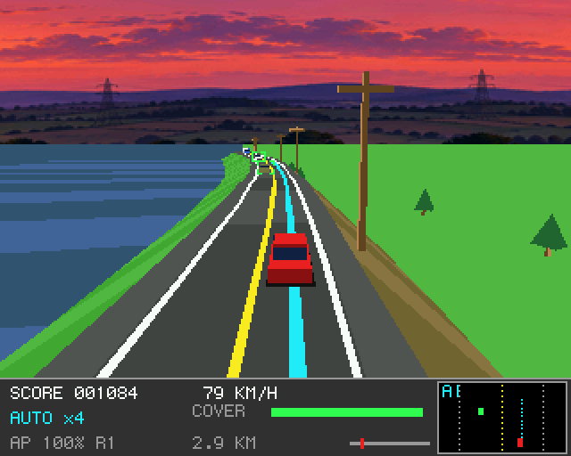
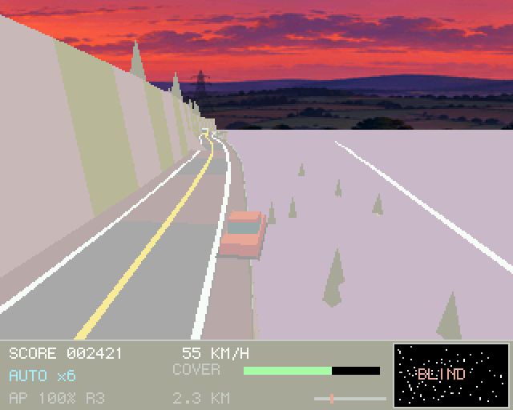
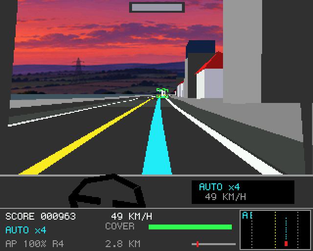
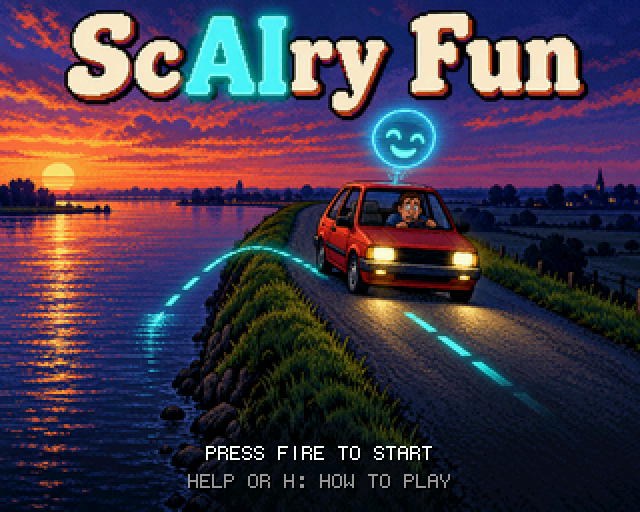
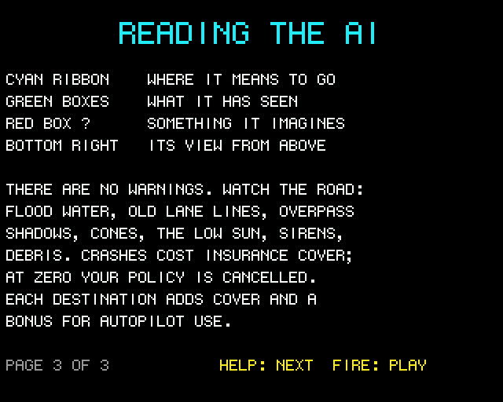

# ScAIry Fun (Boing BASIC)

A self-driving car game in Boing BASIC: a port of amiga_mcp's
[`examples/scairy_fun`](https://github.com/geekychris/amiga_games/tree/main/scairy_fun)
(C with its own road renderer, on the amiga3d engine's maths).

You ride in a car that drives itself. Points come from the distance it drives **on autopilot**,
multiplied by how long it has stayed on (up to x8). The autopilot is good, but it has blind
spots: take the wheel just before it gets something wrong, then hand it back. Take over when it
was right all along and it tells you "I had that."

| Key | |
|---|---|
| Left / Right | steer (takes over) |
| Down | brake (takes over) |
| Up | accelerate (when driving yourself) |
| Space | autopilot on / off (on only near a lane centre); starts the game |
| V or C | chase / cockpit view |
| P | pause |
| Help / H | the rules (three pages; the title shows them too) |
| M / S | music / effects on and off |
| F9 | timing overlay |
| Esc | title / quit |

The four routes are the C's: **Levee Road** to the marina (autopilot v1.0: floods, old lane
lines), **Rush Hour** to the office (v2.0: overpass shadows, a coned-off lane, an ambulance,
debris), **Mountain Pass** to the ski lodge (v3.0: the low sun, fallen rocks, old lines) and
**Flooded Town** home (v4.0: flooded streets, a detour through the oncoming lane, an ambulance,
a phantom shadow). Damage comes off your insurance cover; at 0 the policy is cancelled.

| | |
|---|---|
|  |  |
|  |  |

## What is the same, what changed

Kept from the C original:

- **The simulation, exactly.** `ScCore.bas` is `track.c` and `world.c` line for line: the four
  routes' sections built into 8 m segments with their hazards, the car (steering, the bends
  pushing it out, aquaplaning, the guardrails, the river and the embankment, the tow truck),
  the autopilot (its plan, lane changes, the cyclist, what it sees, the phantom brake at an
  overpass, being blinded by the sun, the old lane lines it follows, its comments), traffic,
  the tailgating truck, the ambulance and its ticket, cones, collisions, scoring, the
  multiplier, good catches and needless grabs, arrival, the software update and the next route.
  Where C's `&&` skips a call to the random generator, the BASIC nests `If`s.
- The picture: render.c's road (each segment a cross-section of 8 points: levee and river,
  embankment, rock wall, cliff and valley, median, town pavement, canal), the lines (and the
  old ones), rails, the chequered finish, the autopilot's cyan path, cones, scenery (trees,
  pines, poles, boulders, lamps, houses, blocks), the overpass and the finish gantry, every
  model from models.c with its own shading rule, the low sun washing the palette towards white,
  the painted dusk all the way round (`assets/horizon.png`), the AI's brackets (and the
  imagined red one), the cockpit with its steering wheel, the messages, the HUD with the
  autopilot's view from above, the intro, arrival, update, game-over and win boxes, the title
  painting, the demo and the three rules pages in turn.
- The sound: "Autopilot Lounge" (`scairy.mod`), the ten effects made at start-up with the same
  numbers as `game_sound_init` (the scrape's halved groups too), and the AI's 19 spoken lines
  (`scairy.voc`, Kokoro's bf_emma), split into `sc_voice_NN.raw` by `tools/make_assets.py`.

Changed:

- **Drawing** is Boing.Engine3D: each segment is one pass of the engine (Begin, its strips in
  one `QuadsW` call at one depth, the models standing on it, Flush), so the painter's order by
  segment is render.c's. The engine draws the models (render.c's add_model) with the same
  culling and face order.
- **The picture is 320 x 256** (shown 2x); the C on AmigaOS 4 draws at 640 x 512.
- **High scores**: a table of eight, saved beside the program, with name entry when a game ends
  (cancelled or home).
- **Text** is the Canvas's 6 x 9 font.
- **Keys**: Space also starts (the C's fire); M and S switch the music and effects, F9 the
  timing overlay. The AmigaBridge interface (the tunables, the scene hooks) isn't ported.

## Files

| File | |
|---|---|
| `ScairyFun.bbp` | the game: the form `scairy.afg` + `scairy.bas` |
| `ScCore.bas` | the routes and the simulation (track.c, world.c) and the state hash |
| `ScShell.bas` | the shell (game.c): the world's tick, the title cycle, which screen to draw |
| `ScDraw.bas` | the road on Engine3D, the models, the sky, the overlays, the HUD, the screens |
| `ScSound.bas` | music, effects and the voice on Boing.Audio |
| `Trace.bbp`, `tools/trace.c`, `tools/trace.sh`, `tools/test.sh` | the host test against the C |
| `Bench.bbp` | console bench: the perfect autopilot drives, every frame drawn off-screen |
| `tools/make_assets.py` | the pictures, the music and the voice from the C original's files |
| `tools/guest_shots.py` | the screenshots on a guest |

## Tests

- **Host (`make test`)**: `tools/test.sh` runs `Trace.bbp` in the VM, the VM with every loop
  JIT-compiled, and native; each must print `tests/trace.out`, the C original's output
  (`tools/trace.sh`, which uses a state hash of the whole world: the car, the autopilot's plan
  and state, every object, the hazards, the score). It drives the title's demo, the perfect
  autopilot along each route to the destination, the shipped autopilot hands-off along each
  route (failing its hazards: the river, the policy cancelled), and random hands on each route
  (takeovers, needless grabs, crashes). The state hash is compared every 1000 frames.
- **Guest smoke run**: `BB_GUEST=m1b examples/common/tools/guest_game.py
  examples/scairy_fun_bb/ScairyFun.bbp vm --smoke 400 --data RAM:bbg/examples/scairy_fun_bb`.

## Performance

FPS_TABLE
