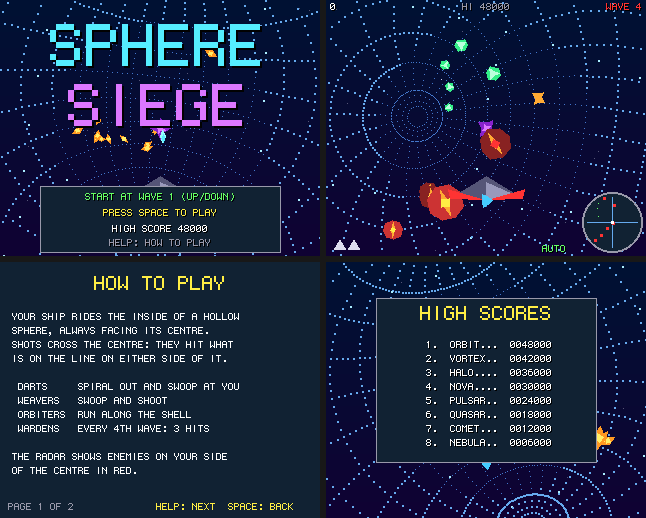

# Sphere Siege

A shooter inside a hollow sphere: a port to Boing BASIC of the amiga3d game in amiga_mcp's
`examples/sphere_siege` (C, for AmigaOS 4).

Your ship rides the inside of the shell, always facing the centre, and fires inward: a shot
crosses the centre and carries on to the far wall, so it hits what is on the line on either
side. Enemies come out of the centre in spiralling trains, circle, swoop out at you and shoot
back; orbiters run along the shell itself. Every fourth wave is a siege wave of armoured
wardens.

*Frames saved by the game itself on the AmigaOS 4 guest (`--saveshot`), at the 320 x 256
it draws; the window shows them at twice the size.*

## The game

- Darts spiral out and swoop at you; weavers swoop and shoot; orbiters run along the shell;
  wardens (every fourth wave) take three hits.
- Three ships, an extra one every 25 000 points.
- Scoring: dart 100, weaver 150, orbiter 200, warden 400, +10 a wave; 500 x the wave for
  clearing it. The eight best scores are kept in `sphere_siege.scores` beside the program.
- The radar shows enemies about the ship: red on its own side of the centre, where the view
  doesn't reach.
- An autopilot (B) plays on its own (it leads the nearest enemy and dodges bullets); it also
  plays behind the title.

| Keys | |
|---|---|
| Cursor keys / WASD | slide over the shell (on the title: the wave to start at) |
| Space | fire (hold), start |
| G | the shell's grid: every dot, every other dot, none |
| P | pause |
| B | autopilot on / off |
| Help / H | the rules and controls |
| F1 | timing overlay |
| Esc | back to the title, or quit from it |

Command line: `--wave N`, `--seed N`, `--grid 0|1|2`, `--attract`, `--perf`, `--log`,
`--bench N`.

## Files

| file | |
|---|---|
| `SphereSiege.bbp` | the game: a form project (startup form `sphere`) |
| `sphere.afg`, `sphere.bas` | the form and its code-behind |
| `SsCore.bas` | the rules, a line-by-line port of `ss_core.c`: the ship's rotation frame (no pole), shots through the centre, the enemies' phases, waves, the autopilot, the state hash over the whole game state in the C struct's order |
| `SsDraw.bas` | the picture (`render.c`): a camera built from the ship's frame, stars, the dotted shell (2688 dots, `PSetMany`), the line of fire, the vortex, enemies as spinning shapes, shots, bullets, bursts, the ship; HUD and radar |
| `SsSound.bas` | the original's sound effects (`game_sound_init`) on `Boing.Audio` |
| `Bench.bbp`, `BenchMain.bas` | the console bench |
| `tools/trace.c`, `tools/trace.sh` | the C original's games, for checking the port |

## Same game as the C

`tests/programs/sphere_siege` plays three autopilot games (waves 1, 4 and 6) and checks the
state hashes against the C original's, in the VM, with the JIT and native; the first is the
original's own vector (seed 1234, 6000 ticks: `D4927FCB`). The C hashes its whole `SSGame`
struct as 32-bit words; `SsStateHash` hashes the same fields in the same order.

## What changed from the original

- No bridge; command-line options instead. A table of eight high scores with name entry (the
  original kept only the best score in a file).
- The Canvas's 6 x 9 font; the picture at 320 x 256 shown at 2x; the shell's far dots one
  pixel and the nearer ones 2 x 2 (the original: 1, 2 and 2/3 pixels by distance).
- Sound: the original's effects, synthesised at start-up with the same calls and arithmetic as amiga3d's `a3d_sound.c` (`Boing.Audio`'s `SfxDefine`/`SfxTone`/`SfxNoise`/`Sfx`), so they are byte for byte the C game's; like the original, there is no music.

## Performance

`guest_game.py ... --bench 300`: 300 frames of the autopilot from seed 1234, on the AmigaOS 4.1
guest m1b (QEMU sam460ex on an M1 Mac), with sound. Every run printed the same state hash
as the console bench on the Mac. The Mac column is the console bench (`Bench.bbp --frames
300`, the same game and drawing into a canvas that is never shown) on the M1 itself. Blit
(showing the picture in QEMU's window) depends on the host's display load, about 3.4 ms
normally; logic and draw are the game's own work.

| build | fps on the guest | logic | draw | blit (ms/frame) | Mac console |
|---|---:|---:|---:|---:|---:|
| VM | **26** | 8.228 | 22.252 | 7.121 | 4814 fps |
| VM `--jit` | **15** | 9.461 | 47.943 | 7.072 | - |
| native (`boing build --target os4`) | **86** | 0.315 | 4.194 | 6.911 | 23253 fps |

Played in real time (`--demo --perf`, the form's 40 ms timer, the original's 25 fps), the VM
build ran at 21-23 fps on the same guest, while the host's display made each blit about 9 ms. Sphere Siege's frames there were 1 to 5 ms over the 40 ms tick (with a 3.4 ms
blit it keeps up).

Grid detail adapts to the frame time: when frames take over 38 ms for a second (the timer is
40 ms, the original's 25 fps), the shell's grid is drawn with every other dot; it goes back
to every dot under 25 ms, changing at most once in 3 seconds. The VM and JIT runs above
settled on every other dot ("grid detail 1"); the native build keeps every dot. `--grid N`
(0 none, 1 half, 2 all) or the G key fix it.

On the QEMU guest the interpreted frame time also depends on where the code happens to lie
in memory: the PPC 460's small TLB is refilled in software, slowly, under QEMU
(`docs/performance.md`). Byte-for-byte the same grid loop took 11, 19 or 36 ms a frame
depending only on the size of code earlier in the module. Real AmigaOS 4 machines refill
their TLBs in hardware and should not show it.

## Tests

- `make test` runs `tests/programs/sphere_siege` (autopilot waves checked against the C
  original's state hashes, in the VM, with the JIT and natively) and the form headless.
- On an OS4 guest: `examples/common/tools/guest_game.py examples/sphere_siege/SphereSiege.bbp
  all --bench 300` runs the form game in the VM, with the JIT and natively and checks the state
  hash against the Mac's.
