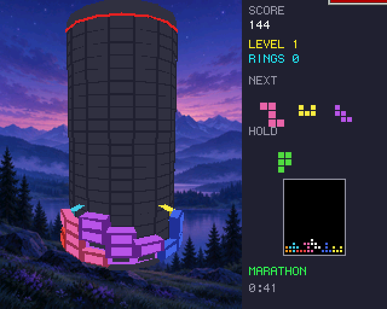
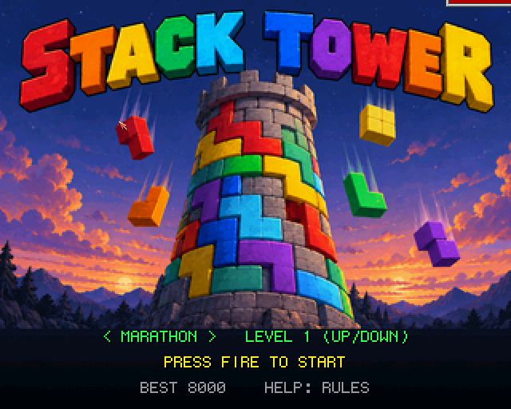
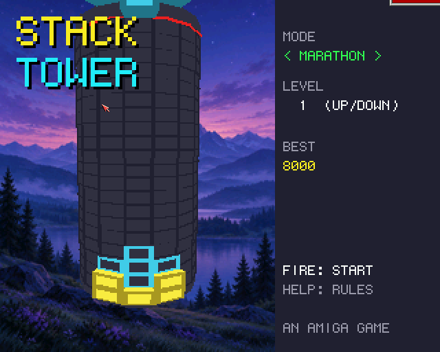
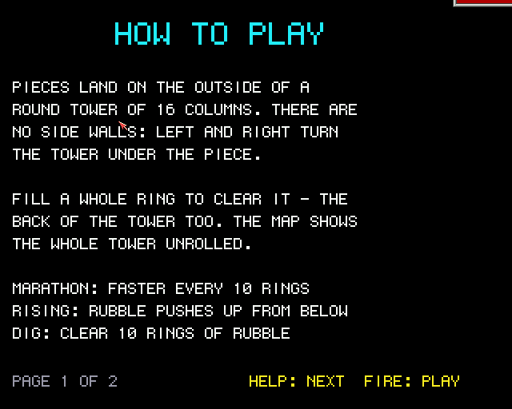
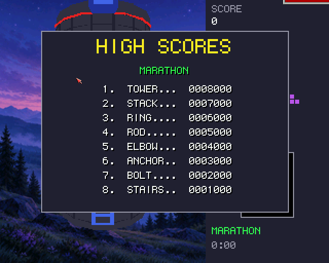

# Stack Tower (Boing BASIC)

The falling-block puzzle wrapped round a tower, in Boing BASIC: a port of amiga_mcp's
[`examples/stack_tower`](https://github.com/geekychris/amiga_games/tree/main/stack_tower)
(C on the amiga3d engine), itself a port of the browser game
[Stack tower](https://geekychris.github.io/tools/stack-tower/).

The well is sixteen columns that go all the way round, so there are no side walls: a piece
can hang over the seam, and a ring only clears when the back of the tower is full too.
Moving a piece left or right turns the tower under it. The pieces are the browser game's
eight: a three-square rod and elbow, and six five-square shapes (cup, flag, star, anchor,
stairs, bolt).



| Key | |
|---|---|
| Left / Right (A / D) | turn the tower (held: repeats after 0.28 s) |
| Up / X | rotate clockwise |
| Z | rotate anticlockwise |
| Down | soft drop |
| Space | hard drop |
| C | hold |
| G | ghost on / off |
| P | pause |
| B | the bot plays (and stops) |
| Help / H | the rules (two pages) |
| M / S | music / effects on and off |
| F9 | timing overlay |
| Esc | title / quit |

On the title, Left / Right choose the mode and Up / Down the starting level, Space or Return
starts. **Marathon** speeds up every 10 rings; in **Rising** a ring of rubble with a gap or
two pushes up from below every few seconds; **Dig** is ten rings of rubble to clear.
Scoring is the browser's: 100, 300, 600, 1000, 1500 x level for one to five rings, a combo
bonus for clearing on piece after piece, 2 a row for a hard drop and 1 for a soft one.

| | |
|---|---|
|  |  |
|  |  |

## What is the same, what changed

Kept from the C original:

- **The rules, exactly.** `StCore.bas` is `st_core.c` line for line: the mulberry32 random
  generator and the bag (a seed deals the same pieces as the C and the browser), the kick
  table, the lock delay and its 15 resets, gravity per level, rising rubble, dig, scoring,
  combos and levels. Times are whole milliseconds, ticks are 40 ms.
- The title's demo game (the same placement rule), the turn auto-repeat, the tower turning
  towards the piece, the flash texts, the three modes and ten starting levels.
- The look: render.c's tower (the core, every block a bevelled brick sticking out of it,
  the drop guide, the grid, the red line at the top of the well, the ghost as an outline,
  the piece standing out further), its 32-colour palette, the panel with the next three
  pieces, the held one and the whole tower unrolled, the painted backdrop and title
  painting (the same `assets/*.png`, as PPM files), the help pages and the game-over box.
- The music ("Tower Climb", `stack_tower.mod`) and the ten effects, made at start-up with
  the same calls and numbers as `game_sound_init` (Boing.Audio's `SfxDefine`, `SfxTone`,
  `SfxNoise` are a3d_sound.c's arithmetic).

Changed:

- **Drawing.** render.c works out every corner with sin/cos each frame under a fixed
  camera. Here the tower stands still and the camera goes round it (the same picture),
  and everything is a small Engine3D model (a block for each colour and set of
  neighbours, a grid line, a ring piece, a core panel, a guide cell) placed by
  `DrawModels`: one call a list, in C. The lists are rebuilt only when the board, the
  column facing you or the piece changes. Within a pass the engine sorts whole blocks by
  their middle (render.c sorted each face), which looks the same here.
- **High scores**: a table of eight per mode, saved beside the program
  (`stack_tower_<mode>.scores`), with name entry after a game that makes it. The C keeps
  only the best score per mode, in memory.
- **Text** is the Canvas's 6 x 9 font (the C uses topaz 8), so it is a little smaller.
- **New keys**: B (the bot), M and S (music, effects), F9 (timing). The C's left Shift for
  hold isn't there (the forms runtime doesn't report Shift on its own); F1 starts a game as
  in the C.
- The AmigaBridge interface (hooks, variables, the board memory region) isn't ported; the
  tests drive the BASIC directly (below).

## Files

| File | |
|---|---|
| `StackTower.bbp` | the game: the form `stack.afg` + `stack.bas` |
| `StCore.bas` | the rules (st_core.c) and a state hash |
| `StBot.bas` | the title's demo and the bot |
| `StShell.bas` | the shell's 40 ms tick (game.c's `game_update`) |
| `StTower.bas` | the tower on Boing.Engine3D |
| `StDraw.bas` | the panel, title, help, game over, scores |
| `StSound.bas` | music and effects on Boing.Audio |
| `Trace.bbp` | the rules against the C original (the host test) |
| `Bench.bbp` | console bench: the bot plays, every frame drawn off-screen |
| `tools/trace.c`, `tools/trace.sh` | the same games played by the C original |
| `tools/test.sh` | the host test (part of `make test`) |
| `../common/` | shared with the other amiga3d ports: A3Fix (C's 32-bit maths), HiScore, Perf, Gfx2D |

## Running

```sh
build/boing run examples/stack_tower_bb/StackTower.bbp          # on AmigaOS 4 (forms)
boing build StackTower.bbp --target os4                          # native
StackTower --bench 500       # the bot plays 500 frames back to back, then a timing report
StackTower --smoke 500       # the bot plays 500 frames in real time with sound, then a report
StackTower --mode 2 --level 5 --seed 7 --perf --log --nomusic --autoplay --help 1 --scores
build/boing run examples/stack_tower_bb/Bench.bbp --frames 600 --prof [--shots DIR]   # any platform
```

## Tests

- **Host (`make test`)**: `tools/test.sh` runs `Trace.bbp` in the VM, in the VM with every
  loop JIT-compiled, and as a native build. Each must print `tests/trace.out`, which is the
  C original's output (`tools/trace.sh` builds `tools/trace.c` against amiga_mcp's
  `st_core.c`; when amiga_mcp is checked out beside boing_basic the C is run and compared
  too). The trace plays the browser's four test vectors (pieces, score, board hash, queue
  and held piece all match the browser's) and five games of 6000 to 20000 ticks: the
  title's demo, and the bot in marathon (levels 1 and 9), rising and dig, with soft drops,
  holds, kicks, lock resets, combos and level-ups. After every game and at the end the full
  state hash (board, queue, generator, piece, timers, score) is the C's.
- **Guest smoke run**: `BB_GUEST=m1b examples/common/tools/guest_game.py
  examples/stack_tower_bb/StackTower.bbp vm --smoke 400 --data RAM:bbg/examples/stack_tower_bb`
  opens the window on the guest, the bot plays in real time with music and effects, and it
  prints the state, fps, the audio device (`ahi, music playing`) and a picture hash; the
  tool fails on a runtime error or a Grim Reaper. (`--data` because under `boing run` the
  program's own directory is the interpreter's.)
- **Screenshots**: `tools/guest_shots.py OUTDIR` (one lock ticket each; the banner's edge
  can show in a corner). The ones above are from the local guest.

## Performance

`StackTower --bench 500`: the bot plays marathon from seed 1234 in the form's window,
frames back to back, every frame drawn (the tower through Engine3D, the panel and text
through the Canvas) and shown. On **m1b** (QEMU sam460ex on an unloaded Mac; boing main
of 2026-11-08, one session), ms per frame:

| | logic | draw | blit | frame | fps |
|---|---:|---:|---:|---:|---:|
| VM (`boing run`) | 0.35 | 8.10 | 3.35 | 12.15 | **82.3** (82.8 on a second run) |
| VM `--jit` | 0.79 | 8.82 | 3.26 | 13.21 | **75.7** |
| native (`boing build --target os4`) | 0.08 | 4.51 | 3.19 | 7.88 | **126.9** |

Dig mode (`--mode 2`: ten rings of rubble on the board from the start, ~293 polygons a
frame): VM 68.5 fps (logic 0.74, draw 10.26, blit 3.22), native 119.4 fps (0.10 / 5.04 /
3.12); the same state hash (FF5DAD11).

In marathon all three end in the same state hash (08E8EAA7). Played in real time
(`--smoke`, the form's 20 ms timer, music and effects on through AHI) the VM shows 31 fps
on m1b, the timer's pace: well over the 25 the game's 40 ms ticks need.

The 3D is cheap in BASIC because the BASIC hardly touches it: about four `DrawModels`
calls a frame, with lists rebuilt only when the board, the facing column or the piece
changes. The draw time is mostly the backdrop (a 200 x 256 image), the Engine3D fill of
~230 polygons and the panel's text. An earlier version with the 3D in BASIC (a stand-in
for the engine: per-face transform, culling and clipping in BASIC, polygons through the
Canvas) drew the same frames at 11.5 fps in the VM on m1, 86 ms a frame (56 ms of it the
BASIC face loop, 22 ms the Canvas fills).

On the Mac (Apple M-series), `Bench.bbp --frames 3000 --mode 2` (dig, off-screen canvas):
VM 0.068 ms/frame, VM `--jit` 0.066, native 0.059: the drawing is all in C, so the three
are close. The picture hashes are the same in the VM and native.

The JIT doesn't help here (the logic is small and call-heavy; see docs/performance.md on
the JIT under QEMU), so the plain VM is the one to use.
