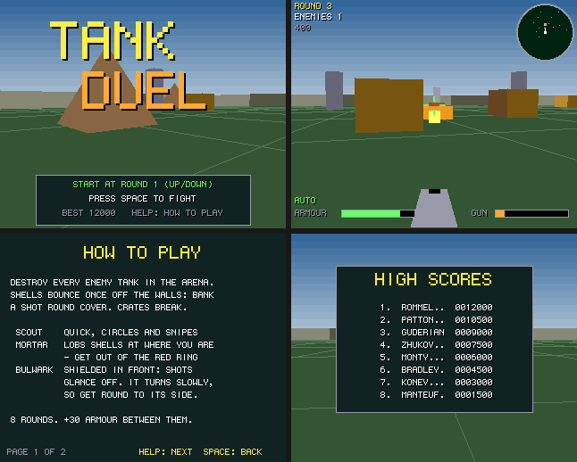

# Tank Duel

A tank fight in a walled arena, seen from the turret: a port to Boing BASIC of the amiga3d
game in amiga_mcp's `examples/tank_duel` (C, for the classic Amiga and AmigaOS 4).

Destroy every enemy tank in the arena. Shells bounce once off the walls, so you can bank a
shot round cover, and crates break. Each enemy needs different handling:

- **Scout**: quick and light. It circles you, then turns in to snipe.
- **Mortar**: slow. It lobs shells at where you are; a red ring on the ground shows where each
  will land, so get out of it.
- **Bulwark**: a heavy tank with a shield across its front, and shots there glance off
  (sometimes back at you). It turns slowly, so get round to its side.

*Frames saved by the game itself on the AmigaOS 4 guest (`--saveshot`), at the 320 x 256
it draws; the window shows them at twice the size.*

## The game

- 8 rounds, from two scouts to six tanks with three bulwarks. Between rounds your tank is
  patched up by 30 armour points.
- Armour 100; a shell takes 20, a mortar round up to 35 at the middle of its ring. Scouts take
  one hit, mortars and bulwarks two.
- The radar turns with you: ahead is up. Scouts green, mortars orange, bulwarks cyan, mortar
  rings red.
- Scoring: 100 a scout, 200 a mortar, 300 a bulwark, 20 a crate; 500 x the round for clearing
  it, and 5 for each point of armour left. The eight best scores are kept in
  `tank_duel.scores` beside the program.
- An autopilot (B) fights on its own; it also fights behind the title.

| Keys | |
|---|---|
| Up / Down (W / S) | forward / back (on the title: the round to start at) |
| Left / Right (A / D) | turn |
| Space | fire |
| P | pause |
| B | autopilot on / off |
| Help / H | the rules and controls |
| F1 | timing overlay |
| Esc | back to the title, or quit from it |

Command line: `--round N`, `--seed N`, `--attract` (the title's fight only), `--perf` (timing
overlay and a log line a second), `--log` (each change of screen), `--bench N` (the autopilot
fights N frames as fast as it can, drawing every one, then prints a timing report and quits),
`--blit M` (Canvas.BlitMode).

## Files

| file | |
|---|---|
| `TankDuel.bbp` | the game: a form project (startup form `arena`) |
| `arena.afg`, `arena.bas` | the form (a 320 x 256 Canvas shown at 2x, a 40 ms Timer) and its code-behind: title, fight, game over, name entry, high scores, help, `--bench` |
| `TdCore.bas` | the rules, a line-by-line port of `td_core.c`: 16.16 fixed point, the enemies' minds, the autopilot, the state hash. No drawing |
| `TdDraw.bas` | the picture (`render.c`) and the effects (`game.c`): scene, HUD, radar, title, help |
| `TdSound.bas` | the original's sound effects (`game_sound_init`) on `Boing.Audio` |
| `Bench.bbp`, `BenchMain.bas` | the console bench: the autopilot fights, every frame drawn on an off-screen Canvas (any platform) |
| `tools/trace.c`, `tools/trace.sh` | the C original's autopilot fights, built from amiga_mcp's sources, for checking the port |
| `../common/A3Fix.bas` | amiga3d's integer maths (`a3d_math.c`, `a3d_fix.c`) bit for bit: 32-bit wrapping, shifts, FMUL/FDIV, the sine table, atan2, square roots, the random generators |
| `../common/A3Engine.bas` | bb-3d's A3Scene-compatible layer on `Boing.Engine3D` (the amiga3d engine in C): the camera maths in BASIC, the draw list, clipping, models and filling in C |
| `../common/A3Scene.bas` | the same API all in BASIC (the stopgap the ports were first drawn with; kept as a reference) |
| `../common/Draw2D.bas` | amiga3d's 2D calls on one Canvas (`gcv`): 32 pens, rectangles by corners, shadowed and big text |
| `../common/HiScore.bas`, `../common/Perf.bas` | the high-score table, frame timing |

## Same fight as the C

`TdCore.bas` keeps the C's integer arithmetic exactly: 16.16 positions, 16-bit angles, the
mulberry32 generator and FNV state hash, with `A3Fix.bas` doing what VB lacks (unsigned 32-bit
multiplies, shifts, 64-bit FMUL/FDIV). Five autopilot fights from different seeds and rounds
give the same state hashes as the original (`tools/trace.sh` prints them from the C;
`tests/programs/tank_duel` checks them in `make test`, in the VM, with the JIT and native),
including the original's own long-fight vector (seed 1234, 9000 ticks: `7CFAB335`).

## What changed from the original

- No bridge: the C game's devbench variables and hooks are replaced by command-line options
  (`--bench`, `--round`, `--seed`, `--log`).
- A table of eight high scores with name entry (the original kept only the best score).
- Text is the Canvas's 6 x 9 font, centred by its width (the original's topaz 8 x 8); big text
  is that font scaled up.
- The 3D is drawn at 320 x 256 and shown at twice the size (the original's AmigaOS 4 build fills
  polygons at 640 x 512). The floor's grid is drawn as lines rather than thin quads, and the sky
  as 8-row bands of its gradient.
- Sound: the original's effects, synthesised at start-up with the same calls and arithmetic as amiga3d's `a3d_sound.c` (`Boing.Audio`'s `SfxDefine`/`SfxTone`/`SfxNoise`/`Sfx`), so they are byte for byte the C game's; like the original, there is no music.

## Performance

`guest_game.py ... --bench 300`: 300 frames of the autopilot from seed 1234, on the AmigaOS 4.1
guest m1b (QEMU sam460ex on an M1 Mac), with sound. Every run printed the same state hash
as the console bench on the Mac. The Mac column is the console bench (`Bench.bbp --frames
300`, the same game and drawing into a canvas that is never shown) on the M1 itself. Blit
(showing the picture in QEMU's window) depends on the host's display load, about 3.4 ms
normally; logic and draw are the game's own work.

| build | fps on the guest | logic | draw | blit (ms/frame) | Mac console |
|---|---:|---:|---:|---:|---:|
| VM | **35** | 8.155 | 16.539 | 3.411 | 6673 fps |
| VM `--jit` | **31** | 10.071 | 18.680 | 3.351 | - |
| native (`boing build --target os4`) | **143** | 0.322 | 3.289 | 3.208 | 8270 fps |

## Tests

- `make test` runs `tests/programs/tank_duel`: five autopilot fights checked against the C
  original's state hashes, in the VM, with the JIT and as a native build.
- On an OS4 guest: `examples/common/tools/guest_game.py examples/tank_duel/TankDuel.bbp all
  --bench 500` runs the form game in the VM, with the JIT and natively, and reports the frame
  times; `shot:OUT.png:SECONDS` takes a screenshot of a running game.
