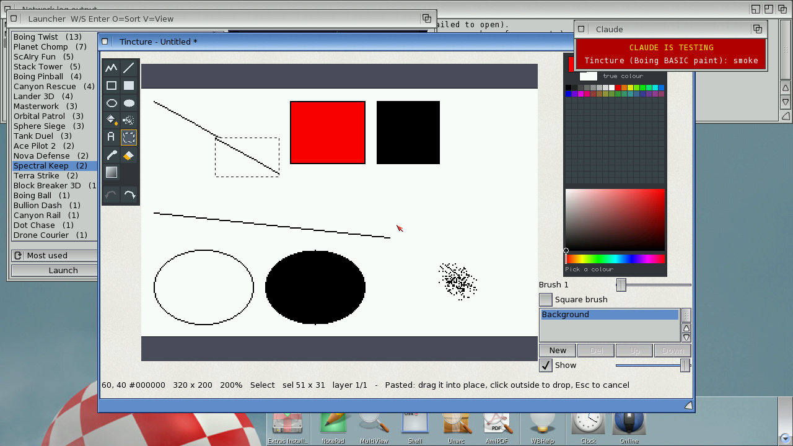

# Tincture — a paint program for AmigaOS 4.1, in Boing BASIC

Tincture paints in true colour or with a palette of up to 256 colours, in up to 16 layers,
with multi-level undo, custom brushes, a magnifier and an ARexx-style command language. The
application logic is BASIC; the per-pixel work (fills, brushes, scaled views, codecs) is done
by Canvas members in the runtime's C.



## Features

- **Tools** (key): Freehand `d`, Line `v`, Rectangle `r` / filled `R`, Ellipse `o` / filled `O`,
  Flood fill `f` (with tolerance), Airbrush `a`, Text `t`, Select `s`, Pick colour `i`, Eraser `e`,
  Gradient `G`. Shift constrains shapes (squares, circles, 45° lines). Brush size 1–64, round
  or square (`[` `]`), with an outline under the pointer.
- **Selections**: cut, copy, paste as a floating selection you drag into place, move (Ctrl:
  copy), clear, crop, and **custom brushes** from a selection (flip, rotate, double/half size,
  own colours or one colour).
- **Colour**: a palette panel and an HSV picker; Shift-click (or double-click) a pen to edit it.
  **Indexed mode** (2–256 colours, median cut, optional Floyd–Steinberg dither): editing a pen
  recolours every pixel painted with it.
- **Layers**: up to 16, with visibility, opacity, reorder, merge down, flatten, rename.
- **Undo/redo**: one step per stroke/shape/fill/operation, 64 steps or 12 megapixels of history
  (setting). Region steps keep only the changed rectangle.
- **Symmetry**: freehand, airbrush and eraser can paint mirrored left/right, top/bottom or four ways.
- **View**: zoom 25 %–1600 % around the pointer (wheel, `+` `-` `1` `0`), scroll with the middle
  button / Space-drag / cursor keys, a **magnifier pane** with pixel grid, an optional grid.
- **Files**: IFF ILBM (24-bit, or 1–8 planes with the palette; reads EHB, HAM6/8, masks), PNG
  (RGB, RGBA, indexed) — both read and written by Tincture itself, the same on every platform —
  and other formats through datatypes. `.tinc` keeps all layers. Saves are written to a new file
  and renamed; **autosave** every 30 s, recovery offered at the next start after a crash.
- **Application**: full menus with Amiga-key shortcuts, keyboard shortcuts for every tool, an
  AmigaGuide help file (`Tincture.guide`), saved settings, Workbench icons, drag and drop of
  pictures onto the window (they open, or float into a changed picture), the command language
  for the ARexx port and `--script` files.

## Running

```
boing run Tincture.bbp [picture] [--size WxH] [--script file.tsc]     # interpreted
boing build Tincture.bbp --target os4 -o Tincture                    # native
```

Copy `Icons/Tincture.info` beside the program, and `Icons/picture.info` to `Icons/` beside it
(the template for icons of saved pictures).

### The command language

Every tool, file and layer operation is a command (`Script.bas`); the same strings drive the
ARexx port, `--script` files and the tests. See the "ARexx" node of the help:

```
NEW 640 512
COLOR 30 24 80
BGCOLOR 250 170 90
GRADIENT 0 0 0 320
LAYER ADD Sun
COLOR #FFDC5A
CIRCLE 320 300 70 FILL
SAVE "RAM:sunset.tinc"
```

`demo/sunset.tsc` paints the picture in the screenshot.

## How it is built

| File | |
|---|---|
| `Doc.bas` | the document: size, layers, palette, pens, the composite and dirty rectangles, layer and whole-picture operations, indexed colour |
| `History.bas` | undo/redo: one swap-based history of region steps (pixels of a rectangle) and document snapshots (images shared copy-on-write) |
| `Tools.bas` | what press / drag / release do for each tool; selection, floating image, clipboard, brushes |
| `View.bas` | zoom, scrolling, the magnifier, drawing the picture and its overlays |
| `FileIO.bas` | open/save, the `.tinc` format, autosave and recovery |
| `Script.bas` | the command language |
| `Panels.bas` | the tool box and colour panel (drawn in canvases, icons drawn at start-up) |
| `Actions.bas`, `Prefs.bas`, `Workbench.bas` | shared actions, settings, the Workbench side |
| `main.afg` / `main.bas`, `newdlg.afg` / `newdlg.bas` | the window and the New Picture / size dialog |

All pictures are images of one Canvas; layers are composited into one image only where
something changed, and the view is one scaled blit plus overlays. Strokes call
`BrushLine`/`StampLine` once per mouse move, so the interpreter does a handful of calls per
event whatever the brush size.

## Performance

PERFORMANCE_TABLE

## Tests

- `make test` runs `tests/host-test.sh`: `tests/ModelTest.bas` drives the core through the
  command language off-screen — every tool, undo/redo, selections and brushes, layers,
  whole-picture operations, indexed colour, PNG/ILBM/`.tinc` round trips (pixel hashes), autosave
  and recovery, and the view mapping — in the VM and as a native build.
  `tests/graphics/paint.bas` tests the Canvas paint members.
- `make test` also runs the whole program (form, menus, panels, timers) headless on the host
  (`BOING_HEADLESS=1`): `Tincture --smoke` in the VM and native, and expects the same result.
- `tools/guest.py smoke` runs `Tincture --smoke` on a guest: every tool through the real event
  handlers, undo all (hash back to the blank picture), redo all, screenshot, clean exit.
  `tools/guest.py input` steers the real mouse into Tincture's own active window (using the
  positions Tincture logs) and paints a stroke (`docs/input.png`); `tools/guest.py arexx` drives
  a running Tincture through its ARexx port; `tools/guest.py bench N` gives the timings above;
  `tools/guest.py demo` paints `demo/*.tsc` for screenshots.
- `tests/Render.bbp` renders a script off-screen on the host (view and panels as PPM).

## Known limits

KNOWN_LIMITS
